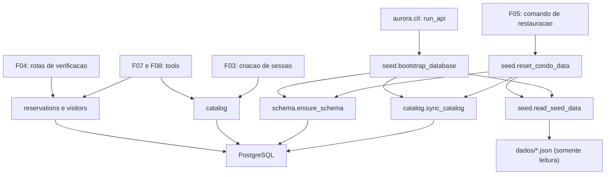

# Especificação técnica: Condominium Data Store

## 1. Visão técnica

**O quê:** a camada de dados do condomínio. Um pacote `aurora.store` com o esquema PostgreSQL (apartamentos, áreas, reservas, visitantes e a sequência de códigos), as operações de reserva e de visitante sempre filtradas por apartamento, a consulta de disponibilidade que só responde livre ou ocupada, o catálogo de áreas e de apartamentos e a carga que devolve tudo ao conteúdo de `dados/`. A feature não expõe rota nem comando próprio: ela é chamada em processo pelas features seguintes e acrescenta um passo de preparação do banco à subida da API.

**Por quê:** duas das cinco garantias do produto moram aqui, e precisam valer sem depender do modelo. A exclusividade (uma reserva ativa por área e data) é decidida pelo banco no instante da gravação, por um índice único parcial, e não por uma conferência feita antes. O isolamento por apartamento é estrutural: não existe operação que liste ou cancele sem receber o apartamento. Além disso, os códigos `RSV-` saem de uma sequência do banco, então nunca se repetem, nem depois de cancelamento.

**Escopo**

Incluído:
- Tabelas `apartments`, `areas`, `reservations` e `visitors`, a sequência `reservation_code_seq` e os índices
- Criação idempotente do esquema e sincronização do catálogo a partir de `dados/`
- Preparação do banco na subida da API (`uv run aurora-api`), antes de abrir a porta
- Operações de reserva: criar, cancelar, listar por apartamento, consultar disponibilidade
- Operações de visitante: criar, listar por apartamento, sem duplicar nome e data no mesmo apartamento
- Catálogo: listar áreas, consultar uma área, consultar um apartamento
- Carga dos dados iniciais, que restaura reservas, visitantes e a sequência de códigos
- Tipos de resultado para os desfechos esperados e erros próprios da camada

Contratos de entrada (PRD, bloco Consumes): do F01, a URL do banco (`Settings.database_url`), a engine assíncrona criada por `aurora.db.create_engine` e mantida em `app.state.engine`, e a constante `DATA_DIR`.

Contratos de saída (PRD, bloco Provides):
- Operações de reserva por apartamento, consumidas por F04 e F07
- Operações de visitante por apartamento, consumidas por F04 e F08
- Catálogo de áreas com id, nome e taxa, consumido por F07
- Consulta de apartamento, consumida por F03 para validar o número
- Carga dos dados iniciais, consumida por F05

Fora do escopo desta feature:
- Rotas HTTP de verificação (F04) e de sessão (F03)
- O comando de restauração e a limpeza das sessões (F05)
- Tools dos agentes, validação de formato de data e de tamanho de nome vindos do modelo (F07 e F08)

## 2. Impacto na arquitetura

Componentes afetados:
- `src/aurora/store/` (novo): `schema.py`, `models.py`, `errors.py`, `catalog.py`, `reservations.py`, `visitors.py`, `seed.py`
- `src/aurora/cli.py` (modificado): passo de preparação do banco na subida
- `tests/` (novo e modificado): fixtures de banco, testes da camada, diretórios de dados de apoio em `tests/fixtures/`



Fluxo das operações: cada operação pública recebe a engine, abre uma transação própria, executa e confirma. Se algo falhar, a transação inteira é desfeita, então nenhuma operação deixa escrita parcial.

Fluxo da subida: depois de validar a configuração e esperar o banco (F01), o comando prepara o banco (esquema e catálogo) e só então entrega o controle ao uvicorn. A preparação nunca grava reservas nem visitantes.

Fluxo da carga: os quatro arquivos de `dados/` são lidos e validados antes de qualquer comando no banco. Só depois a carga garante o esquema, sincroniza o catálogo, substitui reservas e visitantes e reposiciona a sequência, tudo na conexão recebida de quem chamou. Quem chama é dono da transação, o que permite ao F05 limpar as sessões no mesmo commit.

## 3. Decisões técnicas

| Decisão | Abordagem escolhida | Alternativa considerada | Trade-off |
|---|---|---|---|
| Estilo de acesso | SQLAlchemy Core: objetos `Table` em um módulo, consultas como expressões, resultados em dataclasses congeladas | ORM declarativo com `AsyncSession`; SQL puro em arquivo `.sql` | Mapeamento manual de linha para dataclass, em troca de o esquema e a restrição de exclusividade ficarem em um único arquivo legível |
| Exclusividade | Índice único parcial em `(area_id, day)` restrito a `status = 'active'`, com inserção `ON CONFLICT DO NOTHING ... RETURNING` | Capturar `IntegrityError` pelo nome da restrição; `SELECT ... FOR UPDATE`; trava consultiva por área e data | A inserção recusada consome um número da sequência, então os códigos têm lacunas |
| Geração de códigos | Sequência `reservation_code_seq` como valor padrão da coluna `code` | `max(code) + 1`; UUID ou código aleatório | Códigos previsíveis e com lacunas; em troca, a unicidade não depende de leitura prévia |
| Reposição da sequência na carga | `ALTER SEQUENCE ... RESTART`, que participa da transação | `setval`, que nunca é desfeito | Bloqueia `nextval` de outras transações até o commit da carga |
| Piso da sequência na preparação | `setval` condicional, que só sobe o valor quando ele está abaixo do maior código inicial | Recriar a sequência; calcular o início na criação com DDL próprio | Depende de ler `dados/reservas.json` também na subida |
| Criação do esquema | `metadata.create_all` idempotente sob trava consultiva de transação, chamado na subida e na carga | Alembic; criar só na carga | Sem histórico de migrações (decisão já tomada no F01) |
| Catálogo | Tabelas `apartments` e `areas` sincronizadas por upsert a partir de `dados/` | Ler os JSON em memória a cada consulta | Um passo de escrita na subida, em troca de chaves estrangeiras reais nas reservas e nos visitantes |
| Formato da interface | Funções de módulo que recebem a `AsyncEngine`; uma transação por chamada | Objeto `CondoStore` em `app.state` | A engine é repassada em toda chamada; em troca, mantém o estilo funcional dos módulos do F01 |
| Desfechos esperados | Valores de retorno tipados (data ocupada, não encontrada, já autorizado, área desconhecida) | Exceções de domínio | Quem chama precisa tratar a união de tipos; exceção fica reservada a falha de infraestrutura |
| Duplicidade de visitante | Índice único em `(apartment, lower(name), day)` com `ON CONFLICT DO NOTHING` | Conferir a lista antes de inserir, na tool | Comparação sem diferenciar maiúsculas, mas sensível a acentos |
| Datas | `datetime.date` nas operações e coluna `DATE` | Texto `AAAA-MM-DD` de ponta a ponta | A conversão de texto fica nas bordas (tools e rotas) |
| Limpeza na carga | `DELETE` nas duas tabelas | `TRUNCATE` | Mais lento em tabelas grandes, o que não é o caso; evita a trava exclusiva enquanto a API está no ar |

## 4. Visão geral dos componentes (Component Overview)

**Backend:**

| Caminho | Novo/Modificado | Propósito | Responsabilidades |
|---|---|---|---|
| `src/aurora/store/__init__.py` | Novo | Pacote | Marca o pacote; sem lógica |
| `src/aurora/store/schema.py` | Novo | Esquema | `metadata`; tabelas `apartments`, `areas`, `reservations`, `visitors`; sequência `reservation_code_seq`; índices; `ensure_schema(conn, code_floor)` |
| `src/aurora/store/models.py` | Novo | Tipos da camada | Dataclasses congeladas `Apartment`, `Area`, `Reservation`, `Visitor`, `SeedSummary`; enums `ReservationStatus` e `Availability`; marcadores `DateTaken`, `UnknownArea`, `ReservationNotFound`, `AlreadyAuthorized` |
| `src/aurora/store/errors.py` | Novo | Erros | `StoreError` (falha genérica de serviço); `SeedDataError` (dados iniciais ausentes ou inválidos); tradução de erros do driver para `StoreError` |
| `src/aurora/store/catalog.py` | Novo | Catálogo | `list_areas`, `get_area`, `get_apartment`; `sync_catalog(conn, apartments, areas)` |
| `src/aurora/store/reservations.py` | Novo | Reservas | `create_reservation`, `cancel_reservation`, `list_reservations`, `check_availability` |
| `src/aurora/store/visitors.py` | Novo | Visitantes | `create_visitor`, `list_visitors`; normalização do nome |
| `src/aurora/store/seed.py` | Novo | Dados iniciais | `read_seed_data(data_dir)`; `bootstrap_store(conn, data_dir)`; `bootstrap_database(url, data_dir)`; `reset_condo_data(conn, data_dir)` |
| `src/aurora/cli.py` | Modificado | Ponto de entrada | Chama a preparação do banco depois da espera pelo banco; converte `SeedDataError` e `StoreError` em mensagem em stderr e código 1 |

**Banco de dados:**

| Origem | Tabelas afetadas | Operação | Observações |
|---|---|---|---|
| `src/aurora/store/schema.py` (sem arquivo de migração) | `apartments`, `areas`, `reservations`, `visitors`, sequência `reservation_code_seq` | CREATE idempotente | Executado por `ensure_schema`; ver seção 6 |

**Testes:**

| Caminho | Novo/Modificado | Propósito | Responsabilidades |
|---|---|---|---|
| `tests/conftest.py` | Modificado | Fixtures de banco | Engine por teste em `aurora_test`; estado inicial preparado pela própria carga; database sem os objetos da feature |
| `tests/fixtures/seed_malformed/` | Novo | Dados de apoio | Quatro arquivos; `reservas.json` não é JSON válido |
| `tests/fixtures/seed_missing_file/` | Novo | Dados de apoio | Três arquivos válidos; falta `visitantes.json` |
| `tests/fixtures/seed_inconsistent/` | Novo | Dados de apoio | Quatro arquivos válidos como JSON; uma reserva aponta para o apartamento `999` |
| `tests/test_store_schema.py` | Novo | Testes do esquema | Ver seção 7 |
| `tests/test_store_catalog.py` | Novo | Testes do catálogo | Ver seção 7 |
| `tests/test_store_reservations.py` | Novo | Testes de reservas | Ver seção 7 |
| `tests/test_store_visitors.py` | Novo | Testes de visitantes | Ver seção 7 |
| `tests/test_store_seed.py` | Novo | Testes da carga | Ver seção 7 |
| `tests/test_store_interface.py` | Novo | Testes da interface | Ver seção 7 |
| `tests/test_cli.py` | Modificado | Testes do comando | Isola o novo passo de preparação nos testes existentes; cobre as falhas novas |

### Detalhe: `src/aurora/store/schema.py`

- Um único `MetaData` reúne as quatro tabelas, a sequência e os índices. As definições estão na seção 6.
- `ensure_schema(conn, code_floor)` recebe uma conexão com transação aberta e faz três coisas, nesta ordem: pega uma trava consultiva de transação com chave fixa (para que subida e carga simultâneas não disputem a criação), cria o que faltar com `create_all`, e sobe a sequência até `code_floor` quando o valor atual está abaixo dele. Nunca diminui a sequência e nunca apaga nada.
- Chamar `ensure_schema` duas vezes seguidas não produz erro nem mudança.

### Detalhe: `src/aurora/store/models.py`

| Tipo | Campos | Observações |
|---|---|---|
| `Apartment` | `number: str`, `resident: str` | |
| `Area` | `id: str`, `name: str`, `fee: Decimal` | |
| `Reservation` | `code: str`, `apartment: str`, `area_id: str`, `day: date`, `status: ReservationStatus` | |
| `Visitor` | `apartment: str`, `name: str`, `day: date` | |
| `SeedSummary` | `reservations: int`, `visitors: int` | Quantidades carregadas |
| `ReservationStatus` | `ACTIVE = "active"`, `CANCELLED = "cancelled"` | Enum de texto |
| `Availability` | `FREE = "free"`, `TAKEN = "taken"` | Enum de texto; únicos dois valores |
| `DateTaken` | nenhum | Não carrega apartamento nem código do ocupante |
| `UnknownArea` | nenhum | |
| `ReservationNotFound` | nenhum | Mesmo valor para código inexistente, de outro apartamento ou já cancelado |
| `AlreadyAuthorized` | nenhum | |

Os marcadores sem campos são o que impede o vazamento: não há onde colocar o dono de uma data ocupada nem os dados de uma reserva alheia.

### Detalhe: `src/aurora/store/reservations.py`

- `create_reservation`: na mesma transação, confere se a área existe (senão devolve `UnknownArea`) e insere com `ON CONFLICT DO NOTHING` sobre o índice parcial, pedindo o código de volta. Sem linha devolvida, o resultado é `DateTaken`. Não há consulta de disponibilidade antes da inserção.
- `cancel_reservation`: um único `UPDATE` que muda o status para `cancelled` e preenche `cancelled_at`, filtrando por código, apartamento e status ativo. Sem linha afetada, o resultado é `ReservationNotFound`. Nenhuma linha é apagada.
- `list_reservations`: só reservas ativas do apartamento, ordenadas por data e depois por código.
- `check_availability`: devolve `UnknownArea` para área fora do catálogo; senão `TAKEN` quando existe reserva ativa para a área e a data, `FREE` caso contrário. A consulta não seleciona apartamento nem código.

### Detalhe: `src/aurora/store/visitors.py`

- O nome é normalizado antes de gravar e de comparar: espaços das pontas removidos e sequências de espaços reduzidas a um. A grafia original de maiúsculas é mantida.
- `create_visitor`: insere com `ON CONFLICT DO NOTHING` sobre o índice `(apartment, lower(name), day)`. Sem linha devolvida, o resultado é `AlreadyAuthorized`.
- `list_visitors`: visitantes do apartamento, ordenados por data e depois por nome.

### Detalhe: `src/aurora/store/catalog.py`

- `list_areas` devolve as áreas ordenadas por nome. `get_area` e `get_apartment` devolvem o registro ou `None`.
- Não existe operação que liste todos os apartamentos: o catálogo só responde sobre um número informado.
- `sync_catalog` faz upsert pela chave primária. Não remove linhas que não estejam nos arquivos.

### Detalhe: `src/aurora/store/seed.py`

- `read_seed_data(data_dir)` lê e valida os quatro arquivos, sem tocar no banco, e calcula o maior número de código das reservas iniciais (o piso da sequência). Regras de validação na seção 5.
- `bootstrap_store(conn, data_dir=DATA_DIR)`: lê os dados, chama `ensure_schema` com o piso e sincroniza o catálogo. Não altera reservas nem visitantes.
- `bootstrap_database(url, data_dir=DATA_DIR)`: abre uma engine temporária, executa `bootstrap_store` em uma transação e descarta a engine. Segue o formato de `wait_for_database`, porque roda fora do laço de eventos do uvicorn.
- `reset_condo_data(conn, data_dir=DATA_DIR)`: valida os arquivos, garante o esquema, sincroniza o catálogo, apaga reservas e visitantes, insere os registros iniciais com os códigos originais e reinicia a sequência no piso mais um. Não faz commit: quem chama é dono da transação. Devolve `SeedSummary`.
- Nenhuma função deste módulo abre arquivo de `dados/` para escrita.

### Detalhe: `src/aurora/cli.py`

Ordem de `run_api()`: carregar configuração → esperar o banco → preparar o banco → `uvicorn.run(...)`. A espera e a preparação rodam no mesmo laço de eventos temporário. `SeedDataError` e `StoreError` entram na lista de erros que viram uma linha em stderr e `SystemExit(1)`, sem traceback, junto de `ConfigError` e `DatabaseUnavailableError`.

## 5. Contratos de API

Esta feature não cria endpoints HTTP. O contrato dela é a interface em processo de `aurora.store`, descrita abaixo. As chaves em português do contrato do enunciado (`codigo`, `area`, `data`, `nome`) são responsabilidade das rotas e das tools que consomem estas operações.

**Operações de reserva** (`aurora.store.reservations`)

| Operação | Parâmetros | Resultado |
|---|---|---|
| `create_reservation` | `engine`; nomeados e obrigatórios: `apartment: str`, `area_id: str`, `day: date` | `Reservation` ativa, `DateTaken` ou `UnknownArea` |
| `cancel_reservation` | `engine`; nomeados e obrigatórios: `apartment: str`, `code: str` | `Reservation` com status `cancelled`, ou `ReservationNotFound` |
| `list_reservations` | `engine`; nomeado e obrigatório: `apartment: str` | `list[Reservation]`, só ativas, por data e código |
| `check_availability` | `engine`; nomeados e obrigatórios: `area_id: str`, `day: date` | `Availability` ou `UnknownArea` |

**Operações de visitante** (`aurora.store.visitors`)

| Operação | Parâmetros | Resultado |
|---|---|---|
| `create_visitor` | `engine`; nomeados e obrigatórios: `apartment: str`, `name: str`, `day: date` | `Visitor` ou `AlreadyAuthorized` |
| `list_visitors` | `engine`; nomeado e obrigatório: `apartment: str` | `list[Visitor]`, por data e nome |

**Catálogo** (`aurora.store.catalog`)

| Operação | Parâmetros | Resultado |
|---|---|---|
| `list_areas` | `engine` | `list[Area]`, por nome |
| `get_area` | `engine`; nomeado: `area_id: str` | `Area` ou `None` |
| `get_apartment` | `engine`; nomeado: `number: str` | `Apartment` ou `None` |

**Dados iniciais** (`aurora.store.seed`)

| Operação | Parâmetros | Resultado |
|---|---|---|
| `bootstrap_database` | `url: str`, `data_dir: Path = DATA_DIR` | `None` |
| `bootstrap_store` | `conn: AsyncConnection`, `data_dir: Path = DATA_DIR` | `None` |
| `reset_condo_data` | `conn: AsyncConnection`, `data_dir: Path = DATA_DIR` | `SeedSummary` |

Regras da interface:
- `apartment` é sempre nomeado e sem valor padrão em toda operação que lista ou cancela. Omiti-lo é erro de chamada, antes de qualquer acesso ao banco.
- A única operação que olha dados de mais de um apartamento é `check_availability`, e o tipo de retorno dela não tem campo para apartamento nem para código.
- Um apartamento fora do catálogo em `create_reservation` ou `create_visitor` não é um desfecho esperado (o número vem da sessão, validado pelo F03): a operação falha com `StoreError` e não grava nada. As listagens de um apartamento fora do catálogo devolvem lista vazia; quem precisa distinguir usa `get_apartment`.
- Erros de infraestrutura saem como `StoreError`; os desfechos de negócio nunca são exceção.

**Exemplo de resultados** (representação ilustrativa dos valores devolvidos):

```json
{
  "create_reservation": {
    "code": "RSV-4822",
    "apartment": "101",
    "area_id": "quadra",
    "day": "2030-04-06",
    "status": "active"
  },
  "check_availability": "taken",
  "create_visitor": {
    "apartment": "101",
    "name": "Joana Ribeiro",
    "day": "2030-04-21"
  },
  "reset_condo_data": {
    "reservations": 3,
    "visitors": 2
  }
}
```

**Formato dos arquivos de `dados/` aceito pela carga**

| Arquivo | Campo | Tipo | Validação |
|---|---|---|---|
| `apartamentos.json` | `numero` | texto | não vazio; único no arquivo |
| `apartamentos.json` | `morador` | texto | não vazio |
| `areas.json` | `id` | texto | não vazio; único no arquivo |
| `areas.json` | `nome` | texto | não vazio |
| `areas.json` | `taxa` | número | maior ou igual a zero |
| `reservas.json` | `codigo` | texto | formato `RSV-` seguido de dígitos; único no arquivo |
| `reservas.json` | `apartamento` | texto | existe em `apartamentos.json` |
| `reservas.json` | `area` | texto | existe em `areas.json` |
| `reservas.json` | `data` | texto | data válida `AAAA-MM-DD`; par área e data único no arquivo |
| `visitantes.json` | `apartamento` | texto | existe em `apartamentos.json` |
| `visitantes.json` | `nome` | texto | não vazio |
| `visitantes.json` | `data` | texto | data válida `AAAA-MM-DD`; trio apartamento, nome e data único no arquivo |

Cada arquivo precisa existir, ser JSON válido em UTF-8 e conter uma lista de objetos. Campos extras são ignorados.

**Exemplo de entrada** (`dados/reservas.json`):

```json
[
  {"codigo": "RSV-1377", "apartamento": "101", "area": "quadra", "data": "2030-03-09"}
]
```

## 6. Modelo de dados

**Tabela: `apartments`**

| Coluna | Tipo | Nulo | Padrão | Descrição |
|---|---|---|---|---|
| `number` | `varchar(10)` | Não | - | Número do apartamento; chave primária |
| `resident` | `varchar(120)` | Não | - | Nome do morador |

**Tabela: `areas`**

| Coluna | Tipo | Nulo | Padrão | Descrição |
|---|---|---|---|---|
| `id` | `varchar(40)` | Não | - | Identificador da área; chave primária |
| `name` | `varchar(80)` | Não | - | Nome de exibição |
| `fee` | `numeric(10,2)` | Não | - | Taxa em reais; zero significa sem cobrança |

**Tabela: `reservations`**

| Coluna | Tipo | Nulo | Padrão | Descrição |
|---|---|---|---|---|
| `code` | `varchar(20)` | Não | `'RSV-' \|\| nextval('reservation_code_seq')` | Código da reserva; chave primária |
| `apartment` | `varchar(10)` | Não | - | Apartamento dono da reserva |
| `area_id` | `varchar(40)` | Não | - | Área reservada |
| `day` | `date` | Não | - | Data da reserva |
| `status` | `varchar(10)` | Não | `'active'` | `active` ou `cancelled` |
| `created_at` | `timestamptz` | Não | `now()` | Momento da criação |
| `cancelled_at` | `timestamptz` | Sim | - | Momento do cancelamento |

**Tabela: `visitors`**

| Coluna | Tipo | Nulo | Padrão | Descrição |
|---|---|---|---|---|
| `id` | `bigint` | Não | identidade | Chave primária |
| `apartment` | `varchar(10)` | Não | - | Apartamento que autorizou |
| `name` | `varchar(100)` | Não | - | Nome do visitante, já normalizado |
| `day` | `date` | Não | - | Data da visita |
| `created_at` | `timestamptz` | Não | `now()` | Momento da autorização |

**Sequência: `reservation_code_seq`**

Fornece o número dos códigos novos. Com os dados iniciais, o maior código é `RSV-4821`, então o primeiro código novo é `RSV-4822`. A sequência só volta atrás na carga dos dados iniciais.

**Índices:**

| Índice | Tabela | Colunas | Tipo | Propósito |
|---|---|---|---|---|
| `uq_reservations_active_area_day` | `reservations` | `area_id`, `day`, com filtro `status = 'active'` | único parcial | Exclusividade no instante da gravação; reservas canceladas não bloqueiam a data |
| `ix_reservations_apartment_day` | `reservations` | `apartment`, `day` | btree | Listagem por apartamento |
| `uq_visitors_apartment_name_day` | `visitors` | `apartment`, `lower(name)`, `day` | único por expressão | Uma autorização por nome e data em cada apartamento; também atende a listagem por apartamento |

**Restrições:**

| Restrição | Tabela | Tipo | Definição | Propósito |
|---|---|---|---|---|
| `pk_apartments` | `apartments` | PRIMARY KEY | `number` | Identidade |
| `pk_areas` | `areas` | PRIMARY KEY | `id` | Identidade |
| `ck_areas_fee_non_negative` | `areas` | CHECK | `fee >= 0` | Taxa nunca negativa |
| `pk_reservations` | `reservations` | PRIMARY KEY | `code` | Código nunca repetido |
| `fk_reservations_apartment` | `reservations` | FOREIGN KEY | `apartment REFERENCES apartments(number)` | Integridade |
| `fk_reservations_area` | `reservations` | FOREIGN KEY | `area_id REFERENCES areas(id)` | Integridade |
| `ck_reservations_status` | `reservations` | CHECK | `status IN ('active', 'cancelled')` | Só os dois estados |
| `pk_visitors` | `visitors` | PRIMARY KEY | `id` | Identidade |
| `fk_visitors_apartment` | `visitors` | FOREIGN KEY | `apartment REFERENCES apartments(number)` | Integridade |

**SQL de referência** (equivalente ao que `ensure_schema` produz; não há arquivo de migração):

```sql
CREATE SEQUENCE IF NOT EXISTS reservation_code_seq;

CREATE TABLE IF NOT EXISTS apartments (
    number   VARCHAR(10)  NOT NULL,
    resident VARCHAR(120) NOT NULL,
    CONSTRAINT pk_apartments PRIMARY KEY (number)
);

CREATE TABLE IF NOT EXISTS areas (
    id   VARCHAR(40)   NOT NULL,
    name VARCHAR(80)   NOT NULL,
    fee  NUMERIC(10,2) NOT NULL,
    CONSTRAINT pk_areas PRIMARY KEY (id),
    CONSTRAINT ck_areas_fee_non_negative CHECK (fee >= 0)
);

CREATE TABLE IF NOT EXISTS reservations (
    code         VARCHAR(20) NOT NULL DEFAULT 'RSV-' || nextval('reservation_code_seq'),
    apartment    VARCHAR(10) NOT NULL,
    area_id      VARCHAR(40) NOT NULL,
    day          DATE        NOT NULL,
    status       VARCHAR(10) NOT NULL DEFAULT 'active',
    created_at   TIMESTAMPTZ NOT NULL DEFAULT now(),
    cancelled_at TIMESTAMPTZ,
    CONSTRAINT pk_reservations PRIMARY KEY (code),
    CONSTRAINT fk_reservations_apartment FOREIGN KEY (apartment) REFERENCES apartments (number),
    CONSTRAINT fk_reservations_area FOREIGN KEY (area_id) REFERENCES areas (id),
    CONSTRAINT ck_reservations_status CHECK (status IN ('active', 'cancelled'))
);

CREATE UNIQUE INDEX IF NOT EXISTS uq_reservations_active_area_day
    ON reservations (area_id, day) WHERE status = 'active';

CREATE INDEX IF NOT EXISTS ix_reservations_apartment_day
    ON reservations (apartment, day);

CREATE TABLE IF NOT EXISTS visitors (
    id         BIGINT GENERATED BY DEFAULT AS IDENTITY,
    apartment  VARCHAR(10)  NOT NULL,
    name       VARCHAR(100) NOT NULL,
    day        DATE         NOT NULL,
    created_at TIMESTAMPTZ  NOT NULL DEFAULT now(),
    CONSTRAINT pk_visitors PRIMARY KEY (id),
    CONSTRAINT fk_visitors_apartment FOREIGN KEY (apartment) REFERENCES apartments (number)
);

CREATE UNIQUE INDEX IF NOT EXISTS uq_visitors_apartment_name_day
    ON visitors (apartment, lower(name), day);
```

As tabelas do ADK para sessões (`sessions`, `events`, `app_states`, `user_states`, `adk_internal_metadata`) usarão a mesma database a partir do F03 e não colidem com estes nomes.

## 7. Estratégia de testes

**Convenções** (as do F01 continuam valendo):
- Testes de integração contra `aurora_test`, com o compose de pé
- Estado persistente preparado por fixtures do pytest que chamam a própria carga da feature
- Dados de apoio em `tests/fixtures/`; os diretórios `seed_*` são cópias de `dados/` com um defeito cada
- Nenhum teste escreve em `dados/` nem chama o Gemini

**Fixtures novas em `tests/conftest.py`:**

| Fixture | Escopo | O que entrega |
|---|---|---|
| `engine` | por teste | Engine assíncrona para `aurora_test`, descartada ao final |
| `seeded` | por teste | A mesma engine, depois de a carga restaurar o estado inicial a partir de `dados/` |
| `empty_database` | por teste | A mesma engine, depois de remover as tabelas e a sequência da feature |

**Estrutura dos arquivos de teste:**

| Arquivo | Tipo | Alvo | Meta de cobertura |
|---|---|---|---|
| `tests/test_store_schema.py` | Integração | `aurora.store.schema` | 90% |
| `tests/test_store_catalog.py` | Integração | `aurora.store.catalog` | 90% |
| `tests/test_store_reservations.py` | Integração | `aurora.store.reservations` | 95% |
| `tests/test_store_visitors.py` | Integração | `aurora.store.visitors` | 95% |
| `tests/test_store_seed.py` | Unitário e integração | `aurora.store.seed` | 90% |
| `tests/test_store_interface.py` | Unitário | Interface pública de `aurora.store` | - |
| `tests/test_cli.py` | Unitário | `aurora.cli` | 85% |

**`tests/test_store_schema.py`:**

| Função | Descrição | Asserções |
|---|---|---|
| `test_ensure_schema_creates_everything_on_empty_database` | Database sem objetos da feature | As quatro tabelas, a sequência e os três índices existem |
| `test_ensure_schema_is_idempotent` | Duas chamadas seguidas | Nenhum erro; linhas existentes preservadas |
| `test_active_index_is_partial` | Definição do índice de exclusividade | Único; restrito a `status = 'active'` |
| `test_sequence_is_raised_to_floor` | Sequência nova com piso 4821 | Próximo valor é 4822 |
| `test_sequence_is_never_lowered` | Sequência já acima do piso | Próximo valor continua de onde estava |

**`tests/test_store_catalog.py`:**

| Função | Descrição | Asserções |
|---|---|---|
| `test_list_areas_returns_three_with_fees` | Estado inicial | Três áreas; taxas 150.00, 80.00 e 0 como `Decimal` |
| `test_get_area_known_and_unknown` | `quadra` e `piscina` | Registro para a primeira; `None` para a segunda |
| `test_get_apartment_known_and_unknown` | `101` e `999` | Registro para o primeiro; `None` para o segundo |
| `test_sync_catalog_is_idempotent` | Sincronização repetida | Seis apartamentos e três áreas, sem duplicar |

**`tests/test_store_reservations.py`:**

| Função | Descrição | Asserções |
|---|---|---|
| `test_create_on_free_date` | `101`, `quadra`, 2030-04-06 | `Reservation` ativa; código `RSV-` com número acima de 4821; aparece na lista |
| `test_create_on_taken_date_returns_date_taken` | `101` pede a data do `302` | `DateTaken`; listas do `101` e do `302` inalteradas |
| `test_concurrent_creates_have_one_winner` | Duas criações simultâneas, em 10 datas distintas | Em cada data, uma `Reservation` e um `DateTaken`; nenhuma exceção; uma linha ativa |
| `test_cancelled_reservation_frees_the_date` | Cancela e outro apartamento reserva | Segunda criação é `Reservation`; código diferente do cancelado |
| `test_create_unknown_area` | Área `piscina` | `UnknownArea`; nada gravado |
| `test_create_unknown_apartment_raises_store_error` | Apartamento `999` | `StoreError`; nada gravado |
| `test_codes_stay_distinct_after_twenty_cycles` | 20 ciclos de criar e cancelar a mesma área e data | 20 códigos distintos entre si e dos três iniciais |
| `test_cancel_own_reservation` | `101` cancela `RSV-1377` | `Reservation` com status `cancelled`; some da lista; linha continua na tabela |
| `test_cancel_foreign_code_is_not_found` | `101` cancela `RSV-4821` | `ReservationNotFound`; reserva do `302` intacta |
| `test_cancel_unknown_code_is_not_found` | `101` cancela `RSV-9999` | `ReservationNotFound`, igual ao caso anterior |
| `test_cancel_twice_is_not_found` | Segundo cancelamento do mesmo código | `ReservationNotFound` |
| `test_list_is_scoped_active_and_ordered` | Várias reservas e um cancelamento | Só as do apartamento; só ativas; por data e código |
| `test_list_for_apartment_without_reservations` | `102` | Lista vazia |
| `test_availability_taken_and_free` | Data ocupada e data livre | `Availability.TAKEN` e `Availability.FREE` |
| `test_availability_after_cancel_is_free` | Data de reserva cancelada | `Availability.FREE` |
| `test_availability_unknown_area` | Área `piscina` | `UnknownArea` |

**`tests/test_store_visitors.py`:**

| Função | Descrição | Asserções |
|---|---|---|
| `test_create_and_list_visitor` | `101` autoriza Joana Ribeiro | `Visitor` devolvido; aparece na lista do `101` |
| `test_list_is_scoped_to_apartment` | Listas do `302` e do `101` | Marina Duarte só no `302`; lista do `101` vazia |
| `test_duplicate_returns_already_authorized` | Mesmo nome e data, outra grafia de maiúsculas e espaços | `AlreadyAuthorized`; uma linha |
| `test_concurrent_duplicates_leave_one_row` | Duas autorizações iguais simultâneas | Um `Visitor` e um `AlreadyAuthorized`; uma linha |
| `test_same_name_in_another_apartment_is_allowed` | `201` autoriza o mesmo nome e data | `Visitor`; lista do `101` inalterada |
| `test_name_is_normalized` | Nome com espaços extras | Gravado sem espaços nas pontas e com um espaço entre palavras |

**`tests/test_store_seed.py`:**

| Função | Descrição | Asserções |
|---|---|---|
| `test_read_seed_data_from_dados` | Leitura de `dados/` | 6 apartamentos, 3 áreas, 3 reservas, 2 visitantes; piso 4821 |
| `test_reset_restores_initial_state` | Carga depois de alterações | Listas iguais ao conteúdo de `dados/`; resumo 3 e 2 |
| `test_reset_is_idempotent` | Duas cargas seguidas | Mesmo estado; nenhum erro |
| `test_reset_restarts_code_sequence` | Criação logo depois da carga | Código `RSV-4822` |
| `test_reset_on_empty_database_creates_schema` | Database sem objetos da feature | Carga conclui; catálogo e dados iniciais presentes |
| `test_reset_rolled_back_changes_nothing` | Carga em transação desfeita por quem chamou | Estado anterior intacto; sequência não rebobinada |
| `test_malformed_file_aborts_before_any_change` | `tests/fixtures/seed_malformed/` | `SeedDataError` citando `reservas.json`; banco inalterado |
| `test_missing_file_aborts_before_any_change` | `tests/fixtures/seed_missing_file/` | `SeedDataError` citando `visitantes.json`; banco inalterado |
| `test_inconsistent_reference_aborts_before_any_change` | `tests/fixtures/seed_inconsistent/` | `SeedDataError`; banco inalterado |
| `test_bootstrap_preserves_reservations_and_visitors` | Preparação sobre banco com dados | Reservas e visitantes iguais; sequência não rebobinada |
| `test_dados_files_are_untouched` | Hash dos arquivos antes e depois da carga e da preparação | Hashes idênticos; mesma lista de arquivos |

**`tests/test_store_interface.py`:**

| Função | Descrição | Asserções |
|---|---|---|
| `test_list_and_cancel_require_apartment` | Assinaturas de `list_reservations`, `cancel_reservation`, `list_visitors` | `apartment` nomeado e sem padrão; chamada sem ele falha |
| `test_no_operation_lists_across_apartments` | Funções públicas dos módulos de reservas, visitantes e catálogo | Nenhuma devolve reservas, visitantes ou apartamentos sem filtro por apartamento |
| `test_date_taken_and_not_found_carry_no_data` | Campos de `DateTaken` e `ReservationNotFound` | Nenhum campo |
| `test_availability_has_exactly_two_values` | Membros de `Availability` | Apenas `free` e `taken` |

**`tests/test_cli.py` (acréscimos):**

| Função | Descrição | Asserções |
|---|---|---|
| `test_run_api_prepares_database_before_uvicorn` | Subida com preparação bem-sucedida | Preparação chamada antes do uvicorn |
| `test_run_api_exits_1_when_seed_data_is_invalid` | Preparação lança `SeedDataError` | Código 1; stderr cita o arquivo; uvicorn não é chamado |
| `test_run_api_exits_1_when_store_fails` | Preparação lança `StoreError` | Código 1; mensagem genérica em stderr; uvicorn não é chamado |

Os três testes existentes de `tests/test_cli.py` passam a substituir também o passo de preparação, para continuarem sem depender do banco.

**Testes de falha do banco** (em `tests/test_store_reservations.py`):

| Função | Descrição | Asserções |
|---|---|---|
| `test_unreachable_database_raises_store_error` | Engine apontando para porta sem serviço | `StoreError`; mensagem sem senha e sem SQL |

## Tratamento de erros

| Cenário | Comportamento | Resultado |
|---|---|---|
| Inserção em área e data com reserva ativa, inclusive em disputa simultânea | Nenhuma linha gravada; nenhuma exceção | `DateTaken` |
| Área fora do catálogo ao reservar ou consultar | Nada gravado | `UnknownArea` |
| Cancelamento de código inexistente, de outro apartamento ou já cancelado | Nada alterado; os três casos são indistinguíveis | `ReservationNotFound` |
| Autorização repetida de mesmo nome e data no apartamento | Nenhuma segunda linha | `AlreadyAuthorized` |
| Banco inacessível ou conexão perdida no meio de uma operação | Transação desfeita; nada parcial | `StoreError` com a mensagem `Serviço de dados indisponível no momento.` |
| Violação de integridade inesperada (por exemplo, apartamento fora do catálogo ao gravar) | Transação desfeita | `StoreError` com a mesma mensagem genérica |
| Arquivo de `dados/` ausente, ilegível, com JSON inválido ou com referência inconsistente | Abortado antes de qualquer comando no banco | `SeedDataError` com a mensagem `Dados iniciais inválidos em <arquivo>: <motivo>.` |
| `SeedDataError` ou `StoreError` na subida da API | Processo encerra com código 1 antes de abrir a porta 8000 | Uma linha em stderr, sem traceback |

`StoreError` nunca reproduz SQL, URL do banco nem senha; o erro original fica como causa encadeada. A tradução cobre os erros do SQLAlchemy e os erros de conexão do sistema operacional.

## Premissas e decisões

Decididas na entrevista:
- Quality gates: `uv run ruff check .`, `uv run ruff format --check .`, `uv run pytest`
- SQLAlchemy Core com as definições em `src/aurora/store/schema.py` e o layout de módulos da seção 4
- Esquema e catálogo preparados na subida da API e também pela carga; reservas e visitantes só entram pela carga
- Duplicidade de visitante resolvida por índice único no banco, sem diferenciar maiúsculas, com nome normalizado
- Interface por funções de módulo que recebem a engine; a carga recebe uma conexão aberta

Assumidas por mim (revise se discordar):
- Nomes de tabelas e colunas em inglês, seguindo a decisão do F01 de manter o código em inglês. A coluna de data se chama `day` para não colidir com o tipo `date` nas dataclasses
- O cancelamento recebe o código, como está no PRD. Localizar a reserva por área e data, a partir da lista do próprio apartamento, fica com a tool do F07
- `list_reservations` devolve só reservas ativas, porque é o que F04 e F07 precisam
- Código comparado de forma exata, sem normalizar maiúsculas ou espaços
- Depois de uma carga, o primeiro código novo volta a ser o maior código inicial mais um (`RSV-4822`), conforme o PRD do F05 pede o reinício da sequência
- A comparação de nomes de visitante ignora maiúsculas, mas não acentos: `Otavio` e `Otávio` são visitantes diferentes
- Tamanho mínimo e máximo do nome do visitante e formato da data são validados pelo F07 e pelo F08; o banco só limita o nome a 100 caracteres
- Colunas `created_at` e `cancelled_at` foram acrescentadas para auditoria; nenhuma operação as devolve
- Não há operação para listar todos os apartamentos, para não criar um caminho que devolva nomes de moradores
- Apartamento fora do catálogo ao gravar é tratado como falha (`StoreError`), não como resultado tipado
- O catálogo é sincronizado por upsert e nunca remove linhas; `dados/` não muda, então isso não ocorre na prática
- A subida passa a falhar se qualquer um dos quatro arquivos de `dados/` estiver inválido, porque o piso da sequência depende de `reservas.json`
- Cobertura por tipo de teste segue as metas do F01; o PRD deixa suítes automatizadas fora da entrega, mas elas são o quality gate do projeto

Verificado antes de escrever, no PostgreSQL 17 do compose, em um esquema descartável:
- Com o índice único parcial e `ON CONFLICT DO NOTHING ... RETURNING`, 20 rodadas de duas inserções simultâneas terminaram com exatamente uma vencedora cada, e a perdedora sem linha e sem exceção
- Uma reserva cancelada não impede nova reserva ativa para a mesma área e data
- `ALTER SEQUENCE ... RESTART` é desfeito junto com a transação
- A inserção recusada consome um número da sequência
- O SQLAlchemy 2.1 com asyncpg gera o `ON CONFLICT` com o predicado do índice parcial e com o índice por expressão `lower(name)`, e os dois são aceitos pelo banco
- `create_all` executado duas vezes não produz erro
- `setval` condicional leva uma sequência nova a 4822 e não altera uma sequência que já passou do piso
- `dados/` no commit atual é idêntico ao do primeiro commit do repositório

## Rastreabilidade com o PRD

| Bloco do PRD (F02) | Onde está nesta especificação |
|---|---|
| Consumes | Seção 1 (contratos de entrada); seção 4 (`cli.py`, uso da engine e de `DATA_DIR`) |
| Provides | Seção 1 (contratos de saída); seção 5 (interface em processo) |
| Capabilities | Seções 3, 4 e 6 |
| Experience | Seção 2 (fluxos); seção 4 (`reservations.py`); seção 5 (regras da interface) |
| Error Handling | Seção "Tratamento de erros" |
