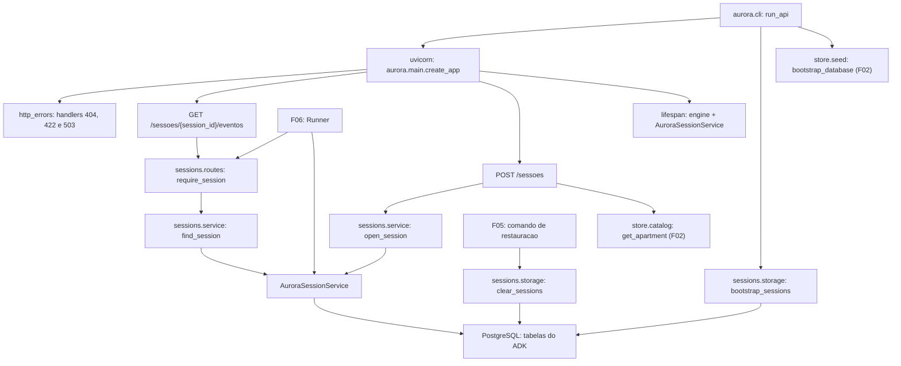

# Especificação técnica: Session Lifecycle and Persistence

## 1. Visão técnica

**O quê:** o ciclo de vida das sessões do assistente. Um pacote `aurora.sessions` com um serviço de sessão do ADK persistido no PostgreSQL, duas rotas (`POST /sessoes` e `GET /sessoes/{session_id}/eventos`), a resolução de sessão que responde `404` para qualquer rota com `{session_id}`, a preparação das tabelas de sessão na subida da API e a limpeza das sessões usada pela restauração de dados. A feature também define o formato único de erro das rotas (`{"detail": "<texto>"}`).

**Por quê:** duas das cinco garantias do produto começam aqui. A primeira é que cada sessão pertence a um apartamento: o apartamento é validado contra o catálogo, gravado uma única vez no state da sessão e protegido em código contra qualquer escrita posterior, porque o ADK aplica ao state todo `state_delta` que um evento trouxer. A segunda é que reiniciar a API não perde nada: sessões e eventos ficam no mesmo PostgreSQL dos dados do condomínio, e não na memória do processo.

**Escopo**

Incluído:
- Serviço de sessão persistido (`DatabaseSessionService` do ADK 2.2.0) com guarda sobre a chave do apartamento
- Criação de sessão vinculada a um apartamento do catálogo, sem chamar o modelo
- Listagem dos eventos de uma sessão, em ordem, com o conteúdo completo de cada um
- Resolução de sessão reutilizável, com `404` para sessão desconhecida
- Preparação das tabelas de sessão na subida da API (`uv run aurora-api`), antes de abrir a porta
- Limpeza de sessões, eventos e states, dentro da transação de quem chama
- Formato único de erro das rotas e os handlers de `404`, `422` e `503`

Contratos de entrada (PRD, bloco Consumes):
- Do F01: a URL do banco (`Settings.database_url`), a aplicação criada por `aurora.main.create_app` e o comando de subida `aurora.cli.run_api`
- Do F02: a consulta de apartamento `aurora.store.catalog.get_apartment`, usada para validar o número informado

Contratos de saída (PRD, bloco Provides):
- Identificador de sessão vinculado a um apartamento, com o apartamento no state e o histórico de eventos persistido, consumido por F06
- Serviço de sessão em `app.state.session_service` e as constantes de identidade (`APP_NAME`, `USER_ID`, `APARTMENT_KEY`), consumidos por F06 para montar o Runner
- Resolução de sessão com `404`, consumida pelas rotas com `{session_id}` das features seguintes
- Limpeza do armazenamento de sessões, consumida por F05

Fora do escopo desta feature:
- Envio de mensagens, agentes e Runner (F06)
- Confirmações pendentes e sua resolução (F07, F08, F10)
- Comando de restauração (F05) e rotas de verificação (F04)

## 2. Impacto na arquitetura

Componentes afetados:
- `src/aurora/sessions/` (novo): `service.py`, `storage.py`, `routes.py`
- `src/aurora/http_errors.py` (novo): formato de erro e handlers
- `src/aurora/main.py` (modificado): serviço de sessão no ciclo de vida, rotas e handlers
- `src/aurora/cli.py` (modificado): passo de preparação das tabelas de sessão
- `tests/` (novo e modificado): fixtures de sessão e testes da feature



Fluxo de subida: depois de validar a configuração, esperar o banco e preparar o esquema do condomínio (F01 e F02), o comando prepara as tabelas de sessão e só então entrega o controle ao uvicorn. As três etapas de banco rodam no mesmo laço de eventos temporário.

Fluxo de criação: a rota valida o corpo, consulta o apartamento no catálogo e, se ele existe, cria a sessão com o apartamento no state. A sessão é gravada em uma única transação do ADK, então uma falha não deixa sessão parcial. Nenhum passo chama o modelo.

Fluxo de leitura: a rota resolve a sessão pelo `session_id`, com a identidade fixa da aplicação, e devolve os eventos na ordem em que o ADK os entrega (do mais antigo para o mais novo), serializados como o próprio ADK os serializa.

Fluxo de escrita de eventos (usado pelo F06): todo evento passa por `AuroraSessionService.append_event`, que retira a chave do apartamento do `state_delta` antes de gravar.

## 3. Decisões técnicas

| Decisão | Abordagem escolhida | Alternativa considerada | Trade-off |
|---|---|---|---|
| Armazenamento das sessões | `DatabaseSessionService` do ADK no mesmo PostgreSQL, com a mesma `DATABASE_URL` | Tabelas próprias de sessão e evento; SQLite separado | As tabelas do ADK (`sessions`, `events`, `app_states`, `user_states`, `adk_internal_metadata`) convivem com as do condomínio e o esquema delas é do ADK, não do projeto |
| Identidade da sessão | `APP_NAME = "aurora"` e `USER_ID` constante para todas as sessões; o apartamento fica só no state | `user_id` igual ao apartamento | O escopo `user:` do state fica compartilhado entre todas as sessões e não pode ser usado; em troca, a busca por `session_id` é direta pelo serviço de sessão |
| Imutabilidade do apartamento | Subclasse do serviço que descarta a chave `apartamento` do `state_delta` de todo evento antes de gravar | Só convenção (nenhuma rota e nenhuma tool escreve a chave) | Acoplamento ao método `append_event`; a guarda cobre o que é persistido, não uma escrita em memória durante a execução em curso |
| Chave do state | `apartamento` | `apartment` | Um identificador em português no código; em troca, é igual ao campo da rota e legível em instruções de agente |
| Motor de banco das sessões | O serviço do ADK cria a própria engine a partir da URL | Reaproveitar `app.state.engine` | Dois pools de conexão no processo; o ADK 2.2.0 não aceita uma engine pronta |
| Criação das tabelas de sessão | Na subida, antes de abrir a porta, por um serviço temporário que executa uma leitura pública | Criação preguiçosa na primeira requisição | Um passo a mais na subida; em troca, falha de criação impede a subida em vez de virar `503` |
| Gatilho da criação | Uma operação pública de leitura do serviço, porque o ADK cria as tabelas na primeira operação | Chamar o método privado `_prepare_tables` | Uma leitura extra na subida; sem dependência de API privada |
| Formato dos eventos na rota | Serialização do próprio ADK: nomes em camelCase, campos nulos omitidos | Projeção própria com campos em português | O formato acompanha a versão do ADK; em troca, nada do conteúdo do evento é perdido |
| Formato de erro | `{"detail": "<texto em português>"}` em todos os erros, inclusive `422` | Padrão do FastAPI, com lista no `422`; chave `erro` | Um handler próprio de validação; perde-se o detalhamento por campo do FastAPI |
| Limpeza das sessões | Função que recebe a conexão de quem chama e apaga com `DELETE` | `TRUNCATE`; `delete_session` do ADK, sessão por sessão | `DELETE` é mais lento em tabelas grandes; em troca, participa da transação do F05 e evita a trava exclusiva com a API no ar |
| Nomes das tabelas na limpeza | Lidos do metadata do esquema v1 do ADK instalado | Literais no código do projeto | Importa um módulo de esquema do ADK; a versão está fixada em 2.2.0 |
| Onde fica a regra de criação | Função `open_session` no módulo de serviço; a rota só traduz para HTTP | Lógica dentro do handler | Uma função a mais; em troca, F06 e os testes usam o mesmo caminho da rota |

## 4. Visão geral dos componentes (Component Overview)

**Backend:**

| Caminho | Novo/Modificado | Propósito | Responsabilidades |
|---|---|---|---|
| `src/aurora/sessions/__init__.py` | Novo | Pacote | Marca o pacote; sem lógica |
| `src/aurora/sessions/service.py` | Novo | Serviço de sessão | Constantes `APP_NAME`, `USER_ID`, `APARTMENT_KEY`; classe `AuroraSessionService`; `create_session_service(settings)`; `open_session`; `find_session`; `session_apartment`; `SessionStoreError` e a tradução de falhas do banco |
| `src/aurora/sessions/storage.py` | Novo | Armazenamento | `bootstrap_sessions(url)`; `clear_sessions(conn)` |
| `src/aurora/sessions/routes.py` | Novo | Rotas | `APIRouter` com `POST /sessoes` e `GET /sessoes/{session_id}/eventos`; dependência `require_session`; modelos de corpo e de resposta |
| `src/aurora/http_errors.py` | Novo | Erros HTTP | `install_error_handlers(app)`; handlers de validação (`422`) e de indisponibilidade (`503`); constantes das mensagens |
| `src/aurora/main.py` | Modificado | Aplicação FastAPI | O lifespan cria e fecha o serviço de sessão em `app.state.session_service`; inclui o router de sessões; instala os handlers |
| `src/aurora/cli.py` | Modificado | Ponto de entrada | Chama a preparação das tabelas de sessão depois da preparação do banco; converte `SessionStoreError` em mensagem em stderr e código 1 |

**Banco de dados:**

| Origem | Tabelas afetadas | Operação | Observações |
|---|---|---|---|
| ADK 2.2.0 (sem arquivo de migração no projeto) | `sessions`, `events`, `app_states`, `user_states`, `adk_internal_metadata` | CREATE idempotente | Executado pelo próprio ADK, disparado por `bootstrap_sessions`; ver seção 6 |

**Testes:**

| Caminho | Novo/Modificado | Propósito | Responsabilidades |
|---|---|---|---|
| `tests/conftest.py` | Modificado | Fixtures de sessão | Serviço de sessão por teste em `aurora_test`; armazenamento de sessões vazio; sessão com histórico; database sem as tabelas de sessão; aplicação com ciclo de vida ativo |
| `tests/test_sessions_service.py` | Novo | Testes do serviço | Ver seção 7 |
| `tests/test_sessions_storage.py` | Novo | Testes do armazenamento | Ver seção 7 |
| `tests/test_sessions_routes.py` | Novo | Testes das rotas | Ver seção 7 |
| `tests/test_http_errors.py` | Novo | Testes dos handlers | Ver seção 7 |
| `tests/test_cli.py` | Modificado | Testes do comando | Isola o novo passo de preparação nos testes existentes; cobre a falha nova |
| `tests/test_health.py` | Modificado | Testes do ciclo de vida | Confere que o serviço de sessão existe em `app.state` durante a execução |

### Detalhe: `src/aurora/sessions/service.py`

| Nome | Tipo | Valor ou assinatura | Observações |
|---|---|---|---|
| `APP_NAME` | constante | `"aurora"` | O `App` e o Runner do F06 usam o mesmo nome |
| `USER_ID` | constante | `"morador"` | Igual para todas as sessões; não identifica o apartamento |
| `APARTMENT_KEY` | constante | `"apartamento"` | Única chave do state que esta feature grava |
| `AuroraSessionService` | classe | subclasse de `DatabaseSessionService` | Sobrescreve só `append_event` |
| `create_session_service` | função | `(settings) -> AuroraSessionService` | Cria o serviço com `settings.database_url`; não abre conexão |
| `open_session` | função assíncrona | `(service, engine, *, apartment: str) -> Session \| None` | `None` quando o apartamento não está no catálogo |
| `find_session` | função assíncrona | `(service, *, session_id: str) -> Session \| None` | `None` quando a sessão não existe |
| `session_apartment` | função | `(session) -> str` | Lê `APARTMENT_KEY` do state; único leitor que as features seguintes devem usar |
| `SessionStoreError` | exceção | mensagem genérica fixa | Nunca carrega SQL, URL nem senha; o erro original fica como causa encadeada |

Regras:
- `AuroraSessionService.append_event` remove `APARTMENT_KEY` do `state_delta` do evento, quando presente, e delega ao ADK. As outras chaves do `state_delta` seguem intactas. O evento gravado não contém a chave.
- `open_session` consulta `get_apartment` primeiro. Só depois chama `create_session` com `app_name=APP_NAME`, `user_id=USER_ID` e `state={APARTMENT_KEY: apartment}`. O `session_id` é sempre gerado pelo ADK (UUID); não há parâmetro para escolhê-lo.
- `find_session` chama `get_session` com a identidade fixa e devolve a sessão com todos os eventos, sem filtro de quantidade ou de data.
- `open_session` e `find_session` traduzem erros do SQLAlchemy e erros de conexão do sistema operacional para `SessionStoreError`, no mesmo formato do `translate_errors` do F02. `StoreError` vindo do catálogo passa adiante sem tradução.
- Nenhuma função deste módulo grava no state depois da criação, e não existe função para trocar o apartamento.

Limite conhecido da guarda: durante uma execução do Runner, uma escrita direta no state em memória (por exemplo, por uma tool) altera o objeto daquela execução. A guarda impede que essa escrita chegue ao banco e aos eventos, então a requisição seguinte volta a ler o valor original. Nenhum código desta feature faz essa escrita.

### Detalhe: `src/aurora/sessions/storage.py`

- `bootstrap_sessions(url)`: cria um `AuroraSessionService` temporário, executa uma leitura pública (o que leva o ADK a criar as tabelas e a registrar a versão do esquema) e fecha o serviço. Segue o formato de `bootstrap_database`, porque roda fora do laço de eventos do uvicorn. Falhas viram `SessionStoreError`. Chamar duas vezes seguidas não produz erro nem mudança.
- `clear_sessions(conn) -> int`: recebe uma conexão com transação aberta. Conta as sessões, apaga as linhas de `events`, `sessions`, `user_states` e `app_states`, nesta ordem, e devolve a contagem. Preserva `adk_internal_metadata`, que guarda a versão do esquema. Quando as tabelas ainda não existem, devolve zero sem erro. Não faz commit: quem chama é dono da transação.
- As confirmações pendentes vivem dentro dos eventos, então desaparecem junto com eles.
- O serviço de sessão não mantém cache de sessões, então uma limpeza feita com a API no ar faz os `session_id` antigos passarem a responder `404`.

### Detalhe: `src/aurora/sessions/routes.py`

- `require_session(session_id, request)`: dependência do FastAPI que chama `find_session` com o serviço de `app.state` e devolve a sessão, ou responde `404` com a mensagem de sessão não encontrada. As rotas com `{session_id}` das features seguintes declaram esta dependência em vez de repetir a busca.
- O corpo de `POST /sessoes` é um modelo pydantic com um único campo obrigatório. Campos extras são ignorados.
- A rota de eventos serializa cada evento com os nomes públicos do ADK (camelCase) e omite campos nulos.

### Detalhe: `src/aurora/http_errors.py`

- Todo erro das rotas tem o corpo `{"detail": "<texto>"}`, com `detail` sempre texto.
- Erro de validação de requisição: `422`. Quando o problema é de um campo, o texto cita o nome do campo; quando o corpo está ausente ou não é JSON válido, o texto diz isso.
- `SessionStoreError` e `StoreError`: `503` com uma mensagem genérica única.
- `404` de rota inexistente e `405` de método não permitido seguem o comportamento do FastAPI, que já usa `detail` como texto.

### Detalhe: `src/aurora/main.py` e `src/aurora/cli.py`

- O lifespan cria o serviço de sessão depois da engine e o fecha antes de descartá-la.
- Ordem de `run_api()`: carregar configuração → esperar o banco → preparar o banco (F02) → preparar as tabelas de sessão → `uvicorn.run(...)`. `SessionStoreError` entra na lista de erros que viram uma linha em stderr e `SystemExit(1)`, sem traceback.

## 5. Contratos de API

**Endpoint: criar sessão**
- **Método:** POST
- **Caminho:** `/sessoes`
- **Autenticação:** nenhuma; o apartamento informado representa o morador autenticado

**Requisição:**

| Campo | Tipo | Obrigatório | Validação | Descrição |
|---|---|---|---|---|
| `apartamento` | `string` | Sim | texto de 1 a 10 caracteres; precisa existir no catálogo | Número do apartamento do morador |

**Exemplo de requisição:**
```json
{
  "apartamento": "101"
}
```

**Resposta (sucesso - 201):**

| Campo | Tipo | Descrição |
|---|---|---|
| `session_id` | `string` | Identificador da sessão criada (UUID gerado pelo ADK) |

**Exemplo de resposta:**
```json
{
  "session_id": "71870f57-b7e3-46a0-bdbd-ea6d98dc4314"
}
```

**Erros:**

| Status | Corpo | Quando |
|---|---|---|
| 404 | `{"detail": "Apartamento não encontrado."}` | Apartamento fora do catálogo; nenhuma sessão é criada |
| 422 | `{"detail": "Requisição inválida: verifique o campo apartamento."}` | Campo ausente, vazio, longo demais ou que não é texto |
| 422 | `{"detail": "Requisição inválida: envie um corpo JSON válido."}` | Corpo ausente ou JSON malformado |
| 503 | `{"detail": "Serviço indisponível no momento. Tente novamente."}` | Catálogo ou armazenamento de sessões inacessível; nenhuma sessão parcial |

Regras:
- O número do apartamento é comparado de forma exata, sem remover espaços. Um número JSON (`101` sem aspas) é recusado com `422`.
- Cada chamada cria uma sessão nova. Duas chamadas para o mesmo apartamento devolvem identificadores diferentes.
- Um campo `session_id` enviado no corpo é ignorado, como qualquer campo extra.

**Endpoint: listar eventos da sessão**
- **Método:** GET
- **Caminho:** `/sessoes/{session_id}/eventos`
- **Autenticação:** nenhuma

**Requisição:** sem corpo. `session_id` no caminho.

**Resposta (sucesso - 200):** uma lista JSON, do evento mais antigo para o mais novo. Sessão sem eventos devolve `[]`.

| Campo de cada evento | Tipo | Descrição |
|---|---|---|
| `id` | `string` | Identificador do evento |
| `invocationId` | `string` | Execução que gerou o evento |
| `author` | `string` | `user` ou o nome do agente |
| `timestamp` | `number` | Momento do evento, em segundos |
| `content.role` | `string` | `user` ou `model` |
| `content.parts[].text` | `string` | Texto de mensagem |
| `content.parts[].functionCall` | `object` | Chamada de tool: `id`, `name`, `args` |
| `content.parts[].functionResponse` | `object` | Resultado de tool: `id`, `name`, `response` |
| `actions.stateDelta` | `object` | Mudanças de state gravadas pelo evento; nunca contém `apartamento` |
| `actions.requestedToolConfirmations` | `object` | Pedidos de confirmação, por id da chamada: `hint`, `confirmed`, `payload` |
| `longRunningToolIds` | `array` | Ids das chamadas que ficaram aguardando |

Os demais campos que o ADK gravar no evento também são devolvidos. Campos nulos são omitidos.

**Exemplo de resposta:**
```json
[
  {
    "id": "5f0c2a8e-3c1d-4f0e-9a51-2b7f6c1d0e11",
    "invocationId": "inv-1",
    "author": "user",
    "timestamp": 1791899266.731,
    "content": {
      "role": "user",
      "parts": [{"text": "Quais são as minhas reservas?"}]
    },
    "actions": {
      "stateDelta": {},
      "artifactDelta": {},
      "requestedAuthConfigs": {},
      "requestedToolConfirmations": {}
    },
    "nodeInfo": {"path": ""}
  },
  {
    "id": "ea67576b-314c-4f4e-9ebe-ac52224ce63a",
    "invocationId": "inv-1",
    "author": "reservas",
    "timestamp": 1791899266.737,
    "content": {
      "role": "model",
      "parts": [{"functionCall": {"id": "fc-1", "name": "listar_minhas_reservas", "args": {}}}]
    },
    "actions": {
      "stateDelta": {},
      "artifactDelta": {},
      "requestedAuthConfigs": {},
      "requestedToolConfirmations": {}
    },
    "nodeInfo": {"path": ""}
  }
]
```

**Erros:**

| Status | Corpo | Quando |
|---|---|---|
| 404 | `{"detail": "Sessão não encontrada."}` | `session_id` desconhecido |
| 503 | `{"detail": "Serviço indisponível no momento. Tente novamente."}` | Armazenamento de sessões inacessível |

**Interface em processo** (bloco Provides; consumida por F05 e F06)

| Operação | Módulo | Parâmetros | Resultado |
|---|---|---|---|
| `open_session` | `aurora.sessions.service` | `service`, `engine`; nomeado e obrigatório: `apartment: str` | `Session` do ADK com `apartamento` no state, ou `None` |
| `find_session` | `aurora.sessions.service` | `service`; nomeado e obrigatório: `session_id: str` | `Session` do ADK com os eventos, ou `None` |
| `session_apartment` | `aurora.sessions.service` | `session` | `str` |
| `require_session` | `aurora.sessions.routes` | dependência do FastAPI | `Session`, ou resposta `404` |
| `clear_sessions` | `aurora.sessions.storage` | `conn` (transação de quem chama) | `int`, sessões removidas |
| `bootstrap_sessions` | `aurora.sessions.storage` | `url: str` | nada; `SessionStoreError` em caso de falha |
| `app.state.session_service` | `aurora.main` | - | `AuroraSessionService` vivo durante o ciclo de vida da aplicação |

## 6. Modelo de dados

Esta feature não define tabelas próprias. As tabelas abaixo pertencem ao ADK 2.2.0 (esquema v1) e são criadas por ele na database da `DATABASE_URL`. O projeto não as altera; a descrição serve de referência para a limpeza e para a inspeção.

**Tabela: `sessions`**

| Coluna | Tipo | Nulo | Padrão | Descrição |
|---|---|---|---|---|
| `app_name` | `varchar(128)` | Não | - | Sempre `aurora`; parte da chave primária |
| `user_id` | `varchar(128)` | Não | - | Sempre o valor de `USER_ID`; parte da chave primária |
| `id` | `varchar(128)` | Não | UUID gerado pelo ADK | `session_id` devolvido pela rota; parte da chave primária |
| `state` | `jsonb` | Sim | `{}` | State da sessão; contém `{"apartamento": "<número>"}` desde a criação |
| `create_time` | `timestamp` | Sim | `now()` | Criação |
| `update_time` | `timestamp` | Sim | `now()` | Último evento gravado |

**Tabela: `events`**

| Coluna | Tipo | Nulo | Padrão | Descrição |
|---|---|---|---|---|
| `id` | `varchar(128)` | Não | - | Identificador do evento; parte da chave primária |
| `app_name` | `varchar(128)` | Não | - | Parte da chave primária |
| `user_id` | `varchar(128)` | Não | - | Parte da chave primária |
| `session_id` | `varchar(128)` | Não | - | Sessão dona do evento; parte da chave primária |
| `invocation_id` | `varchar(256)` | Sim | - | Execução que gerou o evento |
| `timestamp` | `timestamp` | Sim | `now()` | Ordena os eventos |
| `event_data` | `jsonb` | Sim | - | Conteúdo completo do evento |

**Tabelas `app_states` e `user_states`:** state dos escopos `app:` e `user:`. Recebem uma linha cada na primeira criação de sessão e ficam com o state vazio, porque o projeto não usa esses escopos.

**Tabela `adk_internal_metadata`:** guarda a versão do esquema do ADK. Nunca é apagada pela limpeza.

**Índices e restrições (do ADK):**

| Nome | Tabela | Tipo | Definição | Propósito |
|---|---|---|---|---|
| chave primária | `sessions` | PRIMARY KEY | `app_name`, `user_id`, `id` | Identidade da sessão |
| chave primária | `events` | PRIMARY KEY | `id`, `app_name`, `user_id`, `session_id` | Identidade do evento |
| chave estrangeira | `events` | FOREIGN KEY | `(app_name, user_id, session_id)` referencia `sessions`, com `ON DELETE CASCADE` | Eventos somem com a sessão |
| `idx_events_app_user_session_ts` | `events` | btree | `app_name`, `user_id`, `session_id`, `timestamp DESC` | Leitura dos eventos de uma sessão em ordem |

**SQL de referência da limpeza** (equivalente ao que `clear_sessions` executa na conexão recebida):

```sql
SELECT count(*) FROM sessions;
DELETE FROM events;
DELETE FROM sessions;
DELETE FROM user_states;
DELETE FROM app_states;
```

Não há colisão de nomes com as tabelas do F02 (`apartments`, `areas`, `reservations`, `visitors`).

## 7. Estratégia de testes

Seguem as convenções do F01 e do F02: pytest com `pytest-asyncio` em modo automático, `httpx` com `ASGITransport` para chamar a aplicação em processo, database `aurora_test`, variáveis definidas em `tests/conftest.py`, nenhum teste chama o Gemini.

**Fixtures novas em `tests/conftest.py`:**

| Fixture | O que prepara |
|---|---|
| `session_service` | Um `AuroraSessionService` em `aurora_test`, com as tabelas de sessão criadas, fechado ao fim do teste |
| `no_sessions` | Armazenamento de sessões vazio, pela própria `clear_sessions` |
| `session_with_history` | Uma sessão do apartamento `101` com quatro eventos gravados pelo serviço: mensagem de texto do usuário, chamada de tool, resultado de tool e pedido de confirmação |
| `no_session_tables` | A database `aurora_test` sem as tabelas do ADK |
| `client` | Cliente `httpx` sobre a aplicação com o ciclo de vida ativo e o estado inicial do F02 carregado |

**Estrutura dos arquivos de teste:**

| Arquivo | Tipo | Alvo | Meta de cobertura |
|---|---|---|---|
| `tests/test_sessions_service.py` | Integração | `aurora.sessions.service` | 90% |
| `tests/test_sessions_storage.py` | Integração | `aurora.sessions.storage` | 90% |
| `tests/test_sessions_routes.py` | Integração | `aurora.sessions.routes` | 90% |
| `tests/test_http_errors.py` | Unitário e integração | `aurora.http_errors` | 85% |
| `tests/test_cli.py` | Unitário | `aurora.cli` | 85% |

**`tests/test_sessions_service.py`:**

| Função | Descrição | Asserções |
|---|---|---|
| `test_open_session_binds_apartment` | Abre sessão para `101` | Sessão com id não vazio; `session_apartment` devolve `101` |
| `test_open_session_unknown_apartment_returns_none` | Abre sessão para `999` | `None`; contagem de sessões inalterada |
| `test_open_session_generates_distinct_ids` | Duas sessões do mesmo apartamento | Ids diferentes |
| `test_find_session_returns_events_in_order` | Sessão com histórico | Quatro eventos, na ordem de gravação |
| `test_find_session_unknown_returns_none` | Id inexistente | `None`, sem exceção |
| `test_append_event_drops_apartment_from_state_delta` | Evento com `state_delta` que traz `apartamento` e outra chave | Apartamento relido continua `101`; a outra chave foi gravada; o evento relido não tem `apartamento` no `stateDelta` |
| `test_apartment_survives_new_service_instance` | Fecha o serviço e cria outro | Mesma sessão, mesmo apartamento, mesma contagem de eventos |
| `test_append_after_new_service_instance_increases_count` | Grava um evento pelo serviço novo | Contagem sobe em um; o evento novo é o último |
| `test_sessions_of_different_apartments_are_independent` | Sessões de `101` e `201` | Cada uma devolve o próprio apartamento e os próprios eventos |
| `test_unreachable_database_raises_session_store_error` | Serviço apontando para porta sem serviço | `SessionStoreError`; mensagem sem senha e sem SQL |
| `test_no_operation_changes_the_apartment` | Inspeção da interface pública do módulo | Nenhuma função recebe sessão e apartamento para regravar |

**`tests/test_sessions_storage.py`:**

| Função | Descrição | Asserções |
|---|---|---|
| `test_bootstrap_creates_session_tables` | Database sem as tabelas de sessão | As cinco tabelas existem depois da chamada |
| `test_bootstrap_is_idempotent` | Duas chamadas seguidas, com sessões gravadas | Sem erro; sessões preservadas |
| `test_bootstrap_unreachable_database_raises` | URL com porta sem serviço | `SessionStoreError`; mensagem sem senha |
| `test_clear_sessions_removes_everything_and_counts` | Duas sessões, uma com eventos | Devolve 2; nenhuma sessão e nenhum evento restam |
| `test_clear_sessions_twice_returns_zero` | Segunda chamada | Devolve 0; sem erro |
| `test_clear_sessions_without_tables_returns_zero` | Database sem as tabelas de sessão | Devolve 0; sem erro |
| `test_clear_sessions_rollback_keeps_sessions` | Transação desfeita depois da limpeza | Sessões e eventos continuam lá |
| `test_clear_sessions_keeps_schema_version` | Limpeza seguida de nova criação de sessão | A criação funciona sem recriar tabelas |
| `test_cleared_session_id_is_not_found` | Limpeza com o serviço ainda aberto | `find_session` do id antigo devolve `None` |

**`tests/test_sessions_routes.py`:**

| Função | Descrição | Asserções |
|---|---|---|
| `test_create_session_returns_201_and_id` | `POST /sessoes` com `101` | Status 201; `session_id` não vazio; JSON |
| `test_create_session_accepts_all_six_apartments` | Um `POST` por apartamento do catálogo | Seis respostas 201, seis ids distintos |
| `test_create_session_unknown_apartment_returns_404` | `POST` com `999` | Status 404; `detail` texto; contagem de sessões inalterada |
| `test_create_session_missing_field_returns_422` | Corpo `{}` | Status 422; `detail` cita `apartamento`; nenhuma sessão criada |
| `test_create_session_non_string_returns_422` | `{"apartamento": 101}` | Status 422; nenhuma sessão criada |
| `test_create_session_malformed_json_returns_422` | Corpo que não é JSON | Status 422; `detail` texto |
| `test_create_session_ignores_client_session_id` | Corpo com `session_id` de sessão existente e apartamento `302` | 201 com id diferente; a sessão existente continua do `101` |
| `test_create_session_does_not_call_model` | Chave do Gemini inválida | Status 201 |
| `test_events_of_new_session_is_empty_list` | `GET` logo após criar | Status 200; `[]` |
| `test_events_returns_all_in_order` | Sessão com histórico | Quatro itens; ids na ordem de gravação |
| `test_events_carry_full_content` | Sessão com histórico | Texto, chamada de tool, resultado de tool e pedido de confirmação presentes |
| `test_events_never_expose_apartment_in_state_delta` | Sessão que recebeu evento com `apartamento` no `state_delta` | Nenhum evento devolvido traz a chave |
| `test_events_unknown_session_returns_404` | `GET /sessoes/sessao-inexistente/eventos` | Status 404; `detail` texto |
| `test_events_count_survives_app_restart` | Encerra o ciclo de vida da aplicação e cria outra | Mesma contagem e mesmos ids |
| `test_no_route_mutates_a_session` | `PUT`, `PATCH` e `DELETE` em `/sessoes/{id}` | Status 404 ou 405; apartamento da sessão inalterado |
| `test_session_store_failure_returns_503` | Serviço de sessão substituído por um que falha | Status 503; mensagem genérica; nenhuma sessão criada |
| `test_catalog_failure_returns_503` | Consulta ao catálogo falha | Status 503; mesma mensagem genérica |

**`tests/test_http_errors.py`:**

| Função | Descrição | Asserções |
|---|---|---|
| `test_validation_error_detail_is_text` | Erro de validação de campo | `detail` é texto, não lista |
| `test_validation_error_names_the_field` | Campo ausente | `detail` contém o nome do campo |
| `test_unavailable_detail_has_no_internal_data` | `503` | `detail` sem SQL, sem URL e sem senha |
| `test_unknown_route_detail_is_text` | Rota inexistente | Status 404; `detail` texto |

**`tests/test_cli.py`** (acréscimos):

| Função | Descrição | Asserções |
|---|---|---|
| `test_run_api_prepares_sessions_before_uvicorn` | Subida bem-sucedida | Preparação das sessões chamada depois da preparação do banco e antes do uvicorn |
| `test_run_api_exits_1_when_session_storage_fails` | Preparação lança `SessionStoreError` | Código 1; mensagem genérica em stderr; uvicorn não é chamado |

Os testes existentes de `tests/test_cli.py` passam a substituir também o passo de preparação das sessões, para continuarem sem depender do banco.

## Tratamento de erros

| Cenário | Comportamento | Resultado |
|---|---|---|
| Apartamento fora do catálogo na criação | Nenhuma sessão criada | `404` com `Apartamento não encontrado.` |
| Corpo ausente, JSON malformado, campo ausente ou de tipo errado | Nenhuma sessão criada; nada é consultado | `422` com `detail` em texto |
| Catálogo inacessível na criação | Nenhuma sessão criada | `503` com a mensagem genérica |
| Armazenamento de sessões inacessível na criação | A transação do ADK é desfeita; nenhuma sessão parcial | `503` com a mensagem genérica |
| `session_id` desconhecido em qualquer rota de sessão | Nada alterado | `404` com `Sessão não encontrada.` |
| Armazenamento de sessões inacessível na leitura dos eventos | Nada alterado | `503` com a mensagem genérica |
| Evento com `apartamento` no `state_delta` | A chave é descartada; o restante do evento é gravado | Nenhum erro; o apartamento da sessão não muda |
| Falha ao preparar as tabelas de sessão na subida | Processo encerra com código 1 antes de abrir a porta 8000 | Uma linha em stderr, sem traceback |
| Limpeza chamada sem as tabelas de sessão | Nada apagado | Devolve zero |

A mensagem genérica de `503` é `Serviço indisponível no momento. Tente novamente.`. Nenhuma resposta e nenhuma mensagem de erro reproduz SQL, URL do banco ou senha.

## Premissas e decisões

Decididas na entrevista:
- Quality gates: `uv run ruff check .`, `uv run ruff format --check .`, `uv run pytest`
- Identidade fixa (`APP_NAME` e `USER_ID` constantes); o apartamento fica só no state
- Imutabilidade garantida por uma subclasse do serviço de sessão que descarta a chave do apartamento do `state_delta`
- Erros no formato `{"detail": "<texto em português>"}`, inclusive o `422`
- A limpeza das sessões é entregue por esta feature, para o F05 chamar dentro da própria transação
- O critério de aceite sobre nova mensagem depois do reinício é coberto pela parte que cabe a esta feature: um evento novo gravado pelo serviço de sessão aumenta a contagem da rota de eventos
- As tabelas de sessão são criadas na subida, antes de abrir a porta
- A chave do state se chama `apartamento`

Assumidas por mim (revise se discordar):
- `USER_ID = "morador"` e `APP_NAME = "aurora"`
- Pacote `aurora.sessions` com os módulos `service`, `storage` e `routes`, e `aurora.http_errors` para o formato de erro, seguindo a divisão por domínio do `aurora.store`
- A rota de eventos devolve uma lista JSON direta, como o enunciado pede, com os eventos serializados pelo ADK (camelCase, nulos omitidos)
- O apartamento é aceito só como texto JSON e comparado de forma exata; `101` como número responde `422` e `"101 "` com espaço responde `404`
- Campos extras no corpo de `POST /sessoes` são ignorados, inclusive `session_id`
- Uma única mensagem genérica para `503`, sem distinguir catálogo de sessões, para não expor qual parte falhou
- Textos de `404` e `422`: os da seção 5. O PRD pede uma mensagem legível, sem fixar o texto
- A limpeza apaga também `app_states` e `user_states` e preserva `adk_internal_metadata`
- O estado de sessão usado nos testes é gravado pelo próprio serviço de sessão, em fixtures do pytest, porque a rota de mensagens só chega no F06
- O F04 está na mesma onda e também acrescenta rotas em `src/aurora/main.py`; quem for implementado depois precisa conciliar a inclusão dos routers
- Nenhuma dependência nova: `google-adk`, `sqlalchemy[asyncio]` e `asyncpg` já estão no projeto
- A guarda cobre a persistência; a proibição de uma tool escrever a chave em memória durante a execução é conferida nas features das tools

Verificado antes de escrever, no ADK 2.2.0 instalado, em um banco SQLite descartável:
- `get_session` devolve `None` para sessão inexistente, sem exceção
- Uma subclasse que retira a chave do `state_delta` em `append_event` mantém o apartamento original e grava as demais chaves do mesmo evento
- Uma segunda instância do serviço sobre o mesmo banco devolve a mesma sessão com a mesma quantidade de eventos, e um novo evento gravado por ela aumenta a contagem
- A serialização do evento carrega `functionCall`, `functionResponse` e `actions.requestedToolConfirmations` (com `hint`, `confirmed` e `payload`) depois de ir ao banco e voltar
- As tabelas do ADK se chamam `sessions`, `events`, `app_states`, `user_states` e `adk_internal_metadata`, com `ON DELETE CASCADE` de `events` para `sessions`
- O ADK cria as tabelas na primeira operação pública e gera o `session_id` como UUID quando nenhum é informado

Não verificado: o comportamento no PostgreSQL do compose. Os testes de integração desta feature rodam contra ele.

## Rastreabilidade com o PRD

| Bloco do PRD (F03) | Onde está nesta especificação |
|---|---|
| Consumes | Seção 1 (contratos de entrada); seção 4 (`service.py`, `main.py`, `cli.py`) |
| Provides | Seção 1 (contratos de saída); seção 5 (interface em processo) |
| Capabilities | Seções 3, 4 e 5 |
| Experience | Seção 2 (fluxos de criação e de leitura); seção 6 (persistência) |
| Error Handling | Seção "Tratamento de erros"; seção 5 (tabelas de erros) |
