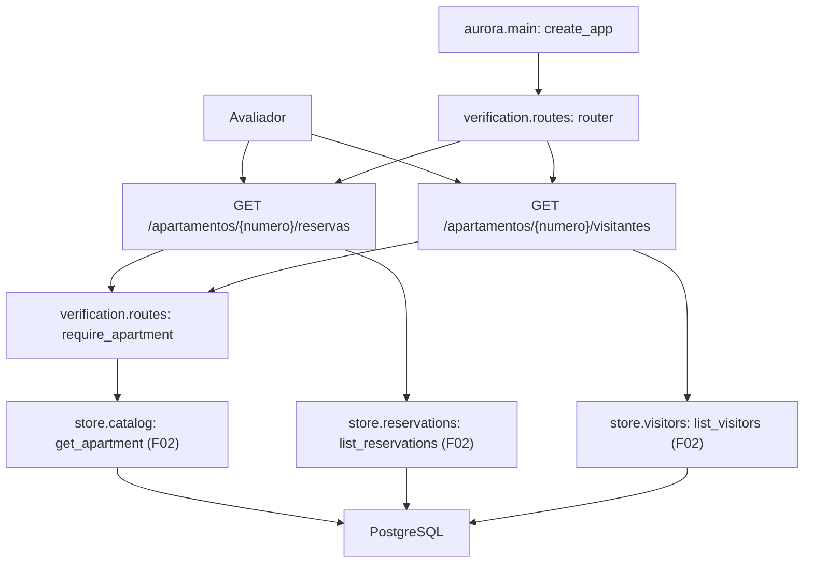

# Especificação técnica: Verification Routes

## 1. Visão técnica

**O quê:** duas rotas de leitura, `GET /apartamentos/{numero}/reservas` e `GET /apartamentos/{numero}/visitantes`, em um pacote novo `aurora.verification`. Cada rota confere o apartamento no catálogo e devolve uma lista JSON com os registros daquele apartamento, lidos direto do PostgreSQL pelas operações da camada de dados do F02.

**Por quê:** o avaliador precisa conferir o efeito de uma conversa sem depender do que o assistente diz. Estas rotas mostram o que está de fato gravado no banco. Por isso elas não passam pelo modelo, não usam sessão e respondem mesmo sem a chave do Gemini no ambiente.

**Escopo**

Incluído:
- Listagem das reservas ativas de um apartamento, com os campos `codigo`, `area` e `data`
- Listagem dos visitantes de um apartamento, com os campos `nome` e `data`
- `404` para apartamento fora do catálogo e `200` com `[]` para apartamento sem registros
- Ordenação estável das duas listas
- `503` com mensagem genérica quando o banco não responde, tratado dentro do próprio router
- Inclusão do router na aplicação

Contratos de entrada (PRD, bloco Consumes):
- Do F02: `aurora.store.reservations.list_reservations` (reservas ativas por apartamento), `aurora.store.visitors.list_visitors` (visitantes por apartamento) e `aurora.store.catalog.get_apartment` (existência do apartamento)
- Do F01, por meio do F02: a engine em `app.state.engine`, criada no ciclo de vida de `aurora.main.create_app`

Contratos de saída:
- O PRD não declara bloco Provides para esta feature. As duas rotas são a saída: o F11 as exercita e o F12 as documenta, sempre por HTTP

Fora do escopo desta feature:
- Qualquer escrita em reservas ou visitantes (F07, F08, F10)
- Sessões e eventos (F03)
- Autenticação: as rotas são abertas por decisão do produto
- Listagem entre apartamentos, de reservas canceladas ou do catálogo

## 2. Impacto na arquitetura

Componentes afetados:
- `src/aurora/verification/` (novo): `__init__.py` e `routes.py`
- `src/aurora/main.py` (modificado): inclusão do router
- `tests/test_verification_routes.py` (novo): testes da feature



Fluxo de leitura: a rota recebe o número do apartamento pelo caminho, consulta o catálogo e responde `404` se o apartamento não existe. Se existe, chama a listagem do F02 com o apartamento como filtro e converte cada registro para o formato da resposta. Uma lista vazia é uma resposta válida.

Nenhum passo importa ou chama o ADK, o Gemini ou o serviço de sessão. O pacote depende só do FastAPI e de `aurora.store`.

## 3. Decisões técnicas

| Decisão | Abordagem escolhida | Alternativa considerada | Trade-off |
|---|---|---|---|
| Local das rotas | Pacote `aurora.verification` com `routes.py`, no mesmo formato de `aurora.sessions` do F03 | Pacote `aurora.apartments`, com o nome do prefixo da URL; módulo único | Um pacote com um só módulo; em troca, o nome do prefixo fica livre para outra feature |
| Acesso aos dados | Só as operações públicas do F02; nenhuma consulta SQL nova | Consulta própria com `JOIN` no catálogo | Duas idas ao banco por requisição (catálogo e listagem); em toda leitura continua valendo o filtro obrigatório por apartamento do F02 |
| Apartamento desconhecido | Dependência `require_apartment` que consulta o catálogo antes da listagem | Deduzir do resultado vazio | Uma consulta a mais; sem ela, apartamento inexistente e apartamento sem registros seriam indistinguíveis |
| Reservas canceladas | A listagem do F02 já devolve só as ativas; a rota não filtra de novo | Filtrar por status na rota | A rota depende dessa regra do F02, que o contrato do F02 já fixa |
| Ordenação | A do F02: reservas por data e depois código; visitantes por data e depois nome | Reordenar na rota | O PRD fala em data e depois código; visitante não tem código, então o desempate é o nome |
| Formato da resposta | Lista JSON direta, com modelos pydantic de resposta e campos em português | Envelope `{"reservas": [...]}`; devolver os dataclasses do F02 | Dois modelos pequenos; em troca, `apartment` e `status` nunca saem na resposta |
| Banco fora do ar | O router captura `StoreError` e responde `503` com o mesmo corpo definido no F03 | Criar `aurora/http_errors.py` também aqui; deixar o `500` padrão | Uma duplicação pequena até o F03 chegar; em troca, nenhum arquivo compartilhado é criado pelas duas features da mesma onda |
| Critério "sem a chave do Gemini" | Requisição em processo depois de remover `GOOGLE_API_KEY` do ambiente, mais as requisições HTTP com a chave inválida `test-key` | Subir a API sem chave | A subida continua abortando sem chave, como o F01 exige; a prova é que a leitura não precisa da chave depois de a aplicação estar de pé |
| Fixtures de teste | Fixture do cliente HTTP dentro do próprio arquivo de teste | Fixture nova em `tests/conftest.py` | O F03 acrescenta fixtures em `conftest.py` na mesma onda; manter a deste arquivo local evita conflito |

## 4. Visão geral dos componentes (Component Overview)

**Backend:**

| Caminho | Novo/Modificado | Propósito | Responsabilidades |
|---|---|---|---|
| `src/aurora/verification/__init__.py` | Novo | Pacote | Marca o pacote; sem lógica |
| `src/aurora/verification/routes.py` | Novo | Rotas de verificação | `APIRouter` com prefixo `/apartamentos`; dependência `require_apartment`; modelos de resposta `ReservaOut` e `VisitanteOut`; tradução de `StoreError` para `503` |
| `src/aurora/main.py` | Modificado | Aplicação FastAPI | Inclui o router de verificação em `create_app` |

**Banco de dados:** nenhuma mudança. A feature só lê as tabelas `apartments`, `reservations` e `visitors` criadas pelo F02.

**Testes:**

| Caminho | Novo/Modificado | Propósito | Responsabilidades |
|---|---|---|---|
| `tests/test_verification_routes.py` | Novo | Testes das rotas | Fixture local do cliente HTTP; ver seção 7 |

### Detalhe: `src/aurora/verification/routes.py`

| Nome | Tipo | Valor ou assinatura | Observações |
|---|---|---|---|
| `router` | `APIRouter` | prefixo `/apartamentos` | Incluído em `create_app` |
| `require_apartment` | dependência assíncrona | `(numero: str, request) -> str` | Devolve o número quando o apartamento existe; responde `404` quando não existe |
| `ReservaOut` | modelo pydantic | `codigo: str`, `area: str`, `data: date` | `area` é o id da área (`area_id` do F02) |
| `VisitanteOut` | modelo pydantic | `nome: str`, `data: date` | Sem o apartamento |
| `APARTMENT_NOT_FOUND` | constante | `"Apartamento não encontrado."` | Mesmo texto do F03 |
| `SERVICE_UNAVAILABLE` | constante | `"Serviço indisponível no momento. Tente novamente."` | Mesmo texto do F03 |

Regras:
- As duas rotas declaram `require_apartment`. A listagem só é chamada depois de o apartamento ser encontrado.
- A engine vem de `request.app.state.engine`. O router não cria engine nem conexão.
- O número do apartamento é comparado de forma exata, sem remover espaços e sem converter para número.
- `data` é serializada como `AAAA-MM-DD`.
- A resposta carrega só os campos dos modelos. `apartment` e `status` do F02 não aparecem.
- `StoreError`, vindo do catálogo ou da listagem, vira `503` com `SERVICE_UNAVAILABLE`. A mensagem original não vai para a resposta.
- O módulo não importa `google.adk`, `google.genai` nem `aurora.sessions`.
- Só o método `GET` é registrado. Os outros métodos seguem o comportamento do FastAPI (`405`).

### Detalhe: `src/aurora/main.py`

- `create_app` inclui o router de verificação. O ciclo de vida não muda.
- O F03 está na mesma onda e também inclui um router e instala handlers neste arquivo. As duas mudanças são independentes; quem entrar depois concilia as linhas.

## 5. Contratos de API

**Endpoint: listar reservas do apartamento**
- **Método:** GET
- **Caminho:** `/apartamentos/{numero}/reservas`
- **Autenticação:** nenhuma (administrativa em produção, aberta aqui por decisão do produto)

**Requisição:**

| Campo | Tipo | Obrigatório | Validação | Descrição |
|---|---|---|---|---|
| `numero` (caminho) | `string` | Sim | precisa existir no catálogo | Número do apartamento |

**Resposta (sucesso - 200):** lista JSON, possivelmente vazia.

| Campo | Tipo | Descrição |
|---|---|---|
| `[].codigo` | `string` | Código da reserva, no formato `RSV-<número>` |
| `[].area` | `string` | Id da área: `salao-de-festas`, `churrasqueira` ou `quadra` |
| `[].data` | `string` | Data da reserva, `AAAA-MM-DD` |

**Exemplo de resposta (apartamento `101`, dados iniciais):**
```json
[
  {
    "codigo": "RSV-1377",
    "area": "quadra",
    "data": "2030-03-09"
  }
]
```

**Erros:**

| Status | Corpo | Quando |
|---|---|---|
| 404 | `{"detail": "Apartamento não encontrado."}` | Apartamento fora do catálogo |
| 503 | `{"detail": "Serviço indisponível no momento. Tente novamente."}` | Banco inacessível |

Regras:
- Só reservas ativas do apartamento informado. Reservas canceladas e reservas de outros apartamentos não aparecem.
- Ordem: `data` crescente e, na mesma data, `codigo` crescente.

**Endpoint: listar visitantes do apartamento**
- **Método:** GET
- **Caminho:** `/apartamentos/{numero}/visitantes`
- **Autenticação:** nenhuma

**Requisição:**

| Campo | Tipo | Obrigatório | Validação | Descrição |
|---|---|---|---|---|
| `numero` (caminho) | `string` | Sim | precisa existir no catálogo | Número do apartamento |

**Resposta (sucesso - 200):** lista JSON, possivelmente vazia.

| Campo | Tipo | Descrição |
|---|---|---|
| `[].nome` | `string` | Nome do visitante autorizado |
| `[].data` | `string` | Data da visita, `AAAA-MM-DD` |

**Exemplo de resposta (apartamento `302`, dados iniciais):**
```json
[
  {
    "nome": "Marina Duarte",
    "data": "2030-03-16"
  }
]
```

**Erros:**

| Status | Corpo | Quando |
|---|---|---|
| 404 | `{"detail": "Apartamento não encontrado."}` | Apartamento fora do catálogo |
| 503 | `{"detail": "Serviço indisponível no momento. Tente novamente."}` | Banco inacessível |

Regras:
- Só visitantes do apartamento informado.
- Ordem: `data` crescente e, na mesma data, `nome` crescente.

## 6. Modelo de dados

Sem mudança de esquema, sem migração e sem índice novo. As leituras usam as tabelas do F02:

| Tabela | Colunas lidas | Filtro |
|---|---|---|
| `apartments` | `number` | `number` igual ao número do caminho |
| `reservations` | `code`, `area_id`, `day` | `apartment` igual ao número e `status` igual a `active` |
| `visitors` | `name`, `day` | `apartment` igual ao número |

## 7. Estratégia de testes

Seguem as convenções do F01 e do F02: pytest com `pytest-asyncio` em modo automático, `httpx` com `ASGITransport` para chamar a aplicação em processo, database `aurora_test`, variáveis definidas em `tests/conftest.py`, nenhum teste chama o Gemini. O estado além dos dados iniciais (reserva nova, reserva cancelada, visitante novo) é gravado pelas operações públicas do F02.

**Fixture local em `tests/test_verification_routes.py`:**

| Fixture | O que prepara |
|---|---|
| `api` | Cliente `httpx` sobre `create_app()` com o ciclo de vida ativo, depois da fixture `seeded` do F02 |

**Estrutura dos arquivos de teste:**

| Arquivo | Tipo | Alvo | Meta de cobertura |
|---|---|---|---|
| `tests/test_verification_routes.py` | Integração | `aurora.verification.routes` | 95% |

**`tests/test_verification_routes.py`:**

| Função | Descrição | Asserções |
|---|---|---|
| `test_reservations_of_101_with_seed_data` | Dados iniciais, apartamento `101` | `200`; corpo igual a uma lista com `RSV-1377`, `quadra`, `2030-03-09` |
| `test_reservation_item_has_only_documented_fields` | Dados iniciais, apartamento `101` | Chaves do elemento são exatamente `codigo`, `area`, `data` |
| `test_reservations_are_scoped_to_apartment` | Dados iniciais, apartamento `302` | Só `RSV-4821`; nenhum código de outro apartamento |
| `test_cancelled_reservation_is_not_listed` | Cancela `RSV-1377` pelo F02 | `200` com `[]` |
| `test_new_reservation_is_listed` | Cria uma reserva pelo F02 | A lista ganha o elemento novo, com o código devolvido pelo F02 |
| `test_reservations_ordered_by_date_then_code` | Três reservas ativas, duas na mesma data | Ordem por data e, na mesma data, por código |
| `test_reservations_empty_for_apartment_without_records` | Apartamento `102` | `200` com `[]` |
| `test_reservations_unknown_apartment_returns_404` | Apartamento `999` | `404`; corpo `{"detail": "Apartamento não encontrado."}` |
| `test_visitors_of_302_with_seed_data` | Dados iniciais, apartamento `302` | `200`; corpo igual a uma lista com Marina Duarte, `2030-03-16` |
| `test_visitor_item_has_only_documented_fields` | Dados iniciais, apartamento `302` | Chaves do elemento são exatamente `nome`, `data` |
| `test_visitors_are_scoped_to_apartment` | Dados iniciais, apartamento `201` | Só Paulo Nogueira |
| `test_new_visitor_is_listed_in_order` | Cria dois visitantes pelo F02 | Três elementos, por data e depois nome |
| `test_visitors_empty_for_apartment_without_records` | Apartamento `101` | `200` com `[]` |
| `test_visitors_unknown_apartment_returns_404` | Apartamento `999` | `404`; corpo com `detail` em texto |
| `test_routes_answer_without_gemini_key` | Remove `GOOGLE_API_KEY` do ambiente depois de o ciclo de vida iniciar | As duas rotas respondem `200` com os dados iniciais |
| `test_module_does_not_import_model_or_sessions` | Inspeção dos imports do módulo de rotas | Nenhuma referência a `google.adk`, `google.genai` ou `aurora.sessions` |
| `test_store_error_becomes_503` | Aplicação com a engine apontando para porta sem serviço | `503`; `detail` genérico; sem senha e sem SQL no corpo |
| `test_write_methods_are_not_allowed` | `POST`, `PUT`, `PATCH` e `DELETE` nas duas rotas | `405` em todas; listas inalteradas |
| `test_apartment_number_is_matched_exactly` | Número com espaço no fim | `404` |

## Tratamento de erros

| Cenário | Comportamento | Resultado |
|---|---|---|
| Apartamento fora do catálogo | A listagem não é chamada | `404` com `Apartamento não encontrado.` |
| Apartamento do catálogo sem registros | Lista vazia | `200` com `[]` |
| Banco inacessível na consulta ao catálogo | Nada lido | `503` com a mensagem genérica |
| Banco inacessível na listagem | Nada devolvido parcialmente | `503` com a mensagem genérica |
| Método diferente de `GET` | Nada alterado | `405`, comportamento do FastAPI |
| `GOOGLE_API_KEY` ausente do ambiente com a aplicação de pé | A leitura segue normal | `200` |

A mensagem genérica de `503` é `Serviço indisponível no momento. Tente novamente.`. Nenhuma resposta reproduz SQL, URL do banco ou senha.

## Premissas e decisões

Decididas na entrevista:
- Quality gates: `uv run ruff check .`, `uv run ruff format --check .`, `uv run pytest`
- O critério "sem a chave do Gemini" é verificado em processo, removendo `GOOGLE_API_KEY` do ambiente depois de a aplicação ser montada, e reforçado pelas requisições HTTP com a chave inválida `test-key`. A subida sem chave continua abortando, como o F01 exige
- Banco fora do ar responde `503`, tratado dentro do router desta feature, com o mesmo corpo do F03. Nenhum arquivo compartilhado de erros é criado aqui
- As rotas ficam em `src/aurora/verification/routes.py`
- Nenhuma issue do GitHub é criada para esta feature

Assumidas por mim (revise se discordar):
- Escopo completo da feature: o PRD não separa Core Scope de Full Scope
- Texto do `404`: `Apartamento não encontrado.`, o mesmo do F03. O PRD não fixa o texto
- Visitantes ordenados por data e depois nome, porque visitante não tem código
- "Exactly" nos critérios de aceite significa que a lista tem só aqueles elementos e cada elemento tem só os campos documentados
- O número do apartamento é comparado de forma exata; `"101 "` com espaço responde `404`
- Só `GET` é aceito; os outros métodos respondem `405` pelo FastAPI, sem handler próprio
- A fixture do cliente HTTP fica no arquivo de teste da feature, e não em `tests/conftest.py`, para não disputar o arquivo com o F03
- Quando o F03 for integrado, o tratamento local de `StoreError` fica redundante com o handler global dele e pode ser removido; os dois produzem a mesma resposta
- O F03 está na mesma onda e também altera `src/aurora/main.py`; quem for integrado depois concilia a inclusão dos routers
- Nenhuma dependência nova e nenhuma variável de ambiente nova

## Rastreabilidade com o PRD

| Bloco do PRD (F04) | Onde está nesta especificação |
|---|---|
| Consumes | Seção 1 (contratos de entrada); seção 4 (`routes.py`) |
| Capabilities | Seções 3, 4 e 5 |
| Experience | Seção 2 (fluxo de leitura); seção 5 (regras de ordenação e autenticação) |
