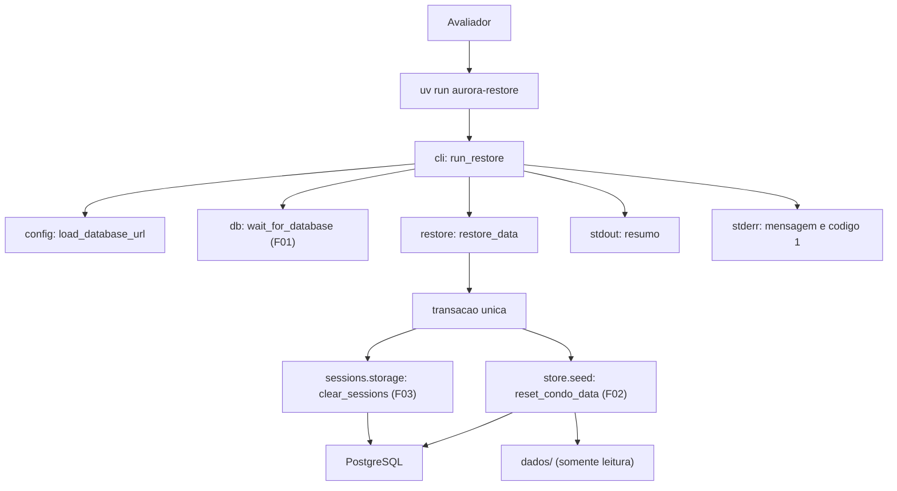

# Especificação técnica: Data Restore Command

## 1. Visão técnica

**O quê:** o comando `uv run aurora-restore`. Em uma única transação, ele apaga sessões, eventos e states do armazenamento de sessões e devolve reservas, visitantes e a sequência de códigos ao conteúdo de `dados/`. No fim, imprime um resumo com as reservas carregadas, os visitantes carregados e as sessões removidas. A feature acrescenta um módulo `aurora.restore` com a operação de restauração, um ponto de entrada `run_restore` em `aurora.cli`, um leitor de configuração que só exige a URL do banco e o registro do comando no `pyproject.toml`.

**Por quê:** o avaliador precisa partir de um estado conhecido a cada execução do fluxo. O F02 e o F03 já entregam as duas metades (a carga dos dados iniciais e a limpeza das sessões), e as duas recebem a conexão de quem chama, sem fazer commit. Falta quem abra a transação, chame as duas e confirme tudo junto, para que o banco nunca fique com dados restaurados e sessões antigas, ou o contrário. Uma confirmação pendente de uma execução anterior, por exemplo, não pode sobreviver sobre dados que voltaram ao início.

**Escopo**

Incluído:
- Comando `uv run aurora-restore`, sem argumentos, executado da raiz do projeto
- Restauração de reservas e visitantes ao conteúdo de `dados/reservas.json` e `dados/visitantes.json`
- Remoção de todas as sessões, eventos e confirmações pendentes
- Reinício da sequência de códigos e remoção do histórico de reservas, incluindo as canceladas
- Transação única para tudo: uma falha em qualquer ponto desfaz o conjunto
- Criação do esquema do condomínio quando a database está vazia
- Resumo em stdout e, em falha, mensagem em stderr com código de saída 1
- Espera de até 10 segundos pelo banco e recusa com host e porta quando ele não responde
- Leitura da `DATABASE_URL` sem exigir `GOOGLE_API_KEY`

Contratos de entrada (PRD, bloco Consumes):
- Do F02: `aurora.store.seed.reset_condo_data(conn, data_dir)`, que restaura reservas, visitantes e a sequência na conexão recebida e devolve `SeedSummary`
- Do F03: `aurora.sessions.storage.clear_sessions(conn)`, que apaga sessões, eventos e states na conexão recebida e devolve a quantidade de sessões removidas
- Do F01, por meio do F02 e do F03: `aurora.db.wait_for_database` e `aurora.db.describe_target`, a constante `DATA_DIR` e a validação da `DATABASE_URL` em `aurora.config`

Contratos de saída:
- O PRD não declara bloco Provides para esta feature. A saída é o próprio comando: o F11 o executa antes do fluxo de verificação e o F12 o documenta na seção Como rodar

Fora do escopo desta feature:
- Qualquer mudança na carga dos dados iniciais (F02) ou na limpeza das sessões (F03)
- Criação das tabelas de sessão, que continua na subida da API (F03)
- Opção de linha de comando para escolher outro diretório de origem
- Escrita em `dados/`
- Documentação do comando no README de entrega (F12)

## 2. Impacto na arquitetura

Componentes afetados:
- `src/aurora/restore.py` (novo): operação de restauração e o resumo dela
- `src/aurora/cli.py` (modificado): ponto de entrada `run_restore`
- `src/aurora/config.py` (modificado): leitura só da URL do banco
- `pyproject.toml` (modificado): registro do comando `aurora-restore`
- `tests/fixtures/seed_overflow/` (novo): dados de origem que passam na validação e falham na escrita
- `tests/test_restore.py` (novo), `tests/test_cli.py` e `tests/test_config.py` (modificados)



Fluxo do comando: `run_restore` lê a URL do banco, espera o banco responder e chama `restore_data`. A operação abre uma engine própria e uma única transação. Dentro dela, primeiro limpa as sessões e depois executa a carga dos dados iniciais. Se as duas terminam, a transação é confirmada e o resumo vai para stdout. Se qualquer passo falha, a transação é desfeita, a mensagem do erro vai para stderr e o processo sai com código 1.

A API não participa. O comando pode rodar com ela no ar: a limpeza usa `DELETE`, sem trava exclusiva, e o serviço de sessão não guarda sessões em cache. Depois do commit, os `session_id` antigos passam a responder `404`.

## 3. Decisões técnicas

| Decisão | Abordagem escolhida | Alternativa considerada | Trade-off |
|---|---|---|---|
| Forma do comando | Console script `aurora-restore` em `[project.scripts]`, ao lado de `aurora-api` | `python -m aurora.restore`; subcomando `aurora-api restore` | Uma entrada a mais no `pyproject.toml`; em troca, os dois comandos documentados têm o mesmo formato e `aurora-api` continua sem análise de argumentos |
| Local da operação | Módulo novo `aurora/restore.py`; `cli.py` só traduz para terminal | Operação dentro de `cli.py`; função nova em `store/seed.py` | Um módulo pequeno a mais; em troca, `aurora.store` continua sem importar `aurora.sessions`, e a operação pode ser chamada em processo sem capturar stdout |
| Transação | Uma só, aberta pela operação, cobrindo a limpeza e a carga | Duas transações em sequência | Nenhum; as duas funções consumidas já foram desenhadas para isso |
| Ordem dentro da transação | Limpeza das sessões primeiro, carga dos dados depois | Carga primeiro | Com dados de origem inválidos, a limpeza é executada e depois desfeita; em troca, uma falha na carga desfaz uma limpeza que já rodou, o que torna a atomicidade observável sem simular falhas |
| Configuração | Leitor só de banco (`load_database_url`), que não exige `GOOGLE_API_KEY` | Reutilizar `load_settings()` | Uma classe e uma função a mais em `config.py`; em troca, a restauração funciona antes de a chave ser preenchida e não depende de algo que não usa |
| Estrutura da configuração | `DatabaseSettings` com `database_url` e a validação existente; `Settings` passa a herdar dela | Duplicar o campo e o validador | `Settings` ganha uma classe base; a validação da URL fica em um lugar só |
| Banco inacessível | `wait_for_database` do F01, com os mesmos 10 segundos da subida | Uma tentativa só; prazo menor | Com o banco parado, a falha leva cerca de 10 segundos; em troca, o comando tolera o Postgres ainda iniciando logo depois de `docker compose up -d` |
| Tabelas de sessão em database vazia | Não são criadas pelo comando; a subida da API continua responsável | Chamar `bootstrap_sessions` antes da transação | Depois do comando em database vazia, as tabelas de sessão ainda não existem; em troca, tudo o que o comando faz cabe na transação |
| Diretório de origem | Parâmetro da operação, com `dados/` como padrão; o comando não tem opção para isso | Opção `--dados` no comando | A falha no meio só é exercitada em processo; em troca, o avaliador não ganha uma forma de restaurar a partir de outro diretório |
| Falhas de conexão na operação | `translate_errors` do F02 sobre a operação inteira | Deixar o erro do driver subir | Abrir a transação e confirmar ficam fora das funções do F02 e do F03; sem a tradução, uma falha ali chegaria ao terminal com traceback |
| Formato do resumo | Texto em português, uma informação por linha, com o destino na primeira | JSON | Menos prático para um script ler; em troca, segue as mensagens do projeto e o F11 só precisa do código de saída |
| Fixtures de teste | Locais ao arquivo `tests/test_restore.py` | Novas fixtures em `tests/conftest.py` | Alguma repetição; o F06 está na mesma onda e pode alterar `conftest.py` |

## 4. Visão geral dos componentes (Component Overview)

**Backend:**

| Caminho | Novo/Modificado | Propósito | Responsabilidades |
|---|---|---|---|
| `src/aurora/restore.py` | Novo | Restauração | `RestoreSummary`; `restore_data(url, data_dir)`: abre a engine e a transação única, limpa as sessões, executa a carga e devolve as contagens |
| `src/aurora/cli.py` | Modificado | Ponto de entrada | `run_restore()`: lê a URL, espera o banco, chama a operação, imprime o resumo e converte os erros previstos em mensagem e código 1 |
| `src/aurora/config.py` | Modificado | Configuração | `DatabaseSettings` com `database_url`; `Settings` herda dela; `load_database_url(env_file)` |
| `pyproject.toml` | Modificado | Manifesto | `aurora-restore = "aurora.cli:run_restore"` em `[project.scripts]` |

**Banco de dados:** nenhuma tabela, índice ou sequência nova. A feature só executa escritas sobre objetos do F02 e do ADK; ver seção 6.

**Testes:**

| Caminho | Novo/Modificado | Propósito | Responsabilidades |
|---|---|---|---|
| `tests/test_restore.py` | Novo | Testes da operação | Ver seção 7 |
| `tests/test_cli.py` | Modificado | Testes do comando | Cobre `run_restore` com a operação e a espera isoladas; confere o registro do script |
| `tests/test_config.py` | Modificado | Testes da configuração | Cobre `load_database_url`; os testes de `load_settings` seguem iguais |
| `tests/fixtures/seed_overflow/` | Novo | Dados de origem | Quatro arquivos válidos para a validação; `visitantes.json` tem um nome que não cabe na coluna |

### Detalhe: `src/aurora/restore.py`

| Nome | Tipo | Valor ou assinatura | Observações |
|---|---|---|---|
| `RestoreSummary` | dataclass imutável | `reservations: int`, `visitors: int`, `sessions: int` | Reservas carregadas, visitantes carregados, sessões removidas |
| `restore_data` | função assíncrona | `(url: str, data_dir: Path = DATA_DIR) -> RestoreSummary` | Não imprime nada e não encerra o processo |

Regras:
- `restore_data` cria uma engine a partir da URL e a descarta no fim, com ou sem erro, no mesmo formato de `bootstrap_database` do F02.
- Dentro de uma única transação, nesta ordem: `clear_sessions(conn)` e depois `reset_condo_data(conn, data_dir)`. Nenhuma das duas faz commit; a operação confirma ao sair do bloco da transação.
- O resultado junta `SeedSummary.reservations`, `SeedSummary.visitors` e a contagem devolvida pela limpeza.
- A operação não captura erros. `SeedDataError`, `StoreError` e `SessionStoreError` sobem para quem chamou depois de a transação ser desfeita. Falhas do driver ao abrir a conexão ou ao confirmar viram `StoreError` pelo `translate_errors` do F02 aplicado à operação.
- A operação não importa o Gemini nem cria o serviço de sessão. Ela importa `aurora.sessions.storage`, que por sua vez importa o módulo de esquema do ADK.
- Nenhuma escrita em disco: os arquivos de `data_dir` são só lidos, pela carga do F02.

### Detalhe: `src/aurora/config.py`

- `DatabaseSettings`: classe de configuração com o campo `database_url`, o padrão `DEFAULT_DATABASE_URL` e o validador que hoje está em `Settings`. Usa a mesma configuração de leitura de `Settings` (valores vazios caem no padrão, variáveis extras são ignoradas).
- `Settings` passa a herdar de `DatabaseSettings` e mantém `google_api_key` e os dois modelos. O comportamento de `load_settings` e de `get_settings` não muda.
- `load_database_url(env_file=PROJECT_ROOT / ".env") -> str`: lê só a `DATABASE_URL`, do ambiente do processo ou do `.env`, com o ambiente tendo precedência. URL inválida gera `ConfigError` com a mensagem que `load_settings` já usa para esse caso, sem reproduzir o valor. Não lê nem exporta `GOOGLE_API_KEY`.

### Detalhe: `src/aurora/cli.py`

- Ordem de `run_restore()`: ler a URL → esperar o banco → restaurar → imprimir o resumo.
- Erros convertidos em uma linha em stderr e `SystemExit(1)`, sem traceback: `ConfigError`, `DatabaseUnavailableError`, `SeedDataError`, `StoreError` e `SessionStoreError`. É a mesma lista de `run_api()`.
- O resumo só é impresso depois de a operação devolver o resultado, isto é, depois do commit. Em falha, stdout fica vazio.
- Em sucesso a função retorna normalmente e o processo sai com código 0.
- `run_restore` não chama `uvicorn`, não monta a aplicação e não lê argumentos de linha de comando.

## 5. Contrato do comando

A feature não tem endpoint HTTP. O contrato é o do comando.

**Comando: restaurar os dados**
- **Invocação:** `uv run aurora-restore`, da raiz do projeto
- **Argumentos:** nenhum. Argumentos extras são ignorados
- **Autenticação:** nenhuma

**Entrada:**

| Variável | Obrigatória | Origem | Validação | Descrição |
|---|---|---|---|---|
| `DATABASE_URL` | Não | Ambiente do processo; depois `.env`; depois o padrão do projeto | URL `postgresql+asyncpg` com host | Banco a restaurar |
| `GOOGLE_API_KEY` | Não | - | - | Não é lida por este comando |

**Saída em sucesso (stdout, código 0):**

| Linha | Conteúdo |
|---|---|
| 1 | `Dados restaurados em <host>:<porta> (database <nome>).` |
| 2 | `Reservas carregadas: <n>` |
| 3 | `Visitantes carregados: <n>` |
| 4 | `Sessões removidas: <n>` |

**Exemplo de saída:**
```
Dados restaurados em localhost:5432 (database aurora).
Reservas carregadas: 3
Visitantes carregados: 2
Sessões removidas: 4
```

O destino da linha 1 vem de `describe_target`, que nunca inclui usuário nem senha.

**Saída em falha (stderr, código 1, stdout vazio):**

| Situação | Mensagem | O que muda no banco |
|---|---|---|
| `DATABASE_URL` inválida | `Configuração inválida: DATABASE_URL não é uma URL postgresql+asyncpg válida.` | Nada; nenhuma conexão é aberta |
| Banco inacessível depois de 10 segundos | `Banco de dados inacessível em <host>:<porta> (database <nome>) após 10 s. Suba o Postgres com "docker compose up -d".` | Nada |
| Arquivo de `dados/` ausente, ilegível, malformado ou inconsistente | `Dados iniciais inválidos em <arquivo>: <motivo>.` | Nada; a transação é desfeita |
| Falha do banco durante a transação ou no commit | `Serviço de dados indisponível no momento.` | Nada; a transação é desfeita |
| Falha na limpeza das sessões | Mensagem genérica do `SessionStoreError` | Nada; a transação é desfeita |

**Exemplo de falha:**
```
Banco de dados inacessível em localhost:5432 (database aurora) após 10 s. Suba o Postgres com "docker compose up -d".
```

**Interface em processo**

| Operação | Módulo | Parâmetros | Resultado |
|---|---|---|---|
| `restore_data` | `aurora.restore` | `url: str`, `data_dir: Path = DATA_DIR` | `RestoreSummary`; `SeedDataError`, `StoreError` ou `SessionStoreError` em falha |
| `load_database_url` | `aurora.config` | `env_file` (padrão: `.env` da raiz) | `str`; `ConfigError` para URL inválida |
| `run_restore` | `aurora.cli` | - | Nada; `SystemExit(1)` em falha |

## 6. Modelo de dados

Nenhuma mudança de esquema. A tabela abaixo mostra o que uma restauração bem-sucedida faz com cada objeto.

| Objeto | Dono | Efeito |
|---|---|---|
| `events`, `sessions`, `user_states`, `app_states` | ADK (F03) | Todas as linhas apagadas, nesta ordem. Tabelas ausentes são ignoradas |
| `adk_internal_metadata` | ADK (F03) | Preservada; guarda a versão do esquema do ADK |
| `apartments`, `areas` | F02 | Criadas se faltarem; sincronizadas com `dados/apartamentos.json` e `dados/areas.json` |
| `reservations` | F02 | Criada se faltar; todas as linhas apagadas, inclusive as canceladas; três linhas inseridas com os códigos originais e status `active` |
| `visitors` | F02 | Criada se faltar; todas as linhas apagadas; duas linhas inseridas |
| `reservation_code_seq` | F02 | Criada se faltar; reposicionada para emitir `RSV-4822` como próximo código |

As confirmações pendentes não têm tabela própria: vivem dentro dos eventos e somem com eles.

"Histórico de códigos", no PRD, corresponde a duas coisas aqui: as linhas canceladas de `reservations`, que mantinham os códigos ocupados, e a posição da sequência. As duas voltam ao início, então o primeiro código depois de uma restauração é sempre `RSV-4822`.

**SQL de referência da transação** (equivalente ao que as funções do F03 e do F02 executam na conexão aberta por `restore_data`):
```sql
BEGIN;

-- clear_sessions (F03), só para as tabelas que existem
DELETE FROM events;
DELETE FROM sessions;
DELETE FROM user_states;
DELETE FROM app_states;

-- reset_condo_data (F02): esquema e catálogo garantidos antes
DELETE FROM reservations;
DELETE FROM visitors;
INSERT INTO reservations (code, apartment, area_id, day) VALUES
    ('RSV-1377', '101', 'quadra', '2030-03-09'),
    ('RSV-4821', '302', 'salao-de-festas', '2030-03-16'),
    ('RSV-2950', '201', 'churrasqueira', '2030-03-23');
INSERT INTO visitors (apartment, name, day) VALUES
    ('302', 'Marina Duarte', '2030-03-16'),
    ('201', 'Paulo Nogueira', '2030-03-23');
ALTER SEQUENCE reservation_code_seq RESTART WITH 4822;

COMMIT;
```

No PostgreSQL, a criação de tabelas e o `ALTER SEQUENCE ... RESTART` participam da transação. Um rollback desfaz também o esquema criado e a posição da sequência.

## 7. Estratégia de testes

Seguem as convenções do F01 ao F04: pytest com `pytest-asyncio` em modo automático, database `aurora_test`, variáveis definidas em `tests/conftest.py`, nenhum teste chama o Gemini. O estado além dos dados iniciais é gravado pelas operações públicas do F02 e pelo serviço de sessão do F03. Os testes do comando isolam a espera pelo banco e a operação com `monkeypatch`, como os testes de `run_api`.

**Fixtures locais em `tests/test_restore.py`:**

| Fixture | O que prepara |
|---|---|
| `changed_state` | Depois de `seeded`: cancela `RSV-1377`, cria uma reserva de `quadra` para 2030-04-06 no apartamento `101` e autoriza Joana Ribeiro para 2030-04-21, tudo pelas operações do F02 |
| `two_sessions` | Depois de `session_with_history`: abre uma segunda sessão, do apartamento `201`, sem eventos |

As fixtures `engine`, `seeded`, `empty_database`, `no_session_tables`, `session_with_history`, `no_sessions` e `client` já existem em `tests/conftest.py` e são reutilizadas sem alteração.

**Estrutura dos arquivos de teste:**

| Arquivo | Tipo | Alvo | Meta de cobertura |
|---|---|---|---|
| `tests/test_restore.py` | Integração | `aurora.restore` | 95% |
| `tests/test_cli.py` | Unidade | `aurora.cli.run_restore` | 95% das linhas novas |
| `tests/test_config.py` | Unidade | `aurora.config.load_database_url` | 95% das linhas novas |

**`tests/test_restore.py`:**

| Função | Descrição | Asserções |
|---|---|---|
| `test_restore_returns_data_to_seed_content` | Restauração sobre `changed_state` | Reservas e visitantes iguais ao conteúdo de `dados/`; resumo com 3 e 2 |
| `test_restore_removes_cancelled_rows` | Restauração sobre `changed_state` | Nenhuma linha com status `cancelled`; nenhum código acima de `RSV-4821` |
| `test_restore_restarts_code_sequence` | Criação pelo F02 logo depois da restauração | Código `RSV-4822` |
| `test_restore_removes_sessions_and_counts_them` | Restauração sobre `two_sessions` | Resumo com 2 sessões; as duas deixam de ser encontradas; nenhum evento |
| `test_restore_keeps_session_tables_and_schema_version` | Restauração sobre `two_sessions` | As cinco tabelas do ADK existem; `adk_internal_metadata` mantém a linha |
| `test_restore_twice_gives_same_state` | Duas restaurações seguidas | Segunda sem erro; resumo 3, 2 e 0; estado e posição da sequência iguais aos da primeira |
| `test_restore_on_empty_database_creates_condo_schema` | `empty_database` e `no_session_tables` | Resumo 3, 2 e 0; catálogo com 6 apartamentos e 3 áreas; tabelas de sessão continuam ausentes |
| `test_restore_without_session_tables` | `seeded` e `no_session_tables` | Conclui; resumo com 0 sessões |
| `test_restore_midway_failure_rolls_back_everything` | `changed_state`, `two_sessions`, origem `seed_overflow` | `StoreError`; reservas, visitantes e posição da sequência intactos; as duas sessões e os quatro eventos continuam |
| `test_restore_invalid_seed_changes_nothing` | `changed_state`, `two_sessions`, origem `seed_malformed` | `SeedDataError` que cita `reservas.json`; dados e sessões intactos |
| `test_restore_session_failure_rolls_back_data` | Limpeza substituída por uma que falha | `SessionStoreError`; reservas e visitantes de `changed_state` intactos |
| `test_restore_unreachable_database_raises_store_error` | URL com porta sem serviço e senha `segredo` | `StoreError`; a mensagem não contém a senha |
| `test_restore_does_not_touch_dados` | Hash dos arquivos antes e depois | Hashes iguais; mesma lista de arquivos |
| `test_restore_with_app_running_turns_sessions_into_404` | `client`; sessão criada pela rota; restauração; mesma aplicação | `GET` dos eventos responde `404`; novo `POST /sessoes` responde `201` |
| `test_module_does_not_import_model` | Inspeção dos imports do módulo | Nenhuma referência a `google.genai` nem ao serviço de sessão |

**`tests/test_cli.py`** (acréscimos):

| Função | Descrição | Asserções |
|---|---|---|
| `test_run_restore_prints_summary` | Operação isolada devolve 3, 2 e 5 | stdout com as quatro linhas e os três números; nenhum `SystemExit`; stderr vazio |
| `test_run_restore_prints_target_without_credentials` | URL com senha `segredo` | stdout cita host, porta e database; não contém a senha |
| `test_run_restore_waits_for_database_before_restoring` | Espera e operação registram a ordem | Ordem `espera`, `restauração` |
| `test_run_restore_does_not_require_gemini_key` | Ambiente sem `GOOGLE_API_KEY`, leitura sem `.env` | Conclui; a variável continua ausente do ambiente |
| `test_run_restore_exits_1_when_database_unreachable` | Espera falha com `DatabaseUnavailableError` | Código 1; stderr cita o destino; a operação não é chamada; stdout vazio |
| `test_run_restore_exits_1_when_restore_fails` | Parametrizado: `SeedDataError`, `StoreError`, `SessionStoreError` | Código 1; stderr com a mensagem do erro; stdout vazio |
| `test_run_restore_exits_1_on_invalid_database_url` | `DATABASE_URL` inválida com senha | Código 1; stderr cita `DATABASE_URL`; não contém a senha |
| `test_run_restore_does_not_start_uvicorn` | Execução bem-sucedida | `uvicorn.run` não é chamado |
| `test_restore_script_is_declared` | Leitura do `pyproject.toml` | `aurora-restore` aponta para `aurora.cli:run_restore` |

**`tests/test_config.py`** (acréscimos):

| Função | Descrição | Asserções |
|---|---|---|
| `test_load_database_url_without_key` | Só `DATABASE_URL` no ambiente | Devolve a URL; nenhum erro |
| `test_load_database_url_defaults_when_absent` | Ambiente limpo | Devolve `DEFAULT_DATABASE_URL` |
| `test_load_database_url_empty_value_falls_back` | `DATABASE_URL` vazia | Devolve o padrão |
| `test_load_database_url_invalid_does_not_leak_value` | URL inválida com senha | `ConfigError` que cita `DATABASE_URL` e não contém a senha |
| `test_load_database_url_does_not_export_key` | Ambiente limpo | `GOOGLE_API_KEY` continua fora do ambiente |
| `test_environment_overrides_env_file` | `.env` temporário com uma URL e ambiente com outra | Devolve a do ambiente |

## Tratamento de erros

| Cenário | Comportamento | Resultado |
|---|---|---|
| Banco inacessível | Espera de até 10 segundos; nenhuma transação é aberta | Código 1; stderr com host, porta e database, sem senha |
| Banco ainda iniciando | A espera tenta de novo a cada segundo e segue assim que o banco responde | Código 0 |
| Falha no meio da transação | A transação é desfeita, inclusive a limpeza das sessões que já tinha rodado | Código 1; mensagem genérica; nenhum dado alterado |
| Arquivo de `dados/` inválido | A carga valida os quatro arquivos antes de escrever; a transação é desfeita | Código 1; stderr cita o arquivo e o motivo |
| `DATABASE_URL` inválida | Nenhuma conexão é tentada | Código 1; stderr cita a variável, sem o valor |
| Database vazia | A carga cria o esquema do condomínio; a limpeza encontra zero sessões | Código 0; `Sessões removidas: 0` |
| Database sem tabelas de sessão | A limpeza devolve zero sem erro | Código 0; `Sessões removidas: 0` |
| Execução com a API no ar | Permitida; sem trava exclusiva | Código 0; os `session_id` antigos passam a responder `404` |
| Segunda execução seguida | Mesmas escritas sobre o estado já restaurado | Código 0; mesmo estado; `Sessões removidas: 0` |
| `GOOGLE_API_KEY` ausente | A chave não é lida | Código 0 |

Nenhuma mensagem reproduz SQL, URL completa ou senha. Em toda falha, stdout fica vazio.

## Premissas e decisões

Decididas na entrevista:
- Quality gates: `uv run ruff check .`, `uv run ruff format --check .`, `uv run pytest`
- O comando é `uv run aurora-restore`, console script apontando para `aurora.cli:run_restore`
- O comando não exige `GOOGLE_API_KEY`; lê só a `DATABASE_URL`
- Banco inacessível: espera de até 10 segundos com `wait_for_database`, como na subida
- O comando cria só o esquema do condomínio; as tabelas de sessão continuam a cargo da subida da API
- A falha no meio é exercitada em processo, com `tests/fixtures/seed_overflow/`; o comando não ganha argumento
- Nenhuma issue do GitHub é criada para esta feature

Assumidas por mim (revise se discordar):
- Escopo completo da feature: o PRD não separa Core Scope de Full Scope
- Dentro da transação, a limpeza das sessões vem antes da carga dos dados. Assim uma falha na carga desfaz uma limpeza que já rodou, e a transação única fica observável
- A operação fica em `src/aurora/restore.py`, e não em `aurora.store`, para que a camada de dados do condomínio não importe o pacote de sessões
- `DatabaseSettings` vira a classe base de `Settings`; o comportamento de `load_settings` não muda
- Texto do resumo: o da seção 5, em português, com o destino na primeira linha. O PRD fixa só as três contagens
- Em falha, a mensagem é a do próprio erro, em uma linha, como em `run_api`; o código de saída é sempre 1
- O comando não lê argumentos; argumentos extras são ignorados
- "Reset the reservation code sequence and history" significa apagar todas as reservas, inclusive as canceladas, e reposicionar a sequência. O F02 já faz as duas coisas
- "Pending confirmations" não exige nada além de apagar os eventos, porque as confirmações vivem neles. Se o F10 criar armazenamento próprio para confirmações, a limpeza dele precisa entrar na mesma transação
- A fixture `seed_overflow` usa um nome de visitante com 101 caracteres, um a mais que o limite da coluna `visitors.name`
- As fixtures de teste novas ficam em `tests/test_restore.py`, e não em `tests/conftest.py`, para não disputar o arquivo com o F06, que está na mesma onda
- O F06 também pode alterar `src/aurora/cli.py`, `src/aurora/config.py` e `pyproject.toml`; quem for integrado depois concilia
- O contrato tem as superfícies CLI e E2E. O critério "sessões respondem `404` depois" só é observável com a API no ar, pelas rotas do F03
- As rotas de verificação do F04 não são usadas no contrato, porque o F04 não é dependência do F05; os efeitos no banco são lidos direto na database
- Nenhuma dependência nova e nenhuma variável de ambiente nova

Verificado antes de escrever, na database `aurora_test` do compose:
- Um `visitantes.json` com nome de 101 caracteres passa em `read_seed_data` e falha no INSERT, depois de as reservas já terem sido trocadas; `reset_condo_data` lança `StoreError`
- Depois desse rollback, reservas (incluindo uma criada antes), visitantes e a posição da sequência ficam idênticos ao estado anterior
- Com a limpeza das sessões executada antes da carga na mesma transação, a sessão apagada volta a ser encontrada depois do rollback
- No caminho de sucesso, o `session_id` antigo deixa de ser encontrado por um serviço de sessão que já estava aberto, e uma sessão nova é aceita em seguida
- Depois da restauração, a sequência fica com `last_value = 4822` e `is_called = false`
- `adk_internal_metadata` tem uma linha, que a limpeza preserva
- A transação completa leva cerca de 0,03 s e os imports do comando, menos de 1 s
- `aurora.cli` é importado sem `GOOGLE_API_KEY` no ambiente

Não verificado: o comando de ponta a ponta com `uv run aurora-restore`, que ainda não existe; a execução com o processo da API de fato no ar (a verificação usou um serviço de sessão aberto no mesmo processo); o comportamento quando o Postgres termina de iniciar durante a espera.

## Rastreabilidade com o PRD

| Bloco do PRD (F05) | Onde está nesta especificação |
|---|---|
| Consumes | Seção 1 (contratos de entrada); seção 4 (`restore.py`) |
| Capabilities | Seções 3, 4, 5 e 6 |
| Experience | Seção 2 (fluxo do comando); seção 5 (invocação e saídas) |
| Error Handling | Seção "Tratamento de erros"; seção 5 (saída em falha) |
