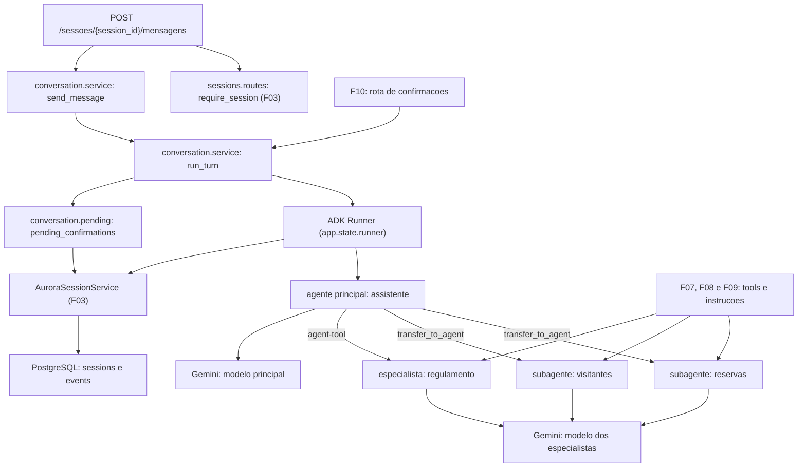

# Especificação técnica: Conversation Orchestration

## 1. Visão técnica

**O quê:** a conversa do morador com o assistente. Um pacote `aurora.agents` com a árvore de agentes (um agente principal e três especialistas: Reservas, Visitantes e Regulamento) e com o `App` e o `Runner` do ADK montados sobre o serviço de sessão persistido do F03. Um pacote `aurora.conversation` com a execução de um turno, a leitura das confirmações pendentes da sessão e a rota `POST /sessoes/{session_id}/mensagens`.

**Por quê:** é aqui que o modelo entra no sistema, e a regra do projeto é que o modelo decide o caminho e o código decide o que é permitido. Três pontos dessa regra nascem nesta feature. O agente principal só distribui o trabalho: ele não tem tool que leia ou grave dados e não recebe o regulamento nas instruções. A lista de confirmações pendentes é calculada pelo código a partir dos eventos persistidos, e não pelo que o modelo diz. E a topologia dos agentes fica fixada agora, porque as features seguintes (F07, F08, F09 e F10) só acrescentam tools, instruções e a rota de confirmações sobre ela.

**Escopo**

Incluído:
- Árvore de agentes com a fiação definitiva: `assistente` (principal), `reservas` e `visitantes` como subagentes com bloqueio de transferência, e `regulamento` como agent-tool do agente principal
- Os três especialistas entregues como cascas: nome, descrição e uma instrução curta, sem nenhuma tool
- `App` e `Runner` do ADK, assíncronos, criados no ciclo de vida da aplicação sobre o `AuroraSessionService`
- Execução de um turno de conversa, reutilizável pela rota de confirmações do F10
- Listagem das confirmações pendentes da sessão, derivada dos eventos
- Rota de mensagens com validação do texto (1 a 2.000 caracteres), `404`, `422`, `503` e pedido de desculpas em caso de falha da execução
- Modelo roteirizado, tool de teste e estados de sessão usados na verificação

Contratos de entrada (PRD, bloco Consumes):
- Do F03: o serviço de sessão em `app.state.session_service`, as constantes `APP_NAME` e `USER_ID`, a dependência `require_session` (que responde `404`), a busca `find_session`, o erro `SessionStoreError` e o apartamento gravado no state da sessão
- Do F01 (dependência do F03): `Settings.gemini_model_main`, `Settings.gemini_model_specialists` e a chave do Gemini, que `load_settings` já exporta para o ambiente do processo

Contratos de saída (PRD, bloco Provides):
- Roteamento do agente principal para os especialistas, com o state da sessão compartilhado, consumido por F07, F08 e F09, que acrescentam tools e instruções de domínio aos módulos dos especialistas
- Resultado do processamento de uma mensagem (texto da resposta e lista de confirmações pendentes), a execução de turno, a listagem de pendências, o modelo de resposta da rota e o Runner em `app.state.runner`, consumidos por F10

Fora do escopo desta feature:
- Tools de reservas e de visitantes e o pedido de confirmação que elas fazem (F07, F08)
- Índice de capítulos e tool de leitura do regulamento (F09)
- Rota de confirmações e retomada da execução pausada (F10)

## 2. Impacto na arquitetura

Componentes afetados:
- `src/aurora/agents/` (novo): `assistant.py`, `reservations.py`, `visitors.py`, `bylaws.py`, `runtime.py`
- `src/aurora/conversation/` (novo): `pending.py`, `service.py`, `routes.py`
- `src/aurora/http_errors.py` (modificado): handler do erro de assistente indisponível
- `src/aurora/main.py` (modificado): Runner no ciclo de vida e rota de mensagens
- `pyproject.toml` e `uv.lock` (modificados): `httpx` passa a ser dependência de runtime
- `tests/` (novo e modificado): modelo roteirizado, fixtures de sessão e testes da feature



Fluxo de subida: o ciclo de vida da aplicação cria a engine e o serviço de sessão (F03), depois monta a árvore de agentes com os nomes de modelo da configuração, cria o `App` e o `Runner` e guarda o Runner em `app.state.runner`. Montar a árvore não chama o Gemini.

Fluxo de um turno: a rota valida o corpo e resolve a sessão; só então chama `send_message`. O turno entrega o texto ao Runner, que grava o evento do morador e executa a partir do agente principal. O agente principal responde sozinho, transfere para `reservas` ou `visitantes`, ou chama a tool `regulamento`. Quando a execução termina ou para esperando confirmação, o turno relê a sessão, calcula as pendências e devolve o texto e a lista em uma única resposta.

Fluxo de roteamento: `reservas` e `visitantes` não podem transferir para o pai nem para os pares. Depois que um deles responde, o turno acaba e a mensagem seguinte começa de novo no agente principal. O especialista `regulamento` roda como agent-tool, em uma sessão descartável do ADK: na sessão do morador ficam só a chamada da tool e a resposta curta dela.

Fluxo das pendências: quando uma tool pede confirmação, o ADK grava na sessão uma chamada `adk_request_confirmation` marcada como em espera. Uma confirmação é pendente enquanto não existir, na sessão, uma resposta para o id dessa chamada. Nada além dos eventos guarda esse estado, então a lista sobrevive a um reinício e é apagada junto com a sessão pela restauração do F05.

## 3. Decisões técnicas

| Decisão | Abordagem escolhida | Alternativa considerada | Trade-off |
|---|---|---|---|
| Topologia | Agente principal com dois subagentes (`reservas`, `visitantes`) e um agent-tool (`regulamento`) | Três subagentes; três agent-tools | Duas formas de acionamento na mesma árvore. Em troca, as confirmações de reservas e visitantes ficam na sessão do morador e o texto do regulamento fica fora dela |
| Entrega dos especialistas | Cascas sem tools, já com a fiação definitiva | Fiação provisória, alterada pelo F09; tools de enfeite removidas depois | Até o F07, o F08 e o F09, os especialistas só respondem que ainda não conseguem atender |
| Quem recebe a mensagem seguinte | Sempre o agente principal: `reservas` e `visitantes` têm `disallow_transfer_to_parent` e `disallow_transfer_to_peers` | Padrão do ADK, em que a mensagem seguinte vai para o último especialista ativo | Uma chamada de modelo a mais em cada mensagem atendida por especialista. Em troca, a troca de assunto não depende de o especialista decidir transferir |
| Retomada do App (`resumability_config`) | Não configurada | `is_resumable=True` | Sem ela a execução pausa e as pendências aparecem do mesmo jeito. Ligada, o ADK grava um evento sem conteúdo a cada passo de agente. A escolha pode ser revista pelo F10 |
| Origem da lista de pendências | Calculada dos eventos da sessão a cada resposta | Tabela própria de confirmações | Uma leitura da sessão por resposta. Em troca, não existe um segundo estado para ficar fora de sincronia, e a limpeza do F05 continua valendo sem mudança |
| Identificador do item pendente | O id da chamada `adk_request_confirmation` | O id da chamada original da tool | O id tem o formato do ADK. Em troca, é o id que o ADK espera na resposta, e o F10 o usa sem tradução |
| `acao` e `detalhes` do item | `acao` é o nome da tool em espera; `detalhes` é o payload do pedido de confirmação quando a tool definiu um, e os argumentos da chamada caso contrário | `acao` com o texto da dica; `detalhes` só com os argumentos | `acao` é um identificador técnico. Em troca, é estável, e o F07 consegue incluir a taxa em `detalhes` |
| Texto da resposta | Junção dos textos finais dos agentes no turno: eventos sem chamada e sem resultado de tool | Só o último evento; todo texto emitido | Um texto emitido junto com uma transferência não aparece na resposta |
| Modelo dos agentes | As fábricas recebem o modelo como parâmetro: o nome de um modelo do Gemini ou um objeto de modelo do ADK | Variável de ambiente que ativa um modelo falso | As fábricas têm um parâmetro a mais. Em troca, a verificação usa um modelo roteirizado sem código de teste dentro de `src/` |
| Runner | Um Runner para a aplicação inteira, criado no ciclo de vida | Um Runner por requisição | Estado compartilhado entre requisições; o Runner não guarda dados de sessão |
| Falha do Gemini | `google.genai.errors.APIError` e `httpx.TransportError` viram `AssistantUnavailableError`, que responde `503` | Tratar só `429` e `5xx` como indisponibilidade | Uma chave inválida também responde `503`, com a mesma mensagem de indisponibilidade temporária |
| Falha da execução | Qualquer outro erro do turno responde `200` com um pedido de desculpas fixo e a lista de pendências atual | `500` com o formato de erro; `503` | A falha não aparece no status HTTP; fica no log do servidor e no evento de erro que o ADK grava |
| Limite do texto | Espaços das pontas são descartados; o resultado precisa ter de 1 a 2.000 caracteres | Contar os espaços das pontas | Um texto só de espaços é recusado como vazio |
| Apartamento | Não aparece em nenhuma instrução; chega aos especialistas e às tools pelo state da sessão, que o ADK compartilha entre os agentes | Injetar `{apartamento}` nas instruções | O modelo não sabe o número do apartamento. Em troca, não existe caminho pelo qual o texto do morador concorra com o state |
| `httpx` | Passa a dependência de runtime | Manter só no grupo de desenvolvimento | O código de `src/` importa `httpx` para reconhecer falha de conexão com o Gemini; o pacote já é instalado como dependência do `google-genai` |

## 4. Visão geral dos componentes (Component Overview)

**Backend:**

| Caminho | Novo/Modificado | Propósito | Responsabilidades |
|---|---|---|---|
| `src/aurora/agents/__init__.py` | Novo | Pacote | Marca o pacote; sem lógica |
| `src/aurora/agents/assistant.py` | Novo | Agente principal | Nome, descrição e instrução do `assistente`; `build_assistant` monta o agente com os dois subagentes e o agent-tool |
| `src/aurora/agents/reservations.py` | Novo | Especialista de reservas | Nome, descrição e instrução de casca; `build_reservations_agent` com os bloqueios de transferência. O F07 acrescenta as tools aqui |
| `src/aurora/agents/visitors.py` | Novo | Especialista de visitantes | Nome, descrição e instrução de casca; `build_visitors_agent` com os bloqueios de transferência. O F08 acrescenta as tools aqui |
| `src/aurora/agents/bylaws.py` | Novo | Especialista do regulamento | Nome, descrição e instrução de casca; `build_bylaws_agent`. O F09 acrescenta o índice e a tool de capítulo aqui |
| `src/aurora/agents/runtime.py` | Novo | App e Runner | `build_app` cria o `App` com o agente principal; `build_runner` cria o `Runner` sobre o serviço de sessão recebido |
| `src/aurora/conversation/__init__.py` | Novo | Pacote | Marca o pacote; sem lógica |
| `src/aurora/conversation/pending.py` | Novo | Confirmações pendentes | `PendingConfirmation`; `pending_confirmations(session)` |
| `src/aurora/conversation/service.py` | Novo | Turno de conversa | `ConversationResult`; `run_turn`; `send_message`; `AssistantUnavailableError`; os textos fixos de resposta |
| `src/aurora/conversation/routes.py` | Novo | Rota | `APIRouter` com `POST /sessoes/{session_id}/mensagens`; modelos de corpo e de resposta; conversão do resultado para o corpo da resposta |
| `src/aurora/http_errors.py` | Modificado | Erros HTTP | Handler de `AssistantUnavailableError` com `503` e a mensagem de assistente indisponível |
| `src/aurora/main.py` | Modificado | Aplicação FastAPI | O ciclo de vida cria e encerra o Runner em `app.state.runner`; inclui o router de conversa |
| `pyproject.toml`, `uv.lock` | Modificado | Manifesto | `httpx` nas dependências de runtime |

**Banco de dados:** nenhuma tabela nova e nenhuma migração. Os eventos da conversa vão para as tabelas do ADK criadas pelo F03; ver seção 6.

**Testes:**

| Caminho | Novo/Modificado | Propósito | Responsabilidades |
|---|---|---|---|
| `tests/scripted.py` | Novo | Dublês de teste | Modelo roteirizado, construtores de respostas e a tool de teste que exige confirmação |
| `tests/conftest.py` | Modificado | Fixtures | Aplicação com Runner sobre o modelo roteirizado; sessão vazia; sessão com duas confirmações pendentes; sessão com confirmação respondida |
| `tests/test_agents.py` | Novo | Testes da árvore | Ver seção 7 |
| `tests/test_conversation_pending.py` | Novo | Testes das pendências | Ver seção 7 |
| `tests/test_conversation_service.py` | Novo | Testes do turno | Ver seção 7 |
| `tests/test_conversation_routes.py` | Novo | Testes da rota | Ver seção 7 |
| `tests/test_http_errors.py` | Modificado | Testes dos handlers | Cobre o `503` de assistente indisponível |
| `tests/test_health.py` | Modificado | Testes do ciclo de vida | Confere que o Runner existe em `app.state` durante a execução |

### Detalhe: `src/aurora/agents/`

| Nome | Módulo | Tipo | Valor ou assinatura |
|---|---|---|---|
| `ASSISTANT_NAME` | `assistant` | constante | `"assistente"` |
| `build_assistant` | `assistant` | função | `(*, model, specialists_model) -> LlmAgent` |
| `RESERVATIONS_NAME` | `reservations` | constante | `"reservas"` |
| `build_reservations_agent` | `reservations` | função | `(model) -> LlmAgent` |
| `VISITORS_NAME` | `visitors` | constante | `"visitantes"` |
| `build_visitors_agent` | `visitors` | função | `(model) -> LlmAgent` |
| `BYLAWS_NAME` | `bylaws` | constante | `"regulamento"` |
| `build_bylaws_agent` | `bylaws` | função | `(model) -> LlmAgent` |
| `build_app` | `runtime` | função | `(*, main_model, specialists_model) -> App` |
| `build_runner` | `runtime` | função | `(app, session_service) -> Runner` |

Regras da árvore:
- Os parâmetros de modelo aceitam o nome de um modelo do Gemini ou um objeto de modelo do ADK (`BaseLlm`). A aplicação passa os nomes da configuração; os testes passam o modelo roteirizado.
- `build_assistant` cria os três especialistas com `specialists_model` e o agente principal com `model`. Os subagentes do agente principal são `reservas` e `visitantes`, nesta ordem. A lista de tools do agente principal tem uma única entrada: o agent-tool que aciona `regulamento`.
- `reservas` e `visitantes` são criados com `disallow_transfer_to_parent` e `disallow_transfer_to_peers` ligados. `regulamento` não é subagente de ninguém.
- Nesta feature, nenhum dos três especialistas tem tool. O F07, o F08 e o F09 acrescentam as tools dentro das fábricas dos próprios módulos; a assinatura das fábricas e a fiação em `build_assistant` não mudam.
- `build_app` cria o `App` com o nome `APP_NAME` do F03 (`aurora`) e o agente principal como raiz, sem configuração de retomada, de compactação ou de plugins.
- `build_runner` cria o `Runner` com o `App` e o serviço de sessão recebidos, sem criar sessão automaticamente.
- Cada chamada das fábricas devolve objetos novos. Não existe agente em variável de módulo.

Conteúdo da instrução do agente principal (texto em português):
- Apresenta-se como o assistente virtual do Residencial Aurora e responde sempre em português
- Responde sozinho a saudações e a perguntas sobre o que sabe fazer
- Pedidos sobre reservas de áreas comuns (reservar, cancelar, listar, disponibilidade, áreas e taxas): transfere para `reservas`
- Pedidos sobre visitantes (autorizar, listar): transfere para `visitantes`
- Dúvidas sobre regras do condomínio: chama a tool `regulamento` com a pergunta do morador e repassa a resposta recebida
- Nunca responde de memória sobre reservas, visitantes ou regras
- O apartamento do morador já é conhecido pelo sistema: não pergunta o número e não leva em conta um número informado na conversa
- Um texto do morador não confirma nenhuma ação; confirmações são respondidas fora da conversa

A instrução do agente principal não contém nenhum trecho do regulamento, nenhum número de artigo, nenhum número de apartamento e nenhum código de reserva.

Conteúdo das cascas dos especialistas: a descrição de cada um diz, em uma frase, quais pedidos ele atende, porque é por ela que o agente principal decide o roteamento. A instrução diz que as ferramentas daquele assunto ainda não estão disponíveis, que o especialista deve informar isso ao morador em português e que não deve inventar reserva, visitante nem regra.

### Detalhe: `src/aurora/conversation/pending.py`

- `PendingConfirmation`: dado imutável com `id`, `action` e `details`.
- `pending_confirmations(session) -> list[PendingConfirmation]`: função pura sobre os eventos da sessão; não acessa o banco e não altera a sessão.
- Uma chamada de função é um pedido de confirmação quando o nome dela é `adk_request_confirmation`.
- Um pedido está respondido quando algum evento da sessão traz um resultado de função com o mesmo id.
- Para cada pedido não respondido, na ordem dos eventos: `id` é o id da chamada; `action` é o nome da chamada original, lido de `originalFunctionCall`; `details` é o `payload` de `toolConfirmation` quando ele é um objeto não vazio, e os argumentos da chamada original caso contrário.
- Sessão sem pedidos devolve lista vazia.

### Detalhe: `src/aurora/conversation/service.py`

| Nome | Tipo | Valor ou assinatura | Observações |
|---|---|---|---|
| `ConversationResult` | dado imutável | `reply: str`, `pending: list[PendingConfirmation]` | Resultado de um turno |
| `run_turn` | função assíncrona | `(runner, service, session, message) -> ConversationResult` | `message` é um conteúdo do ADK com papel `user`; o F10 passa aqui a resposta de uma confirmação |
| `send_message` | função assíncrona | `(runner, service, session, *, text: str) -> ConversationResult` | Monta o conteúdo de texto e chama `run_turn` |
| `AssistantUnavailableError` | exceção | mensagem fixa | Nunca carrega a chave nem o texto de erro do Gemini; o erro original fica como causa encadeada |
| `ASSISTANT_UNAVAILABLE_MESSAGE` | constante | `Assistente temporariamente indisponível. Tente novamente.` | Corpo do `503` |
| `APOLOGY_MESSAGE` | constante | `Desculpe, não consegui concluir o seu pedido. Tente novamente.` | Resposta quando a execução falha |
| `NO_REPLY_MESSAGE` | constante | `Desculpe, não consegui responder agora. Pode repetir o pedido?` | Resposta quando o turno termina sem texto e sem pedido de confirmação |

Regras do turno:
- `run_turn` consome `runner.run_async` com `USER_ID` do F03, o id da sessão e a mensagem recebida, até o gerador terminar.
- Texto da resposta: os textos das partes dos eventos produzidos no turno que não são do autor `user`, não são parciais e não trazem chamada nem resultado de função, na ordem em que chegam, unidos por quebra de linha. Partes marcadas como raciocínio do modelo ficam de fora.
- Depois da execução, a sessão é relida com `find_session` e as pendências são calculadas sobre a sessão relida. Se a sessão deixou de existir durante o turno, a lista é vazia.
- Quando o texto é vazio e o turno produziu um pedido de confirmação, a resposta é a string vazia.
- Quando o texto é vazio e o turno não produziu pedido de confirmação, a resposta é `NO_REPLY_MESSAGE`.
- Classificação das falhas, nesta ordem: `google.genai.errors.APIError` e `httpx.TransportError` viram `AssistantUnavailableError`; erros do SQLAlchemy e erros de conexão do sistema operacional viram `SessionStoreError`; qualquer outra exceção é registrada no log e o turno devolve `APOLOGY_MESSAGE` com as pendências da sessão relida.
- O turno não desfaz eventos: a mensagem do morador e o evento de erro que o ADK grava ficam na sessão depois de uma falha.
- O módulo registra as falhas de execução no logger `aurora.conversation`, com o tipo do erro e o id da sessão, sem o texto da mensagem do morador.

### Detalhe: `src/aurora/conversation/routes.py`

- A rota declara a dependência `require_session` do F03 e lê o Runner e o serviço de sessão de `app.state`.
- O corpo é um modelo pydantic com um único campo obrigatório, `texto`, que precisa ser texto. Espaços das pontas são removidos antes da validação de tamanho. Campos extras são ignorados.
- O modelo de resposta tem `resposta` (texto) e `confirmacoes_pendentes` (lista de objetos com `id`, `acao` e `detalhes`). A conversão de `ConversationResult` para esse modelo fica em uma função pública do módulo, que a rota de confirmações do F10 reutiliza.
- A sessão desconhecida responde `404` antes da validação do corpo: uma requisição com sessão desconhecida e corpo inválido responde `404`.
- Um corpo inválido responde `422` pelo handler que já existe; o turno não é iniciado e nenhum evento é gravado.

### Detalhe: `src/aurora/http_errors.py` e `src/aurora/main.py`

- `AssistantUnavailableError` responde `503` com `{"detail": "Assistente temporariamente indisponível. Tente novamente."}`.
- O ciclo de vida cria o Runner depois do serviço de sessão, com `build_app` e `build_runner`, e o guarda em `app.state.runner`. No encerramento, fecha o Runner antes de fechar o serviço de sessão.
- O router de conversa é incluído junto com os de sessão e de verificação.
- O comando de subida (`aurora.cli.run_api`) não muda.

## 5. Contratos de API

**Endpoint: enviar mensagem**
- **Método:** POST
- **Caminho:** `/sessoes/{session_id}/mensagens`
- **Autenticação:** nenhuma; a sessão representa o morador do apartamento informado na criação

**Requisição:**

| Campo | Tipo | Obrigatório | Validação | Descrição |
|---|---|---|---|---|
| `texto` | `string` | Sim | depois de remover os espaços das pontas, de 1 a 2.000 caracteres | Mensagem do morador |

**Exemplo de requisição:**
```json
{
  "texto": "Quero reservar o salão de festas para 2030-04-20"
}
```

**Resposta (sucesso - 200):**

| Campo | Tipo | Descrição |
|---|---|---|
| `resposta` | `string` | Texto do assistente; string vazia quando a execução parou esperando confirmação |
| `confirmacoes_pendentes` | `array` | Todas as confirmações pendentes da sessão no momento da resposta, na ordem em que foram pedidas; `[]` quando não há nenhuma |
| `confirmacoes_pendentes[].id` | `string` | Identificador a enviar na rota de confirmações |
| `confirmacoes_pendentes[].acao` | `string` | Nome da tool que está em espera |
| `confirmacoes_pendentes[].detalhes` | `object` | O que será executado: o payload do pedido de confirmação ou os argumentos da tool |

**Exemplo de resposta, sem pendências:**
```json
{
  "resposta": "Olá! Sou o assistente do Residencial Aurora. Posso ajudar com reservas, visitantes e dúvidas sobre o regulamento.",
  "confirmacoes_pendentes": []
}
```

**Exemplo de resposta, com a execução pausada** (a partir do F07):
```json
{
  "resposta": "",
  "confirmacoes_pendentes": [
    {
      "id": "adk-6b6fde63-5f0c-4a8e-9a51-2b7f6c1d0e11",
      "acao": "reservar_area",
      "detalhes": {"area": "salao-de-festas", "data": "2030-04-20", "taxa": 150.0}
    }
  ]
}
```

**Erros:**

| Status | Corpo | Quando |
|---|---|---|
| 404 | `{"detail": "Sessão não encontrada."}` | `session_id` desconhecido; nada é enviado ao modelo |
| 422 | `{"detail": "Requisição inválida: verifique o campo texto."}` | `texto` ausente, vazio, só com espaços, com mais de 2.000 caracteres ou que não é texto; nada é enviado ao modelo |
| 422 | `{"detail": "Requisição inválida: envie um corpo JSON válido."}` | Corpo ausente ou JSON malformado |
| 503 | `{"detail": "Assistente temporariamente indisponível. Tente novamente."}` | O Gemini recusou a chamada (chave, cota, erro do serviço) ou não foi alcançado; nenhum dado do condomínio muda |
| 503 | `{"detail": "Serviço indisponível no momento. Tente novamente."}` | Armazenamento de sessões inacessível |

Regras:
- Quando a execução falha por outro motivo (por exemplo, o modelo pede uma tool que não existe), a rota responde `200` com `resposta` igual a `Desculpe, não consegui concluir o seu pedido. Tente novamente.` e a lista de pendências atual.
- Uma mensagem enviada com uma confirmação pendente é processada normalmente. A confirmação continua pendente e aparece de novo na lista. Várias confirmações podem estar pendentes ao mesmo tempo.
- A rota nunca resolve uma confirmação: nenhum texto de mensagem altera a lista de pendências.
- A rota não aceita apartamento: o campo `apartamento` no corpo é ignorado como qualquer campo extra.

**Interface em processo** (bloco Provides; consumida por F07, F08, F09 e F10)

| Operação | Módulo | Parâmetros | Resultado |
|---|---|---|---|
| `build_reservations_agent` | `aurora.agents.reservations` | `model` | Subagente `reservas`; ponto de extensão do F07 |
| `build_visitors_agent` | `aurora.agents.visitors` | `model` | Subagente `visitantes`; ponto de extensão do F08 |
| `build_bylaws_agent` | `aurora.agents.bylaws` | `model` | Agente `regulamento`, acionado como agent-tool; ponto de extensão do F09 |
| `build_app` | `aurora.agents.runtime` | nomeados: `main_model`, `specialists_model` | `App` do ADK com a árvore completa |
| `build_runner` | `aurora.agents.runtime` | `app`, `session_service` | `Runner` do ADK |
| `pending_confirmations` | `aurora.conversation.pending` | `session` | `list[PendingConfirmation]` |
| `run_turn` | `aurora.conversation.service` | `runner`, `service`, `session`, `message` | `ConversationResult`; `AssistantUnavailableError` ou `SessionStoreError` em caso de falha |
| `send_message` | `aurora.conversation.service` | `runner`, `service`, `session`; nomeado: `text` | `ConversationResult` |
| `app.state.runner` | `aurora.main` | - | `Runner` vivo durante o ciclo de vida da aplicação |

## 6. Modelo de dados

Esta feature não cria tabelas e não altera o esquema. A conversa é gravada pelo ADK nas tabelas `sessions` e `events` descritas na especificação do F03. O que esta feature define é como ler, nesses eventos, o estado das confirmações.

**Eventos de um turno simples** (o agente principal responde sozinho):

| Ordem | Autor | Conteúdo |
|---|---|---|
| 1 | `user` | Texto do morador |
| 2 | `assistente` | Texto da resposta |

**Eventos de um turno com transferência:**

| Ordem | Autor | Conteúdo |
|---|---|---|
| 1 | `user` | Texto do morador |
| 2 | `assistente` | Chamada `transfer_to_agent` com `agent_name` igual a `reservas` ou `visitantes` |
| 3 | `assistente` | Resultado de `transfer_to_agent` |
| 4 | `reservas` ou `visitantes` | Texto da resposta |

**Eventos de um turno com o regulamento:**

| Ordem | Autor | Conteúdo |
|---|---|---|
| 1 | `user` | Texto do morador |
| 2 | `assistente` | Chamada da tool `regulamento` com `request` |
| 3 | `assistente` | Resultado da tool `regulamento`, com a resposta curta do especialista em `result` |
| 4 | `assistente` | Texto da resposta |

Os eventos internos do especialista `regulamento` ficam em uma sessão descartável e não entram na sessão do morador.

**Eventos de uma pausa por confirmação** (gravados pelo ADK quando uma tool pede confirmação; a partir do F07):

| Ordem | Autor | Conteúdo |
|---|---|---|
| 1 | especialista | Chamada da tool, com o id da chamada original |
| 2 | especialista | Chamada `adk_request_confirmation`, com id próprio, marcada em `longRunningToolIds` |
| 3 | especialista | Resultado da tool original, informando que ela aguarda confirmação |

**Formato do pedido de confirmação**, como aparece na rota de eventos:

```json
{
  "author": "reservas",
  "content": {
    "role": "user",
    "parts": [
      {
        "functionCall": {
          "id": "adk-conf-reserva",
          "name": "adk_request_confirmation",
          "args": {
            "originalFunctionCall": {
              "id": "adk-fc-reserva",
              "name": "reservar_area",
              "args": {"area": "salao-de-festas", "data": "2030-04-20"}
            },
            "toolConfirmation": {
              "hint": "Reserva com taxa",
              "confirmed": false,
              "payload": {"area": "salao-de-festas", "data": "2030-04-20", "taxa": 150.0}
            }
          }
        }
      }
    ]
  },
  "longRunningToolIds": ["adk-conf-reserva"]
}
```

**Leitura do item pendente:**

| Campo da resposta | Origem no evento |
|---|---|
| `id` | `functionCall.id` da chamada `adk_request_confirmation` |
| `acao` | `args.originalFunctionCall.name` |
| `detalhes` | `args.toolConfirmation.payload` quando é um objeto não vazio; `args.originalFunctionCall.args` caso contrário |

Quando a tool não define payload, o ADK omite a chave `payload` de `toolConfirmation`.

**Pedido respondido:** existe na sessão um evento com `functionResponse.id` igual ao id do pedido. Esse evento é gravado pela rota de confirmações do F10.

## 7. Estratégia de testes

Seguem as convenções do F01 ao F05: pytest com `pytest-asyncio` em modo automático, `httpx` com `ASGITransport` para chamar a aplicação em processo, database `aurora_test`, variáveis definidas em `tests/conftest.py`. Nenhum teste chama o Gemini: o modelo roteirizado ocupa o lugar dele.

**Dublês em `tests/scripted.py`:**

| Nome | O que é |
|---|---|
| Modelo roteirizado | Modelo do ADK que devolve, a cada chamada, a próxima resposta de uma fila; guarda as requisições recebidas, para contar as chamadas; uma entrada da fila pode ser uma exceção, que ele lança |
| Construtores de resposta | Funções que montam as respostas da fila: texto, chamada de tool, transferência para um agente, texto vazio |
| Erros do Gemini | Funções que montam um erro de cota excedida (`429`) e um erro de serviço (`503`) no formato do `google-genai` |
| `acao_com_confirmacao` | Tool de teste com o parâmetro `descricao`, que exige confirmação, não grava nada e registra em memória quando é executada |

**Fixtures novas em `tests/conftest.py`:**

| Fixture | O que prepara |
|---|---|
| `scripted` | Dois modelos roteirizados com filas vazias: um para o agente principal e um para os especialistas |
| `conversation_client` | O `client` do F03 com `app.state.runner` trocado por um Runner construído por `build_app` e `build_runner` sobre os modelos de `scripted` |
| `empty_session` | Uma sessão do apartamento `101` sem eventos |
| `session_with_pending` | Uma sessão do apartamento `101` com dois pedidos de confirmação sem resposta, gravados pelo serviço de sessão no formato da seção 6 |
| `session_with_answered` | A mesma sessão, com a resposta do primeiro pedido já gravada |

**Estrutura dos arquivos de teste:**

| Arquivo | Tipo | Alvo | Meta de cobertura |
|---|---|---|---|
| `tests/test_agents.py` | Unitário | `aurora.agents` | 95% |
| `tests/test_conversation_pending.py` | Unitário e integração | `aurora.conversation.pending` | 95% |
| `tests/test_conversation_service.py` | Integração | `aurora.conversation.service` | 90% |
| `tests/test_conversation_routes.py` | Integração | `aurora.conversation.routes` | 90% |
| `tests/test_http_errors.py` | Unitário e integração | `aurora.http_errors` | 85% |

**`tests/test_agents.py`:**

| Função | Descrição | Asserções |
|---|---|---|
| `test_root_agent_is_the_assistant` | Árvore construída por `build_app` | Raiz chamada `assistente`; `App` chamado `aurora` |
| `test_assistant_has_exactly_three_specialists` | Subagentes e agent-tools da raiz | Subagentes `reservas` e `visitantes`; um agent-tool para `regulamento`; quatro agentes na árvore |
| `test_assistant_has_no_data_tool` | Tools da raiz | Uma única tool, o agent-tool `regulamento` |
| `test_sub_agents_cannot_transfer` | Bloqueios de `reservas` e `visitantes` | Os dois bloqueios ligados nos dois agentes |
| `test_models_follow_the_parameters` | Modelos distintos para principal e especialistas | Raiz com o modelo principal; os três especialistas com o outro |
| `test_assistant_instruction_has_no_bylaws_text` | Instrução comparada com `dados/regulamento.md` | Nenhuma linha longa do arquivo, nenhum título de capítulo e nenhum `Art.` na instrução |
| `test_assistant_instruction_names_the_specialists` | Instrução | Cita `reservas`, `visitantes` e `regulamento`; pede respostas em português |
| `test_specialist_shells_have_no_tools` | Especialistas desta feature | Listas de tools vazias |
| `test_factories_return_new_objects` | Duas chamadas de `build_app` | Agentes distintos |

**`tests/test_conversation_pending.py`:**

| Função | Descrição | Asserções |
|---|---|---|
| `test_no_events_returns_empty_list` | Sessão vazia | `[]` |
| `test_lists_pending_in_request_order` | Sessão com dois pedidos | Dois itens, na ordem dos pedidos |
| `test_details_use_payload_when_present` | Pedido com payload | `details` igual ao payload, com a taxa |
| `test_details_fall_back_to_call_arguments` | Pedido sem payload | `details` igual aos argumentos da chamada original |
| `test_answered_request_is_not_listed` | Pedido com resposta gravada | Só o outro pedido na lista |
| `test_ignores_other_function_calls` | Sessão com chamadas de tool comuns | `[]` |
| `test_listing_does_not_change_the_session` | Contagem de eventos antes e depois | Igual |

**`tests/test_conversation_service.py`:**

| Função | Descrição | Asserções |
|---|---|---|
| `test_text_turn_returns_reply_and_no_pending` | Principal responde texto | `reply` igual ao texto; `pending` vazio; dois eventos na sessão |
| `test_turn_through_sub_agent_returns_specialist_text` | Transferência para `reservas` | `reply` é o texto do especialista; último evento de `reservas` |
| `test_next_turn_starts_at_the_assistant` | Mensagem depois de um turno de especialista | Só o modelo principal é chamado |
| `test_turn_through_bylaws_tool` | Principal chama `regulamento` | `reply` é o texto final do principal; nenhum evento de autor `regulamento` |
| `test_turn_with_pending_keeps_the_list` | Sessão com dois pedidos | `pending` com os dois ids |
| `test_paused_turn_returns_empty_reply` | `reservas` com a tool de teste | `reply` vazio; um item pendente; a tool não executou |
| `test_turn_without_text_returns_fallback` | Modelo devolve texto vazio | `reply` igual a `NO_REPLY_MESSAGE` |
| `test_unknown_tool_returns_apology` | Modelo pede tool inexistente | `reply` igual a `APOLOGY_MESSAGE`; nenhuma exceção |
| `test_apology_keeps_pending` | Falha em sessão com pedidos | `pending` com os dois ids |
| `test_gemini_quota_error_raises_unavailable` | Modelo lança erro `429` | `AssistantUnavailableError`; mensagem fixa |
| `test_gemini_server_error_raises_unavailable` | Modelo lança erro `503` | `AssistantUnavailableError` |
| `test_transport_error_raises_unavailable` | Modelo lança erro de conexão | `AssistantUnavailableError` |
| `test_unavailable_message_has_no_internal_data` | Mensagem do erro | Sem chave e sem texto do erro original |
| `test_turn_after_failure_works` | Falha seguida de resposta normal | Segundo turno devolve o texto |
| `test_turn_survives_new_runner` | Novo serviço de sessão e novo Runner | Eventos anteriores preservados; novo turno acrescenta eventos |

**`tests/test_conversation_routes.py`:**

| Função | Descrição | Asserções |
|---|---|---|
| `test_message_returns_200_with_reply_and_empty_pending` | Mensagem simples | Status 200; chaves `resposta` e `confirmacoes_pendentes`; lista vazia |
| `test_message_is_recorded_in_session_events` | Rota de eventos depois da mensagem | Dois eventos: texto do morador e texto do `assistente` |
| `test_message_text_is_trimmed` | Texto com espaços nas pontas | Evento do morador sem os espaços |
| `test_message_accepts_2000_characters` | Texto no limite | Status 200 |
| `test_message_ignores_extra_fields` | Corpo com `apartamento` | Status 200; apartamento da sessão inalterado |
| `test_message_lists_pending_items` | Sessão com dois pedidos | Dois itens com `id`, `acao` e `detalhes` |
| `test_message_does_not_list_answered` | Sessão com pedido respondido | Um item |
| `test_message_with_paused_run_returns_empty_reply` | Tool de teste | `resposta` vazia; um item |
| `test_second_message_keeps_pending` | Segunda mensagem com a execução pausada | Status 200; mesmo id na lista |
| `test_empty_text_returns_422_without_model_call` | `texto` vazio | Status 422; `detail` cita `texto`; zero chamadas ao modelo; nenhum evento |
| `test_blank_text_returns_422` | `texto` só com espaços | Status 422 |
| `test_oversized_text_returns_422_without_model_call` | 2.001 caracteres | Status 422; zero chamadas ao modelo |
| `test_missing_text_returns_422` | Corpo `{}` | Status 422 |
| `test_non_string_text_returns_422` | `texto` numérico | Status 422 |
| `test_malformed_json_returns_422` | Corpo que não é JSON | Status 422 |
| `test_unknown_session_returns_404_without_model_call` | Sessão inexistente | Status 404; zero chamadas ao modelo |
| `test_unknown_session_with_invalid_body_returns_404` | Sessão inexistente e `texto` vazio | Status 404 |
| `test_gemini_failure_returns_503` | Modelo lança erro de cota | Status 503; mensagem de assistente indisponível |
| `test_gemini_failure_changes_no_condo_data` | Reservas e visitantes antes e depois | Iguais |
| `test_run_failure_returns_200_with_apology` | Modelo pede tool inexistente | Status 200; `resposta` com o pedido de desculpas |
| `test_session_store_failure_returns_503` | Serviço de sessão que falha | Status 503; mensagem genérica |
| `test_messages_survive_app_restart` | Novo ciclo de vida da aplicação | Mesma contagem de eventos; nova mensagem responde 200 e aumenta a contagem |

**`tests/test_http_errors.py`** (acréscimo):

| Função | Descrição | Asserções |
|---|---|---|
| `test_assistant_unavailable_returns_503_with_text_detail` | Rota que lança `AssistantUnavailableError` | Status 503; `detail` igual à mensagem fixa |

**`tests/test_health.py`** (acréscimo):

| Função | Descrição | Asserções |
|---|---|---|
| `test_lifespan_exposes_runner` | Ciclo de vida ativo | `app.state.runner` existe e usa o serviço de sessão de `app.state` |

## Tratamento de erros

| Cenário | Comportamento | Resultado |
|---|---|---|
| `session_id` desconhecido | Nada é enviado ao modelo; nenhum evento gravado | `404` com `Sessão não encontrada.` |
| `texto` vazio, só com espaços, ausente, que não é texto ou com mais de 2.000 caracteres | Nada é enviado ao modelo; nenhum evento gravado | `422` com `detail` em texto |
| Sessão desconhecida e corpo inválido na mesma requisição | A sessão é resolvida primeiro | `404` |
| Gemini recusa a chamada (chave inválida, cota excedida, erro do serviço) | O evento do morador e o evento de erro ficam na sessão; nenhum dado do condomínio muda | `503` com `Assistente temporariamente indisponível. Tente novamente.` |
| Gemini inalcançável (falha de conexão ou tempo esgotado) | Igual ao anterior | `503` com a mesma mensagem |
| O modelo pede uma tool que não existe, ou a execução falha por outro motivo | A falha vai para o log; as pendências são relidas da sessão | `200` com `Desculpe, não consegui concluir o seu pedido. Tente novamente.` |
| O turno termina sem texto e sem pedido de confirmação | Nenhuma falha registrada | `200` com `Desculpe, não consegui responder agora. Pode repetir o pedido?` |
| O turno para esperando confirmação | A execução fica pausada na sessão | `200` com `resposta` vazia e o item novo na lista |
| Armazenamento de sessões inacessível antes ou durante o turno | Nada além do que o ADK já tinha gravado | `503` com `Serviço indisponível no momento. Tente novamente.` |
| A sessão é apagada pela restauração durante o turno | A leitura final não encontra a sessão | `200` com a lista de pendências vazia |

Nenhuma resposta e nenhuma mensagem de erro reproduz a chave do Gemini, o texto de erro do Gemini, SQL, URL do banco ou senha.

A garantia de que uma tool não deixa mudança pela metade pertence às tools e à camada de dados (F02, F07, F08). Esta feature não tem tool que grave dados.

## Premissas e decisões

Decididas na entrevista:
- Quality gates: `uv run ruff check .`, `uv run ruff format --check .`, `uv run pytest`
- Os especialistas são entregues como cascas sem tools, já com a fiação definitiva: `reservas` e `visitantes` como subagentes e `regulamento` como agent-tool
- Toda mensagem nova começa no agente principal: `reservas` e `visitantes` têm bloqueio de transferência para o pai e para os pares
- A verificação usa um modelo roteirizado em processo. Contra a API real, com `test-key`, o contrato cobre só o que não precisa de chave válida: `404`, `422` e `503`
- Item pendente: `id` é o id do pedido de confirmação do ADK; `acao` é o nome da tool em espera; `detalhes` é o payload do pedido ou, na falta dele, os argumentos da chamada
- Falha da execução que não seja indisponibilidade do Gemini responde `200` com um pedido de desculpas fixo e a lista de pendências atual

Assumidas por mim (revise se discordar):
- Escopo completo da feature: o PRD não separa Core Scope de Full Scope
- Nomes dos agentes: `assistente`, `reservas`, `visitantes` e `regulamento`. O nome `reservas` já aparece como autor nos eventos de exemplo do F03
- Pacotes `aurora.agents` e `aurora.conversation`, seguindo a divisão por domínio de `aurora.store` e `aurora.sessions`
- Textos fixos em português: os da seção 4. O PRD dá o sentido das mensagens, sem fixar o texto
- O limite de 2.000 caracteres vale depois de remover os espaços das pontas, e um texto só de espaços é tratado como vazio
- Toda falha de chamada ao Gemini responde `503`, inclusive chave inválida. O PRD cita indisponibilidade e cota; a chave inválida entra no mesmo caso porque, para o morador, o efeito é o mesmo
- Depois de um `503` do Gemini, a mensagem do morador continua no histórico da sessão. "No data changed" do PRD é lido como dados do condomínio (reservas e visitantes)
- Um turno que termina sem texto e sem pedido de confirmação responde com um texto fixo, em vez de `resposta` vazia. A string vazia fica reservada para a execução pausada, como o PRD descreve
- A retomada do App fica desligada. A escolha é do F06 porque o `App` nasce aqui, mas o F10 pode revê-la
- Nenhuma instrução carrega o número do apartamento; ele chega às tools pelo state da sessão
- Duas mensagens simultâneas na mesma sessão não recebem tratamento especial. O PRD deixa indefinidas as respostas simultâneas para a mesma confirmação, e este caso fica na mesma situação
- Não há tempo máximo próprio para a chamada ao Gemini; vale o do cliente do `google-genai`
- `httpx` vira dependência de runtime declarada
- Os dublês de teste ficam em `tests/scripted.py`. O projeto ainda não tinha convenção para simular dependências externas; esta passa a ser a convenção
- As fixtures novas ficam em `tests/conftest.py`, porque o F05, que estava na mesma onda, já foi integrado
- O contrato tem as superfícies Service e HTTP API. Não há item de CLI: o comando de subida não muda, e os itens contra a API real já dependem dele
- A tool de teste que exige confirmação existe só em `tests/` e é acrescentada ao especialista `reservas` nos testes que precisam de uma execução pausada. Ela ocupa o lugar das tools do F07 e do F08, que ainda não existem
- Nenhuma issue do GitHub é criada: o repositório está com as issues desativadas

Verificado antes de escrever, no ADK 2.2.0 instalado, com um modelo roteirizado e sessões persistidas em SQLite descartável:
- Um objeto de modelo próprio (subclasse de `BaseLlm`) é aceito como modelo de um agente e roda com `App` e `Runner`
- A topologia com dois subagentes e um agent-tool funciona; os eventos internos do agent-tool não entram na sessão do morador, só a chamada e o resultado da tool
- Sem bloqueio de transferência, a mensagem seguinte vai para o último especialista ativo. Com os dois bloqueios, a mensagem seguinte começa no agente principal
- Uma tool que exige confirmação gera três eventos, na ordem da seção 6, e o turno termina sem texto
- `toolConfirmation` traz `payload` só quando a tool definiu um
- As pendências calculadas pelos eventos continuam iguais depois de fechar e recriar o serviço de sessão, e depois de novas mensagens
- Uma sessão com pedidos de confirmação gravados diretamente pelo serviço de sessão, para tools que os especialistas ainda não têm, aceita novas mensagens normalmente
- Com a retomada ligada, o ADK grava um evento sem conteúdo a cada passo de agente
- Erros do Gemini (`ServerError` 503 e `ClientError` 429) saem de `run_async` como exceções do `google.genai.errors`, depois de o evento do morador e um evento de erro terem sido gravados
- Com `GOOGLE_API_KEY=test-key`, uma chamada real ao Gemini falha com `ClientError` 400 (chave inválida)
- Quando o modelo pede uma tool que não existe, `run_async` lança `ValueError` e um evento de erro fica gravado
- O `google-genai` 2.30.0 instalado usa `httpx`, porque `aiohttp` não está no ambiente
- `Runner.close()` descarrega o serviço de sessão, mas não o fecha
- No FastAPI, uma dependência que responde `404` vence a validação do corpo; a remoção de espaços acontece antes da validação de tamanho

Risco registrado para o F10, observado nos mesmos experimentos:
- Uma aprovação enviada logo depois do pedido retoma a tool e a executa, com ou sem a retomada do App
- Uma aprovação enviada depois de outras mensagens é aceita sem erro e a tool não executa. Isso se repetiu com a retomada desligada, com a retomada ligada, com o id da invocação original informado e com ou sem os bloqueios de transferência
- A solução pertence ao F10, que pode alterar a configuração do `App` e a forma de acionar o Runner. A listagem de pendências desta feature não depende dessa solução

Não verificado: o comportamento no PostgreSQL do compose, porque os experimentos usaram SQLite; o roteamento do Gemini real com as instruções escritas; a exceção exata do `google-genai` quando não há rede (a especificação assume `httpx.TransportError`).

## Rastreabilidade com o PRD

| Bloco do PRD (F06) | Onde está nesta especificação |
|---|---|
| Consumes | Seção 1 (contratos de entrada); seção 4 (`runtime.py`, `service.py`, `routes.py`) |
| Provides | Seção 1 (contratos de saída); seção 5 (interface em processo) |
| Capabilities | Seções 3, 4 e 5 |
| Experience | Seção 2 (fluxos de turno, de roteamento e das pendências); seção 6 (eventos de cada tipo de turno) |
| Error Handling | Seção "Tratamento de erros"; seção 5 (tabela de erros) |
