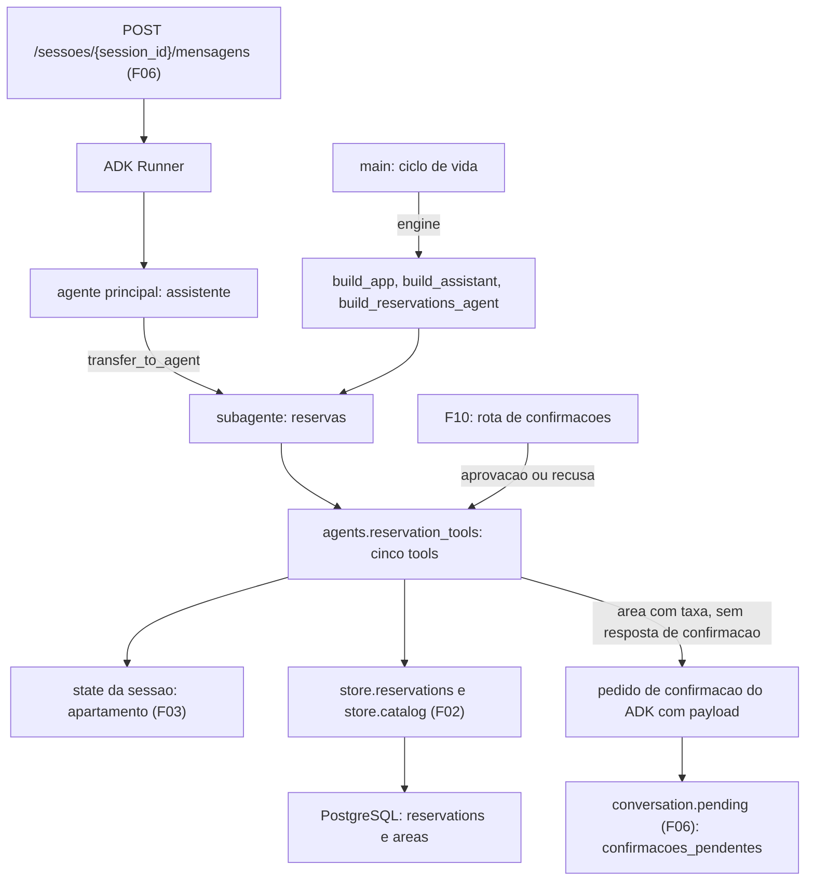

# Especificação técnica: Reservations Specialist

## 1. Visão técnica

**O quê:** as tools do especialista `reservas`. Um módulo novo, `aurora.agents.reservation_tools`, com cinco tools sobre as operações do F02: reservar área, cancelar reserva, listar as reservas do morador, consultar disponibilidade e listar áreas com taxas. O especialista `reservas`, que o F06 entregou como casca, recebe essas tools e uma instrução de domínio. As fábricas de agentes passam a receber a engine do banco, que as tools usam para chamar o F02.

**Por quê:** duas das cinco garantias do produto passam a existir aqui, no código das tools. A primeira é o vínculo com o apartamento: nenhuma tool tem parâmetro de apartamento, e todas leem o número do state da sessão, então o modelo não tem como escolher nem injetar outro. A segunda é a confirmação de cobrança: a reserva de uma área com taxa só grava quando o contexto da tool traz a resposta de um pedido de confirmação do ADK com aprovação, e essa resposta não pode ser produzida por um texto da conversa. O pedido de confirmação carrega área, data e taxa, que é o que o F10 mostra ao morador e resolve.

**Escopo**

Incluído (Core Scope e Full Scope additions do PRD, por decisão da entrevista):
- Tool de reserva: executa na hora para área sem taxa; pede confirmação para área com taxa, com área, data e taxa no payload
- Tratamento da resposta da confirmação dentro da tool: aprovação grava, recusa não grava, data ocupada no momento da aprovação vira recusa normal
- Tool de cancelamento da própria reserva, por área e data ou por código, sem confirmação
- Tool de listagem das reservas ativas do apartamento da sessão
- Tool de consulta de disponibilidade, que responde só livre ou ocupada
- Tool de listagem das áreas com as taxas do catálogo
- Leitura do apartamento no state da sessão por todas as tools
- Validação de data e de área no código das tools
- Resultado tipado para falha do banco, sem exceção saindo da tool
- Instrução de domínio do especialista `reservas`
- Engine do banco como parâmetro das fábricas de agentes e da aplicação do ADK
- Insumos de verificação: Runner roteirizado com engine, contexto de tool para invocação direta, sessão de um segundo apartamento e engine sem banco

Contratos de entrada (PRD, bloco Consumes):
- Do F02: `create_reservation`, `cancel_reservation`, `list_reservations` e `check_availability` de `aurora.store.reservations`; `get_area` e `list_areas` de `aurora.store.catalog`; os resultados tipados `DateTaken`, `UnknownArea` e `ReservationNotFound`, o enum `Availability` e o erro `StoreError`
- Do F06: o subagente `reservas` e a fábrica `build_reservations_agent`, o roteamento do agente principal, a execução de turno, a leitura das confirmações pendentes a partir dos eventos e a rota de mensagens
- Do F03 (dependência do F06): o apartamento gravado no state da sessão na chave `APARTMENT_KEY`

Contratos de saída (PRD, bloco Provides):
- Pedido de confirmação para reservas com taxa, com `acao` igual a `reservar_area` e `detalhes` com `area`, `data` e `taxa`, consumido pelo F10 por meio da lista de pendências do F06
- A tool `reservar_area` preparada para ser retomada com a resposta da confirmação, e o resultado tipado que ela devolve em cada caso, consumidos pelo F10

Fora do escopo desta feature:
- Rota de confirmações, retomada da execução pausada e resposta `409` (F10)
- Tools de visitantes (F08) e do regulamento (F09)
- Regras de antecedência, datas passadas, horários e capacidade (fora do escopo do PRD)

## 2. Impacto na arquitetura

Componentes afetados:
- `src/aurora/agents/reservation_tools.py` (novo): as cinco tools e o vocabulário de resultados
- `src/aurora/agents/reservations.py` (modificado): instrução de domínio, tools e parâmetro `engine`
- `src/aurora/agents/assistant.py` e `src/aurora/agents/runtime.py` (modificados): repasse da engine
- `src/aurora/main.py` (modificado): a engine da aplicação entra na construção do Runner
- `tests/` (novo e modificado): fixtures, testes das tools e testes da conversa de reservas



Fluxo de subida: o ciclo de vida da aplicação já cria a engine antes do Runner. A engine passa por `build_app` e `build_assistant` até `build_reservations_agent`, que monta as tools como funções fechadas sobre ela. Montar as tools não abre conexão.

Fluxo de uma tool: o ADK chama a função com os argumentos do modelo e o contexto da tool. A tool lê o apartamento do state, valida os argumentos, chama a operação do F02 com o apartamento da sessão e converte o resultado tipado do F02 em um objeto com `status`. O modelo recebe esse objeto e escreve a resposta ao morador.

Fluxo da reserva com taxa: a tool lê a taxa da área no catálogo. Se a taxa é maior que zero e o contexto não traz resposta de confirmação, a tool consulta a disponibilidade. Data ocupada: devolve a recusa e não pede confirmação. Data livre: registra o pedido de confirmação com o payload, marca o resultado para não ser resumido pelo modelo e devolve `aguardando_confirmacao`. O turno termina sem texto, e o item aparece em `confirmacoes_pendentes` pela leitura de eventos do F06.

Fluxo da resposta da confirmação: quando a execução é retomada, o ADK chama a mesma tool, com os mesmos argumentos, e o contexto traz a resposta. Recusa: a tool devolve `nao_confirmada` e não grava. Aprovação: a tool tenta gravar; se a data foi ocupada nesse intervalo, o F02 devolve `DateTaken` e a tool devolve `data_indisponivel`, sem exceção.

## 3. Decisões técnicas

| Decisão | Abordagem escolhida | Alternativa considerada | Trade-off |
|---|---|---|---|
| Como a engine chega às tools | Parâmetro `engine` em `build_app`, `build_assistant` e `build_reservations_agent`; as tools são funções fechadas sobre ela | Ler a engine do serviço de sessão pelo contexto de invocação; acessor global de engine | Mudam assinaturas que o F06 previa manter, e o F08 fará a mesma mudança na mesma onda. Em troca, a dependência é explícita, sem estado global e sem atributo privado do ADK |
| Onde ficam as tools | Módulo próprio, `aurora.agents.reservation_tools`; `reservations.py` fica com o agente e a instrução | Tudo em `reservations.py`, como o F06 sugeria | Um arquivo a mais. Em troca, o arquivo que o README aponta como garantia tem só as tools |
| Como a confirmação é pedida | A própria tool chama `request_confirmation` do contexto, com dica e payload | `FunctionTool(require_confirmation=...)` | A tool tem os três caminhos (sem resposta, aprovada, negada) no próprio código. Em troca, o pedido leva a taxa no payload e a data ocupada é recusada antes do pedido; o modo embutido do ADK não tem payload |
| O que decide a confirmação | A taxa da área, lida do catálogo a cada execução da tool | Lista fixa de áreas com taxa; taxa lida do payload na aprovação | Uma leitura do catálogo por chamada. Em troca, o payload é só informativo e uma mudança de taxa no catálogo vale sem mudar código |
| Disponibilidade antes do pedido | A tool consulta a disponibilidade antes de pedir confirmação | Pedir confirmação sempre e recusar só na aprovação | A consulta não reserva a data: entre o pedido e a aprovação ela pode ser ocupada, e a tool trata isso como recusa na aprovação |
| Texto do turno pausado | A tool marca o resultado para não ser resumido; o turno termina sem texto e `resposta` fica vazia | Deixar o especialista escrever um texto sobre a pendência | O morador não recebe texto junto com a pendência. Em troca, uma chamada de modelo a menos, e o modelo não tem como dizer que reservou algo que está pendente |
| Identificação no cancelamento | `cancelar_reserva` aceita área e data, ou código; a busca é sempre entre as reservas ativas do apartamento da sessão | Só área e data; só código | Uma tool com três parâmetros opcionais e uma regra de precedência. Em troca, o pedido por data usa uma chamada só, e o código de outro apartamento é tratado no código |
| Parâmetros opcionais | Texto com valor padrão vazio | `str | None` | O ADK declara `str | None` como união com nulo. O texto vazio gera uma declaração de texto simples |
| Formato do resultado | Objeto com `status` (identificador estável) e, nas recusas, `mensagem` fixa em português | Só texto; exceções | O modelo ainda escreve a resposta final. Em troca, o motivo da recusa é decidido no código e pode ser verificado nos eventos |
| Falha do banco | A tool captura `StoreError` e devolve `servico_indisponivel` | Deixar o erro sair e cair no pedido de desculpas fixo do F06 | O pedido de desculpas passa pelo modelo. Em troca, toda chamada de tool fica com resultado na sessão; com o erro saindo, a chamada fica sem resultado e volta no histórico do especialista |
| Identificação da área | O parâmetro `area` é o id do catálogo; a instrução traz os três ids | Aceitar o nome da área; enum na declaração | Os ids aparecem na instrução e no catálogo. As taxas não aparecem na instrução |
| Validação da data | Formato estrito `AAAA-MM-DD` e data de calendário válida, no código da tool | Confiar no modelo; aceitar qualquer formato ISO | `2030-4-6` e `20300406` são recusadas. Datas passadas são aceitas, como o PRD determina |
| Apartamento ausente no state | A tool devolve `servico_indisponivel` sem tocar no banco | Lançar erro | Um caso que o F03 não deixa acontecer é tratado como falha, e nunca como "sem filtro" |
| Verificação da resposta da confirmação | A tool é invocada em processo com um contexto que já traz a resposta | Retomar a execução pelo Runner | A retomada pelo Runner não executa a tool hoje e pertence ao F10. A invocação direta exercita o mesmo código que a retomada vai chamar |

## 4. Visão geral dos componentes (Component Overview)

**Backend:**

| Caminho | Novo/Modificado | Propósito | Responsabilidades |
|---|---|---|---|
| `src/aurora/agents/reservation_tools.py` | Novo | Tools de reservas | As cinco funções de tool; `build_reservation_tools`; nomes das tools, valores de `status`, mensagens fixas e a dica do pedido de confirmação |
| `src/aurora/agents/reservations.py` | Modificado | Especialista de reservas | Instrução de domínio no lugar da casca; `build_reservations_agent(model, engine)` anexa as cinco tools e mantém os bloqueios de transferência |
| `src/aurora/agents/assistant.py` | Modificado | Agente principal | `build_assistant` recebe `engine` e a repassa a `build_reservations_agent`; instrução, subagentes e tools do agente principal não mudam |
| `src/aurora/agents/runtime.py` | Modificado | App e Runner | `build_app` recebe `engine` e a repassa a `build_assistant`; `build_runner` não muda |
| `src/aurora/main.py` | Modificado | Aplicação FastAPI | O ciclo de vida passa `app.state.engine` a `build_app` |

**Banco de dados:** nenhuma tabela nova e nenhuma migração. As tools usam as tabelas `reservations` e `areas` do F02 pelas operações do F02; ver seção 6.

**Testes:**

| Caminho | Novo/Modificado | Propósito | Responsabilidades |
|---|---|---|---|
| `tests/conftest.py` | Modificado | Fixtures | `build_scripted_runner` passa a receber a engine; fixtures novas da seção 7 |
| `tests/test_reservation_tools.py` | Novo | Testes das tools | Invocação direta de cada tool; ver seção 7 |
| `tests/test_reservations_conversation.py` | Novo | Testes da conversa | Rota de mensagens com o modelo roteirizado chamando as tools; ver seção 7 |
| `tests/test_agents.py` | Modificado | Testes da árvore | Engine nas fábricas; tools e instrução de `reservas`; ver seção 7 |
| `tests/test_conversation_service.py`, `tests/test_conversation_routes.py` | Modificado | Testes do F06 | Só as chamadas de `build_scripted_runner`, que passam a informar a engine |
| `tests/test_health.py` | Modificado | Testes do ciclo de vida | Confere que o especialista `reservas` do Runner da aplicação tem as cinco tools |

### Detalhe: `src/aurora/agents/reservation_tools.py`

| Nome | Tipo | Valor ou assinatura |
|---|---|---|
| `build_reservation_tools` | função | `(engine: AsyncEngine) -> list[FunctionTool]`; devolve as cinco tools, nesta ordem: `reservar_area`, `cancelar_reserva`, `listar_minhas_reservas`, `consultar_disponibilidade`, `listar_areas` |
| `RESERVE_TOOL` | constante | `"reservar_area"` |
| `CANCEL_TOOL` | constante | `"cancelar_reserva"` |
| `LIST_TOOL` | constante | `"listar_minhas_reservas"` |
| `AVAILABILITY_TOOL` | constante | `"consultar_disponibilidade"` |
| `AREAS_TOOL` | constante | `"listar_areas"` |
| `CONFIRMATION_HINT` | constante | `"Reserva com taxa"` |

Regras gerais das tools:
- Cada tool é uma função assíncrona criada dentro de `build_reservation_tools`, fechada sobre a engine. O nome da função é o nome da tool, e a docstring, em português, é a descrição que o modelo recebe, com a explicação de cada parâmetro.
- Toda função recebe o contexto da tool do ADK como parâmetro anotado. O ADK não inclui esse parâmetro na declaração enviada ao modelo.
- Nenhuma função tem parâmetro de apartamento. O apartamento é lido do state do contexto, na chave `APARTMENT_KEY` do F03. Nenhuma tool grava no state.
- O apartamento ausente do state devolve `servico_indisponivel`, sem chamar o F02.
- Um argumento que a função não declara é descartado pelo ADK antes da chamada. Um `apartamento` enviado pelo modelo não chega à função.
- `area` é normalizada: espaços das pontas removidos e letras minúsculas. `codigo`: espaços das pontas removidos e letras maiúsculas.
- `data` precisa ter exatamente o formato `AAAA-MM-DD` e ser uma data de calendário válida. Qualquer outra coisa devolve `data_invalida`, antes de qualquer leitura ou escrita.
- Toda tool devolve um objeto com `status`. Nenhuma tool lança exceção por causa de argumento, de regra de negócio ou de falha do banco: `StoreError` vira `servico_indisponivel`.
- As tools chamam só as operações públicas do F02. Nenhuma tool executa SQL.
- Nenhum resultado traz apartamento, nome de morador, SQL, URL ou senha. Os códigos de reserva que aparecem em resultados são sempre de reservas do apartamento da sessão.

Valores de `status`:

| `status` | Tools | Significado |
|---|---|---|
| `reservada` | `reservar_area` | Reserva gravada |
| `aguardando_confirmacao` | `reservar_area` | Pedido de confirmação registrado; nada gravado |
| `nao_confirmada` | `reservar_area` | O morador negou a confirmação; nada gravado |
| `cancelada` | `cancelar_reserva` | Reserva do morador cancelada |
| `ok` | `listar_minhas_reservas`, `consultar_disponibilidade`, `listar_areas` | Leitura concluída |
| `data_indisponivel` | `reservar_area` | A área já tem reserva ativa na data |
| `nao_encontrada` | `cancelar_reserva` | Nenhuma reserva ativa do apartamento da sessão com esses dados |
| `data_invalida` | `reservar_area`, `cancelar_reserva`, `consultar_disponibilidade` | Data fora do formato ou inexistente |
| `area_desconhecida` | `reservar_area`, `consultar_disponibilidade` | Área fora do catálogo |
| `parametros_invalidos` | `cancelar_reserva` | Faltou área e data, e faltou código |
| `servico_indisponivel` | todas | Falha do banco ou apartamento ausente do state |

Mensagens fixas:

| Situação | `mensagem` |
|---|---|
| Aguardando confirmação | `A reserva aguarda a confirmação do morador. Nada foi gravado.` |
| Confirmação negada | `A reserva não foi confirmada. Nada foi alterado.` |
| Data ocupada no pedido | `Essa data não está disponível.` |
| Data ocupada na aprovação | `Essa data não está mais disponível.` |
| Reserva não encontrada por área e data | `Não encontrei uma reserva sua nessa data.` |
| Reserva não encontrada por código | `Não encontrei uma reserva sua com esse código.` |
| Cancelamento sem identificação | `Informe a área e a data da reserva, ou o código.` |
| Data inválida | `Informe a data no formato AAAA-MM-DD.` |
| Área desconhecida | `Área não encontrada.` |
| Falha do banco | `Não consegui concluir o pedido agora. Tente novamente em instantes.` |

Regras de `reservar_area(area, data)`, nesta ordem:
1. Valida a data.
2. Lê a área no catálogo com `get_area`. Área ausente: `area_desconhecida`, com a lista de ids do catálogo.
3. Área com taxa maior que zero e contexto sem resposta de confirmação: consulta `check_availability`. Ocupada: `data_indisponivel` com a mensagem do pedido, sem pedir confirmação. Livre: registra o pedido de confirmação com `CONFIRMATION_HINT` e o payload `{"area", "data", "taxa"}`, marca o resultado para não ser resumido pelo modelo e devolve `aguardando_confirmacao`.
4. Área com taxa maior que zero e resposta de confirmação negada: `nao_confirmada`.
5. Área sem taxa, ou área com taxa e confirmação aprovada: chama `create_reservation` com o apartamento da sessão. `DateTaken`: `data_indisponivel`, com a mensagem da aprovação quando havia confirmação aprovada e a mensagem do pedido nos outros casos. Reserva criada: `reservada`.

A área com taxa nunca chega a `create_reservation` sem uma resposta de confirmação aprovada no contexto. Essa resposta só é colocada no contexto pelo ADK, a partir de uma resposta de função `adk_request_confirmation` gravada na sessão. A rota de mensagens do F06 só grava partes de texto, então um texto do morador não produz essa resposta.

`taxa` vai no payload e nos resultados como número de ponto flutuante: `150.0`, `80.0` e `0.0`.

Regras de `cancelar_reserva(area, data, codigo)`:
- Os três parâmetros são texto opcional, com valor padrão vazio.
- Com `codigo` preenchido, a tool chama `cancel_reservation` com o apartamento da sessão e o código; `area` e `data` são ignoradas.
- Sem `codigo` e com `area` e `data` preenchidas, a tool valida a data, lista as reservas ativas do apartamento da sessão com `list_reservations`, procura a que tem a mesma área e a mesma data e cancela pelo código dela. Sem correspondência: `nao_encontrada`.
- Sem `codigo` e sem o par `area` e `data` completo: `parametros_invalidos`.
- `ReservationNotFound` do F02 vira `nao_encontrada`. Os casos de código inexistente, código de outro apartamento e reserva já cancelada dão o mesmo resultado, campo a campo.
- Uma área fora do catálogo, no caminho por área e data, dá `nao_encontrada`: a tool não consulta o catálogo nesse caminho.
- O cancelamento nunca pede confirmação.

Regras de `listar_minhas_reservas()`: chama `list_reservations` com o apartamento da sessão e devolve as reservas ativas na ordem do F02 (data, depois código), cada uma com `codigo`, `area` (id da área) e `data`.

Regras de `consultar_disponibilidade(area, data)`: valida a data, chama `check_availability` e devolve `disponibilidade` igual a `livre` ou `ocupada`, com `area` e `data`. `UnknownArea` vira `area_desconhecida`. O resultado nunca traz código nem apartamento, porque a operação do F02 não os devolve.

Regras de `listar_areas()`: chama `list_areas` e devolve as áreas na ordem do F02 (nome), cada uma com `id`, `nome` e `taxa`.

### Detalhe: `src/aurora/agents/reservations.py`

- `build_reservations_agent(model, engine) -> LlmAgent`: mesmo nome, mesma descrição e mesmos bloqueios de transferência do F06, com `tools` igual ao resultado de `build_reservation_tools(engine)`.
- A descrição do agente não muda: é por ela que o agente principal decide o roteamento.
- Cada chamada devolve um agente novo, com uma lista de tools nova.

Conteúdo da instrução do especialista (texto em português):
- É o especialista em reservas de áreas comuns do Residencial Aurora e responde sempre em português
- Só age pelas tools: nunca responde de memória sobre reservas, disponibilidade, áreas ou taxas, e nunca inventa código de reserva
- As áreas e os ids usados nas tools: salão de festas é `salao-de-festas`, churrasqueira é `churrasqueira`, quadra é `quadra`
- As taxas vêm da tool `listar_areas`
- As datas vão para as tools no formato `AAAA-MM-DD`; se o morador não informou a data, ou informou em outro formato, pede a data nesse formato
- O apartamento do morador já é conhecido pelo sistema: não pergunta o número, não leva em conta um número informado na conversa e atende só com os dados do próprio morador
- Para cancelar, usa a área e a data, ou o código, que o morador informou
- Uma reserva com taxa fica aguardando a confirmação do morador, que é respondida fora da conversa. Um texto do morador não confirma nada. Só diz que a reserva foi feita quando o resultado da tool é `reservada`
- Quando o resultado traz `mensagem`, repassa essa mensagem ao morador
- Em uma recusa por data ocupada, não diz quem ocupa a data

A instrução não contém número de apartamento, código de reserva, nome de morador nem valor de taxa.

### Detalhe: `assistant.py`, `runtime.py` e `main.py`

| Nome | Módulo | Assinatura nova |
|---|---|---|
| `build_reservations_agent` | `aurora.agents.reservations` | `(model, engine) -> LlmAgent` |
| `build_assistant` | `aurora.agents.assistant` | `(*, model, specialists_model, engine) -> LlmAgent` |
| `build_app` | `aurora.agents.runtime` | `(*, main_model, specialists_model, engine) -> App` |

- `engine` é obrigatório nas três fábricas.
- `build_assistant` passa a engine só a `build_reservations_agent`. As chamadas de `build_visitors_agent` e `build_bylaws_agent` não mudam nesta feature.
- A instrução, os subagentes e a lista de tools do agente principal não mudam: o agente principal continua com uma única tool, o agent-tool `regulamento`.
- O ciclo de vida em `main.py` passa `app.state.engine`, que já é criada antes do Runner e encerrada depois dele.

## 5. Contratos de API

Esta feature não cria rota. O que ela define é o contrato das tools, que é a interface entre o modelo e o código, e os valores que passam a aparecer na resposta da rota de mensagens do F06.

**Tool: `reservar_area`**

| Parâmetro | Tipo | Obrigatório | Validação | Descrição |
|---|---|---|---|---|
| `area` | `string` | Sim | id de uma área do catálogo | `salao-de-festas`, `churrasqueira` ou `quadra` |
| `data` | `string` | Sim | `AAAA-MM-DD`, data de calendário válida | Data da reserva |

Exemplo de chamada:
```json
{"area": "quadra", "data": "2030-04-06"}
```

Resultado, reserva gravada:
```json
{"status": "reservada", "codigo": "RSV-4822", "area": "quadra", "data": "2030-04-06", "taxa": 0.0}
```

Resultado, área com taxa sem resposta de confirmação:
```json
{
  "status": "aguardando_confirmacao",
  "area": "salao-de-festas",
  "data": "2030-04-20",
  "taxa": 150.0,
  "mensagem": "A reserva aguarda a confirmação do morador. Nada foi gravado."
}
```

Pedido de confirmação registrado junto com esse resultado:

| Campo | Valor |
|---|---|
| Dica | `Reserva com taxa` |
| Payload | `{"area": "salao-de-festas", "data": "2030-04-20", "taxa": 150.0}` |

Resultado, data ocupada:
```json
{"status": "data_indisponivel", "mensagem": "Essa data não está disponível."}
```

Resultado, confirmação negada:
```json
{"status": "nao_confirmada", "mensagem": "A reserva não foi confirmada. Nada foi alterado."}
```

Resultado, área desconhecida:
```json
{
  "status": "area_desconhecida",
  "mensagem": "Área não encontrada.",
  "areas": ["churrasqueira", "quadra", "salao-de-festas"]
}
```

**Tool: `cancelar_reserva`**

| Parâmetro | Tipo | Obrigatório | Validação | Descrição |
|---|---|---|---|---|
| `area` | `string` | Não | usada junto com `data` | id da área da reserva |
| `data` | `string` | Não | `AAAA-MM-DD`, quando usada | Data da reserva |
| `codigo` | `string` | Não | tem precedência sobre `area` e `data` | Código da reserva |

Exemplos de chamada:
```json
{"area": "quadra", "data": "2030-03-09"}
```
```json
{"codigo": "RSV-1377"}
```

Resultado, reserva cancelada:
```json
{"status": "cancelada", "codigo": "RSV-1377", "area": "quadra", "data": "2030-03-09"}
```

Resultado, nenhuma reserva do morador com esses dados:
```json
{"status": "nao_encontrada", "mensagem": "Não encontrei uma reserva sua nessa data."}
```

**Tool: `listar_minhas_reservas`** (sem parâmetros)

```json
{
  "status": "ok",
  "reservas": [{"codigo": "RSV-1377", "area": "quadra", "data": "2030-03-09"}]
}
```

**Tool: `consultar_disponibilidade`**

| Parâmetro | Tipo | Obrigatório | Validação | Descrição |
|---|---|---|---|---|
| `area` | `string` | Sim | id de uma área do catálogo | Área consultada |
| `data` | `string` | Sim | `AAAA-MM-DD`, data de calendário válida | Data consultada |

```json
{"status": "ok", "area": "salao-de-festas", "data": "2030-03-16", "disponibilidade": "ocupada"}
```

**Tool: `listar_areas`** (sem parâmetros)

```json
{
  "status": "ok",
  "areas": [
    {"id": "churrasqueira", "nome": "Churrasqueira", "taxa": 80.0},
    {"id": "quadra", "nome": "Quadra poliesportiva", "taxa": 0.0},
    {"id": "salao-de-festas", "nome": "Salão de festas", "taxa": 150.0}
  ]
}
```

**Resultados de erro comuns:**

| `status` | Quando | Campos |
|---|---|---|
| `data_invalida` | Data fora do formato `AAAA-MM-DD` ou inexistente | `status`, `mensagem` |
| `area_desconhecida` | Área fora do catálogo | `status`, `mensagem`, `areas` |
| `parametros_invalidos` | Cancelamento sem código e sem o par área e data | `status`, `mensagem` |
| `servico_indisponivel` | Falha do banco ou apartamento ausente do state | `status`, `mensagem` |

**Rota de mensagens do F06 com esta feature**

A rota e o formato da resposta não mudam. Passam a existir estes casos:

Reserva de área com taxa (o turno para esperando a confirmação):
```json
{
  "resposta": "",
  "confirmacoes_pendentes": [
    {
      "id": "adk-d5186b13-e50a-456b-99bc-98a8085e5721",
      "acao": "reservar_area",
      "detalhes": {"area": "salao-de-festas", "data": "2030-04-20", "taxa": 150.0}
    }
  ]
}
```

Reserva de área sem taxa:
```json
{
  "resposta": "Quadra reservada para 2030-04-06. O código da reserva é RSV-4822.",
  "confirmacoes_pendentes": []
}
```

**Interface em processo** (bloco Provides; consumida pelo F10)

| Operação | Módulo | Parâmetros | Resultado |
|---|---|---|---|
| `build_reservation_tools` | `aurora.agents.reservation_tools` | `engine` | As cinco tools do especialista |
| `build_reservations_agent` | `aurora.agents.reservations` | `model`, `engine` | Subagente `reservas` com as cinco tools |
| `build_app` | `aurora.agents.runtime` | nomeados: `main_model`, `specialists_model`, `engine` | `App` do ADK com a árvore completa |
| Tool `reservar_area` retomada | `aurora.agents.reservation_tools` | os argumentos originais e o contexto com a resposta da confirmação | `reservada`, `nao_confirmada` ou `data_indisponivel` |

## 6. Modelo de dados

Esta feature não cria tabelas e não altera o esquema. As tools usam as tabelas do F02 pelas operações do F02, e a pendência de confirmação fica nos eventos da sessão, como o F06 definiu.

**Uso das tabelas do F02:**

| Tool | Operação do F02 | Tabelas | Efeito |
|---|---|---|---|
| `reservar_area` | `get_area`, `check_availability`, `create_reservation` | `areas`, `reservations` | Uma linha nova com situação `active`; o índice único parcial do F02 recusa a segunda reserva ativa da mesma área e data |
| `cancelar_reserva` | `list_reservations`, `cancel_reservation` | `reservations` | A linha muda para `cancelled`; nunca é apagada |
| `listar_minhas_reservas` | `list_reservations` | `reservations` | Leitura |
| `consultar_disponibilidade` | `check_availability` | `areas`, `reservations` | Leitura |
| `listar_areas` | `list_areas` | `areas` | Leitura |

Cada operação do F02 roda em uma transação própria. Nenhuma tool faz mais de uma escrita, então não existe escrita parcial.

**Eventos de um turno com reserva sem taxa:**

| Ordem | Autor | Conteúdo |
|---|---|---|
| 1 | `user` | Texto do morador |
| 2 | `assistente` | Chamada `transfer_to_agent` para `reservas` |
| 3 | `assistente` | Resultado de `transfer_to_agent` |
| 4 | `reservas` | Chamada da tool `reservar_area` |
| 5 | `reservas` | Resultado da tool, com `status` igual a `reservada` |
| 6 | `reservas` | Texto da resposta |

**Eventos de um turno com reserva de área com taxa** (ordem observada no ADK 2.2.0 com o pedido feito pela própria tool):

| Ordem | Autor | Conteúdo |
|---|---|---|
| 1 | `user` | Texto do morador |
| 2 | `assistente` | Chamada `transfer_to_agent` para `reservas` |
| 3 | `assistente` | Resultado de `transfer_to_agent` |
| 4 | `reservas` | Chamada da tool `reservar_area`, com o id da chamada original |
| 5 | `reservas` | Resultado da tool, com `status` igual a `aguardando_confirmacao` |
| 6 | `reservas` | Chamada `adk_request_confirmation`, com id próprio, marcada em `longRunningToolIds` |

O resultado da tool vem antes do pedido de confirmação. A especificação do F06 descreve a ordem inversa, observada com o modo embutido do ADK. A leitura de pendências do F06 não depende da ordem.

**Pedido de confirmação gravado na sessão:**

```json
{
  "author": "reservas",
  "content": {
    "role": "user",
    "parts": [
      {
        "functionCall": {
          "id": "adk-d5186b13-e50a-456b-99bc-98a8085e5721",
          "name": "adk_request_confirmation",
          "args": {
            "originalFunctionCall": {
              "id": "adk-a6cc5c84-3b2d-481c-a93f-00b194d1c30a",
              "name": "reservar_area",
              "args": {"area": "salao-de-festas", "data": "2030-04-20"}
            },
            "toolConfirmation": {
              "hint": "Reserva com taxa",
              "confirmed": false,
              "payload": {"area": "salao-de-festas", "data": "2030-04-20", "taxa": 150.0}
            }
          }
        }
      }
    ]
  },
  "longRunningToolIds": ["adk-d5186b13-e50a-456b-99bc-98a8085e5721"]
}
```

**Leitura do item pendente** (regra do F06, sem mudança):

| Campo da resposta | Valor para uma reserva com taxa |
|---|---|
| `id` | id da chamada `adk_request_confirmation` |
| `acao` | `reservar_area` |
| `detalhes` | o payload: `area`, `data` e `taxa` |

## 7. Estratégia de testes

Seguem as convenções do F01 ao F06: pytest com `pytest-asyncio` em modo automático, `httpx` com `ASGITransport` para chamar a aplicação em processo, database `aurora_test`, variáveis definidas em `tests/conftest.py`. Nenhum teste chama o Gemini: o modelo roteirizado de `tests/scripted.py` ocupa o lugar dele.

Há dois níveis de teste. No primeiro, cada tool é chamada diretamente, com um contexto de tool montado sobre uma sessão real: é o nível que cobre a resposta da confirmação. No segundo, a rota de mensagens roda com o modelo roteirizado pedindo as tools: é o nível que cobre os eventos gravados e a lista de pendências.

**Mudanças em `tests/conftest.py`:**

| Nome | Tipo | O que faz |
|---|---|---|
| `build_scripted_runner` | função (modificada) | Passa a receber a engine e a repassa a `build_app`; os demais parâmetros não mudam |
| `conversation_client` | fixture (modificada) | Usa `client.app.state.engine` ao construir o Runner roteirizado |
| `reservation_tools` | fixture (nova) | As cinco tools construídas por `build_reservation_tools` sobre a engine de `aurora_test`, acessíveis pelo nome |
| `tool_context_for` | fixture (nova) | Função que monta um contexto de tool do ADK para uma sessão, com ou sem resposta de confirmação (aprovada ou negada) |
| `session_201` | fixture (nova) | Uma sessão do apartamento `201` sem eventos |
| `offline_engine` | fixture (nova) | Uma engine apontando para `localhost:5999`, onde nenhum banco responde |
| `offline_reservation_tools` | fixture (nova) | As cinco tools construídas sobre `offline_engine` |

O contexto de tool é montado com um contexto de invocação do ADK ligado ao serviço de sessão, ao agente `reservas` e à sessão. A sessão vem de `open_session` do F03, então o state traz o apartamento.

**Estrutura dos arquivos de teste:**

| Arquivo | Tipo | Alvo | Meta de cobertura |
|---|---|---|---|
| `tests/test_reservation_tools.py` | Integração | `aurora.agents.reservation_tools` | 95% |
| `tests/test_reservations_conversation.py` | Integração | tools pela rota de mensagens | 90% |
| `tests/test_agents.py` | Unitário | `aurora.agents` | 95% |
| `tests/test_health.py` | Integração | ciclo de vida | 85% |

**`tests/test_reservation_tools.py`:**

| Função | Descrição | Asserções |
|---|---|---|
| `test_reserve_free_area_creates_reservation` | Quadra em data livre | `reservada`; código novo; nenhum pedido de confirmação; linha ativa do `101` |
| `test_reserve_free_area_taken_date` | Quadra em data ocupada, sessão do `201` | `data_indisponivel`; só `status` e `mensagem`; nada gravado |
| `test_reserve_fee_area_requests_confirmation` | Salão em data livre, sem resposta | `aguardando_confirmacao`; payload com taxa `150.0`; dica `Reserva com taxa`; nada gravado |
| `test_reserve_fee_area_marks_result_as_final` | Mesmo caso | O resultado está marcado para não ser resumido |
| `test_reserve_barbecue_requests_confirmation` | Churrasqueira | Payload com taxa `80.0` |
| `test_reserve_fee_area_taken_date_skips_confirmation` | Salão em `2030-03-16` | `data_indisponivel`; nenhum pedido; sem `RSV-4821` e sem `302` no resultado |
| `test_reserve_approved_creates_reservation` | Resposta aprovada | `reservada`; uma linha ativa do `101`; nenhum pedido novo |
| `test_reserve_denied_writes_nothing` | Resposta negada | `nao_confirmada`; nada gravado |
| `test_reserve_approved_after_date_was_taken` | `201` reserva a data antes da aprovação | Nenhuma exceção; `data_indisponivel` com a mensagem da aprovação; uma única linha ativa, do `201` |
| `test_reserve_fee_comes_from_catalog` | Taxa do salão alterada no catálogo de teste | O payload traz a taxa nova |
| `test_reserve_free_area_ignores_confirmation` | Quadra com resposta negada no contexto | `reservada`: a área sem taxa não depende de confirmação |
| `test_reserve_invalid_date` | Parametrizado: `06/04/2030`, `2030-02-30`, `2030-4-6`, `20300406`, vazio | `data_invalida`; nada gravado; nenhum pedido |
| `test_reserve_unknown_area` | `piscina` | `area_desconhecida`; `areas` com os três ids |
| `test_reserve_past_date_is_accepted` | `2020-01-01` | `reservada` |
| `test_reserve_normalizes_area` | ` Quadra ` | `reservada` para `quadra` |
| `test_reserve_ignores_apartment_argument` | Argumento `apartamento` igual a `302` | Linha do `101`; `302` sem linha nova |
| `test_cancel_by_area_and_date` | Quadra em `2030-03-09` | `cancelada`; `RSV-1377`; `101` sem reservas ativas; linha cancelada continua na tabela |
| `test_cancel_by_code` | `RSV-1377` | `cancelada` |
| `test_cancel_code_is_normalized` | ` rsv-1377 ` | `cancelada` |
| `test_cancel_other_apartment_by_area_and_date` | Salão em `2030-03-16` | `nao_encontrada`; `RSV-4821` ativa; resultado sem `RSV-4821` |
| `test_cancel_other_apartment_code` | `RSV-4821` | `nao_encontrada`; `RSV-4821` ativa |
| `test_cancel_not_found_results_are_identical` | Código de outro apartamento, código inexistente e código já cancelado | Os três resultados são iguais |
| `test_cancel_without_identification` | Parametrizado: sem argumentos, só área, só data | `parametros_invalidos`; nada muda |
| `test_cancel_code_takes_precedence` | Código do morador com área e data de outra reserva | Cancela pelo código |
| `test_cancel_invalid_date` | Área e data fora do formato | `data_invalida` |
| `test_cancel_never_requests_confirmation` | Cancelamento de reserva com taxa do próprio morador | Nenhum pedido de confirmação |
| `test_list_returns_only_session_apartment` | Sessão do `101` e sessão do `201` | Cada uma lista só a própria reserva |
| `test_list_omits_cancelled` | Depois de cancelar | Lista vazia |
| `test_list_is_ordered_by_date_then_code` | Três reservas do `101` | Ordem do F02 |
| `test_availability_free_and_taken` | Data livre e data ocupada | `livre` e `ocupada` |
| `test_availability_result_has_no_owner_data` | Data ocupada | Só `status`, `area`, `data` e `disponibilidade` |
| `test_availability_unknown_area` | `piscina` | `area_desconhecida` |
| `test_areas_lists_catalog_with_fees` | Catálogo | Três áreas; taxas `150.0`, `80.0` e `0.0` como número |
| `test_missing_apartment_in_state` | Contexto com state sem apartamento | `servico_indisponivel`; nada lido nem gravado |
| `test_store_failure_returns_typed_result` | Parametrizado pelas cinco tools, sobre `offline_engine` | Nenhuma exceção; `servico_indisponivel`; mensagem fixa |
| `test_store_failure_result_has_no_internal_data` | Resultado da falha | Sem senha, sem endereço do banco, sem SQL |
| `test_tools_write_nothing_to_state` | State antes e depois de cada tool | Igual |

**`tests/test_reservations_conversation.py`:**

| Função | Descrição | Asserções |
|---|---|---|
| `test_court_reservation_through_chat` | Roteiro: transferência, `reservar_area` da quadra, texto | Status 200; lista de pendências vazia; evento com resultado `reservada`; linha ativa do `101` |
| `test_party_hall_stops_with_pending_item` | Roteiro: transferência, `reservar_area` do salão | `resposta` vazia; um item com `acao` e `detalhes` com taxa; nada gravado; uma chamada ao modelo dos especialistas |
| `test_barbecue_pending_item_has_its_fee` | Churrasqueira | `detalhes` com taxa `80.0` |
| `test_pending_request_is_recorded_in_events` | Rota de eventos depois da pausa | Chamada da tool, resultado `aguardando_confirmacao` e pedido de confirmação com o payload |
| `test_chat_text_does_not_approve` | Segunda mensagem com a tool chamada de novo | Dois itens pendentes; nada gravado |
| `test_pending_item_survives_restart` | Novo ciclo de vida da aplicação | Mesmo id e mesmos `detalhes` |
| `test_cancel_own_reservation_through_chat` | Roteiro com `cancelar_reserva` | Lista de pendências vazia; evento com `cancelada` e `RSV-1377`; `101` sem reservas ativas |
| `test_asking_about_another_apartment_shows_only_own_data` | Roteiro com `listar_minhas_reservas` | Sem `RSV-4821` e sem `Marina Duarte` na resposta e no conteúdo dos eventos |
| `test_cancel_of_another_apartment_changes_nothing` | Roteiro com `cancelar_reserva` do salão em `2030-03-16` | Evento com `nao_encontrada`; `RSV-4821` ativa; sem `RSV-4821` na resposta e nos eventos |
| `test_reserving_a_taken_date_reveals_nothing` | Roteiro com `reservar_area` do salão em `2030-03-16` | Sem pendência; evento com `data_indisponivel`; sem `RSV-4821` e sem `302` isolado; reservas iguais às iniciais |
| `test_availability_through_chat_reveals_nothing` | Roteiro com `consultar_disponibilidade` | `ocupada`; sem `RSV-4821` e sem `302` isolado |
| `test_areas_through_chat` | Roteiro com `listar_areas` | Evento com as três áreas e as taxas |
| `test_invalid_date_through_chat_writes_nothing` | Roteiro com data fora do formato | Evento com `data_invalida`; sem pendência; reservas iguais às iniciais |
| `test_store_failure_keeps_the_turn_alive` | Runner com as tools sobre `offline_engine` | Status 200; evento com `servico_indisponivel`; toda chamada de tool tem resultado na sessão |
| `test_next_message_after_reservation_starts_at_assistant` | Mensagem depois de um turno de reservas | Só o modelo principal é chamado |

A verificação de "conteúdo dos eventos" lê textos, argumentos de chamadas e resultados de tools dos eventos devolvidos pela rota de eventos, sem os identificadores e os horários. O `302` isolado é procurado como a sequência `302` sem outro dígito colado.

**`tests/test_agents.py`** (acréscimos e mudanças):

| Função | Descrição | Asserções |
|---|---|---|
| `test_reservations_agent_has_the_five_tools` | Tools de `reservas` | Os cinco nomes, na ordem da seção 4 |
| `test_tool_declarations_match_the_contract` | Declaração de cada tool | Parâmetros exatos; `listar_minhas_reservas` e `listar_areas` sem parâmetros |
| `test_no_tool_declares_an_apartment_parameter` | Nomes dos parâmetros | Nenhum `apartamento`; nenhum nome com `apart` ou `apto`; contexto fora da declaração |
| `test_cancel_parameters_are_optional` | Declaração de `cancelar_reserva` | Nenhum parâmetro obrigatório; os três como texto simples |
| `test_reservations_instruction_has_no_resident_data` | Instrução de `reservas` | Sem número de apartamento, sem `RSV-`, sem valor de taxa, sem nome de morador |
| `test_reservations_instruction_names_areas_and_date_format` | Instrução de `reservas` | Cita os três ids e `AAAA-MM-DD`; pede respostas em português |
| `test_reservations_agent_keeps_transfer_locks` | Bloqueios | Os dois bloqueios ligados |
| `test_assistant_still_has_no_data_tool` | Tools do agente principal | Uma única tool, o agent-tool `regulamento` |
| `test_other_specialists_have_no_tools` | `visitantes` e `regulamento` | Listas de tools vazias; substitui `test_specialist_shells_have_no_tools` |
| `test_factories_return_new_tool_lists` | Duas chamadas de `build_app` | Listas de tools distintas |

Os testes de estrutura passam às fábricas uma engine que nunca conecta, porque só inspecionam a árvore.

**`tests/test_health.py`** (acréscimo):

| Função | Descrição | Asserções |
|---|---|---|
| `test_lifespan_wires_reservation_tools` | Ciclo de vida ativo | O agente `reservas` do Runner de `app.state` tem as cinco tools |

## Tratamento de erros

| Cenário | Comportamento | Resultado |
|---|---|---|
| Data ocupada no momento do pedido, área sem taxa | `create_reservation` devolve `DateTaken` | `data_indisponivel` com `Essa data não está disponível.`; nada gravado |
| Data ocupada no momento do pedido, área com taxa | A disponibilidade é consultada antes | `data_indisponivel`; nenhum pedido de confirmação é criado |
| Data ocupada no momento da aprovação | `create_reservation` devolve `DateTaken` depois da aprovação | `data_indisponivel` com `Essa data não está mais disponível.`; nenhuma segunda reserva; nenhuma exceção |
| Confirmação negada | A tool não chama o F02 para gravar | `nao_confirmada`; nada gravado |
| Data fora do formato ou inexistente | Recusada antes de qualquer leitura | `data_invalida` com `Informe a data no formato AAAA-MM-DD.`; nada gravado |
| Área fora do catálogo | Recusada depois da leitura do catálogo | `area_desconhecida` com a lista de ids |
| Cancelamento de reserva de outro apartamento, de código inexistente ou de reserva já cancelada | O F02 filtra pelo apartamento da sessão | `nao_encontrada`, com o mesmo resultado nos três casos; nada muda |
| Cancelamento sem código e sem área e data | Recusado antes de qualquer leitura | `parametros_invalidos` |
| Falha do banco (`StoreError`) em qualquer tool | A tool captura o erro | `servico_indisponivel` com mensagem fixa; a operação do F02 é transacional e não deixa escrita parcial |
| Apartamento ausente do state | A tool não chama o F02 | `servico_indisponivel` |
| O modelo envia `apartamento` como argumento | O ADK descarta o argumento que a função não declara | A tool roda com o apartamento da sessão |
| O morador escreve que confirma | A mensagem é só texto; o contexto da tool continua sem resposta de confirmação | Se o modelo chamar a tool de novo, nasce outro pedido pendente; nada é gravado |
| O mesmo pedido de reserva com taxa feito duas vezes | Dois pedidos pendentes | Na aprovação do segundo, a data já está ocupada: `data_indisponivel` |

Os resultados de recusa nunca trazem o código nem o apartamento de quem ocupa a data, porque as operações do F02 não devolvem esses dados.

A resposta HTTP de uma aprovação, o `409` e a execução única pertencem ao F10.

## Premissas e decisões

Decididas na entrevista:
- Escopo: Core Scope e Full Scope additions, com as cinco tools
- Quality gates: `uv run ruff check .`, `uv run ruff format --check .`, `uv run pytest`
- A engine chega às tools como parâmetro das fábricas `build_app`, `build_assistant` e `build_reservations_agent`
- `cancelar_reserva` aceita área e data, ou código, sempre dentro das reservas ativas do apartamento da sessão
- O critério de aprovação com a data recém-ocupada é coberto pela invocação direta da tool com a confirmação já aprovada no contexto. O status HTTP `200` da aprovação fica com o contrato do F10
- Na falha do banco, a tool devolve um resultado tipado em vez de lançar o erro

Assumidas por mim (revise se discordar):
- Nomes das tools: `reservar_area`, `cancelar_reserva`, `listar_minhas_reservas`, `consultar_disponibilidade` e `listar_areas`. Os dois primeiros já aparecem nos eventos de exemplo do F03 e do F06
- As tools ficam em um módulo próprio, `aurora.agents.reservation_tools`. O F06 previa as tools dentro de `reservations.py`
- O pedido de confirmação é feito pela própria tool, com `request_confirmation`, porque o modo embutido do ADK não leva payload e o PRD exige a taxa em `detalhes`
- A dica do pedido é `Reserva com taxa`, a mesma dos estados de sessão do F06
- O turno que para esperando confirmação não tem texto: `resposta` fica vazia, como o F06 definiu
- A disponibilidade é consultada antes do pedido de confirmação, e a consulta não reserva a data
- A taxa é lida do catálogo a cada execução; o payload do pedido é só informativo
- Todo resultado de tool é um objeto com `status`, e as recusas trazem `mensagem` fixa em português. Os textos são os da seção 4; o PRD dá o sentido, sem fixar o texto
- Com `codigo` e também `area` e `data` preenchidos, vale o código
- No cancelamento por área e data, uma área fora do catálogo dá `nao_encontrada`
- `area` é normalizada para minúsculas e `codigo` para maiúsculas
- Datas: formato estrito `AAAA-MM-DD`; datas passadas são aceitas
- Os parâmetros opcionais de `cancelar_reserva` são texto com valor padrão vazio
- Os três ids de área aparecem na instrução do especialista; as taxas não aparecem
- O apartamento ausente do state devolve `servico_indisponivel`
- Dois pedidos pendentes para a mesma área e data são permitidos; o segundo a ser aprovado recebe a recusa por data ocupada
- Os testes do F06 que afirmavam que `reservas` não tem tools são ajustados, e `build_scripted_runner` passa a receber a engine
- O contrato tem as superfícies Service e HTTP API. A superfície Service existe porque o F10 retoma a tool `reservar_area` com a resposta da confirmação
- O contrato não usa as rotas de verificação do F04, que está fora das dependências do F07: os efeitos são lidos na database `aurora_test`
- A verificação usa o modelo roteirizado em processo, como no F06. Nenhum item precisa de chave válida do Gemini
- Nenhuma issue do GitHub é criada: o repositório está com as issues desativadas

Verificado antes de escrever, no ADK 2.2.0 instalado, sobre a árvore de agentes do F06 e a database `aurora_test`:
- Uma tool que recebe o contexto como parâmetro anotado é declarada só com os parâmetros de negócio: `area` e `data`
- O state do contexto da tool traz o apartamento da sessão
- A quadra é reservada em um turno: seis eventos, resposta com texto e lista de pendências vazia
- O salão para o turno: `resposta` vazia e um item pendente com `acao` igual a `reservar_area` e `detalhes` com `area`, `data` e `taxa` `150.0`; nada gravado
- A ordem dos eventos da pausa é chamada da tool, resultado da tool e pedido de confirmação
- Uma data ocupada é recusada sem pedido de confirmação, e o turno segue até o texto do especialista
- A tool chamada diretamente, com um contexto de tool montado sobre uma sessão, funciona nos quatro casos: sem resposta, aprovada, negada e aprovada com a data ocupada
- Quando a tool lança `StoreError`, o turno responde com o pedido de desculpas fixo do F06 e a chamada da tool fica na sessão sem resultado. Na mensagem seguinte, o modelo do especialista `reservas` recebe essa chamada sem resultado no histórico
- O ADK descarta, antes de chamar a função, os argumentos que ela não declara
- Uma função de tool sem parâmetros de negócio gera uma declaração sem parâmetros
- Parâmetros `str | None` são declarados como união de texto e nulo; parâmetros de texto com valor padrão vazio são declarados como texto simples, e nenhum fica obrigatório

Risco registrado para o F10, observado nos mesmos experimentos:
- Uma resposta de confirmação enviada por `run_turn` não retoma a tool. Depois dela, a lista de pendências fica vazia, a tool não é chamada, o modelo não é chamado e nada é gravado. Isso se repetiu logo depois do pedido e depois de outra mensagem, com a retomada do App desligada e ligada
- A especificação do F06 registra que a aprovação enviada logo depois do pedido executava a tool. Isso não se reproduziu na árvore real com PostgreSQL
- Pela leitura do código do Runner no ADK 2.2.0, uma resposta de função só é encaminhada ao agente que fez a chamada quando a retomada do App está ligada. Mesmo com ela ligada, a tool não foi executada nos experimentos. A causa não foi investigada: pertence ao F10
- A tool desta feature já trata a resposta da confirmação. O F10 precisa fazer a resposta chegar a ela

Não verificado: o comportamento do Gemini real com a instrução escrita e com as declarações das tools; se o Gemini recusa um histórico com chamada de tool sem resultado (a decisão sobre a falha do banco assume que sim); a retomada pelo Runner, que é do F10.

## Rastreabilidade com o PRD

| Bloco do PRD (F07) | Onde está nesta especificação |
|---|---|
| Consumes | Seção 1 (contratos de entrada); seção 4 (regras gerais das tools); seção 6 (uso das tabelas do F02) |
| Provides | Seção 1 (contratos de saída); seção 5 (pedido de confirmação e interface em processo); seção 6 (pedido gravado na sessão) |
| Core Scope | Seção 1 (incluído); seção 4 (`reservar_area`, `cancelar_reserva`, `listar_minhas_reservas`) |
| Full Scope additions | Seção 1 (incluído); seção 4 (`consultar_disponibilidade`, `listar_areas`) |
| Capabilities | Seções 3, 4 e 5 |
| Experience | Seção 2 (fluxos); seção 5 (exemplos de resultado e de resposta da rota); seção 6 (eventos) |
| Error Handling | Seção "Tratamento de erros"; seção 5 (resultados de erro comuns) |
