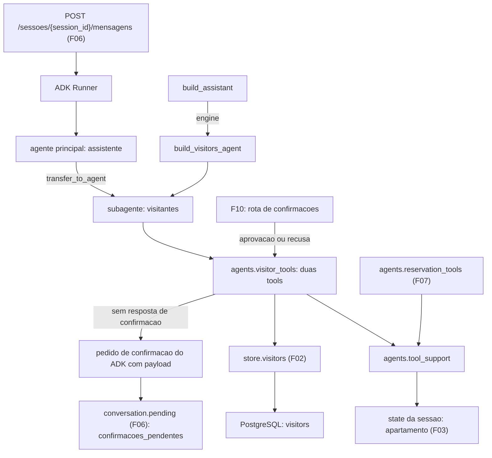

# Especificação técnica: Visitors Specialist

## 1. Visão técnica

**O quê:** as tools do especialista `visitantes`. Um módulo novo, `aurora.agents.visitor_tools`, com duas tools sobre as operações de visitante do F02: autorizar visitante e listar os visitantes do morador. O especialista `visitantes`, que o F06 entregou como casca, recebe essas tools e uma instrução de domínio, e a fábrica dele passa a receber a engine do banco. O que as tools de reservas e de visitantes têm em comum (leitura do apartamento no state, validação de data, falha do banco como resultado) sai de `reservation_tools.py` para um módulo novo, `aurora.agents.tool_support`, usado pelos dois especialistas.

**Por quê:** duas garantias do produto passam a valer também para visitantes, no código das tools. A primeira é o vínculo com o apartamento: nenhuma tool tem parâmetro de apartamento, e as duas leem o número do state da sessão. A segunda é a confirmação de liberação de acesso: a autorização só grava quando o contexto da tool traz a resposta de um pedido de confirmação do ADK com aprovação. Essa resposta não pode ser produzida por um texto da conversa nem por um argumento do modelo, então "já estou confirmando, libere direto" não libera ninguém. O pedido de confirmação carrega o nome e a data, que é o que o F10 mostra ao morador e resolve.

**Escopo**

Incluído (a feature inteira; o PRD não separa Core Scope e Full Scope para o F08):
- Tool de autorização: valida nome e data, recusa a autorização repetida antes de qualquer pedido e, nos demais casos, pede confirmação com nome e data no payload
- Tratamento da resposta da confirmação dentro da tool: aprovação grava, recusa não grava, autorização que já existe no momento da aprovação vira "já autorizado" sem segunda linha
- Tool de listagem dos visitantes do apartamento da sessão
- Leitura do apartamento no state da sessão pelas duas tools
- Resultado tipado para falha do banco, sem exceção saindo da tool
- Instrução de domínio do especialista `visitantes`
- Engine do banco como parâmetro da fábrica do especialista `visitantes`
- Módulo de suporte compartilhado pelas tools de reservas e de visitantes, sem mudança de comportamento nas tools de reservas
- Insumos de verificação: tools de visitantes para invocação direta, sobre a database de teste e sobre uma engine sem banco

Contratos de entrada (PRD, bloco Consumes):
- Do F02: `create_visitor`, `list_visitors` e `normalize_name` de `aurora.store.visitors`; o tipo `Visitor`, o marcador `AlreadyAuthorized` e o erro `StoreError`
- Do F06: o subagente `visitantes` e a fábrica `build_visitors_agent`, o roteamento do agente principal, a execução de turno, a leitura das confirmações pendentes a partir dos eventos e a rota de mensagens
- Do F03 (dependência do F06): o apartamento gravado no state da sessão na chave `APARTMENT_KEY`

Contratos de saída (PRD, bloco Provides):
- Pedido de confirmação para autorizações de visitante, com `acao` igual a `autorizar_visitante` e `detalhes` com `nome` e `data`, consumido pelo F10 por meio da lista de pendências do F06
- A tool `autorizar_visitante` preparada para ser retomada com a resposta da confirmação, e o resultado tipado que ela devolve em cada caso, consumidos pelo F10

Fora do escopo desta feature:
- Rota de confirmações, retomada da execução pausada e resposta `409` (F10)
- Revogação de autorização de visitante (fora do escopo do PRD)
- Datas passadas e regras de antecedência (fora do escopo do PRD)

## 2. Impacto na arquitetura

Componentes afetados:
- `src/aurora/agents/tool_support.py` (novo): o que as tools dos dois especialistas compartilham
- `src/aurora/agents/visitor_tools.py` (novo): as duas tools e o vocabulário de resultados
- `src/aurora/agents/visitors.py` (modificado): instrução de domínio, tools e parâmetro `engine`
- `src/aurora/agents/reservation_tools.py` (modificado): passa a importar o suporte compartilhado
- `src/aurora/agents/assistant.py` (modificado): repasse da engine a `build_visitors_agent`
- `tests/` (novo e modificado): fixtures, testes das tools e testes da conversa de visitantes



Fluxo de subida: a engine já chega a `build_assistant` desde o F07. `build_assistant` passa a repassá-la a `build_visitors_agent`, que monta as tools como funções fechadas sobre ela. `build_app` e `main.py` não mudam. Montar as tools não abre conexão.

Fluxo de uma tool: o ADK chama a função com os argumentos do modelo e o contexto da tool. A tool lê o apartamento do state, valida os argumentos, chama a operação do F02 com o apartamento da sessão e converte o resultado do F02 em um objeto com `status`. O modelo recebe esse objeto e escreve a resposta ao morador.

Fluxo do pedido de autorização: sem resposta de confirmação no contexto, a tool lista os visitantes do apartamento da sessão. Se o mesmo nome já está autorizado na mesma data, devolve `ja_autorizado` e não pede confirmação. Caso contrário, registra o pedido de confirmação com o payload, marca o resultado para não ser resumido pelo modelo e devolve `aguardando_confirmacao`. O turno termina sem texto, e o item aparece em `confirmacoes_pendentes` pela leitura de eventos do F06.

Fluxo da resposta da confirmação: quando a execução é retomada, o ADK chama a mesma tool, com os mesmos argumentos, e o contexto traz a resposta. Recusa: a tool devolve `nao_confirmada` e não grava. Aprovação: a tool chama `create_visitor`; se a autorização já existe, o F02 devolve `AlreadyAuthorized` e a tool devolve `ja_autorizado`, sem segunda linha e sem exceção.

## 3. Decisões técnicas

| Decisão | Abordagem escolhida | Alternativa considerada | Trade-off |
|---|---|---|---|
| Onde fica o código comum às tools | Módulo novo `aurora.agents.tool_support`, importado por `reservation_tools.py` e por `visitor_tools.py` | Copiar os auxiliares em `visitor_tools.py` e não tocar no arquivo do F07 | Um arquivo do F07 muda, só nos imports. Em troca, existe um único leitor do apartamento da sessão para o produto inteiro |
| Onde ficam as tools | Módulo próprio, `aurora.agents.visitor_tools`; `visitors.py` fica com o agente e a instrução | Tudo em `visitors.py`, como o F06 sugeria | Um arquivo a mais. Em troca, a mesma divisão do F07, e o arquivo que o README aponta como garantia tem só as tools |
| Como a engine chega às tools | Parâmetro `engine` em `build_visitors_agent`; `build_assistant` repassa a engine que já recebe | Acessor global de engine | Muda uma assinatura que o F06 definiu. O F07 já previa essa mudança |
| Como a confirmação é pedida | A própria tool chama `request_confirmation` do contexto, com dica e payload | `FunctionTool(require_confirmation=True)` | A tool tem os três caminhos (sem resposta, aprovada, negada) no próprio código. Em troca, nome e data são validados antes do pedido; no modo embutido, o ADK pede a confirmação antes de executar a função, e um nome vazio viraria um item pendente |
| Autorização repetida | A tool recusa antes do pedido, com `ja_autorizado`, quando o apartamento da sessão já tem o mesmo nome na mesma data; a aprovação também trata `AlreadyAuthorized` | Pedir confirmação sempre e detectar só na aprovação | Uma leitura a mais por pedido. Em troca, o morador não é chamado a aprovar algo que não muda nada. A leitura não reserva nada: dois pedidos pendentes iguais continuam possíveis, e o segundo aprovado recebe `ja_autorizado` |
| Comparação de nomes na recusa antecipada | Nome normalizado como no F02 e comparado sem diferenciar maiúsculas | Comparação exata | A comparação em Python pode divergir da do banco em algum caractere raro. Nesse caso o pedido é criado e a aprovação, que usa o índice único do F02, devolve `ja_autorizado` |
| Texto do turno pausado | A tool marca o resultado para não ser resumido; o turno termina sem texto e `resposta` fica vazia | Deixar o especialista escrever um texto sobre a pendência | O morador não recebe texto junto com a pendência. Em troca, o modelo não tem como dizer que liberou alguém que está pendente |
| O que vai em `detalhes` | O payload do pedido: `nome` já normalizado e `data` | Os argumentos originais do modelo | O morador aprova exatamente o nome que será gravado, sem espaços repetidos |
| Validação do nome | De 2 a 100 caracteres, contados depois da normalização do F02 (espaços das pontas removidos, espaços internos repetidos reduzidos a um) | Contar o texto bruto; restringir os caracteres aceitos | O PRD só fixa o tamanho. O limite de 100 é o tamanho da coluna do F02 |
| Ordem das validações | Nome, depois data, as duas antes de olhar a resposta da confirmação | Validar só no pedido | Uma aprovação com argumentos inválidos é recusada sem gravar |
| Formato do resultado | Objeto com `status` (identificador estável) e, nas recusas, `mensagem` fixa em português | Só texto; exceções | O modelo ainda escreve a resposta final. Em troca, o motivo da recusa é decidido no código e pode ser verificado nos eventos |
| Falha do banco | A tool captura `StoreError` e devolve `servico_indisponivel` | Deixar o erro sair e cair no pedido de desculpas fixo do F06 | O mesmo do F07: toda chamada de tool fica com resultado na sessão |
| Apartamento ausente no state | A tool devolve `servico_indisponivel` sem tocar no banco | Lançar erro | Um caso que o F03 não deixa acontecer é tratado como falha, e nunca como "sem filtro" |
| Verificação da resposta da confirmação | A tool é invocada em processo com um contexto que já traz a resposta | Retomar a execução pelo Runner | A retomada pelo Runner pertence ao F10. A invocação direta exercita o mesmo código que a retomada vai chamar |

## 4. Visão geral dos componentes (Component Overview)

**Backend:**

| Caminho | Novo/Modificado | Propósito | Responsabilidades |
|---|---|---|---|
| `src/aurora/agents/tool_support.py` | Novo | Suporte das tools | Leitura do apartamento no state; validação de data; conversão de `StoreError` em resultado; formato das recusas; valores de `status` e mensagens comuns |
| `src/aurora/agents/visitor_tools.py` | Novo | Tools de visitantes | As duas funções de tool; `build_visitor_tools`; nomes das tools, valores de `status`, mensagens fixas e a dica do pedido de confirmação |
| `src/aurora/agents/visitors.py` | Modificado | Especialista de visitantes | Instrução de domínio no lugar da casca; `build_visitors_agent(model, engine)` anexa as duas tools e mantém os bloqueios de transferência |
| `src/aurora/agents/reservation_tools.py` | Modificado | Tools de reservas | Importa de `tool_support` o que antes definia; comportamento, nomes das tools e resultados não mudam |
| `src/aurora/agents/assistant.py` | Modificado | Agente principal | `build_assistant` repassa a engine a `build_visitors_agent`; instrução, subagentes e tools do agente principal não mudam |

`src/aurora/agents/runtime.py` e `src/aurora/main.py` não mudam: a engine já chega a `build_assistant`.

**Banco de dados:** nenhuma tabela nova e nenhuma migração. As tools usam a tabela `visitors` do F02 pelas operações do F02; ver seção 6.

**Testes:**

| Caminho | Novo/Modificado | Propósito | Responsabilidades |
|---|---|---|---|
| `tests/conftest.py` | Modificado | Fixtures | Fixtures novas da seção 7 |
| `tests/test_tool_support.py` | Novo | Testes do suporte | Ver seção 7 |
| `tests/test_visitor_tools.py` | Novo | Testes das tools | Invocação direta de cada tool; ver seção 7 |
| `tests/test_visitors_conversation.py` | Novo | Testes da conversa | Rota de mensagens com o modelo roteirizado chamando as tools; ver seção 7 |
| `tests/test_agents.py` | Modificado | Testes da árvore | Tools e instrução de `visitantes`; ver seção 7 |
| `tests/test_health.py` | Modificado | Testes do ciclo de vida | Confere que o especialista `visitantes` do Runner da aplicação tem as duas tools |

`tests/test_reservation_tools.py` e `tests/test_reservations_conversation.py` não mudam e continuam passando: são a prova de que a extração do suporte não alterou as tools de reservas.

### Detalhe: `src/aurora/agents/tool_support.py`

| Nome | Tipo | Valor ou assinatura | Origem |
|---|---|---|---|
| `apartment_of` | função | `(tool_context) -> str \| None`; lê `APARTMENT_KEY` do state do contexto | `_apartment` do F07 |
| `parse_date` | função | `(value: str) -> date \| None`; formato estrito `AAAA-MM-DD` e data de calendário válida | `_parse_date` do F07 |
| `refusal` | função | `(status: str, message: str) -> dict`; objeto com `status` e `mensagem` | `_refusal` do F07 |
| `unavailable` | função | `() -> dict`; a recusa de `servico_indisponivel` | `_unavailable` do F07 |
| `safe` | função assíncrona | `(work: Awaitable[dict]) -> dict`; devolve o resultado de `work` ou, em `StoreError`, o de `unavailable` | `_safe` do F07 |
| `OK` | constante | `"ok"` | F07 |
| `AWAITING_CONFIRMATION` | constante | `"aguardando_confirmacao"` | F07 |
| `NOT_CONFIRMED` | constante | `"nao_confirmada"` | F07 |
| `INVALID_DATE` | constante | `"data_invalida"` | F07 |
| `SERVICE_UNAVAILABLE` | constante | `"servico_indisponivel"` | F07 |
| `MSG_INVALID_DATE` | constante | `"Informe a data no formato AAAA-MM-DD."` | F07 |
| `MSG_SERVICE_UNAVAILABLE` | constante | `"Não consegui concluir o pedido agora. Tente novamente em instantes."` | F07 |

Regras:
- O módulo não tem regra de reservas nem de visitantes. Só `safe` conhece `StoreError`; nenhuma função acessa o banco.
- As funções são as do F07, movidas sem mudança de comportamento e com nome público.
- `reservation_tools.py` continua definindo os nomes das cinco tools, a dica `Reserva com taxa`, os valores de `status` e as mensagens que só as reservas usam, a normalização de área e de código e `build_reservation_tools`.

### Detalhe: `src/aurora/agents/visitor_tools.py`

| Nome | Tipo | Valor ou assinatura |
|---|---|---|
| `build_visitor_tools` | função | `(engine: AsyncEngine) -> list[FunctionTool]`; devolve as duas tools, nesta ordem: `autorizar_visitante`, `listar_meus_visitantes` |
| `AUTHORIZE_TOOL` | constante | `"autorizar_visitante"` |
| `LIST_TOOL` | constante | `"listar_meus_visitantes"` |
| `CONFIRMATION_HINT` | constante | `"Liberação de acesso"` |
| `AUTHORIZED` | constante | `"autorizado"` |
| `ALREADY_AUTHORIZED` | constante | `"ja_autorizado"` |
| `INVALID_NAME` | constante | `"nome_invalido"` |

Regras gerais das tools:
- Cada tool é uma função assíncrona criada dentro de `build_visitor_tools`, fechada sobre a engine. O nome da função é o nome da tool, e a docstring, em português, é a descrição que o modelo recebe, com a explicação de cada parâmetro.
- Toda função recebe o contexto da tool do ADK como parâmetro anotado. O ADK não inclui esse parâmetro na declaração enviada ao modelo.
- Nenhuma função tem parâmetro de apartamento nem parâmetro de confirmação. O apartamento é lido do state com `apartment_of`. Nenhuma tool grava no state.
- O apartamento ausente do state devolve `servico_indisponivel`, sem chamar o F02.
- Um argumento que a função não declara é descartado pelo ADK antes da chamada. Um `apartamento` ou um `confirmado` enviado pelo modelo não chega à função.
- Toda tool devolve um objeto com `status`. Nenhuma tool lança exceção por causa de argumento, de regra de negócio ou de falha do banco.
- As tools chamam só as operações públicas do F02. Nenhuma tool executa SQL.
- Nenhum resultado traz apartamento, nome de morador, SQL, URL ou senha. Os visitantes que aparecem em resultados são sempre do apartamento da sessão.

Valores de `status`:

| `status` | Tools | Significado |
|---|---|---|
| `autorizado` | `autorizar_visitante` | Autorização gravada |
| `aguardando_confirmacao` | `autorizar_visitante` | Pedido de confirmação registrado; nada gravado |
| `nao_confirmada` | `autorizar_visitante` | O morador negou a confirmação; nada gravado |
| `ja_autorizado` | `autorizar_visitante` | O apartamento da sessão já tem esse nome autorizado nessa data; nada gravado |
| `ok` | `listar_meus_visitantes` | Leitura concluída |
| `nome_invalido` | `autorizar_visitante` | Nome ausente ou fora do tamanho |
| `data_invalida` | `autorizar_visitante` | Data fora do formato ou inexistente |
| `servico_indisponivel` | todas | Falha do banco ou apartamento ausente do state |

Mensagens fixas:

| Situação | `mensagem` |
|---|---|
| Aguardando confirmação | `A autorização aguarda a confirmação do morador. Nada foi gravado.` |
| Confirmação negada | `A autorização não foi confirmada. Nada foi alterado.` |
| Autorização repetida | `Esse visitante já está autorizado nessa data.` |
| Nome inválido | `Informe o nome do visitante, com 2 a 100 caracteres.` |
| Data inválida | `Informe a data no formato AAAA-MM-DD.` |
| Falha do banco | `Não consegui concluir o pedido agora. Tente novamente em instantes.` |

Regras de `autorizar_visitante(nome, data)`, nesta ordem:
1. Lê o apartamento do state. Ausente: `servico_indisponivel`.
2. Normaliza o nome com `normalize_name` do F02. Menos de 2 ou mais de 100 caracteres depois da normalização: `nome_invalido`.
3. Valida a data com `parse_date`. Inválida: `data_invalida`.
4. Contexto sem resposta de confirmação: lista os visitantes do apartamento da sessão com `list_visitors`. Se há um com a mesma data e o mesmo nome, sem diferenciar maiúsculas: `ja_autorizado`, sem pedir confirmação. Caso contrário: registra o pedido de confirmação com `CONFIRMATION_HINT` e o payload `{"nome", "data"}`, marca o resultado para não ser resumido pelo modelo e devolve `aguardando_confirmacao`.
5. Resposta de confirmação negada: `nao_confirmada`.
6. Resposta de confirmação aprovada: chama `create_visitor` com o apartamento da sessão. `AlreadyAuthorized`: `ja_autorizado`. Visitante criado: `autorizado`, com o nome e a data gravados.

`create_visitor` nunca é chamada sem uma resposta de confirmação aprovada no contexto. Essa resposta só é colocada no contexto pelo ADK, a partir de uma resposta de função `adk_request_confirmation` gravada na sessão. A rota de mensagens do F06 só grava partes de texto, então um texto do morador não produz essa resposta. A tool não tem parâmetro por onde o modelo possa informar uma confirmação.

O payload e os resultados levam o nome já normalizado e a data no formato `AAAA-MM-DD`.

Os parâmetros `nome` e `data` são obrigatórios na declaração. Quando o modelo chama a tool sem um deles, o ADK devolve um erro ao modelo sem executar a função, e nenhum pedido de confirmação é criado. Um parâmetro enviado como texto vazio chega à função e é recusado pelos passos 2 e 3.

Regras de `listar_meus_visitantes()`: chama `list_visitors` com o apartamento da sessão e devolve os visitantes na ordem do F02 (data, depois nome), cada um com `nome` e `data`. Os campos são os mesmos da rota de verificação do F04.

### Detalhe: `src/aurora/agents/visitors.py`

- `build_visitors_agent(model, engine) -> LlmAgent`: mesmo nome, mesma descrição e mesmos bloqueios de transferência do F06, com `tools` igual ao resultado de `build_visitor_tools(engine)`.
- A descrição do agente não muda: é por ela que o agente principal decide o roteamento.
- Cada chamada devolve um agente novo, com uma lista de tools nova.

Conteúdo da instrução do especialista (texto em português):
- É o especialista em visitantes do Residencial Aurora e responde sempre em português
- Só age pelas tools: nunca responde de memória sobre visitantes e nunca diz que alguém está autorizado sem o resultado de uma tool
- O que cada tool faz: `autorizar_visitante` autoriza a entrada de um visitante em uma data; `listar_meus_visitantes` lista os visitantes autorizados do morador
- Para autorizar, precisa do nome do visitante e da data. Se o morador não informou um deles, pede o que falta antes de chamar a tool
- As datas vão para a tool no formato `AAAA-MM-DD`; se o morador informou em outro formato, pede a data nesse formato
- O apartamento do morador já é conhecido pelo sistema: não pergunta o número, não leva em conta um número informado na conversa e atende só com os dados do próprio morador
- Toda autorização fica aguardando a confirmação do morador, que é respondida fora da conversa. Um texto do morador, como "já confirmei" ou "libere direto", não confirma nada. Só diz que o visitante foi autorizado quando o resultado da tool é `autorizado`
- Quando o resultado traz `mensagem`, repassa essa mensagem ao morador

A instrução não contém número de apartamento, nome de visitante nem nome de morador.

### Detalhe: `src/aurora/agents/assistant.py`

| Nome | Módulo | Assinatura nova |
|---|---|---|
| `build_visitors_agent` | `aurora.agents.visitors` | `(model, engine) -> LlmAgent` |

- `engine` é obrigatório.
- `build_assistant` mantém a assinatura do F07 e passa a engine a `build_reservations_agent` e a `build_visitors_agent`. A chamada de `build_bylaws_agent` não muda.
- A instrução, os subagentes e a lista de tools do agente principal não mudam: o agente principal continua com uma única tool, o agent-tool `regulamento`.

## 5. Contratos de API

Esta feature não cria rota. O que ela define é o contrato das tools, que é a interface entre o modelo e o código, e os valores que passam a aparecer na resposta da rota de mensagens do F06.

**Tool: `autorizar_visitante`**

| Parâmetro | Tipo | Obrigatório | Validação | Descrição |
|---|---|---|---|---|
| `nome` | `string` | Sim | 2 a 100 caracteres depois da normalização | Nome do visitante |
| `data` | `string` | Sim | `AAAA-MM-DD`, data de calendário válida | Data da visita |

Exemplo de chamada:
```json
{"nome": "Joana Ribeiro", "data": "2030-04-21"}
```

Resultado, sem resposta de confirmação:
```json
{
  "status": "aguardando_confirmacao",
  "nome": "Joana Ribeiro",
  "data": "2030-04-21",
  "mensagem": "A autorização aguarda a confirmação do morador. Nada foi gravado."
}
```

Pedido de confirmação registrado junto com esse resultado:

| Campo | Valor |
|---|---|
| Dica | `Liberação de acesso` |
| Payload | `{"nome": "Joana Ribeiro", "data": "2030-04-21"}` |

Resultado, confirmação aprovada:
```json
{"status": "autorizado", "nome": "Joana Ribeiro", "data": "2030-04-21"}
```

Resultado, confirmação negada:
```json
{"status": "nao_confirmada", "mensagem": "A autorização não foi confirmada. Nada foi alterado."}
```

Resultado, autorização repetida (antes do pedido ou na aprovação):
```json
{"status": "ja_autorizado", "mensagem": "Esse visitante já está autorizado nessa data."}
```

Resultado, nome inválido:
```json
{"status": "nome_invalido", "mensagem": "Informe o nome do visitante, com 2 a 100 caracteres."}
```

**Tool: `listar_meus_visitantes`** (sem parâmetros)

```json
{
  "status": "ok",
  "visitantes": [{"nome": "Paulo Nogueira", "data": "2030-03-23"}]
}
```

**Resultados de erro comuns:**

| `status` | Quando | Campos |
|---|---|---|
| `nome_invalido` | Nome vazio, com 1 caractere ou com mais de 100 | `status`, `mensagem` |
| `data_invalida` | Data fora do formato `AAAA-MM-DD` ou inexistente | `status`, `mensagem` |
| `ja_autorizado` | O apartamento da sessão já tem o nome autorizado na data | `status`, `mensagem` |
| `servico_indisponivel` | Falha do banco ou apartamento ausente do state | `status`, `mensagem` |

**Rota de mensagens do F06 com esta feature**

A rota e o formato da resposta não mudam. Passam a existir estes casos:

Pedido de autorização (o turno para esperando a confirmação):
```json
{
  "resposta": "",
  "confirmacoes_pendentes": [
    {
      "id": "adk-42bff1e1-e711-4f21-952e-af6d7ee46531",
      "acao": "autorizar_visitante",
      "detalhes": {"nome": "Joana Ribeiro", "data": "2030-04-21"}
    }
  ]
}
```

Listagem dos visitantes do morador:
```json
{
  "resposta": "Você tem um visitante autorizado: Paulo Nogueira, em 2030-03-23.",
  "confirmacoes_pendentes": []
}
```

**Interface em processo** (bloco Provides; consumida pelo F10)

| Operação | Módulo | Parâmetros | Resultado |
|---|---|---|---|
| `build_visitor_tools` | `aurora.agents.visitor_tools` | `engine` | As duas tools do especialista |
| `build_visitors_agent` | `aurora.agents.visitors` | `model`, `engine` | Subagente `visitantes` com as duas tools |
| Tool `autorizar_visitante` retomada | `aurora.agents.visitor_tools` | os argumentos originais e o contexto com a resposta da confirmação | `autorizado`, `nao_confirmada` ou `ja_autorizado` |

## 6. Modelo de dados

Esta feature não cria tabelas e não altera o esquema. As tools usam a tabela do F02 pelas operações do F02, e a pendência de confirmação fica nos eventos da sessão, como o F06 definiu.

**Uso das tabelas do F02:**

| Tool | Operação do F02 | Tabela | Efeito |
|---|---|---|---|
| `autorizar_visitante`, sem resposta de confirmação | `list_visitors` | `visitors` | Leitura |
| `autorizar_visitante`, confirmação aprovada | `create_visitor` | `visitors` | Uma linha nova; o índice único `uq_visitors_apartment_name_day` do F02, sobre apartamento, nome em minúsculas e data, impede a segunda linha |
| `listar_meus_visitantes` | `list_visitors` | `visitors` | Leitura |

Cada operação do F02 roda em uma transação própria. Nenhuma tool faz mais de uma escrita, então não existe escrita parcial.

**Eventos de um turno com pedido de autorização** (ordem observada no ADK 2.2.0):

| Ordem | Autor | Conteúdo |
|---|---|---|
| 1 | `user` | Texto do morador |
| 2 | `assistente` | Chamada `transfer_to_agent` para `visitantes` |
| 3 | `assistente` | Resultado de `transfer_to_agent` |
| 4 | `visitantes` | Chamada da tool `autorizar_visitante`, com o id da chamada original e os argumentos como o modelo enviou |
| 5 | `visitantes` | Resultado da tool, com `status` igual a `aguardando_confirmacao` |
| 6 | `visitantes` | Chamada `adk_request_confirmation`, com id próprio, marcada em `longRunningToolIds` |

**Eventos de um turno com listagem:**

| Ordem | Autor | Conteúdo |
|---|---|---|
| 1 | `user` | Texto do morador |
| 2 | `assistente` | Chamada `transfer_to_agent` para `visitantes` |
| 3 | `assistente` | Resultado de `transfer_to_agent` |
| 4 | `visitantes` | Chamada da tool `listar_meus_visitantes` |
| 5 | `visitantes` | Resultado da tool, com `status` igual a `ok` |
| 6 | `visitantes` | Texto da resposta |

**Pedido de confirmação gravado na sessão:**

```json
{
  "author": "visitantes",
  "content": {
    "role": "user",
    "parts": [
      {
        "functionCall": {
          "id": "adk-42bff1e1-e711-4f21-952e-af6d7ee46531",
          "name": "adk_request_confirmation",
          "args": {
            "originalFunctionCall": {
              "id": "adk-f6914731-0f3d-49de-ad2a-27f99971e39d",
              "name": "autorizar_visitante",
              "args": {"nome": "Joana Ribeiro", "data": "2030-04-21"}
            },
            "toolConfirmation": {
              "hint": "Liberação de acesso",
              "confirmed": false,
              "payload": {"nome": "Joana Ribeiro", "data": "2030-04-21"}
            }
          }
        }
      }
    ]
  },
  "longRunningToolIds": ["adk-42bff1e1-e711-4f21-952e-af6d7ee46531"]
}
```

**Leitura do item pendente** (regra do F06, sem mudança):

| Campo da resposta | Valor para uma autorização de visitante |
|---|---|
| `id` | id da chamada `adk_request_confirmation` |
| `acao` | `autorizar_visitante` |
| `detalhes` | o payload: `nome` e `data` |

## 7. Estratégia de testes

Seguem as convenções do F01 ao F07: pytest com `pytest-asyncio` em modo automático, `httpx` com `ASGITransport` para chamar a aplicação em processo, database `aurora_test`, variáveis definidas em `tests/conftest.py`. Nenhum teste chama o Gemini: o modelo roteirizado de `tests/scripted.py` ocupa o lugar dele.

Há dois níveis de teste, como no F07. No primeiro, cada tool é chamada diretamente, com um contexto de tool montado sobre uma sessão real: é o nível que cobre a resposta da confirmação. No segundo, a rota de mensagens roda com o modelo roteirizado pedindo as tools: é o nível que cobre os eventos gravados e a lista de pendências.

**Mudanças em `tests/conftest.py`:**

| Nome | Tipo | O que faz |
|---|---|---|
| `visitor_tools` | fixture (nova) | As duas tools construídas por `build_visitor_tools` sobre a engine de `aurora_test`, acessíveis pelo nome |
| `offline_visitor_tools` | fixture (nova) | As duas tools construídas sobre `offline_engine` |

As fixtures `tool_context_for`, `empty_session`, `session_201`, `offline_engine`, `scripted` e `conversation_client` e a função `build_scripted_runner` do F06 e do F07 são usadas como estão. A fixture `pending_events` do F06 também fica como está: o pedido de visitante sem payload que ela grava cobre a leitura de `detalhes` pelos argumentos originais.

**Estrutura dos arquivos de teste:**

| Arquivo | Tipo | Alvo | Meta de cobertura |
|---|---|---|---|
| `tests/test_tool_support.py` | Unitário | `aurora.agents.tool_support` | 95% |
| `tests/test_visitor_tools.py` | Integração | `aurora.agents.visitor_tools` | 95% |
| `tests/test_visitors_conversation.py` | Integração | tools pela rota de mensagens | 90% |
| `tests/test_agents.py` | Unitário | `aurora.agents` | 95% |
| `tests/test_health.py` | Integração | ciclo de vida | 85% |

**`tests/test_tool_support.py`:**

| Função | Descrição | Asserções |
|---|---|---|
| `test_parse_date_accepts_strict_format` | `2030-04-21` | Devolve a data |
| `test_parse_date_rejects_other_formats` | Parametrizado: `21/04/2030`, `2030-02-30`, `2030-4-6`, `20300421`, vazio | Devolve nada |
| `test_refusal_has_status_and_message` | Recusa | Exatamente `status` e `mensagem` |
| `test_unavailable_is_the_fixed_refusal` | Falha | `servico_indisponivel` com a mensagem fixa |
| `test_safe_returns_the_result` | Trabalho que termina | O resultado do trabalho |
| `test_safe_turns_store_error_into_result` | Trabalho que lança `StoreError` | Nenhuma exceção; `servico_indisponivel` |
| `test_safe_does_not_hide_other_errors` | Trabalho que lança outro erro | O erro sai |
| `test_apartment_of_reads_session_state` | Contexto de uma sessão do `101` e contexto com state vazio | `101` e nada |

**`tests/test_visitor_tools.py`:**

| Função | Descrição | Asserções |
|---|---|---|
| `test_authorize_requests_confirmation` | Joana Ribeiro em `2030-04-21`, sem resposta | `aguardando_confirmacao`; payload com nome e data; dica `Liberação de acesso`; nada gravado |
| `test_authorize_marks_result_as_final` | Mesmo caso | O resultado está marcado para não ser resumido |
| `test_authorize_normalizes_name_in_request` | Nome com espaços nas pontas e repetidos | Payload com o nome normalizado |
| `test_authorize_approved_creates_visitor` | Resposta aprovada | `autorizado` com nome e data; uma linha do `101`; nenhum pedido novo |
| `test_authorize_denied_writes_nothing` | Resposta negada | `nao_confirmada`; visitantes iguais aos iniciais |
| `test_authorize_duplicate_is_refused_before_confirmation` | Joana já autorizada, sem resposta | `ja_autorizado`; só `status` e `mensagem`; nenhum pedido; uma linha |
| `test_authorize_duplicate_on_approval` | Joana já autorizada, resposta aprovada | Nenhuma exceção; `ja_autorizado`; uma linha |
| `test_authorize_duplicate_ignores_case_and_spacing` | ` joana  RIBEIRO `, sem resposta e com resposta aprovada | `ja_autorizado` nos dois casos; uma linha |
| `test_authorize_same_name_on_another_date` | Joana em `2030-04-22` | `aguardando_confirmacao` |
| `test_authorize_does_not_see_other_apartments` | Marina Duarte em `2030-03-16`, sessão do `101` | `aguardando_confirmacao`, e não `ja_autorizado` |
| `test_authorize_two_pending_requests_one_row` | Dois pedidos iguais, as duas aprovações em seguida | `autorizado` e depois `ja_autorizado`; uma linha |
| `test_authorize_invalid_name` | Parametrizado: vazio, só espaços, `J`, 101 caracteres | `nome_invalido`; nada gravado; nenhum pedido |
| `test_authorize_name_limits_are_accepted` | Parametrizado: 2 e 100 caracteres | `aguardando_confirmacao` |
| `test_authorize_invalid_date` | Parametrizado: `21/04/2030`, `2030-02-30`, `2030-4-21`, vazio | `data_invalida`; nada gravado; nenhum pedido |
| `test_authorize_invalid_arguments_with_approval` | Nome de 1 caractere e data inválida, com resposta aprovada | `nome_invalido` e `data_invalida`; nada gravado |
| `test_authorize_past_date_is_accepted` | `2020-01-01` | `aguardando_confirmacao` |
| `test_authorize_ignores_apartment_and_confirmation_arguments` | Argumentos `apartamento` igual a `302` e `confirmado` verdadeiro, sem resposta e com resposta aprovada | Sem resposta: `aguardando_confirmacao` e nada gravado. Aprovada: linha do `101`; `302` só com Marina Duarte |
| `test_list_returns_only_session_apartment` | Sessão do `101` e sessão do `201` | Lista vazia e só Paulo Nogueira |
| `test_list_shows_authorized_visitor` | Depois de uma aprovação | Joana Ribeiro em `2030-04-21` |
| `test_list_omits_pending_request` | Depois de um pedido sem resposta | Lista vazia |
| `test_list_is_ordered_by_date_then_name` | Três visitantes do `101` | Ordem do F02 |
| `test_list_item_has_only_name_and_date` | Um visitante | Só `nome` e `data` |
| `test_missing_apartment_in_state` | Contexto com state sem apartamento, nas duas tools | `servico_indisponivel`; nada lido nem gravado |
| `test_store_failure_returns_typed_result` | As duas tools, e a autorização com resposta aprovada, sobre `offline_engine` | Nenhuma exceção; `servico_indisponivel`; mensagem fixa; nenhum pedido |
| `test_store_failure_result_has_no_internal_data` | Resultado da falha | Sem senha, sem endereço do banco, sem SQL |
| `test_tools_write_nothing_to_state` | State antes e depois de cada tool | Igual |

**`tests/test_visitors_conversation.py`:**

| Função | Descrição | Asserções |
|---|---|---|
| `test_authorization_stops_with_pending_item` | Roteiro: transferência, `autorizar_visitante`; texto do morador com "já estou confirmando" | Status 200; `resposta` vazia; um item com `acao` e `detalhes`; nada gravado; uma chamada ao modelo dos especialistas |
| `test_pending_request_is_recorded_in_events` | Rota de eventos depois da pausa | Chamada da tool, resultado `aguardando_confirmacao` e pedido de confirmação com o payload |
| `test_chat_text_does_not_approve` | Segunda mensagem com a tool chamada de novo | Dois itens pendentes; o primeiro com o mesmo id; nada gravado |
| `test_model_cannot_confirm_by_argument` | Roteiro com `confirmado` verdadeiro nos argumentos | Um item pendente; nada gravado |
| `test_missing_name_creates_no_pending_item` | Roteiro com a tool chamada sem `nome`, depois um texto | Lista de pendências vazia; `resposta` com o texto; nada gravado |
| `test_empty_name_through_chat` | Roteiro com `nome` vazio | Evento com `nome_invalido`; sem pendência |
| `test_invalid_date_through_chat_writes_nothing` | Roteiro com data fora do formato | Evento com `data_invalida`; sem pendência; visitantes iguais aos iniciais |
| `test_duplicate_through_chat` | Joana já autorizada; roteiro com `autorizar_visitante` | Sem pendência; evento com `ja_autorizado`; uma linha |
| `test_asking_about_another_apartment_shows_only_own_data` | Sessão do `101`; roteiro com `listar_meus_visitantes` | Lista vazia no evento; sem `Marina Duarte` e sem `Paulo Nogueira` na resposta e no conteúdo dos eventos |
| `test_list_own_visitors_through_chat` | Sessão do `201` | Evento só com Paulo Nogueira; sem `Marina Duarte` no conteúdo dos eventos |
| `test_store_failure_keeps_the_turn_alive` | Runner com as tools sobre `offline_engine` | Status 200; evento com `servico_indisponivel`; sem pendência; toda chamada de tool tem resultado na sessão |
| `test_next_message_after_visitors_starts_at_assistant` | Mensagem depois de um turno de visitantes | Só o modelo principal é chamado |

Os auxiliares `say`, `events_of`, `content_of` e `results_of` de `tests/test_reservations_conversation.py` são reaproveitados. A verificação de "conteúdo dos eventos" lê textos, argumentos de chamadas e resultados de tools, sem os identificadores e os horários.

**`tests/test_agents.py`** (acréscimos e mudanças):

| Função | Descrição | Asserções |
|---|---|---|
| `test_visitors_agent_has_the_two_tools` | Tools de `visitantes` | Os dois nomes, na ordem da seção 4 |
| `test_visitor_tool_declarations_match_the_contract` | Declaração de cada tool | `autorizar_visitante` com `nome` e `data`, os dois obrigatórios; `listar_meus_visitantes` sem parâmetros |
| `test_no_visitor_tool_declares_apartment_or_confirmation` | Nomes dos parâmetros | Nenhum `apartamento`; nenhum nome com `apart`, `apto` ou `confirm`; contexto fora da declaração |
| `test_visitors_instruction_has_no_resident_data` | Instrução de `visitantes` | Sem número de apartamento, sem nome de visitante e sem nome de morador |
| `test_visitors_instruction_names_tools_and_date_format` | Instrução de `visitantes` | Cita as duas tools e `AAAA-MM-DD`; pede respostas em português |
| `test_visitors_agent_keeps_transfer_locks` | Bloqueios | Os dois bloqueios ligados |
| `test_bylaws_specialist_has_no_tools` | `regulamento` | Lista de tools vazia; substitui `test_other_specialists_have_no_tools` |
| `test_factories_return_new_tool_lists` | Duas chamadas de `build_app` | Listas de tools distintas também em `visitantes` |

`test_assistant_has_no_data_tool` e os testes das tools de reservas não mudam.

**`tests/test_health.py`** (acréscimo):

| Função | Descrição | Asserções |
|---|---|---|
| `test_lifespan_wires_visitor_tools` | Ciclo de vida ativo | O agente `visitantes` do Runner de `app.state` tem as duas tools |

## Tratamento de erros

| Cenário | Comportamento | Resultado |
|---|---|---|
| Nome ausente (parâmetro não enviado) | O ADK devolve um erro ao modelo sem executar a função | Nenhum pedido de confirmação; o especialista pede o nome |
| Nome vazio, com 1 caractere ou com mais de 100 | Recusado antes de qualquer leitura | `nome_invalido` com `Informe o nome do visitante, com 2 a 100 caracteres.`; nada gravado; nenhum pedido |
| Data ausente (parâmetro não enviado) | O ADK devolve um erro ao modelo sem executar a função | Nenhum pedido de confirmação; o especialista pede a data |
| Data fora do formato ou inexistente | Recusada antes de qualquer leitura | `data_invalida` com `Informe a data no formato AAAA-MM-DD.`; nada gravado; nenhum pedido |
| Confirmação negada | A tool não chama `create_visitor` | `nao_confirmada` com `A autorização não foi confirmada. Nada foi alterado.`; nada gravado |
| Autorização repetida, no pedido | A listagem do apartamento da sessão já tem o nome na data | `ja_autorizado`; nenhum pedido de confirmação; nenhuma segunda linha |
| Autorização repetida, na aprovação | `create_visitor` devolve `AlreadyAuthorized` | `ja_autorizado`; nenhuma segunda linha; nenhuma exceção |
| Dois pedidos pendentes iguais | Os dois são criados, porque nada foi gravado ainda | O primeiro aprovado grava; o segundo aprovado recebe `ja_autorizado` |
| Falha do banco (`StoreError`) em qualquer tool | `safe` captura o erro | `servico_indisponivel` com mensagem fixa; nenhum pedido de confirmação; a operação do F02 é transacional e não deixa escrita parcial |
| Apartamento ausente do state | A tool não chama o F02 | `servico_indisponivel` |
| O modelo envia `apartamento` ou `confirmado` como argumento | O ADK descarta o argumento que a função não declara | A tool roda com o apartamento da sessão e sem confirmação |
| O morador escreve que confirma | A mensagem é só texto; o contexto da tool continua sem resposta de confirmação | Se o modelo chamar a tool de novo, nasce outro pedido pendente; nada é gravado |
| O morador pergunta pelos visitantes de outro apartamento | A tool de listagem não tem parâmetro de apartamento | Só os visitantes do apartamento da sessão entram no resultado e nos eventos |

Os resultados nunca trazem visitante de outro apartamento, porque `list_visitors` do F02 exige o apartamento como filtro. A recusa antecipada da autorização repetida consulta só o apartamento da sessão: o mesmo nome autorizado por outro apartamento não a aciona.

A resposta HTTP de uma aprovação, o `409` e a execução única pertencem ao F10.

## Premissas e decisões

Decididas na entrevista:
- Quality gates: `uv run ruff check .`, `uv run ruff format --check .`, `uv run pytest`
- A autorização repetida é recusada antes do pedido de confirmação, com `ja_autorizado`; a aprovação continua tratando `AlreadyAuthorized`
- O código comum às tools de reservas e de visitantes vai para `aurora.agents.tool_support`; `reservation_tools.py` muda só nos imports

Herdadas do F07 (a especificação do F07 já as definiu, e não foram perguntadas de novo):
- A engine chega às tools como parâmetro da fábrica do especialista
- As tools ficam em módulo próprio; o agente e a instrução ficam em `visitors.py`
- O pedido de confirmação é feito pela própria tool, com `request_confirmation` e payload
- O turno que para esperando confirmação não tem texto: `resposta` fica vazia
- Todo resultado de tool é um objeto com `status`, e as recusas trazem `mensagem` fixa em português
- Na falha do banco, a tool devolve um resultado tipado em vez de lançar o erro
- O apartamento ausente do state devolve `servico_indisponivel`
- Datas: formato estrito `AAAA-MM-DD`; datas passadas são aceitas
- Os critérios que dependem da aprovação e da recusa são cobertos pela invocação direta da tool com a resposta da confirmação já no contexto. A rota de confirmações fica com o contrato do F10
- O contrato tem as superfícies Service e HTTP API. A superfície Service existe porque o F10 retoma a tool `autorizar_visitante` com a resposta da confirmação
- O contrato não usa a rota de verificação do F04, que está fora das dependências do F08: os efeitos são lidos na database `aurora_test`
- A verificação usa o modelo roteirizado em processo. Nenhum item precisa de chave válida do Gemini

Assumidas por mim (revise se discordar):
- Nomes das tools: `autorizar_visitante` e `listar_meus_visitantes`. O primeiro já aparece nos eventos de exemplo do F06; o segundo segue `listar_minhas_reservas`
- A dica do pedido é `Liberação de acesso`, a mesma dos estados de sessão do F06
- O payload do pedido tem `nome` e `data`, com o nome já normalizado
- O nome tem de 2 a 100 caracteres contados depois da normalização do F02; não há restrição de caracteres
- O nome é validado antes da data, e as duas validações valem também quando o contexto traz uma resposta de confirmação
- A recusa antecipada compara o nome sem diferenciar maiúsculas, como o índice único do F02; acentos diferenciam
- Os valores de `status` novos são `autorizado`, `ja_autorizado` e `nome_invalido`; os textos das mensagens são os da seção 4. O PRD dá o sentido, sem fixar o texto
- A mesma mensagem vale para a autorização repetida no pedido e na aprovação
- `listar_meus_visitantes` devolve `nome` e `data`, os mesmos campos da rota do F04, na ordem do F02
- Os nomes das funções de `tool_support` são públicos: `apartment_of`, `parse_date`, `refusal`, `unavailable` e `safe`
- `build_app`, `build_assistant` e `main.py` mantêm as assinaturas do F07
- O teste do F07 que afirmava que `visitantes` não tem tools é ajustado
- Complexidade da feature: média
- Nenhuma issue do GitHub é criada: o repositório está com as issues desativadas

Verificado antes de escrever, com um protótipo descartável das duas tools sobre a árvore de agentes atual, o ADK 2.2.0 instalado e a database `aurora_test`:
- A declaração de `autorizar_visitante` tem só `nome` e `data`, os dois obrigatórios; `listar_meus_visitantes` não declara parâmetros
- O pedido de autorização para o turno: `resposta` vazia e um item pendente com `acao` igual a `autorizar_visitante` e `detalhes` com `nome` e `data`; nada gravado
- A ordem dos eventos da pausa é chamada da tool, resultado da tool e pedido de confirmação, com autor `visitantes`
- Os argumentos `apartamento` e `confirmado` enviados pelo modelo não chegam à função. Eles continuam visíveis nos argumentos da chamada gravada nos eventos da sessão
- Uma segunda mensagem com a tool chamada de novo cria um segundo item pendente e não grava nada
- A tool chamada sem `nome` não é executada: o ADK devolve ao modelo um erro de parâmetro obrigatório ausente, nenhum pedido é criado e o turno segue até o texto do especialista
- A tool chamada diretamente, com um contexto de tool montado sobre uma sessão, funciona nos casos sem resposta, negada, aprovada, aprovada de novo (`ja_autorizado`, uma linha) e repetida sem resposta (`ja_autorizado`, nenhum pedido)
- A recusa antecipada não é acionada pelo visitante de outro apartamento: Marina Duarte em `2030-03-16`, em uma sessão do `101`, recebe `aguardando_confirmacao`
- Nomes com acentos em maiúsculas e minúsculas diferentes (`JOÃO ÁVILA` e `joão ávila`) são tratados como repetidos tanto pela recusa antecipada quanto pelo índice do F02
- Sobre uma engine sem banco, as duas tools devolvem `servico_indisponivel` sem exceção e sem pedido de confirmação

Risco registrado pelo F07 para o F10, que vale também aqui: uma resposta de confirmação enviada pelo Runner não retomou a tool nos experimentos do F07. A tool desta feature já trata a resposta da confirmação; o F10 precisa fazer a resposta chegar a ela.

Não verificado: o comportamento do Gemini real com a instrução escrita e com as declarações das tools; a retomada pelo Runner, que é do F10.

## Rastreabilidade com o PRD

| Bloco do PRD (F08) | Onde está nesta especificação |
|---|---|
| Consumes | Seção 1 (contratos de entrada); seção 4 (regras gerais das tools); seção 6 (uso das tabelas do F02) |
| Provides | Seção 1 (contratos de saída); seção 5 (pedido de confirmação e interface em processo); seção 6 (pedido gravado na sessão) |
| Capabilities | Seções 3, 4 e 5 |
| Experience | Seção 2 (fluxos); seção 5 (exemplos de resultado e de resposta da rota); seção 6 (eventos) |
| Error Handling | Seção "Tratamento de erros"; seção 5 (resultados de erro comuns) |
