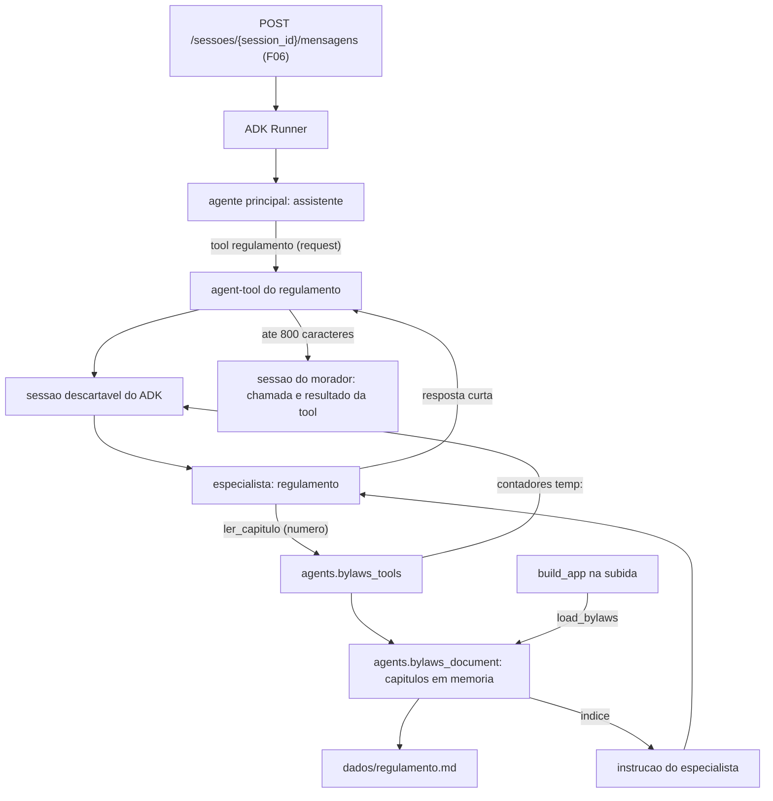

# Especificação técnica: Bylaws Specialist

## 1. Visão técnica

**O quê:** a consulta ao regulamento interno pelo especialista `regulamento`. Um módulo novo, `aurora.agents.bylaws_document`, lê `dados/regulamento.md` uma vez na subida, separa os capítulos e monta o índice. Outro módulo novo, `aurora.agents.bylaws_tools`, traz a única tool do especialista, `ler_capitulo`, que entrega um capítulo por número. O especialista `regulamento`, que o F06 entregou como casca, recebe o índice na instrução, a tool e uma instrução de domínio. O agent-tool que o agente principal usa para acioná-lo passa a limitar o tamanho da resposta e a devolver um resultado fixo quando o modelo do especialista falha.

**Por quê:** o regulamento tem cerca de 45 KB. Se o texto entrar no histórico da sessão do morador, ele acompanha todas as mensagens seguintes. A regra do projeto é que o modelo decide o caminho e o código decide o que é permitido, e nesta feature o código decide quatro coisas. O especialista roda em uma sessão descartável, então os capítulos lidos não entram na sessão do morador. A tool entrega no máximo 2 capítulos por pergunta, mesmo que o modelo peça mais. A resposta que volta para a sessão do morador tem no máximo 800 caracteres, menos que o menor capítulo. E quando o arquivo não pode ser lido, a resposta é um texto fixo, sem chamada ao modelo do especialista.

**Escopo**

Incluído (a feature inteira; o PRD não separa Core Scope e Full Scope para o F09):
- Leitura de `dados/regulamento.md` uma vez na subida, com separação dos capítulos pelos títulos
- Índice de capítulos com número, título, faixa de artigos e as palavras iniciais de cada artigo
- Tool `ler_capitulo`, que entrega um capítulo por número
- Limite de 2 capítulos entregues por pergunta, contado no código
- Número de capítulo inválido: lista dos capítulos válidos e uma única nova tentativa por pergunta
- Instrução de domínio do especialista `regulamento`, com o índice
- Resposta fixa, sem chamada ao modelo, quando o arquivo está ausente, ilegível ou sem capítulos
- Limite de 800 caracteres na resposta que o agent-tool devolve
- Resultado fixo do agent-tool quando o modelo do especialista falha
- Uma frase nova na instrução do agente principal: enviar a dúvida completa ao chamar `regulamento`
- Insumos de verificação: pastas de regulamento ausente, ilegível e sem capítulos, e resposta do modelo roteirizado com várias chamadas de tool

Contratos de entrada (PRD, bloco Consumes):
- Do F06: o agente `regulamento` e a fábrica `build_bylaws_agent`, o agent-tool montado em `build_assistant`, a instrução do agente principal, a execução de turno e a rota de mensagens
- Do F01 (dependência do F06): `DATA_DIR` de `aurora.config`

Contratos de saída: o PRD não tem bloco Provides para o F09. O F11 e o F12 consomem a feature pela rota de mensagens e pela descrição do agente, sem interface em processo.

Fora do escopo desta feature:
- Busca por palavra-chave, embeddings ou qualquer índice além do índice de capítulos
- Edição de `dados/regulamento.md` (o PRD proíbe alterar `dados/`)
- Recarga do arquivo sem reiniciar a API
- Verificação com o Gemini real da pergunta da piscina (F11)

## 2. Impacto na arquitetura

Componentes afetados:
- `src/aurora/agents/bylaws_document.py` (novo): leitura do arquivo, capítulos e índice
- `src/aurora/agents/bylaws_tools.py` (novo): a tool `ler_capitulo` e o vocabulário de resultados
- `src/aurora/agents/bylaws.py` (modificado): instrução de domínio, resposta fixa, agent-tool com limite de tamanho
- `src/aurora/agents/assistant.py` (modificado): recebe o regulamento carregado e ganha uma frase na instrução
- `src/aurora/agents/runtime.py` (modificado): carrega o regulamento uma vez em `build_app`
- `tests/` (novo e modificado): fixtures, testes do documento, da tool, do especialista e da conversa



Fluxo de subida: `build_app` chama `load_bylaws` uma vez, com a pasta de dados, e passa o resultado a `build_assistant`, que o repassa à fábrica do especialista. O arquivo é lido e separado em capítulos nesse momento. Se a leitura falha, `load_bylaws` devolve nada, a aplicação sobe do mesmo jeito e o especialista é montado no modo indisponível. `main.py` não muda.

Fluxo de uma pergunta: o agente principal chama a tool `regulamento` com a dúvida no argumento `request`. O agent-tool cria uma sessão descartável em memória e roda o especialista nela. O especialista recebe a instrução com o índice, escolhe um capítulo, chama `ler_capitulo` e escreve a resposta. O agent-tool devolve só o texto final, já limitado a 800 caracteres. Na sessão do morador ficam quatro eventos: o texto do morador, a chamada da tool `regulamento`, o resultado dela e o texto do agente principal.

Fluxo do limite: `ler_capitulo` guarda dois contadores no state da sessão descartável, em chaves com o prefixo `temp:`. Um conta os capítulos entregues, o outro conta os números inválidos. Cada pergunta roda em uma sessão descartável nova, então os contadores começam do zero. O ADK não grava nem repassa chaves `temp:`, então eles não chegam à sessão do morador.

Fluxo do regulamento indisponível: quando `load_bylaws` devolveu nada, o especialista é montado sem tool e com um callback de início de agente que devolve a mensagem fixa. O modelo do especialista não é chamado.

Fluxo da falha do modelo do especialista: o agent-tool captura o erro do Gemini e devolve a mesma mensagem fixa como resultado da tool. A chamada `regulamento` fica com resultado na sessão do morador e o turno continua no agente principal.

## 3. Decisões técnicas

| Decisão | Abordagem escolhida | Alternativa considerada | Trade-off |
|---|---|---|---|
| Resumo de cada capítulo no índice | Derivado do arquivo na subida: título, faixa de artigos e as palavras iniciais de cada artigo | Só título e faixa de artigos; resumos escritos à mão no código | Cerca de 7.200 caracteres na instrução do especialista. Em troca, o índice acompanha o arquivo, e regras em capítulos de título vago (os elevadores estão em "Direitos e deveres dos moradores") são encontradas sem gastar uma leitura |
| Onde fica o índice | Na instrução do especialista, montada uma vez na subida | Uma segunda tool que lista os capítulos | A instrução do especialista cresce. Em troca, uma chamada ao modelo a menos por pergunta. A instrução não é evento de sessão |
| Numeração dos capítulos | Números de 1 a 14, pela ordem de aparição no arquivo | Ler o numeral romano do título | Se o arquivo pulasse um numeral, o número da tool não bateria com o do título. O arquivo base tem os 14 em ordem |
| Limite de capítulos por pergunta | A tool conta as entregas e recusa a terceira com `limite_atingido`, sem texto | Só a instrução; resposta fixa quando o limite é atingido | Uma resposta que precisaria de 3 capítulos fica incompleta. Em troca, o limite vale mesmo que o modelo ignore a instrução, e o que já foi lido ainda pode ser usado |
| O que conta para o limite | Cada entrega de texto, inclusive do mesmo capítulo duas vezes | Contar capítulos distintos | Reler um capítulo gasta o limite. Em troca, um único contador inteiro e nenhum laço de releitura |
| Onde ficam os contadores | State da sessão descartável, em chaves `temp:` | Contar os eventos da sessão descartável; dicionário em memória por invocação | Depende de como o ADK trata `temp:`. Em troca, o contador vale para chamadas paralelas no mesmo passo e não vaza para a sessão do morador (verificado no protótipo) |
| Número inválido | A primeira vez devolve `capitulo_invalido` com a lista; a segunda, na mesma pergunta, devolve `limite_atingido`. Não gasta o limite de capítulos | Devolver a lista sempre; gastar o limite de capítulos | Dois contadores em vez de um. Em troca, um erro de número não custa metade das leituras e um modelo confuso não fica em laço |
| Tipos aceitos em `numero` | Inteiro, número com parte decimal zero e texto só de dígitos | Só inteiro | O ADK não converte os argumentos: `"4"` e `4.0` chegam como o modelo enviou. Aceitar os equivalentes evita uma recusa sem motivo |
| Carga do arquivo | Uma vez na subida; os capítulos ficam em memória | Ler do disco a cada chamada | Um arquivo restaurado só vale depois de reiniciar a API. Em troca, o índice e os capítulos nunca divergem |
| Arquivo ausente ou ilegível | A aplicação sobe; um callback do especialista devolve a mensagem fixa, sem chamar o modelo | O modelo repassa um resultado de tool; a aplicação não sobe | O morador recebe sempre o mesmo texto. Em troca, nada pode ser inventado e reservas e visitantes continuam funcionando |
| Tamanho da resposta | Instrução pede resposta curta; o agent-tool corta acima de 800 caracteres na última frase completa | Só a instrução; trocar a resposta longa por uma mensagem fixa | Uma resposta longa e correta perde o final. Em troca, nenhum capítulo inteiro cabe no resultado: o menor tem 1.088 caracteres |
| Onde o corte é aplicado | Subclasse de `AgentTool` em `bylaws.py`, que trata o resultado | Callback depois do modelo; `max_output_tokens` | Uma classe a mais. Em troca, o corte é exato em caracteres e não depende de tokens de raciocínio do modelo |
| Falha do modelo do especialista | O agent-tool captura o erro e devolve a mensagem fixa como resultado | Deixar o erro sair e responder `503`, como o F06 | Uma falha do Gemini no especialista responde `200` com a mensagem de regulamento inacessível. Em troca, a chamada `regulamento` nunca fica sem resultado na sessão do morador |
| Resposta vazia do especialista | O agent-tool devolve `Não encontrei isso no regulamento.` | Devolver o texto vazio | Um defeito do modelo aparece como "não encontrei". Em troca, o agente principal nunca recebe um resultado vazio para completar por conta própria |
| Pergunta ambígua | O especialista pede o assunto; o agente principal manda a dúvida completa na chamada seguinte | Dar memória ao especialista; nunca perguntar | Uma frase nova na instrução do agente principal, que é do F06. Em troca, a topologia e a sessão descartável não mudam |
| Como a pasta chega ao especialista | Parâmetro `data_dir` em `build_app`, com `DATA_DIR` como padrão, igual ao F02 e ao F05 | Variável de ambiente | Mais um parâmetro em `build_app` e em `build_assistant`. Nenhuma variável nova no `.env` |
| Verificação | Rota de mensagens com o modelo roteirizado; o que o especialista leu é observado no que o roteiro recebeu | Invocar a tool em processo, como no F07 e no F08 | Os itens do contrato não chamam a tool diretamente. A tool não tem consumidor fora desta feature, e o que o modelo recebe é a fronteira real |

## 4. Visão geral dos componentes (Component Overview)

**Backend:**

| Caminho | Novo/Modificado | Propósito | Responsabilidades |
|---|---|---|---|
| `src/aurora/agents/bylaws_document.py` | Novo | Documento do regulamento | Ler o arquivo; separar capítulos e artigos; montar o índice; devolver nada quando o arquivo não serve |
| `src/aurora/agents/bylaws_tools.py` | Novo | Tool do regulamento | A função `ler_capitulo`; `build_bylaws_tools`; validação do número; contadores; valores de `status` e mensagens |
| `src/aurora/agents/bylaws.py` | Modificado | Especialista do regulamento | Instrução de domínio com o índice; callback da resposta fixa; `build_bylaws_agent`; agent-tool com corte e captura de falha |
| `src/aurora/agents/assistant.py` | Modificado | Agente principal | `build_assistant` recebe o regulamento carregado e monta o agent-tool por `build_bylaws_tool`; a instrução ganha uma frase |
| `src/aurora/agents/runtime.py` | Modificado | Montagem do `App` | `build_app` recebe `data_dir`, chama `load_bylaws` uma vez e repassa o resultado |

`src/aurora/main.py` e `src/aurora/config.py` não mudam: `build_app` usa `DATA_DIR` como padrão.

**Banco de dados:** nenhuma tabela nova e nenhuma migração. A feature não lê nem grava no banco; ver seção 6.

**Testes:**

| Caminho | Novo/Modificado | Propósito | Responsabilidades |
|---|---|---|---|
| `tests/fixtures/bylaws_missing/.gitkeep` | Novo | Pasta sem regulamento | Pasta que existe e não tem `regulamento.md` |
| `tests/fixtures/bylaws_unreadable/regulamento.md` | Novo | Arquivo ilegível | Bytes que não são UTF-8 válido |
| `tests/fixtures/bylaws_no_chapters/regulamento.md` | Novo | Arquivo sem capítulos | Texto UTF-8 sem nenhuma linha de título de capítulo |
| `tests/scripted.py` | Modificado | Modelo roteirizado | Resposta com várias chamadas de tool |
| `tests/conftest.py` | Modificado | Fixtures | Fixtures novas e parâmetro novo da seção 7 |
| `tests/test_bylaws_document.py` | Novo | Testes do documento | Ver seção 7 |
| `tests/test_bylaws_tools.py` | Novo | Testes da tool | Ver seção 7 |
| `tests/test_bylaws_conversation.py` | Novo | Testes da conversa | Rota de mensagens com o modelo roteirizado; ver seção 7 |
| `tests/test_agents.py` | Modificado | Testes da árvore | Tool e instrução de `regulamento`; ver seção 7 |
| `tests/test_health.py` | Modificado | Testes do ciclo de vida | Confere que o especialista do Runner da aplicação tem a tool e o índice |

`tests/test_conversation_service.py` e `tests/test_conversation_routes.py` não mudam e continuam passando: neles o especialista responde só com texto.

### Detalhe: `src/aurora/agents/bylaws_document.py`

| Nome | Tipo | Valor ou assinatura |
|---|---|---|
| `BYLAWS_FILE` | constante | `"regulamento.md"` |
| `LEAD_CHARS` | constante | `60` |
| `Article` | dataclass imutável | `number: int`, `lead: str` |
| `Chapter` | dataclass imutável | `number: int`, `title: str`, `articles: tuple[Article, ...]`, `text: str` |
| `Bylaws` | dataclass imutável | `chapters: tuple[Chapter, ...]`; método `chapter(number: int) -> Chapter \| None` |
| `parse_bylaws` | função | `(text: str) -> Bylaws \| None` |
| `load_bylaws` | função | `(data_dir: Path = DATA_DIR) -> Bylaws \| None` |
| `render_index` | função | `(bylaws: Bylaws) -> str` |

Regras de leitura:
- Um capítulo começa em uma linha no formato `## Capítulo <numeral romano>: <título>` e vai até a linha anterior ao próximo título de capítulo ou até o fim do arquivo.
- `number` é a posição do capítulo no arquivo, começando em 1. O numeral romano não é convertido.
- `title` é o texto depois dos dois-pontos, sem espaços nas pontas. Para o capítulo 4, `Piscina`.
- `text` é o capítulo inteiro, do título até o fim, sem linhas em branco nas pontas. Começa com a linha do título.
- O que vem antes do primeiro título de capítulo (o título do documento) não pertence a nenhum capítulo.
- Um artigo começa em uma linha no formato `**Art. <número>º**` ou `**Art. <número>.**`. `number` é o número do artigo. `lead` é o texto da mesma linha depois do marcador: inteiro quando tem até `LEAD_CHARS` caracteres; senão, cortado no último espaço dentro dos primeiros `LEAD_CHARS` caracteres, sem vírgula, ponto e vírgula ou dois-pontos no fim, seguido de `…`.
- `parse_bylaws` devolve nada quando o texto não tem nenhum título de capítulo.
- `load_bylaws` lê `data_dir / BYLAWS_FILE` como UTF-8. Arquivo ausente, erro de leitura, bytes que não são UTF-8 ou texto sem capítulos: devolve nada e registra um erro no log com o tipo da falha e o caminho, sem conteúdo do arquivo. A função não lança exceção por causa do arquivo.
- O módulo não importa o ADK e não acessa o banco.

Formato do índice (`render_index`): para cada capítulo, uma linha `<número>. <título> (Art. <primeiro> a <último>)`, seguida de uma linha por artigo, `   - Art. <número>: <lead>`. Um capítulo sem artigos tem só a primeira linha, sem os parênteses.

Trecho do índice do arquivo base:

```text
4. Piscina (Art. 21 a 28)
   - Art. 21: A piscina destina-se ao lazer dos moradores e de seus…
   - Art. 22: A piscina observa os seguintes períodos de uso:
14. Disposições finais (Art. 93 a 96)
```

O índice do arquivo base tem 14 capítulos, 96 artigos e cerca de 7.200 caracteres. Nenhuma linha de `dados/regulamento.md` com 40 ou mais caracteres aparece inteira no índice.

### Detalhe: `src/aurora/agents/bylaws_tools.py`

| Nome | Tipo | Valor ou assinatura |
|---|---|---|
| `build_bylaws_tools` | função | `(bylaws: Bylaws) -> list[FunctionTool]`; devolve uma tool: `ler_capitulo` |
| `READ_TOOL` | constante | `"ler_capitulo"` |
| `MAX_CHAPTERS` | constante | `2` |
| `MAX_INVALID` | constante | `1` |
| `READ_COUNT_KEY` | constante | `"temp:regulamento_capitulos_lidos"` |
| `INVALID_COUNT_KEY` | constante | `"temp:regulamento_numeros_invalidos"` |
| `INVALID_CHAPTER` | constante | `"capitulo_invalido"` |
| `LIMIT_REACHED` | constante | `"limite_atingido"` |
| `MSG_INVALID_CHAPTER` | constante | `"Capítulo inexistente. Escolha um número da lista."` |
| `MSG_LIMIT_REACHED` | constante | `"Limite de consultas atingido. Responda com o que já leu ou diga que não encontrou no regulamento."` |

`OK` e `refusal` vêm de `aurora.agents.tool_support`.

Regras gerais:
- A tool é uma função assíncrona criada dentro de `build_bylaws_tools`, fechada sobre o regulamento carregado. O nome da função é o nome da tool, e a docstring, em português, é a descrição que o modelo recebe.
- A função recebe o contexto da tool do ADK como parâmetro anotado. O ADK não inclui esse parâmetro na declaração enviada ao modelo.
- A tool declara um único parâmetro, `numero`, inteiro e obrigatório.
- A tool não lê o apartamento, não acessa o banco e não lê o disco. No state, grava só as duas chaves `temp:`.
- A tool sempre devolve um objeto com `status` e nunca lança exceção por causa do argumento.

Regras de `ler_capitulo(numero)`, nesta ordem:
1. Converte `numero` em inteiro. São aceitos: inteiro; número com parte decimal zero (`4.0`); texto só de dígitos, com ou sem espaços nas pontas (`"4"`). Booleano, texto com outros caracteres (`"IV"`, `"quatro"`), número com parte decimal e valor ausente não são número de capítulo.
2. Valor que não é número de capítulo ou que não está entre 1 e o total de capítulos: se o contador de números inválidos já está em `MAX_INVALID`, devolve `limite_atingido`. Senão, soma 1 ao contador e devolve `capitulo_invalido`, com `mensagem` e a lista `capitulos` (número e título de cada capítulo, em ordem).
3. Número válido com o contador de capítulos entregues já em `MAX_CHAPTERS`: devolve `limite_atingido`, sem texto.
4. Número válido dentro do limite: soma 1 ao contador de capítulos entregues e devolve `ok`, com `numero`, `titulo` e `texto`.

O contador de números inválidos não altera o de capítulos entregues, e o contrário também vale. A leitura e a escrita de cada contador acontecem sem ponto de espera entre elas, então chamadas paralelas no mesmo passo veem o valor atualizado.

Quando o modelo chama a tool sem `numero`, o ADK devolve um erro ao modelo sem executar a função, e nenhum contador muda.

### Detalhe: `src/aurora/agents/bylaws.py`

| Nome | Tipo | Valor ou assinatura |
|---|---|---|
| `BYLAWS_NAME` | constante | `"regulamento"` (sem mudança) |
| `DESCRIPTION` | constante | sem mudança |
| `MAX_ANSWER_CHARS` | constante | `800` |
| `MSG_NOT_FOUND` | constante | `"Não encontrei isso no regulamento."` |
| `MSG_UNAVAILABLE` | constante | `"Não consigo acessar o regulamento agora."` |
| `build_instruction` | função | `(bylaws: Bylaws) -> str` |
| `shorten` | função | `(text: str, limit: int = MAX_ANSWER_CHARS) -> str` |
| `build_bylaws_agent` | função | `(model, bylaws: Bylaws \| None) -> LlmAgent` |
| `BylawsAgentTool` | classe | subclasse de `AgentTool` |
| `build_bylaws_tool` | função | `(model, bylaws: Bylaws \| None) -> BylawsAgentTool` |

Regras de `build_bylaws_agent`:
- Mesmo nome e mesma descrição do F06. A descrição é o que o agente principal vê na declaração da tool `regulamento`.
- Com o regulamento carregado: `instruction` é o resultado de `build_instruction` e `tools` é o resultado de `build_bylaws_tools`.
- Sem o regulamento (`bylaws` vazio): o agente não tem tools, a instrução diz só que o regulamento não está acessível e manda responder `MSG_UNAVAILABLE`, e o agente tem um callback de início que devolve `MSG_UNAVAILABLE` como resposta final. Com esse callback, o modelo não é chamado.
- Cada chamada devolve um agente novo, com uma lista de tools nova.

Conteúdo da instrução do especialista (texto em português), com o regulamento carregado:
- É o especialista no regulamento interno do Residencial Aurora e responde sempre em português
- Só responde com base no texto de capítulos lidos pela tool `ler_capitulo` nesta pergunta: nunca responde de memória e nunca usa o índice como fonte da regra
- Escolhe o capítulo pelo índice e lê só o capítulo que trata da dúvida; lê no máximo 2 capítulos por pergunta
- A resposta é curta, com a regra como está escrita e o artigo entre parênteses, no formato `(Art. 22)`; não copia artigos que não respondem à dúvida
- Se a dúvida não está no índice ou o capítulo lido não a responde, a resposta é exatamente `Não encontrei isso no regulamento.`
- Se a dúvida pode ser de mais de um assunto e não dá para escolher um capítulo, pergunta ao morador qual é o assunto, sem ler vários capítulos
- Se a tool devolver `capitulo_invalido`, escolhe um número da lista e tenta mais uma vez
- Se a tool devolver `limite_atingido`, responde com o que já leu ou com `Não encontrei isso no regulamento.`
- O índice, no formato de `render_index`, depois de um título que o identifica como índice

A instrução não contém número de apartamento, código de reserva nem nome de morador ou de visitante.

Regras de `shorten`:
- Remove os espaços das pontas. Texto com até `limit` caracteres volta como está.
- Texto maior: corta depois do último ponto final, ponto de exclamação ou ponto de interrogação que esteja dentro dos primeiros `limit` caracteres, seja seguido de espaço ou quebra de linha e não seja o ponto de `Art.`.
- Sem um fim de frase nessas condições: corta no último espaço dentro dos primeiros `limit - 1` caracteres e acrescenta `…`.
- O resultado nunca passa de `limit` caracteres.

Regras de `BylawsAgentTool` (o que muda em relação a `AgentTool`):
- A declaração enviada ao modelo não muda: nome `regulamento`, um parâmetro de texto obrigatório, `request`.
- Erro do Gemini (`google.genai.errors.APIError`) ou de transporte (`httpx.TransportError`) durante a execução do especialista: registra um erro no log com o tipo da falha e devolve `MSG_UNAVAILABLE`. Outros erros saem como no F06.
- Resposta vazia ou só de espaços: devolve `MSG_NOT_FOUND`.
- Demais respostas: devolve `shorten(resposta)`.

`build_bylaws_tool` monta o especialista com `build_bylaws_agent` e o embrulha em `BylawsAgentTool`.

### Detalhe: `src/aurora/agents/assistant.py` e `src/aurora/agents/runtime.py`

| Nome | Módulo | Assinatura nova |
|---|---|---|
| `build_assistant` | `aurora.agents.assistant` | `(*, model, specialists_model, engine, bylaws: Bylaws \| None) -> LlmAgent` |
| `build_app` | `aurora.agents.runtime` | `(*, main_model, specialists_model, engine, data_dir: Path = DATA_DIR) -> App` |

- `build_app` chama `load_bylaws(data_dir)` uma vez e passa o resultado a `build_assistant`.
- `build_assistant` monta a lista de tools do agente principal com uma única entrada, o resultado de `build_bylaws_tool(specialists_model, bylaws)`. Os subagentes não mudam.
- A instrução do agente principal ganha uma orientação: ao chamar `regulamento`, enviar a dúvida completa, em um texto que se entenda sozinho; se o morador está respondendo a um pedido de esclarecimento sobre o regulamento, juntar a dúvida original com a resposta dele.
- A instrução do agente principal continua sem trecho do regulamento, sem título de capítulo, sem `Art.`, sem número de apartamento e com menos de 4.000 caracteres.

## 5. Contratos de API

Esta feature não cria rota. Ela define o contrato da tool `ler_capitulo`, que é a interface entre o modelo do especialista e o código, o resultado da tool `regulamento` e os valores que passam a aparecer na resposta da rota de mensagens do F06.

**Tool: `ler_capitulo`**

| Parâmetro | Tipo | Obrigatório | Validação | Descrição |
|---|---|---|---|---|
| `numero` | `integer` | Sim | De 1 ao total de capítulos (14 no arquivo base) | Número do capítulo no índice |

Exemplo de chamada:
```json
{"numero": 4}
```

Resultado, capítulo entregue (texto abreviado no exemplo):
```json
{
  "status": "ok",
  "numero": 4,
  "titulo": "Piscina",
  "texto": "## Capítulo IV: Piscina\n\n**Art. 21.** A piscina destina-se ao lazer dos moradores..."
}
```

Resultado, número inválido (lista abreviada no exemplo; a lista real tem todos os capítulos):
```json
{
  "status": "capitulo_invalido",
  "mensagem": "Capítulo inexistente. Escolha um número da lista.",
  "capitulos": [
    {"numero": 1, "titulo": "Disposições gerais"},
    {"numero": 2, "titulo": "Direitos e deveres dos moradores"}
  ]
}
```

Resultado, limite atingido (terceiro capítulo ou segundo número inválido na mesma pergunta):
```json
{
  "status": "limite_atingido",
  "mensagem": "Limite de consultas atingido. Responda com o que já leu ou diga que não encontrou no regulamento."
}
```

**Resultados por situação:**

| `status` | Quando | Campos |
|---|---|---|
| `ok` | Número válido e menos de 2 capítulos entregues na pergunta | `status`, `numero`, `titulo`, `texto` |
| `capitulo_invalido` | Primeiro número inválido da pergunta | `status`, `mensagem`, `capitulos` |
| `limite_atingido` | Terceiro pedido de capítulo válido, ou segundo número inválido | `status`, `mensagem` |

**Tool: `regulamento`** (agent-tool do agente principal; declaração sem mudança)

| Parâmetro | Tipo | Obrigatório | Descrição |
|---|---|---|---|
| `request` | `string` | Sim | A dúvida do morador, completa |

O resultado é sempre um texto de até 800 caracteres, gravado na sessão do morador como `{"result": "<texto>"}`:

| Situação | Texto |
|---|---|
| O especialista respondeu | A resposta dele, cortada por `shorten` se passar de 800 caracteres |
| O especialista não devolveu texto | `Não encontrei isso no regulamento.` |
| Regulamento não carregado na subida | `Não consigo acessar o regulamento agora.` |
| Falha do Gemini ou de conexão no especialista | `Não consigo acessar o regulamento agora.` |

**Rota de mensagens do F06 com esta feature**

A rota e o formato da resposta não mudam. Passam a existir estes casos:

Dúvida respondida:
```json
{
  "resposta": "Aos domingos e feriados, a piscina funciona das 9h às 20h (Art. 22).",
  "confirmacoes_pendentes": []
}
```

Dúvida que o regulamento não cobre:
```json
{
  "resposta": "Não encontrei isso no regulamento.",
  "confirmacoes_pendentes": []
}
```

Regulamento inacessível:
```json
{
  "resposta": "Não consigo acessar o regulamento agora.",
  "confirmacoes_pendentes": []
}
```

O texto de `resposta` é escrito pelo agente principal, que repassa o resultado da tool. Os códigos de erro da rota (`404`, `422`, `503`) são os do F06. Uma falha do Gemini no agente principal continua respondendo `503`.

## 6. Modelo de dados

Esta feature não cria tabelas, não altera o esquema e não lê nem grava no banco. O regulamento fica em memória, carregado de `dados/regulamento.md`, que não é alterado.

**Estrutura em memória** (montada uma vez na subida):

| Objeto | Campo | Tipo | Descrição |
|---|---|---|---|
| `Bylaws` | `chapters` | tupla de `Chapter` | Capítulos na ordem do arquivo |
| `Chapter` | `number` | inteiro | Posição no arquivo, a partir de 1 |
| `Chapter` | `title` | texto | Título sem o prefixo `Capítulo <numeral>:` |
| `Chapter` | `articles` | tupla de `Article` | Artigos do capítulo, na ordem |
| `Chapter` | `text` | texto | Capítulo inteiro, começando na linha do título |
| `Article` | `number` | inteiro | Número do artigo |
| `Article` | `lead` | texto | Palavras iniciais, até 60 caracteres |

**State da sessão descartável** (em memória; some com a sessão ao fim da pergunta):

| Chave | Tipo | Valor inicial | Quem grava |
|---|---|---|---|
| `temp:regulamento_capitulos_lidos` | inteiro | ausente (lido como 0) | `ler_capitulo`, a cada capítulo entregue |
| `temp:regulamento_numeros_invalidos` | inteiro | ausente (lido como 0) | `ler_capitulo`, a cada número inválido |
| `apartamento` | texto | copiado da sessão do morador pelo ADK | ninguém nesta feature; a tool não lê |

O state da sessão do morador não muda em um turno do regulamento: continua só com `apartamento`.

**Eventos de um turno com o regulamento, na sessão do morador** (ordem observada no ADK 2.2.0):

| Ordem | Autor | Conteúdo |
|---|---|---|
| 1 | `user` | Texto do morador |
| 2 | `assistente` | Chamada da tool `regulamento`, com `request` |
| 3 | `assistente` | Resultado da tool `regulamento`: `{"result": "<resposta curta>"}` |
| 4 | `assistente` | Texto da resposta |

Nenhum evento da sessão do morador tem o autor `regulamento`, e nenhum traz chamada ou resultado de `ler_capitulo`.

**Eventos da sessão descartável** (em memória; nunca gravados no banco):

| Ordem | Autor | Conteúdo |
|---|---|---|
| 1 | `user` | O texto de `request` |
| 2 | `regulamento` | Chamada da tool `ler_capitulo` |
| 3 | `regulamento` | Resultado da tool, com o texto do capítulo |
| 4 | `regulamento` | Texto da resposta |

## 7. Estratégia de testes

Seguem as convenções do F01 ao F08: pytest com `pytest-asyncio` em modo automático, `httpx` com `ASGITransport` para chamar a aplicação em processo, database `aurora_test`, variáveis definidas em `tests/conftest.py`. Nenhum teste chama o Gemini: o modelo roteirizado de `tests/scripted.py` ocupa o lugar dele.

Há três níveis de teste. No primeiro, o documento é testado sem ADK: leitura, capítulos, índice. No segundo, a tool é chamada diretamente com um contexto de tool: validação do número e contadores. No terceiro, a rota de mensagens roda com o modelo roteirizado: é o nível que cobre a sessão descartável, os eventos da sessão do morador e o que cada modelo recebeu, lido da lista de requisições que o modelo roteirizado registra.

**Mudanças em `tests/scripted.py`:**

| Nome | Tipo | O que faz |
|---|---|---|
| `tool_calls` | função (nova) | Monta uma única resposta do modelo com várias chamadas de tool, a partir de pares de nome e argumentos |

**Mudanças em `tests/conftest.py`:**

| Nome | Tipo | O que faz |
|---|---|---|
| `build_scripted_runner` | função (modificada) | Ganha o parâmetro opcional `data_dir`, repassado a `build_app`; sem ele, usa `dados/` |
| `bylaws` | fixture (nova) | O regulamento carregado de `dados/` por `load_bylaws` |
| `bylaws_tools` | fixture (nova) | A tool construída por `build_bylaws_tools` sobre `bylaws`, acessível pelo nome |

As fixtures `tool_context_for`, `empty_session`, `session_with_history`, `scripted` e `conversation_client` são usadas como estão. Os testes que precisam de outra pasta do regulamento trocam o Runner da aplicação por um construído com `build_scripted_runner` e `data_dir`, como o F08 faz com a engine sem banco.

**Estrutura dos arquivos de teste:**

| Arquivo | Tipo | Alvo | Meta de cobertura |
|---|---|---|---|
| `tests/test_bylaws_document.py` | Unitário | `aurora.agents.bylaws_document` | 95% |
| `tests/test_bylaws_tools.py` | Integração | `aurora.agents.bylaws_tools` | 95% |
| `tests/test_bylaws_conversation.py` | Integração | especialista pela rota de mensagens | 90% |
| `tests/test_agents.py` | Unitário | `aurora.agents` | 95% |
| `tests/test_health.py` | Integração | ciclo de vida | 85% |

**`tests/test_bylaws_document.py`:**

| Função | Descrição | Asserções |
|---|---|---|
| `test_load_reads_fourteen_chapters` | Arquivo base | 14 capítulos, numerados de 1 a 14 |
| `test_chapter_titles_come_from_headings` | Capítulos 1, 4 e 14 | `Disposições gerais`, `Piscina`, `Disposições finais` |
| `test_chapter_text_starts_at_its_heading` | Capítulo 4 | Começa com `## Capítulo IV: Piscina`; não contém `## Capítulo V` |
| `test_chapter_text_has_the_sunday_rule` | Capítulo 4 | Contém a linha do horário de domingos e feriados |
| `test_chapters_cover_the_whole_file` | Todos os capítulos | Toda linha do arquivo depois do primeiro título está em exatamente um capítulo |
| `test_articles_are_numbered_from_the_file` | Todos os capítulos | 96 artigos, de 1 a 96, em ordem; capítulo 4 vai do 21 ao 28 |
| `test_article_markers_with_ordinal_and_dot` | Artigos 1 e 10 | Os dois formatos de marcador são reconhecidos |
| `test_lead_is_cut_at_a_word` | Artigo com mais de 60 caracteres | Até 60 caracteres mais `…`; termina em palavra inteira |
| `test_short_lead_is_kept_whole` | Artigo 22 | Texto inteiro, sem `…` |
| `test_index_lists_chapters_and_articles` | `render_index` | 14 linhas de capítulo e 96 linhas de artigo; linha `4. Piscina (Art. 21 a 28)` |
| `test_index_has_no_long_line_of_the_file` | `render_index` | Nenhuma linha do arquivo com 40 ou mais caracteres aparece inteira |
| `test_chapter_lookup_out_of_range` | `chapter(0)`, `chapter(15)` | Devolve nada |
| `test_parse_without_chapters_returns_nothing` | Texto sem títulos de capítulo | Devolve nada |
| `test_load_missing_file_returns_nothing` | `tests/fixtures/bylaws_missing/` | Devolve nada; nenhuma exceção; erro no log |
| `test_load_unreadable_file_returns_nothing` | `tests/fixtures/bylaws_unreadable/` | Devolve nada; nenhuma exceção |
| `test_load_file_without_chapters_returns_nothing` | `tests/fixtures/bylaws_no_chapters/` | Devolve nada |
| `test_load_failure_log_has_no_file_content` | Log da falha | Tipo da falha e caminho; nenhum texto do arquivo |
| `test_load_does_not_change_the_file` | Arquivo base antes e depois | Conteúdo igual |

**`tests/test_bylaws_tools.py`:**

| Função | Descrição | Asserções |
|---|---|---|
| `test_read_returns_the_chapter` | `numero` 4 | `ok`; `numero` 4; `titulo` `Piscina`; `texto` igual ao do capítulo |
| `test_read_result_has_one_chapter_only` | `numero` 4 | `texto` sem título de outro capítulo |
| `test_third_read_is_refused` | Capítulos 4, 8 e 9 no mesmo contexto | `ok`, `ok`, `limite_atingido`; o terceiro sem `texto` |
| `test_repeated_chapter_counts` | Capítulo 4 três vezes | `ok`, `ok`, `limite_atingido` |
| `test_invalid_number_returns_the_list` | `numero` 15 | `capitulo_invalido`; `capitulos` com 14 entradas de `numero` e `titulo`; sem `texto` |
| `test_second_invalid_number_hits_the_limit` | 15 e depois 0 | `capitulo_invalido`, `limite_atingido` |
| `test_invalid_number_does_not_spend_the_budget` | 99, 4 e 8 | `capitulo_invalido`, `ok`, `ok` |
| `test_read_after_limit_stays_refused` | 4, 8, 9 e 4 | Os dois últimos `limite_atingido` |
| `test_number_equivalents_are_accepted` | Parametrizado: `"4"`, `" 4 "`, `4.0` | `ok` com `numero` 4 |
| `test_non_numbers_are_invalid` | Parametrizado: `"IV"`, `"quatro"`, `4.5`, `True`, `None`, `0`, `-1` | `capitulo_invalido` |
| `test_counters_live_in_temp_state` | State depois de uma leitura | Só chaves com o prefixo `temp:` foram gravadas |
| `test_new_context_starts_from_zero` | Outro contexto, sobre outra sessão | Duas leituras `ok` de novo |
| `test_tool_declaration_has_only_numero` | Declaração da tool | Um parâmetro, `numero`, inteiro e obrigatório; contexto fora da declaração |

**`tests/test_bylaws_conversation.py`:**

| Função | Descrição | Asserções |
|---|---|---|
| `test_pool_question_returns_the_closing_time` | Principal chama `regulamento`; especialista lê o capítulo 4 e responde | Status 200; `resposta` com `20h`; sem pendência |
| `test_specialist_receives_the_requested_chapter` | Mesmo roteiro | O roteiro dos especialistas recebeu o resultado `ok` do capítulo 4, com a linha de domingos e feriados e sem texto de outro capítulo |
| `test_resident_session_has_four_events` | Rota de eventos depois da pergunta | Quatro eventos; chamada e resultado de `regulamento`; nenhum autor `regulamento`; nenhum `ler_capitulo` |
| `test_resident_state_is_unchanged` | State da sessão depois da pergunta | Só `apartamento` |
| `test_specialist_instruction_carries_the_index` | Instrução recebida pelo roteiro dos especialistas | 14 capítulos; linha do capítulo 4; entrada do artigo 22; frase de "não encontrei" |
| `test_main_agent_receives_no_bylaws_text` | O que o roteiro do agente principal recebeu | Instrução sem linha longa do arquivo, sem título de capítulo e sem `Art.`; mensagens sem `ler_capitulo` |
| `test_third_chapter_is_refused_in_the_run` | Especialista pede 4, 8 e 9 | Dois `ok` e um `limite_atingido`; o marcador do capítulo 9 não chega ao roteiro |
| `test_three_chapters_in_one_step` | Uma resposta com três chamadas | Dois `ok` e um `limite_atingido` |
| `test_limit_is_per_question` | Segunda pergunta depois de uma que leu 2 capítulos | A leitura da segunda pergunta é `ok` |
| `test_invalid_chapter_then_retry` | Especialista pede 15 e depois 4 | `capitulo_invalido` com a lista; depois `ok` |
| `test_second_invalid_chapter_hits_the_limit` | Especialista pede 15 e depois 0 | `capitulo_invalido`, `limite_atingido` |
| `test_missing_numero_is_not_executed` | Tool chamada sem `numero` | Erro do ADK para o modelo; nenhum contador muda: duas leituras seguintes são `ok` |
| `test_not_found_answer_reaches_the_resident` | Especialista responde a frase fixa sem ler | `resposta` e resultado da tool com a frase; uma chamada ao especialista |
| `test_empty_answer_becomes_not_found` | Especialista responde texto vazio | Resultado da tool igual a `Não encontrei isso no regulamento.` |
| `test_clarifying_question_loads_no_chapter` | Especialista devolve uma pergunta | `resposta` com a pergunta; uma chamada ao especialista; eventos sem título de capítulo |
| `test_each_question_starts_a_fresh_session` | Segunda pergunta na mesma sessão | O roteiro dos especialistas recebe só o `request` novo |
| `test_long_answer_is_cut` | Especialista responde o capítulo 8 inteiro | Resultado da tool com até 800 caracteres, terminando em ponto; sem o marcador do capítulo 8 |
| `test_earlier_tool_calls_stay_in_the_session` | Sessão com histórico; especialista lê 4 e 8 | Oito eventos; os quatro do histórico intactos; conteúdo sem linha longa de outro capítulo |
| `test_missing_file_answers_without_the_model` | Runner com `bylaws_missing` | Mensagem fixa; nenhuma chamada ao especialista; status 200 |
| `test_unreadable_file_answers_without_the_model` | Runner com `bylaws_unreadable` | Igual |
| `test_file_without_chapters_answers_without_the_model` | Runner com `bylaws_no_chapters` | Igual |
| `test_other_requests_work_without_the_file` | Runner com `bylaws_missing`; saudação | Status 200 com o texto do agente principal |
| `test_specialist_model_failure_returns_fixed_result` | Parametrizado: cota, erro do serviço, falha de conexão no especialista | Status 200; resultado da tool com a mensagem fixa; toda chamada de tool tem resultado |
| `test_session_works_after_specialist_failure` | Mensagem seguinte | Status 200; o agente principal recebe a chamada seguida do resultado |
| `test_main_model_failure_still_returns_503` | Especialista falha e o principal falha em seguida | Status 503; a chamada `regulamento` tem resultado na sessão |

**`tests/test_agents.py`** (acréscimos e mudanças):

| Função | Descrição | Asserções |
|---|---|---|
| `test_bylaws_specialist_has_the_read_tool` | Tools de `regulamento` | Só `ler_capitulo`; substitui `test_bylaws_specialist_has_no_tools` |
| `test_bylaws_tool_keeps_the_request_declaration` | Declaração do agent-tool | Um parâmetro, `request`; nome `regulamento` |
| `test_bylaws_instruction_has_the_index_and_rules` | Instrução de `regulamento` | Índice; `ler_capitulo`; frase de "não encontrei"; pede português |
| `test_bylaws_instruction_has_no_resident_data` | Instrução de `regulamento` | Sem código de reserva e sem nome de morador ou visitante |
| `test_unavailable_bylaws_agent_has_no_tools` | `build_bylaws_agent` sem regulamento | Sem tools; instrução sem índice; callback de início presente |
| `test_assistant_instruction_asks_for_a_complete_question` | Instrução do agente principal | Orienta a enviar a dúvida completa a `regulamento` |
| `test_shorten_keeps_short_text` | Texto com 800 caracteres | Igual |
| `test_shorten_cuts_at_a_sentence_end` | Texto longo com frases | Até 800 caracteres; termina em fim de frase |
| `test_shorten_does_not_cut_after_art` | Texto cujo último ponto dentro do limite é o de `Art.` | Corta na frase anterior |
| `test_shorten_without_sentence_end` | Texto longo sem pontuação | Até 800 caracteres; termina em `…` |
| `test_factories_return_new_tool_lists` | Duas chamadas de `build_app` | Listas de tools distintas também em `regulamento` |

`test_assistant_has_no_data_tool`, `test_assistant_has_exactly_three_specialists`, `test_models_follow_the_parameters` e `test_assistant_instruction_has_no_bylaws_text` não mudam e continuam passando.

**`tests/test_health.py`** (acréscimo):

| Função | Descrição | Asserções |
|---|---|---|
| `test_lifespan_loads_the_bylaws` | Ciclo de vida ativo | O especialista `regulamento` do Runner de `app.state` tem a tool `ler_capitulo` e o índice na instrução |

## Tratamento de erros

| Cenário | Comportamento | Resultado |
|---|---|---|
| Número de capítulo fora da faixa, primeira vez na pergunta | A tool não entrega texto | `capitulo_invalido` com a lista de capítulos; o especialista tenta de novo |
| Número de capítulo inválido, segunda vez na pergunta | A tool não devolve a lista de novo | `limite_atingido`; o especialista responde com o que tem ou diz que não encontrou |
| `numero` em outro formato (`"IV"`, `"quatro"`, `4.5`, booleano) | Tratado como número inválido | `capitulo_invalido` ou `limite_atingido`, como acima |
| `numero` ausente | O ADK devolve um erro ao modelo sem executar a função | Nenhum contador muda |
| Terceiro capítulo na mesma pergunta | A tool não entrega texto | `limite_atingido`, sem `texto` |
| Três capítulos pedidos no mesmo passo | As chamadas veem o mesmo contador | Dois `ok` e um `limite_atingido` |
| `dados/regulamento.md` ausente, ilegível ou sem capítulos | A aplicação sobe; o especialista responde pelo callback, sem modelo | `Não consigo acessar o regulamento agora.`; nada inventado; as outras rotas e os outros especialistas funcionam |
| Falha do Gemini ou de conexão no especialista | O agent-tool captura o erro | Resultado `Não consigo acessar o regulamento agora.`; a chamada `regulamento` fica com resultado; o turno continua |
| Falha do Gemini no agente principal | Regra do F06 | `503` com `Assistente temporariamente indisponível. Tente novamente.` |
| Outro erro durante a execução do especialista | Regra do F06 | `200` com o pedido de desculpas fixo |
| Dúvida que o regulamento não cobre | A instrução fixa a frase | `Não encontrei isso no regulamento.` |
| Pergunta ambígua | O especialista pergunta o assunto, sem ler capítulos | A pergunta volta ao morador pelo agente principal; a resposta dele chega ao especialista como uma dúvida completa |
| Especialista responde texto vazio | O agent-tool troca o resultado | `Não encontrei isso no regulamento.` |
| Especialista responde um texto longo | O agent-tool corta | Até 800 caracteres, na última frase completa |

O que depende do modelo e não do código: escolher o capítulo certo, citar o artigo, reconhecer que a dúvida não está no regulamento e perceber a ambiguidade. O código garante o que pode ser lido, quanto pode ser lido e quanto volta para a sessão do morador.

## Premissas e decisões

Decididas na entrevista:
- Quality gates: `uv run ruff check .`, `uv run ruff format --check .`, `uv run pytest`
- O resumo de cada capítulo no índice são as palavras iniciais de cada artigo, derivadas do arquivo na subida
- O terceiro capítulo da mesma pergunta é recusado pelo código, com `limite_atingido` e sem texto
- O arquivo é carregado uma vez na subida; ausente ou ilegível, a aplicação sobe e a resposta fixa sai de um callback, sem chamada ao modelo
- A resposta do especialista é limitada a 800 caracteres no código, com corte na última frase completa
- Para a pergunta ambígua, o agente principal envia a dúvida completa: uma frase nova na instrução dele
- O código permite uma nova tentativa depois de um número inválido; a segunda devolve `limite_atingido`; números inválidos não gastam o limite de capítulos
- A falha do modelo dentro do especialista vira um resultado fixo do agent-tool

Herdadas das features anteriores (não foram perguntadas de novo):
- O especialista `regulamento` é um agent-tool do agente principal, com o nome e a descrição do F06
- Todo resultado de tool é um objeto com `status`, e as recusas trazem `mensagem` fixa em português
- As tools ficam em módulo próprio; o agente e a instrução ficam no módulo do especialista
- A pasta de dados chega por parâmetro com `DATA_DIR` como padrão, como no F02 e no F05
- Arquivos de teste ficam em `tests/fixtures/`; a configuração de teste fica em `tests/conftest.py`
- A verificação usa o modelo roteirizado em processo. Nenhum item precisa de chave válida do Gemini

Assumidas por mim (revise se discordar):
- Nome da tool: `ler_capitulo`, com o parâmetro `numero`
- Os capítulos são numerados de 1 a 14 pela ordem no arquivo; o numeral romano do título não é convertido
- `numero` aceita inteiro, número com parte decimal zero e texto só de dígitos
- Cada entrega conta para o limite, inclusive a do mesmo capítulo duas vezes
- O texto entregue pela tool é o capítulo inteiro, começando na linha do título
- As palavras iniciais de cada artigo têm até 60 caracteres, cortadas em palavra inteira
- Textos fixos: `Não encontrei isso no regulamento.`, `Não consigo acessar o regulamento agora.`, `Capítulo inexistente. Escolha um número da lista.` e a mensagem de limite da seção 4. O PRD dá o sentido, sem fixar o texto
- A falha do modelo do especialista usa a mesma mensagem do arquivo inacessível
- Um arquivo sem nenhum título de capítulo é tratado como ilegível
- A resposta vazia do especialista vira `Não encontrei isso no regulamento.`
- O ponto de `Art.` não conta como fim de frase no corte
- O contrato tem só a superfície HTTP API. Não há superfície Service porque nenhuma outra feature chama a tool ou as fábricas desta feature em processo. O que o especialista leu é observado no que o modelo roteirizado recebeu
- Para mostrar que as chamadas de tool anteriores continuam na sessão depois de uma dúvida do regulamento, a verificação usa a sessão com histórico do F03, que já traz chamadas de tool
- "Trecho de capítulo de outro assunto" é verificado de duas formas: nenhuma linha do arquivo com 40 ou mais caracteres, de capítulo diferente do IV, e a ausência de quatro expressões que só existem em um capítulo cada
- Complexidade da feature: média
- Nenhuma issue do GitHub é criada: o repositório está com as issues desativadas

Verificado antes de escrever, com protótipos descartáveis sobre o ADK 2.2.0 instalado, o modelo roteirizado e o arquivo base:
- Um contador em chave `temp:` no state da sessão descartável limita as leituras a 2 em chamadas seguidas e também em três chamadas no mesmo passo
- O contador recomeça do zero na pergunta seguinte da mesma sessão do morador, e o state da sessão do morador continua só com `apartamento`
- Um callback de início do especialista que devolve conteúdo encerra a pergunta sem chamada ao modelo do especialista, e o texto chega como resultado da tool `regulamento`
- O ADK não converte os argumentos da tool: `"IV"` e `4.0` chegam à função como texto e como número decimal
- A tool chamada sem `numero` não é executada: o ADK devolve ao modelo um erro de parâmetro obrigatório ausente
- Um turno do regulamento deixa quatro eventos na sessão do morador, nenhum com autor `regulamento`
- O modelo roteirizado registra a instrução e as mensagens de cada chamada, inclusive os resultados de tool
- Uma subclasse de `AgentTool` que trata o resultado mantém a declaração com o parâmetro `request` e continua sendo reconhecida como `AgentTool`
- Sem a captura, uma falha do modelo dentro do especialista sai como erro do turno e deixa a chamada `regulamento` sem resultado na sessão; a requisição seguinte ao modelo principal leva uma chamada de função sem resposta. Com a captura, a chamada fica com resultado
- No arquivo base: 14 capítulos, 96 artigos, menor capítulo com 1.088 caracteres, índice com cerca de 7.200 caracteres e nenhuma linha longa do arquivo inteira no índice
- O capítulo 8 cortado em 800 caracteres fica com 726, termina em fim de frase e não contém `coleira refletiva cor de mostarda`

Não verificado: o comportamento do Gemini real com a instrução e o índice; se o Gemini real recusa um histórico com chamada de função sem resposta (a captura da falha existe para não depender disso).

## Rastreabilidade com o PRD

| Bloco do PRD (F09) | Onde está nesta especificação |
|---|---|
| Consumes | Seção 1 (contratos de entrada); seção 4 (detalhe de `assistant.py` e `runtime.py`) |
| Capabilities | Seções 2, 3 e 4; seção 5 (contrato das tools); seção 6 (eventos e state) |
| Experience | Seção 2 (fluxo de uma pergunta); seção 5 (exemplos da rota de mensagens); seção 6 (eventos de um turno) |
| Error Handling | Seção "Tratamento de erros"; seção 5 (resultados por situação) |
