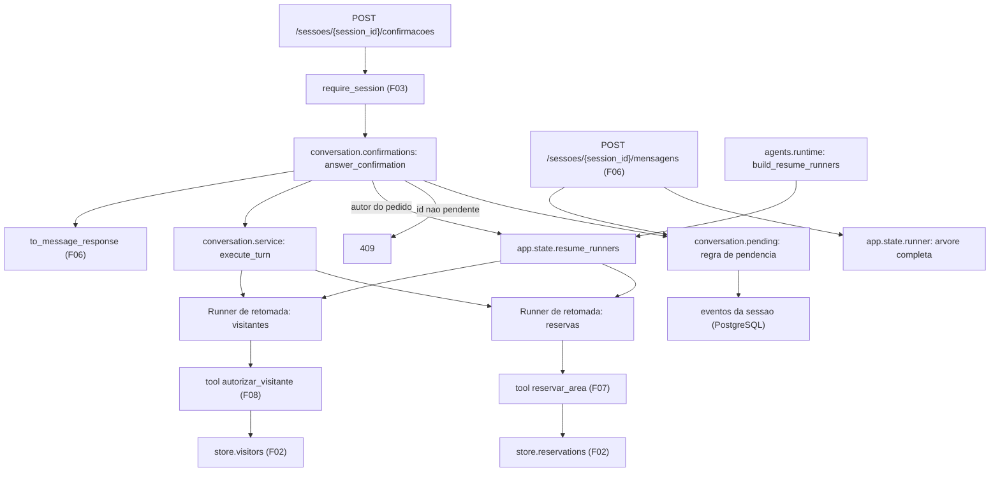

# Especificação técnica: Confirmation Flow

## 1. Visão técnica

**O quê:** a rota `POST /sessoes/{session_id}/confirmacoes`, que recebe a aprovação ou a recusa do morador para uma confirmação pendente e devolve a resposta no mesmo formato da rota de mensagens. A rota confere se o id está pendente naquela sessão, entrega a resposta ao especialista que pediu a confirmação e deixa o ADK retomar a tool em espera (`reservar_area` ou `autorizar_visitante`). Para a entrega funcionar, a aplicação passa a ter um Runner de retomada por especialista, além do Runner da conversa. A regra que diz quando uma confirmação deixa de estar pendente, definida pelo F06 em `aurora.conversation.pending`, muda: o item só sai da lista quando a tool em espera tem um resultado gravado depois da resposta do morador.

**Por quê:** a garantia "cobrança ou acesso só com confirmação" fecha aqui. O F07 e o F08 já fazem a tool gravar só quando o contexto traz a resposta de um pedido de confirmação do ADK. Falta o caminho pelo qual essa resposta entra no sistema, e ele precisa ser um só: a rota. Três pontos dependem de código, e não do modelo. O primeiro é a retomada: no ADK 2.2.0, o Runner da aplicação entrega a resposta de uma confirmação ao agente principal, que não tem a tool; nada executa e nenhum erro aparece. O segundo é a execução única: o ADK executa a tool de novo se a mesma resposta for enviada duas vezes, então é a conferência da rota, com o `409`, que impede a repetição. O terceiro é a falha no meio do caminho: o ADK grava a resposta antes de chamar a tool, e a regra do F06 tirava o item da lista nesse instante, mesmo que a tool não tivesse rodado.

**Escopo**

Incluído (a feature inteira; o PRD não separa Core Scope e Full Scope para o F10):
- Rota de confirmações, com o corpo `{"id", "confirmado"}` e a resposta `{"resposta", "confirmacoes_pendentes"}`
- Resposta `409` para todo id que não está pendente na sessão: id desconhecido, id já resolvido, id de outra sessão
- Entrega da resposta do morador ao especialista que pediu a confirmação, por um Runner de retomada próprio de cada especialista
- Regra nova de pendência: o item fica pendente até a tool em espera ter um resultado gravado depois da resposta
- Texto da resposta: o do especialista; quando o modelo falha ou não escreve texto depois de a tool ter resultado, um texto fixo tirado do resultado
- Retomada que falha: o item continua pendente, a resposta diz que a ação não foi executada, e o morador pode responder de novo
- Autor do pedido no item pendente interno, usado para escolher o Runner de retomada
- Insumos de verificação: Runners de retomada com o modelo roteirizado, entrada de roteiro que repassa a mensagem de um resultado, tool de teste que falha sob comando e estados de sessão novos

Contratos de entrada (PRD, bloco Consumes):
- Do F06: `run_turn`, `ConversationResult`, `pending_confirmations`, `PendingConfirmation`, `to_message_response`, `MessageResponse`, `require_session` (do F03, usado pela rota do F06), o Runner em `app.state.runner` e os erros `AssistantUnavailableError` e `SessionStoreError`
- Do F07: a fábrica `build_reservations_agent`, a tool `reservar_area` preparada para a retomada e os resultados tipados dela (`reservada`, `nao_confirmada`, `data_indisponivel`, `servico_indisponivel`)
- Do F08: a fábrica `build_visitors_agent`, a tool `autorizar_visitante` preparada para a retomada e os resultados tipados dela (`autorizado`, `nao_confirmada`, `ja_autorizado`, `servico_indisponivel`)

Contratos de saída: o PRD não declara bloco Provides para o F10. A rota de confirmações é exercitada pelo script do F11 e descrita pelo README do F12, sempre por HTTP.

Fora do escopo desta feature:
- Qualquer mudança nas tools de reservas e de visitantes, nas instruções dos agentes e na árvore de agentes do F06
- Duas respostas simultâneas para a mesma confirmação (o PRD deixa o comportamento indefinido)
- Armazenamento próprio para confirmações: o estado continua só nos eventos da sessão
- Script do fluxo do avaliador (F11) e README (F12)

## 2. Impacto na arquitetura

Componentes afetados:
- `src/aurora/conversation/confirmations.py` (novo): resposta a uma confirmação pendente
- `src/aurora/conversation/routes.py` (modificado): corpo e rota de confirmações
- `src/aurora/conversation/pending.py` (modificado): regra nova de pendência, autor do pedido e leitura do resultado da tool em espera
- `src/aurora/conversation/service.py` (modificado): execução de turno separada da montagem da resposta
- `src/aurora/agents/runtime.py` (modificado): fábrica dos Runners de retomada
- `src/aurora/main.py` (modificado): Runners de retomada no ciclo de vida
- `tests/` (novo e modificado): dublês, fixtures e testes



Fluxo de subida: o ciclo de vida da aplicação cria a engine, o serviço de sessão e o Runner da conversa, como hoje, e passa a criar também os Runners de retomada, um por especialista que pede confirmação. Cada Runner de retomada tem como agente raiz um especialista construído pela mesma fábrica usada na árvore (`build_reservations_agent` ou `build_visitors_agent`), com o mesmo modelo dos especialistas e a mesma engine, e usa o mesmo serviço de sessão e o mesmo nome de aplicação do ADK. O especialista do Runner de retomada é um objeto próprio, sem agente pai. Construir os Runners não abre conexão e não chama o modelo.

Fluxo de uma resposta: a rota carrega a sessão (`404` se não existe), valida o corpo (`422`) e chama `answer_confirmation`. A função lê as pendências da sessão; se o id não está entre elas, a rota responde `409` e nada mais acontece. Se está, a função monta a resposta de função `adk_request_confirmation` com o id e o valor de `confirmado`, escolhe o Runner de retomada pelo autor do pedido e executa um turno com essa mensagem. O ADK grava a resposta na sessão, encontra a chamada original da tool, executa a tool com a resposta no contexto, grava o resultado e chama o modelo do especialista para escrever o texto.

Fluxo do resultado: depois do turno, a função relê a sessão e olha os eventos, e não o que o turno devolveu. Se a tool em espera tem resultado gravado depois da resposta, a confirmação está resolvida: a resposta da rota leva o texto do especialista ou, se não houve texto, um texto fixo tirado do resultado. Se não tem resultado, a retomada falhou: o item continua na lista, e a resposta diz que a ação não foi executada.

Por que o Runner da conversa não serve: ele escolhe o agente que recebe a mensagem olhando os eventos da sessão. Os subagentes `reservas` e `visitantes` têm os bloqueios de transferência do F06, então o Runner sempre cai no agente principal. O agente principal recebe a resposta da confirmação, procura a tool original entre as tools dele, não acha e termina o turno sem executar nada. Um Runner cujo agente raiz é o próprio especialista não tem essa escolha a fazer.

Fluxo das pendências: a lista de `confirmacoes_pendentes` das duas rotas sai da mesma função. Com a regra nova, uma confirmação que recebeu resposta e não teve a tool executada continua na lista nas duas rotas, inclusive depois de um reinício.

## 3. Decisões técnicas

| Decisão | Abordagem escolhida | Alternativa considerada | Trade-off |
|---|---|---|---|
| Como a resposta chega ao especialista | Um Runner de retomada por especialista, com agente próprio construído pelas mesmas fábricas | Runner apontando para os objetos de especialista da árvore; método privado `_run_node_async` do Runner | Os dois especialistas são construídos duas vezes. Em troca, só a API pública do ADK é usada e a árvore da conversa não é alterada pelo segundo Runner |
| Como o Runner de retomada é escolhido | Pelo autor do evento que traz o pedido de confirmação | Pelo nome da tool em espera | Depende de o autor do evento ser o nome do agente, que é o que o ADK grava. Em troca, não existe tabela de tool para especialista para manter |
| Retomada do App (`resumability_config`) | Continua desligada | `is_resumable=True` | Nenhum. Com o Runner de retomada, a tool executa sem ela, e a sessão não ganha os eventos sem conteúdo que a retomada do App grava |
| Quando a confirmação deixa de estar pendente | Quando a tool em espera tem um resultado gravado depois da resposta do morador | Regra do F06 (basta existir a resposta), apagando a resposta em caso de falha; evento marcador de falha | Muda um módulo do F06, a sessão de teste "com confirmação respondida" ganha um evento e dois itens do contrato do F06 deixam de valer como estão escritos. Em troca, uma retomada que falha ou é interrompida deixa o item pendente sem nenhuma escrita extra, e isso vale depois de um reinício |
| Como a rota sabe o resultado | Relê a sessão depois do turno e procura o resultado da tool em espera | Usar o que `run_turn` devolveu | Uma leitura a mais da sessão. Em troca, a resposta da rota descreve o que ficou gravado, mesmo quando o turno terminou com erro |
| Texto da resposta | O texto do especialista; sem texto, o `mensagem` do resultado da tool; sem `mensagem`, uma frase fixa de aprovação ou de recusa | `503` como na rota de mensagens; nunca chamar o modelo | Quando o modelo falha, o texto é fixo e curto. Em troca, o morador sempre recebe o desfecho de uma ação que já foi executada ou descartada, e as duas aprovações simultâneas respondem `200` mesmo que uma chamada ao Gemini falhe |
| Falha do Gemini na rota de confirmações | Vira ausência de texto, tratada pela regra acima | Propagar `AssistantUnavailableError` e responder `503` | A falha do modelo não aparece no status HTTP da rota; fica no log. A rota de mensagens continua respondendo `503` |
| Retomada que falha | `200`, texto fixo dizendo que a ação não foi executada, item na lista | `500`; `503` | A falha não aparece no status HTTP. É o que o PRD pede: o item fica e o morador responde de novo |
| Falha do banco dentro da tool | O resultado `servico_indisponivel` conta como resultado: o item é resolvido e a resposta leva a mensagem da tool | Tratar `servico_indisponivel` como retomada que falhou | O morador precisa pedir de novo. Em troca, a regra de pendência não conhece os valores de `status` de nenhuma tool |
| Execução única | A rota só aceita id que está na lista de pendências; o reenvio recebe `409` | Trava por sessão para respostas simultâneas | Duas respostas simultâneas para o mesmo id podem chegar as duas à tool. O PRD deixa esse caso indefinido, e os índices únicos do F02 impedem a segunda linha |
| Onde nasce o `409` | A função de serviço devolve "nada" e a rota levanta o erro HTTP | Exceção própria com handler em `http_errors.py` | Mesmo padrão do `404` de sessão e de apartamento |
| Validação do corpo | `id` é texto de pelo menos 1 caractere depois de remover os espaços das pontas; `confirmado` é booleano estrito | Aceitar `"true"`, `1` e `0` | Um cliente que envia texto no lugar do booleano recebe `422`. É o que o PRD pede |
| Tamanho máximo do `id` | Sem limite | Limite de 200 caracteres | Um id longo é só mais um id que não está pendente: `409` |
| Reuso da execução de turno | `service.py` ganha `execute_turn`, que devolve os textos e a marca de pausa; `run_turn` passa a usá-la | Comparar o texto devolvido por `run_turn` com as mensagens fixas | Um refatoramento em um módulo do F06, sem mudança de comportamento. Em troca, a rota de confirmações distingue "sem texto" de "pedido de desculpas" sem comparar textos |
| Verificação da disputa | Duas requisições em paralelo na aplicação em processo, com o modelo roteirizado | Dois processos e Gemini real | Não cobre o Gemini real, que fica com o F11. Em troca, a disputa é verificada sem cota e sem rede |

## 4. Visão geral dos componentes (Component Overview)

**Backend:**

| Caminho | Novo/Modificado | Propósito | Responsabilidades |
|---|---|---|---|
| `src/aurora/conversation/confirmations.py` | Novo | Resposta a uma confirmação | Conferir se o id está pendente; montar a mensagem de resposta do ADK; escolher o Runner de retomada; executar o turno; decidir o texto pelo que ficou gravado; textos fixos |
| `src/aurora/conversation/routes.py` | Modificado | Rotas da conversa | Corpo `ConfirmationBody`; rota `POST /sessoes/{session_id}/confirmacoes`; `409` quando o serviço devolve "nada" |
| `src/aurora/conversation/pending.py` | Modificado | Leitura das pendências | Regra nova de pendência; campo `requester` no item; `confirmation_result` |
| `src/aurora/conversation/service.py` | Modificado | Execução de turno | `execute_turn` e `TurnOutput`; `run_turn` e `send_message` com o mesmo comportamento |
| `src/aurora/agents/runtime.py` | Modificado | Montagem do ADK | `build_resume_runners`; nomes dos especialistas com retomada |
| `src/aurora/main.py` | Modificado | Ciclo de vida | Cria `app.state.resume_runners` e fecha cada Runner na parada |

`src/aurora/agents/reservation_tools.py`, `visitor_tools.py`, `reservations.py`, `visitors.py`, `assistant.py`, `src/aurora/http_errors.py`, `src/aurora/restore.py` e o pacote `aurora.sessions` não mudam.

**Banco de dados:** nenhuma tabela nova e nenhuma migração. O estado das confirmações continua nos eventos da sessão; ver seção 6.

**Testes:**

| Caminho | Novo/Modificado | Propósito | Responsabilidades |
|---|---|---|---|
| `tests/scripted.py` | Modificado | Dublês | Entrada de roteiro calculada a partir da requisição; repasse da mensagem do resultado; tool de teste que falha sob comando |
| `tests/conftest.py` | Modificado | Fixtures | Runners de retomada roteirizados; estados de sessão novos; ver seção 7 |
| `tests/test_confirmations_routes.py` | Novo | Testes da rota | Ver seção 7 |
| `tests/test_confirmations_service.py` | Novo | Testes do serviço | Ver seção 7 |
| `tests/test_conversation_pending.py` | Modificado | Testes da regra | Regra nova, autor do pedido e resultado |
| `tests/test_conversation_service.py` | Modificado | Testes do turno | `execute_turn` |
| `tests/test_conversation_routes.py` | Modificado | Testes da rota de mensagens | Lista de pendências com a regra nova |
| `tests/test_agents.py` | Modificado | Testes da montagem | `build_resume_runners` |
| `tests/test_health.py` | Modificado | Testes do ciclo de vida | `app.state.resume_runners` |

### Detalhe: `src/aurora/conversation/pending.py`

| Nome | Tipo | Assinatura | Comportamento |
|---|---|---|---|
| `PendingConfirmation` | dataclass imutável | `id`, `action`, `details`, `requester` | `requester` é o autor do evento que traz o pedido de confirmação (`reservas` ou `visitantes`). Não aparece na resposta HTTP |
| `pending_confirmations` | função | `(session) -> list[PendingConfirmation]` | Mesma assinatura e mesma ordem (a dos pedidos). Um pedido entra na lista quando não está resolvido, pela regra abaixo |
| `confirmation_result` | função | `(session, confirmation_id) -> dict ou nada` | O resultado da tool em espera gravado depois da resposta ao pedido; nada quando o pedido não existe, não tem resposta ou não tem resultado depois dela |

Regra de pendência, sobre a lista de eventos da sessão em ordem:
- Pedido: uma chamada de função de nome `adk_request_confirmation`. O id dela é o id da confirmação. Os argumentos trazem a chamada original (`originalFunctionCall`), com o id da chamada da tool em espera.
- Resposta: um resultado de função com o id da confirmação, em um evento posterior ao do pedido.
- Resultado: um resultado de função com o id da chamada original, em um evento posterior ao da primeira resposta.
- Resolvido: o pedido tem resposta e tem resultado. Pendente: todo pedido que não está resolvido, com ou sem resposta.

O resultado de função com o id da chamada original que aparece antes da resposta é o aviso de espera, gravado no turno do pedido, e não conta. Quando há mais de um resultado depois da resposta, `confirmation_result` devolve o último. `acao` e `detalhes` do item continuam como o F06 definiu.

### Detalhe: `src/aurora/conversation/service.py`

| Nome | Tipo | Assinatura | Comportamento |
|---|---|---|---|
| `TurnOutput` | dataclass imutável | `texts`, `paused` | Os textos finais dos agentes no turno e a marca de que o turno parou em um pedido de confirmação |
| `execute_turn` | função assíncrona | `(runner, session, message) -> TurnOutput` | Executa o Runner com a mensagem e coleta os textos finais, pela regra do F06. Falha do Gemini vira `AssistantUnavailableError`; falha do armazenamento de sessões vira `SessionStoreError`; qualquer outro erro sai como está. Os registros de log são os de hoje |
| `run_turn` | função assíncrona | sem mudança | Passa a chamar `execute_turn`. O texto de resposta, o pedido de desculpas, a resposta para turno sem texto e a releitura das pendências continuam iguais |

`send_message`, `ConversationResult` e as mensagens fixas não mudam.

### Detalhe: `src/aurora/conversation/confirmations.py`

| Nome | Tipo | Valor ou assinatura |
|---|---|---|
| `NOT_PENDING_MESSAGE` | constante | `Não existe confirmação pendente com esse id nesta sessão.` |
| `NOT_EXECUTED_MESSAGE` | constante | `Não consegui executar a ação agora. A confirmação continua pendente e pode ser respondida de novo.` |
| `APPROVED_MESSAGE` | constante | `Confirmação recebida. A ação foi executada.` |
| `DENIED_MESSAGE` | constante | `Confirmação negada. Nada foi alterado.` |
| `answer_confirmation` | função assíncrona | `(resume_runners, service, session, *, confirmation_id, confirmed) -> ConversationResult ou nada` |

Passos de `answer_confirmation`:
1. Lê as pendências da sessão recebida. Se nenhuma tem o id, devolve nada, sem chamar Runner e sem gravar evento.
2. Monta o conteúdo de papel `user` com um resultado de função de nome `adk_request_confirmation`, o id da confirmação e a resposta `{"confirmed": <booleano>}`. É o formato que o ADK lê para preencher a resposta no contexto da tool.
3. Escolhe o Runner de retomada pelo `requester` do item. Se não existe Runner para esse autor, pula o passo 4.
4. Chama `execute_turn` com esse Runner. `SessionStoreError` sai da função. `AssistantUnavailableError` e qualquer outro erro são registrados em log, com o tipo do erro e o id da sessão, e o turno é tratado como sem texto.
5. Relê a sessão pelo serviço de sessão e calcula as pendências e `confirmation_result` do id.
6. Sem resultado: devolve `NOT_EXECUTED_MESSAGE` com as pendências, que incluem o item.
7. Com resultado: o texto é a junção dos textos do turno; se está vazio, o campo `mensagem` do resultado, quando é um texto não vazio; se não há `mensagem`, `APPROVED_MESSAGE` para aprovação e `DENIED_MESSAGE` para recusa. Devolve o texto com as pendências.

A função não lê o `status` do resultado e não conhece os nomes das tools.

### Detalhe: `src/aurora/conversation/routes.py`

- `ConfirmationBody`: `id` (texto; espaços das pontas removidos; pelo menos 1 caractere) e `confirmado` (booleano estrito). Campos a mais são ignorados, como no corpo da rota de mensagens.
- Rota `POST /sessoes/{session_id}/confirmacoes`: depende de `require_session`, chama `answer_confirmation` com `app.state.resume_runners` e `app.state.session_service`, levanta o erro HTTP `409` com `NOT_PENDING_MESSAGE` quando a função devolve nada e converte o resultado com `to_message_response`.
- `PendingItem`, `MessageResponse` e `to_message_response` não mudam: o campo `requester` não vai para a resposta.

A ordem das verificações é a do FastAPI no projeto: sessão (`404`), corpo (`422`), pendência (`409`).

### Detalhe: `src/aurora/agents/runtime.py`

| Nome | Tipo | Assinatura | Comportamento |
|---|---|---|---|
| `build_resume_runners` | função | `(*, specialists_model, engine, session_service) -> dict[str, Runner]` | Um Runner por especialista que pede confirmação, na chave do nome do agente: `reservas` e `visitantes`. Cada Runner recebe o nome da aplicação do ADK (`APP_NAME`), o serviço de sessão e um especialista novo, construído por `build_reservations_agent` ou `build_visitors_agent`; não cria sessão que não existe |

`build_app` e `build_runner` não mudam. O especialista `regulamento` não entra: ele não pede confirmação.

### Detalhe: `src/aurora/main.py`

O ciclo de vida guarda o dicionário em `app.state.resume_runners`, criado depois do Runner da conversa, com o modelo dos especialistas das configurações. Na parada, cada Runner de retomada é fechado antes do serviço de sessão.

## 5. Contratos de API

**Endpoint: responder confirmação**
- **Método:** POST
- **Caminho:** `/sessoes/{session_id}/confirmacoes`
- **Autenticação:** nenhuma (fora do escopo do PRD)

**Requisição:**

| Campo | Tipo | Obrigatório | Validação | Descrição |
|---|---|---|---|---|
| `session_id` (caminho) | texto | Sim | Sessão existente | Sessão em que a confirmação foi pedida |
| `id` | texto | Sim | Pelo menos 1 caractere depois de remover os espaços das pontas | O `id` de um item de `confirmacoes_pendentes` |
| `confirmado` | booleano | Sim | Booleano estrito: `true` ou `false` | `true` aprova; `false` nega |

**Exemplo de requisição:**
```json
{
  "id": "adk-5516e7ab-7288-413f-90ef-cd3cc77532e7",
  "confirmado": true
}
```

**Resposta (sucesso, 200):** o mesmo formato da rota de mensagens.

| Campo | Tipo | Descrição |
|---|---|---|
| `resposta` | texto | O desfecho: o texto do especialista ou um texto fixo. Nunca é vazio nesta rota |
| `confirmacoes_pendentes` | lista | As confirmações que continuam pendentes na sessão depois da resposta; `[]` quando não há |
| `confirmacoes_pendentes[].id` | texto | Id da confirmação |
| `confirmacoes_pendentes[].acao` | texto | Nome da tool em espera |
| `confirmacoes_pendentes[].detalhes` | objeto | Payload do pedido ou argumentos da chamada |

Aprovação de uma reserva com taxa:
```json
{
  "resposta": "Reserva confirmada: salão de festas em 2030-04-20, código RSV-4822.",
  "confirmacoes_pendentes": []
}
```

Recusa, com outra confirmação ainda pendente na sessão:
```json
{
  "resposta": "A reserva não foi confirmada. Nada foi alterado.",
  "confirmacoes_pendentes": [
    {
      "id": "adk-89b635c4-52ff-4b5d-b097-6660afef07bf",
      "acao": "autorizar_visitante",
      "detalhes": {"nome": "Joana Ribeiro", "data": "2030-04-21"}
    }
  ]
}
```

Aprovação que perdeu a disputa pela data:
```json
{
  "resposta": "Essa data não está mais disponível.",
  "confirmacoes_pendentes": []
}
```

Aprovação com o Gemini indisponível depois de a tool gravar:
```json
{
  "resposta": "Confirmação recebida. A ação foi executada.",
  "confirmacoes_pendentes": []
}
```

Retomada que falhou:
```json
{
  "resposta": "Não consegui executar a ação agora. A confirmação continua pendente e pode ser respondida de novo.",
  "confirmacoes_pendentes": [
    {
      "id": "adk-5516e7ab-7288-413f-90ef-cd3cc77532e7",
      "acao": "reservar_area",
      "detalhes": {"area": "salao-de-festas", "data": "2030-04-20", "taxa": 150.0}
    }
  ]
}
```

**Erros:** todos com o corpo `{"detail": "<texto>"}`, como nas outras rotas.

| Status | Quando | `detail` |
|---|---|---|
| 404 | Sessão desconhecida | `Sessão não encontrada.` |
| 422 | `id` ausente, vazio ou que não é texto; `confirmado` ausente ou que não é booleano; corpo que não é JSON | Texto de `validation_message` do projeto, citando o campo |
| 409 | Não existe confirmação pendente com esse id na sessão | `Não existe confirmação pendente com esse id nesta sessão.` |
| 503 | Armazenamento de sessões indisponível | `Serviço indisponível no momento. Tente novamente.` |

Exemplo de `409`:
```json
{
  "detail": "Não existe confirmação pendente com esse id nesta sessão."
}
```

**Origem do texto de `resposta`:**

| Situação gravada na sessão depois do turno | Texto do especialista | `resposta` |
|---|---|---|
| A tool em espera tem resultado | Sim | O texto do especialista |
| A tool em espera tem resultado | Não (falha do Gemini, texto vazio ou outro erro) | `mensagem` do resultado; sem `mensagem`, `Confirmação recebida. A ação foi executada.` ou `Confirmação negada. Nada foi alterado.` |
| A tool em espera não tem resultado | Indiferente | `Não consegui executar a ação agora. A confirmação continua pendente e pode ser respondida de novo.` |

**Rota de mensagens do F06 com esta feature:** o formato não muda. A lista `confirmacoes_pendentes` passa a seguir a regra nova: uma confirmação que recebeu resposta e não teve a tool executada continua listada.

**Interface em processo** (usada pela rota; não há consumidor fora desta feature)

| Operação | Módulo | Parâmetros | Resultado |
|---|---|---|---|
| `answer_confirmation` | `aurora.conversation.confirmations` | `resume_runners`, `service`, `session`, `confirmation_id`, `confirmed` | `ConversationResult`, ou nada quando o id não está pendente |
| `build_resume_runners` | `aurora.agents.runtime` | `specialists_model`, `engine`, `session_service` | Dicionário de Runners por nome de especialista |
| `confirmation_result` | `aurora.conversation.pending` | `session`, `confirmation_id` | Resultado da tool em espera, ou nada |
| `execute_turn` | `aurora.conversation.service` | `runner`, `session`, `message` | `TurnOutput` |

## 6. Modelo de dados

Esta feature não cria tabelas e não altera o esquema. A confirmação vive nos eventos da sessão, nas tabelas do ADK que o F03 criou, e a restauração do F05 continua apagando tudo junto com a sessão.

**Eventos de uma aprovação** (ordem observada no ADK 2.2.0, sobre PostgreSQL; os seis primeiros são os do turno do pedido, definidos pelo F07 e pelo F08):

| Ordem | Autor | Conteúdo |
|---|---|---|
| 1 | `user` | Texto do morador |
| 2 | `assistente` | Chamada `transfer_to_agent` para o especialista |
| 3 | `assistente` | Resultado de `transfer_to_agent` |
| 4 | especialista | Chamada da tool, com o id da chamada original |
| 5 | especialista | Resultado da tool, com `status` igual a `aguardando_confirmacao` |
| 6 | especialista | Chamada `adk_request_confirmation`, com o id da confirmação |
| 7 | `user` | Resultado de função `adk_request_confirmation`, com o id da confirmação e `{"confirmed": true}` |
| 8 | especialista | Resultado da tool para o id da chamada original, com `status` igual a `reservada` ou `autorizado` |
| 9 | especialista | Texto da resposta |

Os eventos 7 a 9 recebem o id de invocação do turno do pedido, mesmo quando houve outras mensagens entre o pedido e a resposta. Na recusa, o evento 7 traz `{"confirmed": false}` e o evento 8 traz `status` igual a `nao_confirmada`.

**Variações:**

| Caso | Evento 8 | Evento 9 |
|---|---|---|
| Data ocupada no momento da aprovação | Resultado com `status` igual a `data_indisponivel` | Texto |
| Visitante já autorizado no momento da aprovação | Resultado com `status` igual a `ja_autorizado` | Texto |
| Gemini falha depois da tool | Resultado da tool | Evento de erro do ADK, sem conteúdo |
| A tool lança um erro inesperado | Evento de erro do ADK, sem conteúdo | Não existe |

**Resposta do morador gravada na sessão:**

```json
{
  "author": "user",
  "content": {
    "role": "user",
    "parts": [
      {
        "functionResponse": {
          "id": "adk-5516e7ab-7288-413f-90ef-cd3cc77532e7",
          "name": "adk_request_confirmation",
          "response": {"confirmed": true}
        }
      }
    ]
  }
}
```

**Estado de um pedido de confirmação:**

| Estado | Eventos na sessão | Na lista de pendências | Resposta da rota para o id |
|---|---|---|---|
| Aguardando resposta | Pedido, sem resposta | Sim | Executa a retomada |
| Resposta sem resultado | Pedido e resposta; nenhum resultado da tool depois dela | Sim | Executa a retomada de novo |
| Resolvido | Pedido, resposta e resultado da tool depois dela | Não | `409` |

O segundo estado aparece quando a tool lança um erro inesperado, quando o processo para entre a gravação da resposta e a execução da tool, ou quando não existe Runner de retomada para o autor do pedido. Responder de novo grava uma segunda resposta para o mesmo id; o ADK lê a última e executa a tool, porque não há resultado depois dela.

**Uso das tabelas do F02:** a rota não lê nem grava reservas e visitantes. Quem grava é a tool retomada, pelas operações do F02. A exclusividade de área e data e a unicidade de visitante continuam nos índices únicos do F02: são eles que decidem a disputa entre duas aprovações.

## 7. Estratégia de testes

Seguem as convenções do F01 ao F09: pytest com `pytest-asyncio` em modo automático, `httpx` com `ASGITransport` para chamar a aplicação em processo, database `aurora_test`, variáveis definidas em `tests/conftest.py`. Nenhum teste chama o Gemini: o modelo roteirizado de `tests/scripted.py` ocupa o lugar dele, tanto no Runner da conversa quanto nos Runners de retomada.

Há três níveis. A regra de pendência é testada sobre sessões montadas em memória. O serviço é testado em processo, com sessões reais e Runners roteirizados. A rota é testada por HTTP na aplicação em processo, com o pedido feito pela rota de mensagens e a resposta pela rota de confirmações.

**Mudanças em `tests/scripted.py`:**

| Nome | Tipo | O que faz |
|---|---|---|
| `ScriptedModel` | classe (modificada) | Uma entrada do roteiro pode ser uma função: ela recebe a requisição ao modelo e devolve a resposta. As entradas atuais continuam valendo |
| `relay_tool_message` | função (nova) | Entrada de roteiro que responde com o `mensagem` do último resultado de tool da requisição; sem `mensagem`, responde `Pedido concluído.` |
| `ConfirmationTool` | classe (modificada) | Ganha `fail_next`, que faz a próxima execução lançar um erro que não é do banco, antes de registrar a execução |

**Mudanças em `tests/conftest.py`:**

| Nome | Tipo | O que faz |
|---|---|---|
| `build_scripted_resume_runners` | função (nova) | Runners de retomada construídos por `build_resume_runners` com o modelo roteirizado dos especialistas; aceita a tool de teste e uma engine para as tools |
| `conversation_client` | fixture (modificada) | Passa a trocar também `app.state.resume_runners`; com `confirmation_tool_enabled`, a tool de teste entra no especialista `reservas` da árvore e no de retomada |
| `answered_event` | função (modificada) | Vira dois eventos: a resposta `{"confirmed": false}` para `adk-conf-reserva` e o resultado de `reservar_area` para `adk-fc-reserva`, de autor `reservas`, com `status` igual a `nao_confirmada` |
| `session_with_answered` | fixture (modificada) | Dez eventos: os oito de `pending_events` e os dois acima |
| `session_with_unfinished_answer` | fixture (nova) | Nove eventos: os oito de `pending_events` e a resposta `{"confirmed": true}` para `adk-conf-reserva`, sem resultado da tool depois |
| `restarted_client` | fixture (nova) | Cria uma segunda aplicação sobre a mesma database, com Runners roteirizados novos, para os testes de reinício |

As fixtures `empty_session`, `session_201`, `session_with_pending`, `scripted`, `offline_engine` e `engine` são usadas como estão.

**Estrutura dos arquivos de teste:**

| Arquivo | Tipo | Alvo | Meta de cobertura |
|---|---|---|---|
| `tests/test_conversation_pending.py` | Unitário | `aurora.conversation.pending` | 95% |
| `tests/test_conversation_service.py` | Integração | `aurora.conversation.service` | 90% |
| `tests/test_confirmations_service.py` | Integração | `aurora.conversation.confirmations` | 95% |
| `tests/test_confirmations_routes.py` | Integração | rota de confirmações | 90% |
| `tests/test_conversation_routes.py` | Integração | rota de mensagens | 90% |
| `tests/test_agents.py` | Unitário | `aurora.agents.runtime` | 95% |
| `tests/test_health.py` | Integração | ciclo de vida | 85% |

**`tests/test_conversation_pending.py`** (mudanças e acréscimos):

| Função | Descrição | Asserções |
|---|---|---|
| `test_answered_request_without_result_is_listed` | Pedido com resposta e sem resultado | O item continua na lista |
| `test_resolved_request_is_not_listed` | Pedido, resposta e resultado da tool depois dela; substitui `test_answered_request_is_not_listed` | Só o outro item fica na lista |
| `test_waiting_result_before_answer_does_not_resolve` | Resultado de espera gravado antes da resposta | O item continua na lista |
| `test_result_of_another_call_does_not_resolve` | Resposta para um pedido e resultado da tool de outro | O primeiro continua na lista |
| `test_second_answer_then_result_resolves` | Duas respostas e um resultado depois da segunda | O item sai da lista |
| `test_pending_item_carries_requester` | Pedidos de autores diferentes | `requester` igual ao autor de cada evento |
| `test_confirmation_result_returns_result_after_answer` | Pedido resolvido | O resultado gravado depois da resposta |
| `test_confirmation_result_is_empty_without_answer_or_result` | Parametrizado: sem resposta; com resposta e sem resultado; id desconhecido | Nada |
| `test_confirmation_result_returns_the_last_result` | Dois resultados depois da resposta | O último |

Os testes de ordem, de `detalhes` e de sessão sem eventos continuam, ajustados para o campo novo.

**`tests/test_conversation_service.py`** (acréscimos):

| Função | Descrição | Asserções |
|---|---|---|
| `test_execute_turn_returns_texts` | Turno de texto | Os textos do turno; sem marca de pausa |
| `test_execute_turn_marks_pause` | Turno que para em um pedido de confirmação | Lista de textos vazia; marca de pausa |
| `test_execute_turn_translates_model_failure` | Roteiro com falha do Gemini | `AssistantUnavailableError` |
| `test_execute_turn_lets_other_errors_out` | Tool que não existe | O erro original sai |

Os testes de `run_turn` não mudam e continuam passando.

**`tests/test_confirmations_service.py`:**

| Função | Descrição | Asserções |
|---|---|---|
| `test_unknown_id_returns_nothing` | Id que não está na sessão | Nada; nenhum evento novo; nenhuma chamada ao modelo |
| `test_approval_runs_the_held_tool` | Pedido de salão e aprovação | Texto do especialista; lista vazia; uma reserva nova do `101` |
| `test_answer_is_delivered_to_the_requesting_specialist` | Eventos depois da aprovação | Resposta de autor `user`; resultado e texto de autor `reservas`; o modelo principal não é chamado |
| `test_denial_writes_nothing` | Recusa | Resultado `nao_confirmada`; reservas iguais às iniciais |
| `test_visitor_approval` | Pedido de visitante e aprovação | Resultado `autorizado`; uma linha de visitante do `101` |
| `test_request_without_payload_resumes_with_original_arguments` | `adk-conf-visita` de `session_with_pending` | Visitante gravado com o nome e a data dos argumentos originais |
| `test_other_pending_items_remain` | Duas pendências; resposta a uma | A outra continua na lista devolvida |
| `test_model_failure_after_tool_uses_result_message` | Falha do Gemini depois da tool, em aprovação com data ocupada | `mensagem` do resultado como texto; item resolvido |
| `test_model_failure_after_approval_uses_fixed_text` | Falha do Gemini depois de `reservada` | `APPROVED_MESSAGE`; a reserva existe |
| `test_denial_without_message_uses_fixed_text` | Tool de teste negada, modelo sem texto | `DENIED_MESSAGE` |
| `test_empty_model_text_uses_fallback` | Modelo responde texto vazio | Texto fixo; nunca a string vazia |
| `test_failed_resume_keeps_item_pending` | Tool de teste com `fail_next` | `NOT_EXECUTED_MESSAGE`; item na lista; nenhuma execução |
| `test_answer_again_after_failed_resume_executes_once` | Segunda resposta depois da falha | Uma execução; item fora da lista |
| `test_unfinished_answer_can_be_answered` | `session_with_unfinished_answer` | A tool executa; item resolvido |
| `test_missing_resume_runner_keeps_item_pending` | Dicionário de Runners vazio | `NOT_EXECUTED_MESSAGE`; nenhum evento novo |
| `test_store_failure_inside_tool_resolves_item` | Runner de retomada com as tools sobre `offline_engine` | Resultado `servico_indisponivel`; item fora da lista; nada gravado |
| `test_session_store_failure_propagates` | Serviço de sessão que falha na leitura | `SessionStoreError` sai da função |
| `test_no_state_change_to_apartment` | State da sessão antes e depois | Apartamento igual |

**`tests/test_confirmations_routes.py`:**

| Função | Descrição | Asserções |
|---|---|---|
| `test_approval_returns_200_with_message_format` | Aprovação do salão | Status 200; exatamente `resposta` e `confirmacoes_pendentes`; uma reserva |
| `test_approval_after_other_messages` | Mensagem entre o pedido e a aprovação | Status 200; uma reserva |
| `test_denial_returns_200_and_no_reservation` | Recusa | Status 200; reservas iguais às iniciais |
| `test_request_again_after_denial_and_approve` | Recusa, novo pedido, aprovação | Id novo diferente do primeiro; uma reserva |
| `test_visitor_approval_and_denial` | Visitante | Aprovação grava uma linha; recusa não grava |
| `test_replay_of_approved_id_returns_409` | Reenvio do mesmo corpo | Status 409; uma reserva; nenhum evento novo |
| `test_replay_does_not_execute_test_tool_again` | Tool de teste | Uma execução depois do reenvio |
| `test_replay_after_denial_returns_409` | Recusa e depois aprovação do mesmo id | Status 409; nada gravado |
| `test_unknown_id_returns_409` | `id-inexistente` | Status 409; `detail` fixo; dados iguais; nenhum evento novo |
| `test_id_from_another_session_returns_409` | Id pendente em outra sessão | Status 409; a outra sessão continua com a pendência |
| `test_tool_call_id_returns_409` | Id da chamada da tool em espera | Status 409 |
| `test_chat_text_does_not_resolve` | "Confirmo" pela rota de mensagens | Item ainda pendente; nenhuma resposta gravada para o id; nada gravado |
| `test_route_resolves_after_chat_text` | Aprovação depois do texto | Status 200; uma reserva |
| `test_other_pending_items_are_listed` | Duas pendências, uma resposta | A outra aparece em `confirmacoes_pendentes` |
| `test_two_pending_of_same_specialist` | Dois pedidos de salão; aprovação do segundo | Só a segunda data é reservada; o primeiro item continua |
| `test_concurrent_approvals_one_winner` | Duas aprovações em paralelo, sessões do `101` e do `201` | As duas com status 200; uma reserva na data; uma `resposta` com a recusa |
| `test_concurrent_approvals_with_model_failure` | O mesmo, com falha do Gemini nas duas | As duas com status 200; uma reserva na data |
| `test_lost_race_is_a_normal_refusal` | Aprovação depois de a data ser ocupada | Status 200; `resposta` com a recusa; sem o código da reserva vencedora nos eventos |
| `test_approval_after_app_restart` | Pedido, nova aplicação, aprovação | Status 200; uma reserva |
| `test_replay_after_app_restart_returns_409` | Aprovação, nova aplicação, reenvio | Status 409; uma reserva |
| `test_missing_or_invalid_fields_return_422` | Parametrizado: sem `id`; `id` vazio; `id` numérico; sem `confirmado`; `confirmado` como `"sim"`, `"true"`, `1`, nulo | Status 422; `detail` em texto; nenhum evento novo |
| `test_invalid_json_returns_422` | Corpo que não é JSON | Status 422 |
| `test_extra_fields_are_ignored` | Corpo com `apartamento` | Status 200; apartamento da sessão igual |
| `test_item_still_answerable_after_422` | 422 e depois corpo válido | Status 200 |
| `test_unknown_session_returns_404` | Sessão inexistente, com corpo válido e com corpo inválido | Status 404 nos dois casos |
| `test_failed_resume_returns_200_and_keeps_item` | Tool de teste com `fail_next` | Status 200; texto fixo; item na lista |
| `test_model_failure_after_tool_returns_200` | Falha do Gemini depois da tool | Status 200; texto fixo; item fora da lista |
| `test_message_route_still_works_after_confirmation` | Mensagem depois de uma aprovação | Status 200; o agente principal responde |
| `test_session_store_failure_returns_503` | Serviço de sessão que falha | Status 503; `detail` sem senha e sem SQL |

**`tests/test_conversation_routes.py`** (mudanças):

| Função | Descrição | Asserções |
|---|---|---|
| `test_message_does_not_list_answered` | Passa a usar a sessão de dez eventos | Só `adk-conf-visita` na lista |
| `test_message_lists_unfinished_answer` | `session_with_unfinished_answer` | Os dois ids na lista, na ordem |

**`tests/test_agents.py`** (acréscimos):

| Função | Descrição | Asserções |
|---|---|---|
| `test_resume_runners_cover_confirming_specialists` | `build_resume_runners` | Chaves `reservas` e `visitantes`, e só elas |
| `test_resume_runner_agent_matches_tree_specialist` | Agente de cada Runner | Mesmo nome e mesmos nomes de tools do especialista da árvore; sem agente pai; objeto diferente do da árvore |
| `test_resume_runners_share_app_name_and_session_service` | Runners | Nome da aplicação `aurora`; o serviço de sessão recebido |

**`tests/test_health.py`** (acréscimo):

| Função | Descrição | Asserções |
|---|---|---|
| `test_lifespan_exposes_resume_runners` | Ciclo de vida ativo | `app.state.resume_runners` tem os dois especialistas, sobre o serviço de sessão da aplicação |

## Tratamento de erros

| Cenário | Comportamento | Resultado |
|---|---|---|
| Sessão desconhecida | `require_session` responde antes da validação do corpo | `404`; nada lido além da sessão |
| `id` ausente, vazio ou que não é texto | Validação do corpo | `422`; nenhum evento; o item continua pendente |
| `confirmado` ausente ou que não é booleano | Validação do corpo | `422`; nenhum evento; o item continua pendente |
| Id desconhecido | O id não está na lista de pendências | `409`; nenhum Runner chamado; nenhum evento |
| Id já resolvido (reenvio) | O pedido tem resposta e resultado | `409`; a tool não executa de novo |
| Id de outra sessão | As pendências são lidas só da sessão do caminho | `409`; a outra sessão não é tocada |
| Id da chamada da tool, e não do pedido | Não é id de um pedido de confirmação | `409` |
| Recusa | A tool retomada devolve `nao_confirmada` | `200`; nada gravado |
| Data ocupada no momento da aprovação | O índice único do F02 recusa a segunda reserva; a tool devolve `data_indisponivel` | `200` com `Essa data não está mais disponível.`; nenhuma segunda linha |
| Visitante já autorizado no momento da aprovação | O índice único do F02 recusa; a tool devolve `ja_autorizado` | `200` com a mensagem da tool; nenhuma segunda linha |
| Falha do banco dentro da tool | A tool devolve `servico_indisponivel` | `200` com a mensagem da tool; o item é resolvido; nada gravado |
| A tool lança um erro inesperado | O ADK grava um evento de erro; não há resultado da tool | `200` com o texto de ação não executada; o item continua pendente |
| Não existe Runner de retomada para o autor do pedido | O turno não é executado | `200` com o texto de ação não executada; o item continua pendente; nenhum evento |
| O processo para entre a resposta e a execução | A resposta fica gravada sem resultado | Depois do reinício o item aparece como pendente e pode ser respondido |
| Gemini indisponível ou sem cota depois de a tool executar | A falha vira ausência de texto | `200` com o texto tirado do resultado; o item é resolvido |
| O modelo responde sem texto | Mesmo caminho | `200` com o texto tirado do resultado |
| O modelo chama outra tool na retomada | O turno segue as regras do F06; um pedido novo pode nascer | `200`; o pedido novo aparece em `confirmacoes_pendentes` |
| Armazenamento de sessões indisponível | `SessionStoreError` sai do serviço | `503` com a mensagem genérica |
| Duas respostas simultâneas para a mesma confirmação | Sem tratamento próprio (indefinido no PRD) | As duas podem chegar à tool; os índices do F02 impedem a segunda linha |
| O morador escreve que confirma | A rota de mensagens não monta resposta de confirmação | O item continua pendente; se o modelo chamar a tool de novo, nasce outro pedido |

A rota nunca devolve `500` para um erro previsto, e nenhuma resposta traz SQL, endereço do banco, senha ou chave do Gemini. Os logs registram o tipo do erro e o id da sessão.

Nas execuções de retomada, o ADK registra um aviso de log para cada evento de `assistente` que encontra na sessão, porque o agente principal não faz parte da árvore do Runner de retomada. O aviso não muda o resultado.

## Premissas e decisões

Decididas na entrevista:
- Quality gates: `uv run ruff check .`, `uv run ruff format --check .`, `uv run pytest`
- A resposta chega ao especialista por um Runner de retomada por especialista, com agente próprio construído pelas mesmas fábricas
- Uma confirmação fica pendente até a tool em espera ter um resultado gravado depois da resposta do morador. A regra muda em `aurora.conversation.pending`, e a sessão de teste "com confirmação respondida" do F06 ganha o evento do resultado
- O texto é o do especialista. Se o modelo falha ou não escreve texto depois de a tool ter resultado, a rota responde `200` com um texto tirado do resultado

Consequência registrada da segunda decisão: os itens `SVC-PENDING-03` e `API-PENDING-04` do contrato do F06 descrevem uma sessão de nove eventos em que o pedido respondido não é listado. Com a regra nova, essa sessão lista o pedido. O contrato do F06 não é editado aqui; ele volta a valer quando for gerado de novo.

Assumidas por mim (revise se discordar):
- Escopo completo da feature: o PRD não separa Core Scope de Full Scope
- O `409` e o `404` nascem na rota, como os `404` que já existem; `http_errors.py` não muda
- Textos fixos em português: os da seção 4. O PRD dá o sentido das mensagens, sem fixar o texto
- `id` vazio ou só com espaços responde `422`, e não `409`; o `id` não tem tamanho máximo
- `confirmado` é booleano estrito: `"true"`, `1` e nulo respondem `422`
- Campos a mais no corpo são ignorados, como na rota de mensagens
- A resposta desta rota nunca tem `resposta` vazia. Se a retomada terminar em um pedido novo de confirmação, o texto vem do resultado da tool retomada
- O resultado `servico_indisponivel` da tool resolve a confirmação: o morador faz o pedido de novo. A regra de pendência não lê `status`
- Quando não existe Runner de retomada para o autor do pedido, o caso é tratado como retomada que falhou
- A falha do Gemini nesta rota não responde `503`; fica no log. A rota de mensagens não muda
- Duas respostas simultâneas para a mesma confirmação não têm trava. O PRD deixa o caso indefinido, e os índices do F02 impedem linhas repetidas
- A retomada do App continua desligada
- O especialista `regulamento` não tem Runner de retomada
- `PendingConfirmation` ganha o campo `requester`; os testes do F06 que comparam o item inteiro são ajustados
- `run_turn` mantém o comportamento; a extração de `execute_turn` é só estrutural
- O contrato tem só a superfície HTTP API. Não há superfície Service: os consumidores do F10 (F11 e F12) usam a rota por HTTP
- O contrato não usa as rotas de verificação do F04, que está fora das dependências do F10: os efeitos são lidos na database `aurora_test`
- A verificação usa o modelo roteirizado em processo. Os itens contra a API iniciada com `uv run aurora-api` dependem só de o Gemini não aceitar a chave `test-key`, como no F06
- A disputa pela data é verificada com duas requisições em paralelo na aplicação em processo
- Complexidade da feature: média
- Nenhuma issue do GitHub é criada: o repositório está com as issues desativadas

Verificado antes de escrever, no ADK 2.2.0 instalado, com a árvore de agentes atual, o modelo roteirizado e a database `aurora_test`:
- Uma resposta de confirmação enviada pelo Runner da aplicação não retoma a tool: o agente principal recebe a mensagem, a tool não é chamada, o modelo não é chamado e nada é gravado. Aconteceu logo depois do pedido e depois de outra mensagem
- Um Runner cujo agente raiz é um especialista construído por `build_reservations_agent`, com o mesmo nome de aplicação e o mesmo serviço de sessão, retoma a tool: aprovação grava a reserva, recusa devolve `nao_confirmada`, e o especialista escreve o texto
- A retomada funciona depois de outra mensagem na sessão, depois de fechar e recriar o serviço de sessão e os Runners, com duas pendências do mesmo especialista respondidas fora de ordem e com pendências de especialistas diferentes
- A sessão gravada diretamente pelo serviço de sessão com os oito eventos do F06 é retomada normalmente, inclusive o pedido de visitante sem payload, que executa com os argumentos originais
- Depois da retomada, a rota de mensagens continua funcionando com o Runner da aplicação, inclusive com transferência para o mesmo especialista
- Na chamada ao modelo depois da retomada, o especialista recebe o pedido original, a chamada da tool e o resultado final; o aviso de espera e as mensagens enviadas no intervalo não aparecem
- A mesma resposta enviada duas vezes pelo Runner de retomada executa a tool duas vezes. A segunda execução devolve `ja_autorizado` ou `data_indisponivel`, sem segunda linha
- Quando a tool lança um erro inesperado, a sessão fica com a resposta e um evento de erro, sem resultado da tool. Uma segunda resposta executa a tool
- Quando o modelo falha depois da tool, a reserva já está gravada, o resultado da tool está na sessão e a execução termina com o erro de assistente indisponível
- Duas aprovações em paralelo para o salão em `2030-05-11`, uma em sessão do `101` e outra em sessão do `201`, terminam sem erro: uma tool devolve `reservada` e a outra `data_indisponivel`, e existe uma reserva ativa na data
- Marcar o resultado da tool para não ser resumido, por um callback, não evita a chamada ao modelo na retomada
- A tool de teste do F06, com confirmação obrigatória do ADK, é retomada do mesmo jeito: a aprovação executa a função uma vez, e a recusa devolve um erro de rejeição sem executar
- Um protótipo descartável da rota, com a regra nova de pendência e o texto fixo tirado do resultado, respondeu `409` para id desconhecido, id de outra sessão e reenvio, `422` para `confirmado` como texto ou número, e `200` nos demais casos descritos nesta especificação

Não verificado: o comportamento do Gemini real ao receber, na retomada, um histórico com a chamada da tool e o resultado final; a resposta exata do Gemini para a chave `test-key` no processo iniciado por `uv run aurora-api` (a especificação assume a mesma falha que o F06 observou); a disputa com dois processos distintos da API, que o PRD não pede.

## Rastreabilidade com o PRD

| Bloco do PRD (F10) | Onde está nesta especificação |
|---|---|
| Consumes | Seção 1 (contratos de entrada); seção 2 (fluxos); seção 4 (módulos do F06 modificados) |
| Provides | O PRD não declara; seção 1 (contratos de saída) |
| Capabilities | Seções 3, 4 e 5; seção 6 (estado de um pedido) |
| Experience | Seção 2 (fluxo de uma resposta); seção 5 (exemplos); seção 6 (eventos de uma aprovação) |
| Error Handling | Seção "Tratamento de erros"; seção 5 (erros e origem do texto) |
