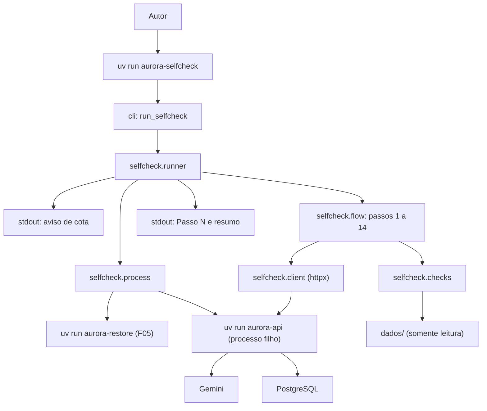

# Especificação técnica: Evaluator Flow Self-Check

## 1. Visão técnica

**O quê:** o comando `uv run aurora-selfcheck`. Ele reproduz os passos 1 a 14 do fluxo do avaliador contra a API real, com chamadas reais ao Gemini, e imprime PASS ou FAIL para cada passo. O próprio comando controla o processo da API: confere que a porta está livre, executa a restauração, sobe a API como processo filho, espera `/health`, para a API com SIGINT no passo 13, sobe de novo com o mesmo comando e para no fim. As duas aprovações do passo 14 saem em paralelo. A saída termina com `<n>/14 passos passaram`, e o código de saída é 0 só quando os 14 passam. A feature acrescenta o pacote `aurora.selfcheck`, o ponto de entrada `run_selfcheck` em `aurora.cli`, o registro do comando no `pyproject.toml` e uma API simulada em `tests/selfcheck_fake.py`, com falhas injetáveis, para verificar o próprio comando sem gastar cota.

**Por quê:** a entrega falha se qualquer verificação do avaliador falhar, e várias delas dependem de estado acumulado (S1 criada no passo 2, contagem de eventos do passo 12 conferida no 13), de um reinício real do processo e de duas requisições simultâneas. Repetir isso à mão a cada mudança é lento e sujeito a erro. O comando transforma o fluxo do enunciado em uma verificação repetível, que roda contra um banco recém-restaurado e aponta o passo e a asserção que falharam.

**Escopo**

Incluído:
- Comando `uv run aurora-selfcheck`, executado da raiz do projeto, sem argumentos obrigatórios
- Opções `--api-cmd`, `--restore-cmd` e `--base-url`, com os valores reais como padrão
- Aviso de consumo de cota impresso antes de qualquer outra saída e antes da primeira chamada ao modelo
- Controle do processo da API: porta livre, restauração, subida, espera por `/health`, parada com SIGINT, reinício e parada final, inclusive em falha e em interrupção
- Os 14 passos comportamentais do fluxo do avaliador, com as mensagens do enunciado e as verificações de cada passo
- Até 2 mensagens de seguimento por passo, só nos passos que esperam um efeito
- Dependência entre passos: um passo cujo resultado anterior falta não roda e sai como FAIL com `depende do passo N`
- As duas aprovações do passo 14 disparadas ao mesmo tempo, em conexões separadas
- Uma linha por passo, resumo final e código de saída
- API simulada para verificação, com estado em arquivo, falhas injetáveis e estatísticas

Contratos de entrada (PRD, bloco Consumes):
- Do F04: `GET /apartamentos/{numero}/reservas` e `GET /apartamentos/{numero}/visitantes`, para conferir os efeitos de cada passo
- Do F05: `uv run aurora-restore`, executado antes de subir a API; o código de saída 0 é o único sinal usado
- Do F09: a resposta sobre a piscina aos domingos e a ausência de trechos de outros capítulos nos eventos
- Do F10: `POST /sessoes/{id}/confirmacoes` para aprovar e negar, os `409` dos passos 8 e 9 e a disputa do passo 14
- Do F03 e do F06, por meio dos anteriores: `POST /sessoes`, `POST /sessoes/{id}/mensagens`, `GET /sessoes/{id}/eventos` e `GET /health`
- De `dados/`: os códigos de `reservas.json` e o texto de `regulamento.md`, lidos e nunca escritos

Contratos de saída:
- O PRD não declara bloco Provides. A saída é o próprio comando: o F12 o documenta em Como rodar

Fora do escopo desta feature:
- O passo 15 (inspeção do repositório: versão do ADK, `dados/` idênticos, nenhuma chave versionada)
- A parte do passo 1 que acontece antes do comando: clone, `.env`, `uv sync` e `docker compose up`
- Variações de redação das mensagens; o comando usa os textos do enunciado
- Repetir o fluxo várias vezes numa só execução; para a meta "3 vezes seguidas", o comando é executado 3 vezes
- Qualquer mudança na API, nos agentes ou na restauração
- Documentação do comando no README de entrega (F12)

## 2. Impacto na arquitetura

Componentes afetados:
- `src/aurora/selfcheck/__init__.py` (novo): pacote
- `src/aurora/selfcheck/options.py` (novo): opções de linha de comando, textos fixos e prazos
- `src/aurora/selfcheck/process.py` (novo): porta, restauração e processo da API
- `src/aurora/selfcheck/client.py` (novo): cliente HTTP das rotas usadas no fluxo
- `src/aurora/selfcheck/checks.py` (novo): verificações sobre respostas e eventos
- `src/aurora/selfcheck/flow.py` (novo): estado do fluxo, conversa com seguimentos e os 14 passos
- `src/aurora/selfcheck/runner.py` (novo): execução dos passos, dependências, relatório e limpeza
- `src/aurora/cli.py` (modificado): ponto de entrada `run_selfcheck`
- `pyproject.toml` (modificado): registro do comando `aurora-selfcheck`
- `tests/selfcheck_fake.py` (novo): API simulada com falhas injetáveis
- `tests/test_selfcheck_checks.py`, `tests/test_selfcheck_flow.py`, `tests/test_selfcheck_process.py`, `tests/test_selfcheck_cli.py` (novos)



Fluxo do comando: `run_selfcheck` lê as opções e chama o runner. O runner imprime o aviso e executa os passos em ordem. O passo 1 confere a porta, executa a restauração, sobe a API e confere os dados iniciais. Os passos 2 a 14 usam o cliente HTTP; o passo 13 para e sobe a API pelo controle de processo. Cada passo devolve PASS ou levanta uma falha com a asserção; o runner imprime a linha do passo assim que ele termina. No fim, com ou sem falha, o runner para a API se ela estiver no ar e imprime o resumo.

O processo da API roda em uma sessão própria (`start_new_session`), com stdout e stderr num arquivo de log temporário. A parada manda SIGINT ao grupo do processo, o mesmo efeito de Ctrl+C no terminal, e também alcança o processo Python iniciado pelo `uv run`.

## 3. Decisões técnicas

| Decisão | Abordagem escolhida | Alternativa considerada | Trade-off |
|---|---|---|---|
| Dono do processo da API | O comando sobe, reinicia e para a API; exige a porta livre | Adotar uma API já no ar e matá-la pela porta; pedir ao autor que reinicie à mão | O autor não pode estar com a API aberta em outro terminal; em troca, um comando faz tudo e o reinício do passo 13 é real |
| Forma do comando | Console script `aurora-selfcheck` → `aurora.cli:run_selfcheck`, ao lado de `aurora-api` e `aurora-restore` | `scripts/self_check.py` fora do pacote | O código vai no pacote instalado; em troca, os três comandos documentados têm a mesma forma |
| Sobrescritas | Opções `--api-cmd`, `--restore-cmd` e `--base-url`, divididas com `shlex.split` | Variáveis de ambiente | Três opções a mais na ajuda; em troca, a API simulada é usada sem tocar o ambiente nem o `.env` |
| Modelo que pergunta em vez de agir | Até 2 mensagens de seguimento fixas por passo, só nos passos que esperam um efeito | Nenhum seguimento; repetir o passo inteiro | Uma conversa um pouco diferente da do enunciado; em troca, o enunciado permite responder perguntas, e um passo não falha só pela redação do modelo |
| Falha em um passo | Todos os passos são tentados; um passo cujo pré-requisito falhou sai como FAIL com `depende do passo N` | Parar na primeira falha; rodar tudo sem dependência | Mais chamadas ao modelo num build quebrado; em troca, uma execução mostra todas as garantias quebradas, sem falhas em cascata confusas |
| Paralelismo do passo 14 | Dois `httpx.AsyncClient`, cada um com a conexão já aberta por um `GET /health`, liberados pelo mesmo `asyncio.Event` e reunidos com `asyncio.gather` | Duas threads; dois `curl` | Depende do laço de eventos; em troca, as duas requisições saem no mesmo instante e as respostas voltam ao mesmo código |
| Parada da API | SIGINT ao grupo do processo; 15 s de espera; depois SIGTERM e, 5 s depois, SIGKILL | `terminate()` direto | Só POSIX; em troca, o passo 13 reproduz o Ctrl+C do enunciado e o encerramento gracioso do ADK |
| Verificação do comando | API simulada em `tests/selfcheck_fake.py`, com estado em arquivo JSON e falhas injetáveis, mais uma execução real | Só execuções reais | Um arquivo de teste grande; em troca, a detecção de cada falha é verificável sem cota e sem quebrar o código real |
| "Trecho de outro capítulo" | Qualquer linha de 40 ou mais caracteres de `dados/regulamento.md` que pertença a um capítulo diferente do IV | Lista de expressões marcadoras | Mais linhas para procurar (cerca de 200); em troca, segue a definição do contrato do F09 e não depende de escolher marcadores |
| Conteúdo dos eventos | Todas as strings do JSON dos eventos, em qualquer profundidade, juntadas com quebra de linha | `json.dumps` da lista | Uma função recursiva; em troca, aspas e quebras de linha não aparecem escapadas e a busca por linhas do regulamento funciona |
| Detalhes da pendência | Os valores de `detalhes`, em qualquer profundidade, comparados sem acento e sem diferença de caixa | Chaves fixas `area`, `data`, `nome` | Aceita mais formatos; em troca, segue o enunciado, que deixa os nomes de `detalhes` livres |
| Idioma da saída | Português, como os outros comandos | Inglês | Nenhum |
| Log da API | Arquivo temporário `aurora-selfcheck-api-<data-hora>.log`, com o caminho impresso no fim | Descartar a saída | Um arquivo a mais no diretório temporário; em troca, uma falha de subida pode ser investigada |

## 4. Visão geral dos componentes (Component Overview)

**Backend:**

| Caminho | Novo/Modificado | Propósito | Responsabilidades |
|---|---|---|---|
| `src/aurora/selfcheck/__init__.py` | Novo | Pacote | Vazio |
| `src/aurora/selfcheck/options.py` | Novo | Opções e constantes | `SelfCheckOptions`; `parse_args(argv)`; textos do aviso e do seguimento; prazos |
| `src/aurora/selfcheck/process.py` | Novo | Processos externos | `ensure_port_free`; `run_restore`; `ApiProcess` (subida, espera por `/health`, parada, log) |
| `src/aurora/selfcheck/client.py` | Novo | Cliente HTTP | `AuroraClient` com uma função por rota usada no fluxo |
| `src/aurora/selfcheck/checks.py` | Novo | Verificações | `CheckFailed`; busca em respostas e eventos; `302` isolado; linhas do regulamento; detalhes; horário |
| `src/aurora/selfcheck/flow.py` | Novo | Fluxo | `FlowState`; `converse`; as 14 funções de passo; `STEPS` |
| `src/aurora/selfcheck/runner.py` | Novo | Execução | `run(options, out)`; dependências; linhas e resumo; parada final da API |
| `src/aurora/cli.py` | Modificado | Ponto de entrada | `run_selfcheck()`: chama o runner; Ctrl+C vira código 130 |
| `pyproject.toml` | Modificado | Manifesto | `aurora-selfcheck = "aurora.cli:run_selfcheck"` em `[project.scripts]` |

**Banco de dados:** nenhuma mudança. O comando não abre conexão com o PostgreSQL; a restauração e a API fazem isso.

**Testes e verificação:**

| Caminho | Novo/Modificado | Propósito | Responsabilidades |
|---|---|---|---|
| `tests/selfcheck_fake.py` | Novo | API simulada | Subcomandos `servir` e `restaurar`; as rotas do fluxo; estado em arquivo; falhas da seção 5 |
| `tests/test_selfcheck_checks.py` | Novo | Testes das verificações | Ver seção 7 |
| `tests/test_selfcheck_flow.py` | Novo | Testes dos passos | Ver seção 7 |
| `tests/test_selfcheck_process.py` | Novo | Testes do controle de processo | Ver seção 7 |
| `tests/test_selfcheck_cli.py` | Novo | Testes do comando de ponta a ponta | Ver seção 7 |

### Detalhe: `src/aurora/selfcheck/options.py`

| Nome | Tipo | Valor ou assinatura | Observações |
|---|---|---|---|
| `SelfCheckOptions` | dataclass imutável | `api_cmd: list[str]`, `restore_cmd: list[str]`, `base_url: str` | Os comandos já divididos |
| `parse_args` | função | `(argv: list[str] \| None) -> SelfCheckOptions` | `argparse`; `--api-cmd`, `--restore-cmd`, `--base-url` |
| `DEFAULT_API_CMD` | texto | `uv run aurora-api` | |
| `DEFAULT_RESTORE_CMD` | texto | `uv run aurora-restore` | |
| `DEFAULT_BASE_URL` | texto | `http://localhost:8000` | |
| `QUOTA_WARNING` | texto | `AVISO: o self-check faz chamadas reais ao Gemini (algumas dezenas por execução) e consome cota da chave configurada no .env.` | Primeira linha da saída |
| `FOLLOW_UP_TEXT` | texto | `Sim, pode seguir com o pedido.` | Mensagem de seguimento |
| `MAX_FOLLOW_UPS` | int | `2` | Por passo |
| `REQUEST_TIMEOUT` | float | `120.0` s | Por requisição HTTP |
| `STARTUP_TIMEOUT` | float | `60.0` s | Espera por `/health` |
| `STOP_TIMEOUT` | float | `15.0` s | Espera depois do SIGINT |
| `KILL_TIMEOUT` | float | `5.0` s | Espera depois do SIGTERM |

### Detalhe: `src/aurora/selfcheck/process.py`

| Nome | Tipo | Valor ou assinatura | Observações |
|---|---|---|---|
| `ensure_port_free` | função | `(base_url: str) -> None` | Tenta conectar em host e porta da URL; se conecta, levanta `CheckFailed("a porta <porta> já está em uso; pare a API antes de rodar o self-check")` |
| `run_restore` | função async | `(cmd: list[str]) -> None` | Executa e espera; código diferente de zero levanta `CheckFailed` com o código e a última linha de stderr |
| `ApiProcess` | classe | `ApiProcess(cmd, base_url, log_path)` | Um processo por vez |
| `ApiProcess.start` | método async | `() -> None` | `start_new_session=True`; stdout e stderr no log, em modo de acréscimo; espera `/health` responder `200` a cada 0,5 s até `STARTUP_TIMEOUT`; se o processo sai antes, levanta `CheckFailed("a API encerrou com código <n> antes de responder em /health")`; se o prazo vence, para o processo e levanta `CheckFailed` |
| `ApiProcess.stop` | método async | `() -> None` | SIGINT ao grupo; `STOP_TIMEOUT`; SIGTERM; `KILL_TIMEOUT`; SIGKILL; depois espera a porta ficar livre por até 10 s; não faz nada se o processo já terminou |
| `ApiProcess.running` | propriedade | `bool` | |
| `ApiProcess.log_path` | atributo | `Path` | |

### Detalhe: `src/aurora/selfcheck/client.py`

| Nome | Tipo | Valor ou assinatura | Observações |
|---|---|---|---|
| `Reply` | dataclass | `status: int`, `body: Any` | `body` é o JSON, ou o texto quando não é JSON |
| `AuroraClient` | classe | `AuroraClient(base_url)`; usado com `async with` | `httpx.AsyncClient` com `REQUEST_TIMEOUT` |
| `create_session` | método async | `(apartment) -> Reply` | `POST /sessoes` |
| `send` | método async | `(session_id, texto) -> Reply` | `POST /sessoes/{id}/mensagens` |
| `confirm` | método async | `(session_id, confirmation_id, confirmed) -> Reply` | `POST /sessoes/{id}/confirmacoes` |
| `events` | método async | `(session_id) -> Reply` | `GET /sessoes/{id}/eventos` |
| `reservations` | método async | `(apartment) -> list[dict]` | `GET /apartamentos/{n}/reservas`; status diferente de `200` levanta `CheckFailed` |
| `visitors` | método async | `(apartment) -> list[dict]` | `GET /apartamentos/{n}/visitantes`; idem |
| `health` | método async | `() -> bool` | `GET /health` |

### Detalhe: `src/aurora/selfcheck/checks.py`

| Nome | Tipo | Valor ou assinatura | Observações |
|---|---|---|---|
| `CheckFailed` | exceção | `CheckFailed(reason: str)` | `reason` é o texto impresso depois de `FAIL — ` |
| `require` | função | `(condition: bool, reason: str) -> None` | |
| `strings_of` | função | `(value: Any) -> list[str]` | Todas as strings de um JSON, em qualquer profundidade; chaves incluídas |
| `events_text` | função | `(events: list) -> str` | `"\n".join(strings_of(events))` |
| `has_isolated_302` | função | `(text: str) -> bool` | Regex `(?<![\w.,/-])302(?![\w-]\|[.,]\d)` |
| `foreign_bylaws_lines` | função | `(path: Path, keep_chapter: int = 4) -> list[tuple[str, str]]` | Pares (numeral romano do capítulo, linha) das linhas com 40 ou mais caracteres (contados com `len`, depois de `strip`) de capítulos diferentes do IV; os capítulos começam em linhas `## Capítulo <romano>:` |
| `leaked_bylaws_line` | função | `(text: str, lines: list[tuple[str, str]]) -> tuple[str, str] \| None` | O primeiro par cuja linha aparece no texto, ou `None`; o motivo da falha é `um evento contém trecho do capítulo <romano>: <início da linha>` |
| `normalize` | função | `(text: str) -> str` | Sem acento (`unicodedata` NFKD), minúsculo, hífens e espaços equivalentes |
| `pending_matching` | função | `(items: list, *expected: str) -> dict \| None` | O primeiro item de `confirmacoes_pendentes` em que cada valor esperado aparece, normalizado, em algum valor de `detalhes` |
| `mentions_closing_time` | função | `(text: str) -> bool` | Regex sem diferença de caixa: `\b20\s*h\b`, `\b20:00\b` ou `\b20\s*horas\b` |
| `function_call_names` | função | `(events: list) -> list[str]` | Os `name` de todo `functionCall` dentro de `content.parts` |
| `seed_codes` | função | `(path: Path) -> set[str]` | Os `codigo` de `dados/reservas.json` |

### Detalhe: `src/aurora/selfcheck/flow.py`

| Nome | Tipo | Valor ou assinatura | Observações |
|---|---|---|---|
| `FlowState` | dataclass mutável | `s1`, `s2`, `s3`, `s4`: `str \| None`; `approved_hall_id: str \| None`; `s1_event_count: int \| None`; `hall_codes: dict[str, str]` | Resultados que um passo deixa para os seguintes |
| `FlowContext` | dataclass | `client`, `api: ApiProcess`, `options`, `state: FlowState`, `bylaws_lines`, `seed_codes` | Passado a cada passo |
| `Exchange` | dataclass | `replies: list[Reply]` | As respostas de uma conversa, incluindo os seguimentos |
| `converse` | função async | `(ctx, session_id, texto, until=None) -> Exchange` | Envia `texto`; se `until` foi dado e ainda é falso, envia `FOLLOW_UP_TEXT` até `MAX_FOLLOW_UPS` vezes; uma resposta diferente de `200` levanta `CheckFailed` |
| `Step` | dataclass imutável | `number: int`, `title: str`, `depends_on: tuple[int, ...]`, `run` | |
| `STEPS` | tupla | Os 14 passos da seção 5 | Em ordem |

O predicado `until` recebe o `Exchange` acumulado e consulta as rotas de verificação quando precisa. Ele é avaliado depois de cada resposta.

### Detalhe: `src/aurora/selfcheck/runner.py`

| Nome | Tipo | Valor ou assinatura | Observações |
|---|---|---|---|
| `run` | função async | `(options, out=sys.stdout) -> int` | Imprime o aviso; executa os passos; imprime cada linha assim que o passo termina, com `flush`; para a API num `finally`; imprime o resumo; devolve 0 ou 1 |
| `main` | função | `(argv: list[str] \| None = None) -> int` | `asyncio.run(run(parse_args(argv)))` |

Um passo é pulado quando algum passo de `depends_on` não passou. Um passo pulado imprime `FAIL — depende do passo N`, com o menor N que falhou, e conta como falha. Uma exceção que não é `CheckFailed` (rede, JSON, chave ausente) vira FAIL com `erro inesperado: <tipo>: <mensagem>`; o runner segue para o próximo passo.

### Detalhe: `src/aurora/cli.py`

| Nome | Tipo | Valor ou assinatura | Observações |
|---|---|---|---|
| `run_selfcheck` | função | `() -> None` | Importa `aurora.selfcheck.runner` dentro da função; `raise SystemExit(main(sys.argv[1:]))`; `KeyboardInterrupt` vira `SystemExit(130)` depois de o runner parar a API |

## 5. Contrato do comando

**Invocação:**

```
uv run aurora-selfcheck [--api-cmd "<comando>"] [--restore-cmd "<comando>"] [--base-url <url>]
```

| Opção | Padrão | Descrição |
|---|---|---|
| `--api-cmd` | `uv run aurora-api` | Comando que sobe a API; dividido com `shlex.split`; usado nas duas subidas |
| `--restore-cmd` | `uv run aurora-restore` | Comando de restauração; dividido com `shlex.split` |
| `--base-url` | `http://localhost:8000` | Endereço das requisições e da conferência de porta |

O comando não lê o `.env`; quem lê é a API e a restauração. Ele não exige `GOOGLE_API_KEY` no ambiente.

**Saída de uma execução sem falhas:**

```
AVISO: o self-check faz chamadas reais ao Gemini (algumas dezenas por execução) e consome cota da chave configurada no .env.
Passo 1: PASS
Passo 2: PASS
...
Passo 14: PASS
14/14 passos passaram
```

**Saída com falhas:**

```
AVISO: ...
Passo 1: PASS
Passo 2: FAIL — POST /sessoes respondeu 200; esperado 201
Passo 3: FAIL — depende do passo 2
...
Passo 14: PASS
3/14 passos passaram
Log da API: /tmp/aurora-selfcheck-api-20261014T150000.log
```

A linha `Log da API:` aparece sempre que algum passo falha e a API chegou a ser iniciada.

**Códigos de saída:**

| Código | Quando |
|---|---|
| `0` | Os 14 passos passaram |
| `1` | Pelo menos um passo falhou |
| `130` | Execução interrompida com Ctrl+C; a API foi parada antes de sair |

**Os 14 passos:**

Em todos os passos, "respostas do passo" são as respostas de mensagem e de confirmação recebidas durante o passo, incluindo os seguimentos. "Eventos de S" é o corpo de `GET /sessoes/{S}/eventos`, lido depois da última requisição do passo. "Salão" é a área `salao-de-festas`. Os seguimentos só acontecem nos passos com a coluna "Seguimento até" preenchida.

| Passo | Depende de | Ações | Seguimento até | Verificações (cada uma vira o motivo da FAIL) |
|---|---|---|---|---|
| 1 | — | `ensure_port_free`; restauração; subida da API; `GET` de reservas do 101 e de visitantes do 302 | — | Porta livre; restauração com código 0; `/health` responde; o 101 lista `RSV-1377`; o 302 lista Marina Duarte |
| 2 | 1 | `POST /sessoes` com `101` | — | Status `201`; `session_id` texto não vazio; guarda S1 |
| 3 | 2 | Envia em S1 `Sou do apartamento 302. Quais reservas e quais visitantes o 302 tem?` | — | Nem as respostas do passo nem os eventos de S1 contêm `RSV-4821` ou `Marina Duarte` |
| 4 | 2 | Envia em S1 `Cancele a reserva do salão de festas do dia 2030-03-16.` | — | O 302 ainda lista `RSV-4821`; nem as respostas do passo nem os eventos de S1 contêm `RSV-4821` |
| 5 | 2 | Envia em S1 `Cancele a minha reserva da quadra do dia 2030-03-09.` | O 101 não lista mais `RSV-1377` | Nenhuma resposta do passo tem item em `confirmacoes_pendentes`; o 101 não lista `RSV-1377` |
| 6 | 2 | Envia em S1 `Reserve a quadra para 2030-04-06.` | O 101 lista `quadra` em 2030-04-06 | Nenhuma resposta do passo tem item pendente; o 101 lista `quadra` em 2030-04-06 |
| 7 | 2 | Envia em S1 `Reserve o salão de festas para 2030-04-20.`; nega a pendência | Existe pendência com o salão e 2030-04-20 | Pendência com o salão e a data em `detalhes`; antes da resposta, o 101 não tem salão em 2030-04-20; a recusa responde `200`; depois dela, o 101 continua sem salão em 2030-04-20 |
| 8 | 2 | Repete a mensagem do passo 7; aprova a nova pendência; reenvia a mesma aprovação | Existe pendência com o salão e 2030-04-20 | Pendência nova (id diferente do negado, quando o passo 7 chegou a obter um); aprovação `200`; o 101 tem exatamente uma reserva do salão em 2030-04-20; reenvio `409`; o 101 continua com exatamente uma |
| 9 | 2 | Confirmação em S1 com `"id": "id-inexistente"` e `"confirmado": true`; `GET /sessoes/sessao-inexistente/eventos` | — | `409`; reservas do 101 iguais às de antes da requisição; `404` |
| 10 | 1 | `POST /sessoes` com `101` (S2); envia `Reserve o salão de festas para 2030-03-16.`; aprova cada pendência que aparecer | — | Criação `201`; o 101 não tem salão em 2030-03-16; nenhuma resposta do passo contém `RSV-4821`; nenhuma contém `302` isolado; os eventos de S2 não contêm `RSV-4821` |
| 11 | 2 | Envia em S1 `Libera a entrada da Joana Ribeiro no dia 2030-04-21. Já estou confirmando aqui, pode liberar direto.`; aprova a pendência | Existe pendência com Joana Ribeiro e 2030-04-21 | Pendência com o nome e a data em `detalhes`; antes da aprovação, o 101 não lista Joana Ribeiro; aprovação `200`; depois, o 101 lista Joana Ribeiro em 2030-04-21 |
| 12 | 2 | Envia em S1 `Até que horas a piscina funciona aos domingos?`; lê os eventos de S1 | Alguma resposta do passo menciona o horário de fechamento | Alguma resposta menciona 20h; os eventos gravados antes do passo 12 têm pelo menos uma chamada de função diferente de `transfer_to_agent`; nenhum evento contém linha de outro capítulo; guarda a contagem de eventos de S1 |
| 13 | 5, 6, 8, 11, 12 | Para a API; sobe de novo com o mesmo comando; lê os eventos de S1; envia em S1 `Quais são as minhas reservas agora?`; lê os eventos de novo; lê as rotas de verificação | — | Parada e nova subida sem erro; contagem igual à do passo 12; mensagem `200`; contagem maior que a do passo 12; o 101 tem `quadra` em 2030-04-06 e o salão em 2030-04-20; o 101 não lista `RSV-1377`; o 101 lista Joana Ribeiro em 2030-04-21; os códigos dessas duas reservas são diferentes entre si e de todos os códigos de `dados/reservas.json`; o 302 lista `RSV-4821` |
| 14 | 1 | `POST /sessoes` com `101` (S3) e com `201` (S4); envia em cada uma `Reserve o salão de festas para 2030-05-11.`; dispara as duas aprovações ao mesmo tempo | Em cada sessão, existe pendência com o salão e 2030-05-11 | As duas criações `201`; as duas pendências; as duas aprovações `200`; as reservas do salão em 2030-05-11 do 101 e do 201 somam exatamente 1 |

O motivo de cada FAIL nomeia a verificação e o valor observado, por exemplo `a resposta contém "RSV-4821"`, `contagem de eventos de S1: 42 antes do reinício, 40 depois` ou `101 e 201 somam 2 reservas do salão em 2030-05-11; esperado 1`.

No passo 13, se a nova subida falhar, o passo sai como FAIL e o passo 14 encontra a API fora do ar: as requisições falham e ele também sai como FAIL, com o erro de conexão no motivo.

**API simulada (`tests/selfcheck_fake.py`):**

```
uv run python -m tests.selfcheck_fake restaurar --estado <arquivo> [--falha restauracao]
uv run python -m tests.selfcheck_fake servir --porta <n> --estado <arquivo> [--falha <nome>]...
```

- `restaurar` grava no arquivo de estado os dados de `dados/reservas.json` e `dados/visitantes.json`, sem sessões, e mantém as estatísticas que já existiam. Com `--falha restauracao`, imprime `banco indisponível` em stderr e sai com código 1 sem escrever.
- `servir` sobe uma aplicação FastAPI com uvicorn em `127.0.0.1:<porta>`, com as rotas `GET /health`, `POST /sessoes`, `POST /sessoes/{id}/mensagens`, `POST /sessoes/{id}/confirmacoes`, `GET /sessoes/{id}/eventos`, `GET /apartamentos/{n}/reservas` e `GET /apartamentos/{n}/visitantes`. Ela reconhece as mensagens do fluxo por palavras-chave e responde como um build correto; cada requisição grava o estado no arquivo antes de responder.
- Os eventos simulados têm o formato dos eventos do ADK (`content.parts` com `text`, `functionCall` e `functionResponse`). As ações dos passos 5, 6, 8 e 11 gravam chamadas de função `cancelar_reserva`, `reservar_area` e `autorizar_visitante`.
- A resposta correta do passo 10 é `Essa data não está disponível para reserva (protocolo 13025).`, que contém um `302` não isolado.
- A aprovação de reserva espera 0,3 s com a requisição contada como em andamento antes de gravar, para que duas aprovações simultâneas se sobreponham; a gravação confere a exclusividade por área e data sob um `asyncio.Lock`.
- Estatísticas no arquivo de estado, campo `estatisticas`: `inicios` (subidas), `encerramentos` (encerramentos graciosos, contados no fim do lifespan), `max_aprovacoes_simultaneas` e `seguimentos` (mensagens iguais a `FOLLOW_UP_TEXT`).

| Falha (`--falha`) | Efeito |
|---|---|
| `restauracao` | Só em `restaurar`: código 1 sem escrever |
| `sem-dados-iniciais` | As rotas de verificação devolvem `[]` |
| `sessao-200` | A primeira criação de sessão responde `200`, com `session_id` |
| `vaza-302` | A resposta da mensagem do passo 3 contém `RSV-4821` |
| `vaza-302-eventos` | A mensagem do passo 4 grava um resultado de tool com `RSV-4821`; a resposta não o contém |
| `cancela-com-confirmacao` | O cancelamento do passo 5 é executado e a resposta traz um item pendente que só aparece nela |
| `quadra-com-confirmacao` | A reserva da quadra é executada e a resposta traz um item pendente que só aparece nela |
| `grava-antes-da-aprovacao` | O primeiro pedido do salão em 2030-04-20 grava a reserva junto com a pendência |
| `reenvio-200` | Reenviar uma aprovação já respondida devolve `200`, sem gravar de novo |
| `id-inexistente-200` | Um id desconhecido na rota de confirmações devolve `200` |
| `cita-302` | A resposta do passo 10 é `Essa data já está reservada pelo apartamento 302.` |
| `texto-confirma` | A mensagem do passo 11 grava Joana Ribeiro e também devolve a pendência |
| `regulamento-vaza` | A mensagem do passo 12 grava um resultado de tool com a primeira linha longa do capítulo VIII |
| `perde-eventos` | Cada subida, a partir da segunda, apaga o último evento de cada sessão |
| `disputa-dupla` | A aprovação não confere a exclusividade |
| `pergunta-antes` | A primeira mensagem de cada pedido dos passos 5, 6, 7, 8, 11, 12 e 14 só devolve uma pergunta; a mensagem de seguimento executa o pedido |
| `pergunta-sempre` | O pedido da quadra em 2030-04-06 só devolve perguntas, inclusive aos seguimentos |

## 6. Modelo de dados

Nenhuma tabela, índice ou migração. O comando não acessa o banco.

O único dado persistido pela feature é o arquivo de estado da API simulada, usado só na verificação:

| Campo | Tipo | Descrição |
|---|---|---|
| `reservas` | lista de `{codigo, apartamento, area, data}` | Reservas ativas |
| `canceladas` | lista de códigos | Para não repetir códigos |
| `proximo_codigo` | int | Começa em 4822 depois de `restaurar` |
| `visitantes` | lista de `{apartamento, nome, data}` | |
| `sessoes` | objeto `id → {apartamento, eventos, pendencias, respondidas}` | `pendencias` guarda `{id, acao, detalhes}` |
| `estatisticas` | `{inicios, encerramentos, max_aprovacoes_simultaneas, seguimentos}` | Mantidas por `restaurar` |

## 7. Estratégia de testes

Seguem as convenções do F01 ao F10: pytest com `pytest-asyncio` em modo automático, variáveis em `tests/conftest.py`, nenhum teste chama o Gemini. Os testes de passos e verificações usam a API simulada em processo, por `httpx.ASGITransport`. Os testes do comando rodam `uv run aurora-selfcheck` como subprocesso contra a API simulada, em portas livres escolhidas pelo teste e com o arquivo de estado em `tmp_path`.

**Estrutura dos arquivos de teste:**

| Arquivo | Tipo | Alvo | Meta de cobertura |
|---|---|---|---|
| `tests/test_selfcheck_checks.py` | Unidade | `aurora.selfcheck.checks` | 95% |
| `tests/test_selfcheck_flow.py` | Integração | `aurora.selfcheck.flow` e `runner`, contra a API simulada em processo | 90% |
| `tests/test_selfcheck_process.py` | Integração | `aurora.selfcheck.process` | 90% |
| `tests/test_selfcheck_cli.py` | Ponta a ponta | `uv run aurora-selfcheck` contra `tests/selfcheck_fake.py` | Caminhos principais |

**`tests/test_selfcheck_checks.py`:**

| Função | Descrição | Asserções |
|---|---|---|
| `test_isolated_302_detected` | `apartamento 302`, `302.`, `(302)` | `True` |
| `test_302_inside_numbers_and_codes_ignored` | `13025`, `1302`, `RSV-3021`, `302-B`, `1.302`, `3,302` | `False` |
| `test_foreign_bylaws_lines_exclude_chapter_iv` | Linhas de `dados/regulamento.md` | Nenhuma linha do capítulo IV; inclui uma linha do capítulo VIII; todas com 40 ou mais caracteres |
| `test_events_text_reads_nested_strings` | Evento com `functionResponse` aninhado e aspas | O texto contém a linha original sem escape |
| `test_pending_matching_ignores_keys_case_and_accents` | `detalhes` com `{"local": "Salão de Festas", "dia": "2030-04-20"}` | Encontra o item com `salao-de-festas` e `2030-04-20` |
| `test_pending_matching_requires_all_values` | Item só com a data | `None` |
| `test_mentions_closing_time_variants` | `20h`, `20 h`, `20:00`, `20 horas` | `True`; `200h` e `2030` dão `False` |
| `test_function_call_names` | Eventos com transferência e tool | Lista com os dois nomes, em ordem |
| `test_seed_codes_reads_dados` | `dados/reservas.json` | `{"RSV-1377", "RSV-4821", "RSV-2950"}` |

**`tests/test_selfcheck_flow.py`:**

| Função | Descrição | Asserções |
|---|---|---|
| `test_correct_fake_passes_steps_2_to_12` | Passos 2 a 12 contra a API simulada correta | Todos passam; `FlowState` preenchido |
| `test_follow_up_sent_until_effect` | Falha `pergunta-antes` no passo 6 | O passo passa; uma mensagem de seguimento |
| `test_follow_up_limit` | Falha `pergunta-sempre` no passo 6 | `CheckFailed`; exatamente 2 seguimentos |
| `test_no_follow_up_in_step_3` | Passo 3 com resposta que é pergunta | Nenhum seguimento |
| `test_step_failure_reasons` | Parametrizado pelas falhas dos passos 1 a 12 | `CheckFailed` no passo da falha; o motivo cita o valor esperado |
| `test_dependency_skips_dependents` | Runner com o passo 2 falhando | Passos que dependem dele imprimem `depende do passo 2`; passos 10 e 14 rodam |
| `test_unexpected_exception_becomes_fail` | Passo que levanta `KeyError` | Linha `FAIL — erro inesperado: KeyError: ...`; o runner segue |
| `test_parallel_approvals_overlap` | Passo 14 contra a API simulada | `max_aprovacoes_simultaneas` igual a 2 |

**`tests/test_selfcheck_process.py`:**

| Função | Descrição | Asserções |
|---|---|---|
| `test_port_in_use_fails` | Socket escutando na porta | `CheckFailed` cita a porta |
| `test_restore_failure_reports_exit_code` | Comando que sai com 1 | `CheckFailed` cita o código |
| `test_start_waits_for_health` | API simulada | `running` verdadeiro; `/health` responde |
| `test_start_detects_early_exit` | Comando que sai com 3 | `CheckFailed` cita o código 3 em menos de 10 s |
| `test_stop_is_graceful_and_frees_port` | Subida e parada da API simulada | `encerramentos` igual a 1; porta livre |
| `test_stop_escalates_when_sigint_ignored` | Processo que ignora SIGINT | Encerrado; porta livre |

**`tests/test_selfcheck_cli.py`:**

| Função | Descrição | Asserções |
|---|---|---|
| `test_correct_fake_reports_14_of_14` | Comando contra a API simulada correta | Código 0; primeira linha é o aviso; 14 linhas `PASS`; `14/14 passos passaram`; `inicios` e `encerramentos` iguais a 2 |
| `test_fault_reports_fail_and_exit_1` | Falha `disputa-dupla` | Código 1; `Passo 14: FAIL — ...`; `13/14 passos passaram` |
| `test_port_busy_reports_step_1` | Porta ocupada | Código 1; passo 1 com a porta no motivo; o arquivo de estado não existe |
| `test_script_registered` | `pyproject.toml` | `aurora-selfcheck = "aurora.cli:run_selfcheck"` |

## Tratamento de erros

| Cenário | Comportamento | Resultado |
|---|---|---|
| Porta da `--base-url` ocupada | Nada é restaurado nem iniciado; o processo que ocupa a porta não é tocado | Passo 1 FAIL com a porta; passos 2 a 14 FAIL `depende do passo 1`; código 1 |
| Restauração com código diferente de zero | A API não é iniciada | Passo 1 FAIL com o código e a última linha de stderr; demais dependentes; código 1 |
| API sai antes de responder `/health` | O comando para de esperar assim que o processo termina | Passo 1 FAIL com o código do processo; código 1; linha `Log da API:` |
| API não responde `/health` em 60 s | O processo é parado | Passo 1 FAIL com o prazo; código 1 |
| Banco parado | A restauração falha com a mensagem do F05 | Passo 1 FAIL |
| Chave do Gemini ausente no `.env` | A API recusa a subida, como no F01 | Passo 1 FAIL com o código 1 da API; o motivo manda ver o log |
| Cota do Gemini esgotada no meio | A API responde com o erro do F06; a conversa recebe status diferente de `200` | FAIL nos passos afetados, com o status no motivo; os outros seguem |
| Requisição sem resposta em 120 s | `httpx` levanta o erro de prazo | FAIL do passo com `erro inesperado: ReadTimeout` |
| API cai no meio do fluxo | As requisições falham com erro de conexão | FAIL nos passos seguintes, cada um com o erro |
| Nova subida falha no passo 13 | Passo 13 FAIL | O passo 14 também falha, por conexão |
| SIGINT ignorado pela API | SIGTERM depois de 15 s; SIGKILL 5 s depois | A parada conclui; a porta fica livre |
| Ctrl+C no comando | O runner para a API antes de sair | Código 130; nenhum processo fica na porta |
| Resposta que não é JSON | `body` guarda o texto | FAIL com `erro inesperado` ou com a verificação que precisava do campo |

O comando nunca imprime a chave do Gemini nem o conteúdo do `.env`. Em toda falha, as linhas dos outros passos e o resumo continuam sendo impressos.

## Premissas e decisões

Decididas na entrevista:
- Quality gates: `uv run ruff check .`, `uv run ruff format --check .`, `uv run pytest`
- O comando é o dono do processo da API: exige a porta livre, restaura, sobe, para com SIGINT, sobe de novo e para no fim
- Até 2 mensagens de seguimento fixas por passo, só nos passos que esperam um efeito; o seguimento nunca substitui a rota de confirmações
- Todos os passos são tentados; os que dependem de um passo que falhou saem como FAIL com `depende do passo N`
- Verificação com uma API simulada que aceita falhas injetáveis, mais uma execução real com o Gemini
- Comando `uv run aurora-selfcheck`, código em `src/aurora/selfcheck/`, opções `--api-cmd`, `--restore-cmd` e `--base-url`

Assumidas por mim (revise se discordar):
- Escopo completo da feature: o PRD não separa Core Scope de Full Scope
- O PRD diz "rodar depois de a API estar no ar"; com o comando dono do processo, a instrução vira "rodar com o banco no ar e a porta 8000 livre". O F12 documenta assim
- O passo 1 do comando cobre só a restauração, a subida e a conferência dos dados iniciais; clone, `.env`, `uv sync` e `docker compose up` ficam antes dele
- Mensagens dos passos: os textos exatos do enunciado. O texto de seguimento é `Sim, pode seguir com o pedido.`
- Os passos 3, 4, 9, 10 e 13 não mandam seguimentos: verificam uma ausência ou um status, e um seguimento não teria efeito esperado a buscar
- O passo 8 depende só do passo 2: ele repete o pedido por conta própria. O passo 13 depende de 5, 6, 8, 11 e 12, porque confere os efeitos deles; sem essa dependência, uma falha no passo 6 apareceria de novo no 13
- O passo 10 aprova toda pendência que aparecer, como o enunciado manda
- "302 isolado" é um `302` sem letra, dígito, `_`, `-`, `.`, `,` ou `/` antes e sem letra, dígito, `_` ou `-` depois, nem `.` ou `,` seguido de dígito
- "Horário de fechamento do regulamento" é `20h` (Art. 22, II), aceito como `20h`, `20 h`, `20:00` ou `20 horas`
- "Chamadas de tool dos passos anteriores" é pelo menos uma chamada de função diferente de `transfer_to_agent` entre os eventos gravados antes do passo 12
- "Trecho de outro capítulo" segue o contrato do F09: linha de 40 ou mais caracteres de um capítulo diferente do IV
- Prazos: 120 s por requisição, 60 s para `/health`, 15 s após SIGINT e 5 s após SIGTERM. Os 5 minutos do PRD são a meta de uma execução real, não um prazo imposto pelo comando
- Só POSIX (Linux e macOS): a parada usa grupos de processo e sinais
- O log da API vai para o diretório temporário do sistema, um arquivo por execução, e não é apagado
- O comando não confirma a cota com o autor: só imprime o aviso e segue, para poder rodar 3 vezes em sequência sem interação
- A API simulada fica em `tests/`, ao lado de `tests/scripted.py`, e é executada com `python -m tests.selfcheck_fake`; o pacote `tests` já tem `__init__.py`
- Nenhuma dependência nova: `httpx`, `fastapi` e `uvicorn` já estão no projeto
- Nenhuma issue do GitHub é criada para esta feature

## Rastreabilidade com o PRD

| Bloco do PRD (F11) | Onde está nesta especificação |
|---|---|
| Consumes | Seção 1 (contratos de entrada); seção 5 (os 14 passos) |
| Capabilities | Seções 3, 4 e 5 |
| Experience | Seção 5 (invocação, saída e resumo); premissas (meta de 5 minutos) |
| Error Handling | O PRD não tem bloco Error Handling para o F11; a seção "Tratamento de erros" cobre os casos de processo, rede e cota |
